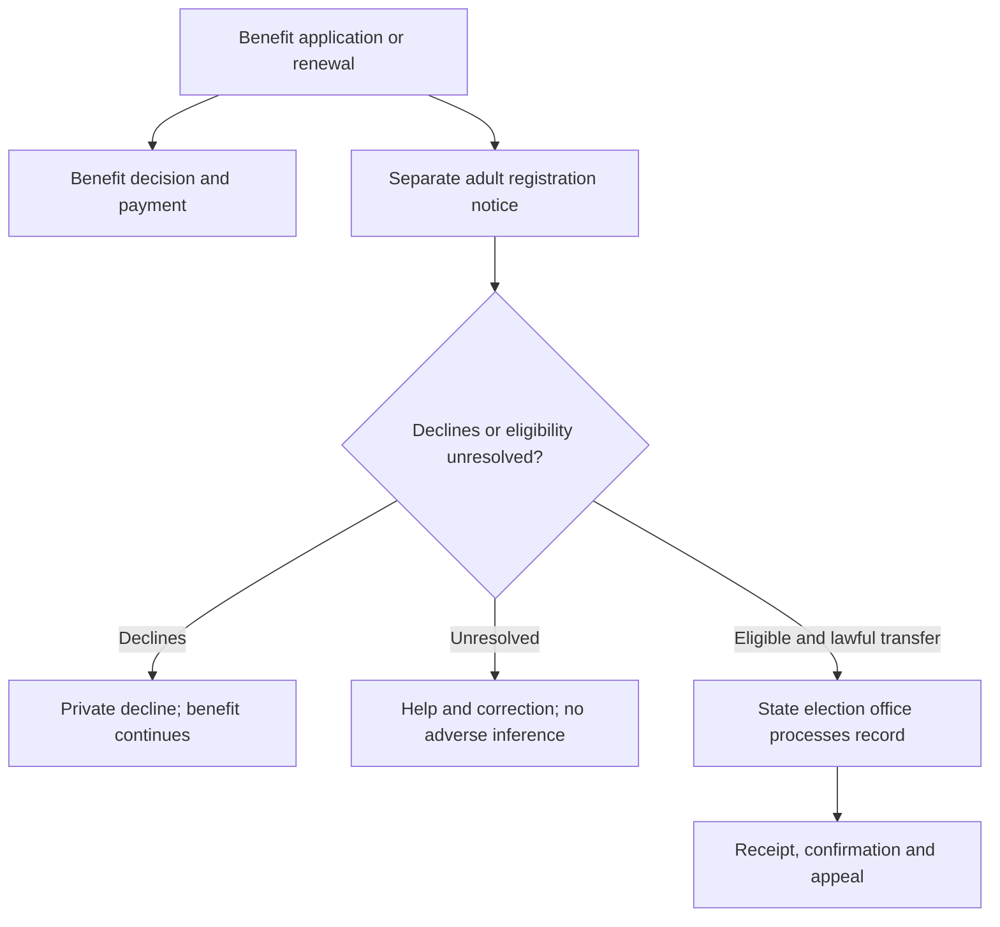

> Full readable text export filed October 24, 2026 from Library `libfile_9bd30b2049588191865ba0946c3b7829`, source filename `project-2050-dem-1-pilot.md`. All 351 reader lines retrieved; no report-body abridgment. This is an extracted text copy, not a claim of byte-identical original recovery. The report's own source date, baseline and limits remain historical. Use [the current queue](project-work-queue.md) for task status; no research recommendation becomes adopted policy through filing.

# Project 2050: DEM-1 institutional and legal-route pilot

October 23, 2026 · Research dossier for Espen Swanson

**Status:** Bounded charter pilot complete as a research and drafting aid. This is neither adopted legislation nor legal clearance. Recommendations, proposed safeguards and illustrative schedules are labeled below. No adopted policy, model input or generated repository output has been changed. Read with `project-2050-legislative-calendar-reconciliation.md`.

**Policy source:** `fm58cn6g4d-stack/project-2050`, active authoritative working branch `claude/pensive-mendel-g1lwl5`, commit **`e15c5c4a711b4cd2b482bac8300de45f2e08721f`**, rechecked October 23. This is the assessment’s commit, still current. It is 31 commits ahead of `main` (`9dbfaa0139d6b0981a12dcbc5307481cbaa86c14`). The authority determination rests on the governing documents and the merged authority/surge PRs targeting this branch, rather than the most recent timestamp. See the companion’s source-version table.

## 1. What the pilot establishes

DEM-1 has a coherent purpose: make participation easier, protect equal political opportunity, constrain manipulation of election rules and reduce candidates’ dependence on large donors. Its strongest existing components are the federal-election floor, the use of established registration institutions, the package’s explicit deadline and general-revenue financing for a voluntary small-donor match. Those components can support a useful legislative specification now.

Three qualifications materially change claims of readiness. First, the proposed Callais response encounters a constitutional argument in the majority opinion, beyond a statutory interpretation Congress could simply reverse. Second, naming benefit agencies under the National Voter Registration Act (NVRA) does not itself create automatic registration or authorize the transfer of protected benefit information. Third, enactment by spring 2030 does not establish that every new registration channel, commission or voting system could operate for that year’s election. The pilot identifies the work between those events.

The calendar review verifies the assessment’s principal conflicts. The adopted floor estimate is 172 session days against 163; the implemented vote-calendar function excludes CLI-7 and SS-1; Moving America retains a 2031 authorization outside D1’s first-Congress rule; and DEM-1’s enrollment explanation conflicts with HLT-3’s 2031/2032 delivery dates. These are planning conflicts, not predictions of legislative defeat. The companion preserves the conflicting passages and offers conditional alternatives.

### Seven separate assessments

| Dimension | Finding | What it permits us to claim |
| --- | --- | --- |
| Goal alignment | Direct connection to participation, equal treatment and accountable representation; the charter’s reciprocity test is essential | A defensible purpose; no promise of subsequent party control or greater trust |
| Design | Four-title outline and adopted DEM-1E/F exist, but scope, defaults, standards and remedies are incomplete | A policy architecture suitable for further drafting |
| Evidence | Statutes, actual predecessor bills, controlling judicial passages and administrative survey infrastructure are available | Specific legal and institutional baselines; no causal estimate for this combined package |
| Fiscal analysis | Matching and formula grants have placeholders; registration integration, enforcement and migration are unpriced | Financing homes can be mapped; a complete incremental cost cannot yet be stated |
| Legal route | Regular order under adopted D2, with powers distinguished by election and provision | A route for counsel to examine; no constitutional or parliamentary certification |
| Delivery | Owners and dependencies can be assigned; agency and state capacity are not verified | A proposed work plan with readiness evidence still required |
| Measurement | Registration, access, error and remedy measures are identifiable | An evaluation design; no adopted numerical outcome target |

**Finding types used throughout:** missing analysis means an answer is not established; conflicting record means source passages disagree; design weakness means a specified mechanism leaves a consequential problem unresolved; specialist review means expertise and the actual draft are required. A single finding can have several types. Lack of an estimate is not proof of policy failure.

## 2. Adopted scope and the boundaries that need reconciliation

The controlling policy is `domains/domain-democracy.md`, “DEM-1,” read with governing D1, D2 and the standing design rules. DEM-1A remains the chosen package. DEM-1E and DEM-1F were adopted October 20. DEM-2A remains chosen; DEM-2E is an open alternative, not a judicially validated replacement.

| Component | Recorded commitment | Boundary requiring a drafting decision |
| --- | --- | --- |
| Title I | Early and mail voting, same-day registration, automatic registration at benefit contacts, list-maintenance rules, paper ballots and risk-limiting audits, ministerial certification and transition triggers | Which elections each rule covers; precise minimums; existing-law amendments; effective dates; accessibility; enforcement |
| Title II | Recent-violation-based preclearance in the John Lewis VRAA lineage | Coverage formula, qualifying violations, lookback, determination process, bailout, submission deadlines and remedies |
| Title III | Section 2 results test and race-conscious remedial districting responding to Callais | Constitutional basis, evidentiary record, tailoring and fallback protections; a statutory rewrite alone is not a survival finding |
| Title IV / INT-5B | Voluntary 6:1 small-dollar match, voluntary spending caps, no opponent-spending trigger; general revenue | Covered offices, qualifying donations, participant thresholds, ceilings, administration, audits, payment authority and appeals |
| Adopted package attachments | Crosswalk/ledger carry DEM-2, DEM-12, DEM-13 and INT-2 DISCLOSE in DEM-1 | The four-title outline does not place all of them explicitly. Prepare one scope schedule; do not omit them because the summary is shorter |
| Related funding | DEM-11’s permanent indexed state/local election funding; EAC/FEC capacity in CAP-7S/CAP-7 | Distinct appropriations, implementation timing and overlap accounting |
| Proposed additions only | SAF-8’s election-worker provisions; AI-8’s synthetic-media disclosure | Espen has not adopted these riders. Any addition needs scope, speech-law, cost and calendar review |
| Other democracy work | DEM-3/4/9 jointly deferred to 2033, with a 2034 redraw | Preserve the congressionally mandated redraw exception in DEM-2’s ban; do not bring the deferred package into DEM-1 by implication |

The predecessor bills are drafting resources, not incorporated texts. The inspected S.1, 118th Congress, as introduced, contains a motor-vehicle automatic-registration architecture in §§1002–1007. Its existence does not supply DEM-1E’s additional IRS, SSA, education and benefit interfaces. S.4, 118th Congress, as introduced, provides concrete coverage and bailout choices, including violation thresholds and a rolling lookback. The project has not adopted those exact thresholds merely by naming the lineage. [L1–L2]

## 3. Mechanisms, authority, owners and remedies

The following is a **proposed specification map** of adopted commitments. Named agencies have existing roles, but proposed assignments and new powers need legislation. Committee referrals below are planning leads for chamber parliamentarians, not formal referral determinations.

| Mechanism and intended effect | Existing law / legal route to examine | Legislative and administrative work | Owner, dependencies and proposed remedy |
| --- | --- | --- | --- |
| Registration, early voting and mail voting reduce avoidable participation burdens | Article I §4 for congressional elections; NVRA, 52 USC §§20503–20510; presidential and state-election coverage require distinct analysis | Amend operative statutes, define minimums and election coverage, retain more protective lawful state rules, establish implementation standards and federal duties | State chief election officials and local offices; EAC support and expressly delegated standards; DOJ enforcement. Accessible notice, correction and enforceable relief before the relevant election |
| DEM-1E registers eligible adults through benefit transactions | NVRA §7 already covers public-assistance and disability-service offices, and permits agreed federal-office designations. It supplies services and transmission, not a blanket automatic-registration default | Add explicit federal duties and eligible-person defaults; reconcile forms, consent, statutory confidentiality, renewals and addresses | IRS/Treasury, SSA, CMS/state agencies, USDA/state school-meal administrators, HHS/ACF and AmeriCorps; election official makes registration disposition. Preserve benefit access and provide a separate appeal |
| Neutral list maintenance prevents improper removal while keeping records accurate | 52 USC §20507 requires nondiscriminatory programs and contains notice and timing rules | Define prohibited practices and permissible evidence; address erroneous identity matches and repeat records; preserve appropriate safeguards near elections | State/local election offices with DOJ oversight. Notice, evidence disclosure, correction, restoration and judicial relief; a match failure alone should not cause removal |
| Paper records and risk-limiting audits make outcomes checkable | HAVA, 52 USC §21081, already addresses verification, audit capacity and accessibility; it is not a universal DEM-1 audit specification | Define voter-verifiable paper evidence, chain of custody, risk limit, escalation, timing, accessible voting and treatment of narrow margins | Local administrators, states, EAC/NIST technical support and vendors. Recount/escalation rules must fit certification deadlines and preserve secret ballots |
| Ministerial certification blocks officials from substituting preference for the lawful count | 3 USC §5 already sets presidential-elector certification duties and expedited review | Define duties by office and election, decision deadlines, permitted corrections and a judicial backstop; preserve lawful recounts and contests | State/local certifiers, courts and Archivist for presidential certificates. Expedited orders to perform duties, with standing and review specified |
| Transition access prevents administrative obstruction | Presidential Transition Act, 3 USC §102 note, already contains post-election triggers and treatment of multiple apparent successful candidates | Identify the residual gap after the 2022 amendments; draft any additional duty against the existing text | GSA and agency transition leads. Reviewable denial and continuity of authorized access; do not treat transition access as a legal determination of the winner |
| Preclearance prevents discriminatory changes before harm occurs | Amend VRA coverage provisions, 52 USC §§10303–10304; Fourteenth/Fifteenth Amendment enforcement powers; Shelby County governs | Establish current evidence, objective coverage, review process, bailout, submission deadlines and effective dates | DOJ Voting Section and reviewing courts; covered jurisdictions submit changes. Enjoin unapproved changes; provide timely determination and appeal |
| Callais response protects equal electoral opportunity and supplies lawful remedies | 52 USC §10301, Callais; constitutional limits on enforcement power and race-based maps | Separate statutory intent, substantive liability, proof and remedy. Develop the current record and alternative constitutional theories with counsel | DOJ, litigants, courts and mapmakers. Express enforcement and remedial authority, but no promise that judicial review will accept a broader results test |
| DEM-2 commissions and mid-decade ban reduce map manipulation | Elections Clause for congressional maps; Rucho and Moore inform the setting without approving every federal mandate | Define commission selection, conflicts, resources, map criteria, deadlines, public input and failure procedure; preserve court-ordered relief and the 2034 congressional-redraw exception | States/commissions, legislatures and courts. Timely public map records and a lawful remedial backstop; avoid a commission vacancy preventing any map |
| DEM-12 restores participation on release and for pretrial detainees | Voter qualifications require analysis distinct from registration procedure; Elections Clause alone does not answer that question | Specify federal-election eligibility, release notices, registration assistance, detention voting and relationship to state law | State corrections, local jails and election offices. Individual correction and accessible ballot routes; constitutional counsel required for federal re-enfranchisement |
| DEM-13 gives people time to vote | Federal holiday and private-employer paid-time duties use different statutory routes | Resolve the existing holiday-or-paid-time choice; name covered workers, enforcement and interaction with other leave | OPM for federal employment; DOL if private-employer duties are chosen. Complaint and wage/remedy procedure; holiday alone does not reach every hourly worker |
| INT-2 disclosure makes political funding inspectable | Amend FECA; Citizens United’s disclosure holding and AFPF v. Bonta’s tailoring requirement | Specify covered spending, intermediary tracing, thresholds, donor-purpose rules, reporting speed and protection against threats | FEC, covered spenders and courts. Correctable reports, proportionate sanctions, reviewable exemptions and enforcement |
| INT-5 matching changes the financing opportunities of participating candidates | Voluntary public financing has precedent; Arizona Free Enterprise rejects opponent-spending-triggered subsidies | Draft qualification, eligible contributions, fixed match rules, payment ceilings, auditing, recovery and appeals | Proposed FEC program administration with Treasury disbursement. Review denials and recover improper payments; do not assume an unresolved INT-7 restructuring is already available |

Sources for this map: NVRA/HAVA and EAC limits [L3–L6, L15]; certification and transition [L13–L14]; preclearance and Callais [L7–L10]; maps [L11–L12]; campaign finance [L16–L18]. The qualification distinction is also explicit in Inter Tribal Council [L6].

### The strongest legal findings

**Callais is a substantive obstacle, not simply missing citations.** The majority ties its interpretation of Section 2 to Congress’s constitutional enforcement power and congruence/proportionality, then requires circumstances supporting an inference of intentional discrimination in redistricting. The existing Section 2 text already contains a results formulation. Adding those words again cannot by itself answer the Court’s reasoning. This finding concerns the redistricting dispute and should not be generalized without analysis to every vote-denial claim. The project’s description of a “re-override” needs counsel review before it becomes a claim of legal feasibility. [L7–L8]

**Preclearance needs a defensible formula, rather than a promise to avoid formulas.** Shelby County invalidated the old coverage formula and left the possibility of a new current-conditions formula open. A recent-violation rule is responsive in concept; neither recency nor a large legislative record automatically establishes validity. Examine which decisions count after Callais, how repeat violations and consent decrees count, the geographic unit, relief from coverage, and whether jurisdictions receive adequate notice. A current violations inventory is missing. [L2, L9]

**Congressional election authority is substantial but bounded.** Inter Tribal Council recognizes federal authority over registration procedure for congressional elections while distinguishing voter qualifications. Rucho identifies a congressional legislative route for redistricting reform; Moore rejects exemption of state legislatures from state constitutional review. Neither opinion certifies DEM-2A’s precise commission design. Presidential and state/local elections need their own authority analysis. A useful draft would distinguish independently operable congressional provisions from other applications. [L6, L11–L12]

**The EAC cannot be assigned a national regulatory job by implication.** Existing HAVA provisions limit EAC rulemaking over states and require at least three commissioner votes for covered actions. If DEM-1 depends on binding standards or deadlines, supply express authority, operational staffing, a lawful continuity mechanism and review. Additional funding alone does not resolve statutory limits or commission deadlock. [L15]

**Disclosure and matching require provision-specific drafting.** Citizens United supports election-related disclosure, while Bonta requires narrow tailoring under exacting scrutiny. The integrity file’s categorical assurance that DISCLOSE survives is too broad without thresholds, covered-donor definitions and exceptions. A voluntary fixed small-donor match avoids the particular opponent-spending trigger rejected in Arizona Free Enterprise; that is a design strength, not clearance of all participation conditions. [L16–L18]

### Counsel questions and alternatives

| Priority | Question for specialist review | Feasible direction to investigate; status |
| --- | --- | --- |
| Before a DEM-1 legislative specification is called viable | Can the intended Section 2 liability and race-conscious remedy survive Callais’s constitutional reasoning? Which powers support each application? | Preserve adopted Title III for review; compare a tailored prophylactic approach, stronger intentional-discrimination remedies and independently operable congressional map standards. These are proposals, not equivalent substitutes for the adopted protection |
| Before coverage is selected | What current record supports the formula, qualifying violations, practice coverage and bailout? | Start from S.4’s concrete machinery, update evidence and tests; do not import its numbers without approval |
| Before benefit-data engineering | Which specific disclosure authority applies to each data field and recipient? What criminal/immigration protections are needed for government-caused errors? | Prefer direct collection of registration information and narrowly specified transfers; consider statutory protections for innocent error. Scope and limits require privacy, tax and immigration counsel |
| Before floor strategy | Which committees have jurisdiction over the combined bill, money, tax-data provisions and new duties? What can fiscal companions carry? | House Administration/Judiciary, Senate Rules/Judiciary as initial leads; Ways and Means/Finance and benefit committees for affected provisions; formal referral and Byrd review remain open |
| Before remedies are promised | Who may sue whom, for which duty, with what relief, standing, venue, deadlines and fees? | Express individual enforcement, DOJ authority, appropriate officer suits and expedited review; address immunity, jurisdiction and federal agency review explicitly |
| Before 2030 implementation | Which provisions can take effect before that election without disruptive late changes? | Provision-specific effective dates and paper/service alternatives; rights should not depend on nationwide completion of a new digital system |
| Before commission drafting | Is mandatory state commission creation the best-supported route? How does the 2034 exception interact with remedial redraws? | Compare DEM-2A with open DEM-2E. Do not adopt E because a scenario’s Court preferred it |
| Before campaign-finance rollout | How will eligibility, fixed subsidies, disclosure exemptions and payment continuity work if the FEC cannot act? | Draft self-executing statutory rules and lawful fallback administration for review, without silently adopting INT-7 |

An adverse ruling may require narrower implementation while lawful protections continue. **Proposed:** sever applications, duties, funding and titles where they can operate independently; preserve unaffected benefits and registration services; specify treatment of pending cases and already-submitted applications. Severability reduces the risk of total collapse but cannot guarantee that a court will preserve every desired fragment or reconstruct an administratively incoherent program.

## 4. DEM-1E: enrollment is a contact, not proof of voting eligibility

An adult can qualify for a benefit without qualifying to vote in a particular election. A payment account can belong to a representative payee. A tax return can contain several adults and children, and a school’s direct-certification record can identify a child without establishing anything about a parent’s citizenship. A shared address can be a mailing address, a shelter or a safety-protected location. These distinctions must be resolved before automatic registration runs.

Current NVRA agency duties include distributing applications, helping applicants, transmitting completed forms and protecting choice and confidentiality. They include renewals and address changes, not only first enrollment. DEM-1E’s automatic default therefore needs an explicit statutory architecture for eligible adults, notice, decline, correction, signatures and election-office processing. It cannot be implemented simply by labeling each portal an NVRA agency. [L3–L4]

### Touchpoint and data map

| Adopted touchpoint | Responsible delivery chain | What can be available by November 2030 under the recorded policy | Required boundary / unresolved dependency |
| --- | --- | --- | --- |
| FAM-1 monthly-credit portal | IRS/Treasury → eligible adult → state election official | R1’s planned portal/payment path, subject to delivery readiness; D5’s lost-R1 fallback shifts first checks to mid-2030 | Use adult applicant’s separately supplied registration data. No transfer of children’s records, income or filing information merely because an account exists. 26 USC §6103 applies |
| Climate Dividend non-filer and beneficiary paths | IRS non-filer system; SSA beneficiary payment channels | CLI-2 targets early-2030 first payments after R2 | A payment issued from existing records is not a new signed registration application. Identify adult, residence, eligibility and representative payees; define outreach for people paid without a new portal visit |
| EDU-3 school meals | USDA FNS → state agency → school food authority / family contact | Expanded meals target school year 2030–31; universal delivery may remove the need for a parent to apply | Offer a separate adult registration service at appropriate contacts. Do not create an intrusive eligibility application for universal meals or infer adult eligibility from a child’s receipt. Meal-record disclosure limits matter |
| FAM-2 child care/pre-K | HHS/ACF → state administering agency / provider | Pre-K/lowest-income phase may provide contacts; full cap begins 2032 | Identify the administering unit, parent/guardian versus beneficiary and relevant renewals. Private providers are not automatically public registration agencies |
| Existing Medicaid and marketplaces | CMS and federal/state marketplaces; state Medicaid offices | Existing contacts and HLT-1 restoration can be relevant in 2030 | Existing public-assistance duties do not authorize all cross-system data uses. Marketplace and Medicaid confidentiality and mixed-household safeguards need separate review |
| New HLT-3 public plan | CMS/public-plan administration and marketplace interfaces | **Public option opens plan year 2031; auto-enrollment starts 2032. It cannot supply the claimed 2030 new-plan enrollment** | Preserve health dates. Use existing contacts earlier, or separately propose a change to HLT-3 with costs and capacity review |
| LAB-9 service enrollment | AmeriCorps/state service commissions and program operators | A partial early cohort may be possible under the chosen authorization-first route; reach is not quantified | Confirm actual participant eligibility, age, residence and the selected vehicle. No assumption of universal pre-2030 reach |

Repository basis: `domain-family.md`, FAM-1/FAM-2; `domain-climate.md`, CLI-2; `domain-education.md`, EDU-3; `domain-health.md`, “Felt dates”; `domain-labor.md`, LAB-9; `domain-capacity.md`, CMS annex. The timing conflict is preserved in the companion’s reconciliation table.

### Proposed transaction design

This is an implementation proposal, not an adopted national data system. Registration would remain a separate function even when the user experiences it within one service visit. Benefit eligibility and payments must continue independently of whether the adult registers, declines or needs help. Program attribution should identify the law and service neutrally, consistent with the NVRA’s ban on partisan influence; it should not pressure recipients to support a party. [L3]

**Privacy requirements for the specification.** Default to the minimum registration fields collected directly from the adult, rather than exporting a benefit dossier. Identify the legal basis, purpose, recipient, retention, access controls and correction route for each field. Keep income, diagnoses, dependents’ records, benefit amounts and registration declines out of public voter files and campaign data. Explain that some ordinary voter-registration information may become publicly available under applicable law; do not promise blanket anonymity. Provide protected-address handling, role-based access, audit logs, encryption and breach response. Contractors and navigators need enforceable limits too.

The Privacy Act is a general federal-records baseline, not permission to disregard more specific statutes. Tax-return information has its own §6103 restrictions; SSA information has §1306 restrictions; marketplace information has requirements under 45 CFR §155.260; school-meal applications have statutory disclosure limits. A generic interagency memorandum or privacy notice cannot be assumed sufficient. The direct-collection approach reduces the scope of proposed disclosure; counsel must still assess the portal, source and records actually used. [L19–L23]

**Citizenship and other eligibility checks.** Identity matching, citizenship, age and voting residence are distinct. Possession of an SSN, a tax identification number or a benefit is not, by itself, citizenship proof. HAVA’s record-matching structure is not a universal citizenship determination. Any authorized verification must preserve human review, alternative evidence, naturalization updates, name-change handling and timely notice. An inconclusive match should enter a help/correction queue, not automatically establish noncitizenship or trigger a purge. No national “perfect database” or accuracy rate is established by this pilot. [L5–L6]

The current verification environment is contested. The September 25, 2026 Supreme Court stay in *DHS v. League of Women Voters*, inspected as reproduced judicial text, permits the challenged modified SAVE system to operate during litigation; it is not a final merits judgment or an accuracy certification. The order describes reliance on SSA records and additional-information requests. The dissent identifies privacy and stale-record concerns. Assess the operative orders and lawful use at the time of drafting; do not treat either a district-court vacatur or the later stay as the whole legal baseline. Direct USCIS fact-sheet retrieval failed, so this dossier does not claim a full inspection of the agency’s current operational instructions. [L24]

**Protect people from government-caused registration errors.** Criminal and immigration provisions can make mistaken noncitizen registration, citizenship assertions or voting consequential. The inspected statutes include 18 USC §611 and 8 USC §§1182(a)(6)(C)(ii), 1227(a)(3)(D) and (a)(6). Their elements and exceptions differ. **Proposed:** counsel should draft appropriately scoped protections for innocent automatic-registration errors, correction, confidentiality and evidence use, while retaining consequences for knowing fraud. Do not tell an individual that an interface safeguard already confers immunity. Election, tax, privacy and immigration counsel need to review these provisions together. [L25]

Other safeguards to specify include accessible and translated notices; an offline route; preregistration separated from current eligibility; no automatic party selection; deduplication without erasing lawful registrations; residence procedures for people without stable housing; and an accessible record of what was transmitted and accepted. Existing beneficiaries need a lawfully authorized outreach/update path after enactment; waiting for new applications alone would miss people paid automatically.

## 5. Legislative steps and delivery work

**Retained governing sequence:** D2 in week one of 2029; R1 before DEM-1 takes the floor; DEM-1 enacted by spring 2030, with mid-2030 the outer deadline. Detailed dates below are **proposed preparation milestones**, not changes to those commitments. They distinguish legislative preparation from implementation. R1’s “about week eight” target and DEM-1’s May–June R1 description conflict; the companion retains both.

| Stage | Work and accountable lead to designate | Evidence of completion / consequence if absent |
| --- | --- | --- |
| Before 2029 introduction | Congressional sponsors and legislative counsel prepare a single scope schedule; civil-rights counsel develops current discrimination record; tax/privacy counsel resolves data routes | Annotated statutory amendments, powers by application, remedy schedule and unresolved opinions. Without them, the package remains a concept-level bill |
| Before rules and committee work | Senate leadership/counsel prepare D2 procedure and minority guarantees; House and Senate committees resolve referrals and companion funding strategy | Procedural strategy, vote assumptions and realistic floor reservation; no claim that Senate rules have already changed |
| During R1 preparation | CAP appropriators/program owners define legally eligible immediate surge funding and early hiring/system preparation; benefit agencies preserve registration interfaces as a documented dependency | Funding purpose/period, workload and procurement plans; no assumption that an unreviewed R1 appropriation authorizes all election policy |
| Before DEM-1 markup | Committees choose operative standards, election scope, effective dates, funding, protections and remedies; sponsors reconcile adopted attachments | A provision-by-provision specification and cost scope. Rights and payments must not rest on future unspecified rulemaking |
| After R1, before DEM-1 enactment | Floor managers preserve adopted package, resolve amendments, secure both chambers and final text; each alteration is recorded for Espen | Enactment by spring 2030 remains the target; failed votes, conference time and House demands consume slack |
| Immediately after enactment | Designated federal program leads and state election officials publish implementation notices, agency agreements, funding awards and assistance routes | Clear owners and lawful duties even if digital integration is incomplete; technical help begins without conditioning benefits on registration |
| Before each 2030 state deadline | States/local offices test transmission, paper fallback, receipt, correction, notices, accessibility, staff training and incident response | End-to-end test with difficult cases, monitored backlog and staffed remedies. Failed automation uses lawful assisted alternatives rather than erroneous bulk registrations |
| Before 2031 mapmaking | DOJ, jurisdictions, commissions and courts have operative coverage/maps rules, datasets, staffing, deadlines and litigation capacity | Enactment alone is insufficient. A stay, incomplete commission or missing data must have a lawful contingency |
| 2031–32 and later | CMS adds new-plan interfaces on HLT-3’s recorded dates; election owners refresh systems, standards and public findings | Maintenance funding and corrections continue after initial procurement; evaluate the 2030 cycle before claiming national effects |

**Proposed implementation work packages**—analytical identifiers only, not new adopted policy IDs:

| Work | Proposed lead | Resources and dependencies to price |
| --- | --- | --- |
| Registration service specification and accessibility | EAC, state chiefs and benefit program owners | Election-law analysts, accessibility/language specialists, service designers and training |
| Agency-to-election interfaces | Each originating agency; state election system owner | API/form changes, signature handling, testing, mail notices, call-center work, security and recurring maintenance |
| Preclearance and rights enforcement | DOJ Civil Rights and litigating counsel | Attorneys, investigators, analysts, current violation records, map expertise and court workload |
| Local voting and audit operation | Counties/municipalities, states, election vendors | Equipment, storage, chain of custody, accessible sites, poll workers, audit teams, postage and recount capacity |
| Commission establishment and map production | States/commissions and courts | Recruitment/conflict screening, GIS/data staff, public participation, translations and contingency mapping |
| Matching and disclosure | Proposed FEC administration/Treasury payment chain | Application review, donor verification, payment schedules, audits, recoveries, public reporting and appeals |
| Independent evaluation and complaint handling | Designated evaluation lead plus inspectors general / external reviewer | Protected analysis capacity, secure data access, publication, field research and timely individual remedies |

State cooperation is a delivery variable. A refusal to modify systems can leave an individual with a federal right and no functioning service. **Proposed:** fund direct local assistance where lawful, maintain usable federal-form and paper routes, impose specific duties with enforceable deadlines, and provide early litigation rather than assuming eventual DOJ action cures an election already missed. A federal takeover or direct grant to a locality requires its own legal authority; it is not an assumed fallback. Tribal governments and disability/language-minority organizations should help test access, without assuming Tribal systems are subordinate state offices.

## 6. Funding and cost boundaries

All amounts below are **repository working estimates**, not new estimates or official scores. Default window is nominal federal budget effects in **2030–39**, except CAP-7S’s lifetime surge total. Unknown is not zero.

| Recorded item | Amount and source | What it includes / what remains unresolved |
| --- | --- | --- |
| DEM-1 / INT-5 | $0.01T midpoint; democracy and integrity ranges $0–0.03T; ledger high $0.04T | The democracy text attributes this to matching. Reconcile high-end scope; do not count INT-5 a second time |
| DEM-11 | $0.02T midpoint, range $0.01–0.04T; explicitly unsourced placeholder | State/local formula funding, distinct from federal EAC administration. Permanent indexed design; exact index/formula and enactment route not settled |
| EAC surge share | About $3B in the provisional CAP allocation | Part of CAP-7S, not another addition to the $600B. Same allocation pattern informs sustained capacity, not a second $3B annual appropriation |
| FEC surge share | About $3B in the provisional CAP allocation | Must be assigned to actual matching/disclosure work and existing duties; not proof of spare staff or appropriated budget |
| DOJ and related civil-rights capacity | Relevant reserve allocations remain pending | Do not silently appropriate or earmark the reserve for DEM-1 enforcement |
| DEM-1E agency integration | Described as “about zero” in the democracy file | No workload, contract, notice, security or systems estimate supports a zero incremental cost. Needs a shared-cost bridge |
| Commission startup, audits, remedies and evaluation | No complete incremental estimate | Test whether included in DEM-11, CAP, underlying benefit administration or a new proposed line; avoid omission and duplication |

The first funding bridge should separate existing agency operations; one-time systems development/migration; federal program administration; federal grants and state/local expenditures; continuing operations; public campaign subsidies; and evaluation/remedies. A federal grant and the state expenditure it finances are two views of one resource flow, not two additive national costs. Every shared system has one cost owner and documented allocation drivers. Link DEM-1E to the existing CMS register, particularly CMS-IMP-02 and CMS-IMP-13, without changing those records or treating health funding as automatically available for election work.

**Authority, budget authority, obligation and cash must remain separate.** CAP-7S is immediately available upon enactment under the adopted direction, but FY2029 cash is unpriced. DEM-11’s preferred mandatory route is not certified as Byrd-eligible; the ledger currently records appropriations. A statutory authorization is not itself usable appropriated funding. Purpose restrictions prevent treating a general agency allocation as freely transferable to any new job. Draft program authority, appropriations language, period, allocation/transfer permissions, payment obligations and reporting together. [L26–L28]

D4 requires the permanent match and continuing election operations to be paid for at maturity; temporary implementation costs need explicit financing treatment. The payment-continuity rule is relevant to recurring matching payments if the program is drafted that way, but standing authority, available money and lawful eligibility still need to be specified. No new trust fund or fiscal saving is proposed here. Improved registration or trust is not booked as revenue.

## 7. Litigation, remedies and institutional durability

| Failure / challenge | Exposure and practical harm | Proposed prevention and remedy; review needed |
| --- | --- | --- |
| Title III enjoined on constitutional grounds | Minority-vote dilution protection may not be operative for maps despite timely enactment | Early merits review where a real case exists, current record, tailored remedies and independently operable protections. Courts decide jurisdiction and relief; no assumed advance advisory opinion |
| State resists registration mandate | Unprocessed applications, different access by state and county | Express duties, receipt logging, assistance, enforcement deadlines and individual relief; fund local implementation. Resolve applicable immunity/standing |
| Citizen falsely flagged in a verification match | Lost registration or ballot, burden on naturalized citizens and people with name changes | Do not equate missing match with ineligibility; notice, human review, alternative proof, correction and restoration. Provide deadline-sensitive review |
| Noncitizen or child transferred automatically | Criminal/immigration risk, chilled benefit use and corrupted rolls | Adult-specific eligibility checks, separation from benefit decision, government-error protections for counsel to draft, rapid correction; no promise of existing immunity |
| Benefit or registration data misused | Exposure of protected address, tax or medical information; partisan targeting | Minimum data, statutory use restrictions, protected-address handling, access logs, breach response and enforceable remedies |
| Agencies/FEC/EAC lack authority or quorum | Funding exists but rules or payments stall | Statutory specificity and a lawful continuity design; do not rely only on commission appointments or an unadopted restructuring |
| Procurement or grants arrive late | Counties cannot meet mandates; last-minute changes create confusion | Early funding, milestones, migration plan, assistance and paper alternatives. Keep lawful services running while fixing the interface |
| Election litigation arrives too late | Relief may be refused or disruptive near an election | Work backward from registration, ballot-printing and certification dates, not only Election Day. Purcell cautions about confusion from late court orders; it supplies no universal safe number of days [L29] |
| Match/disclosure rules burden speech | Injunction, unequal candidate treatment or donor exposure | Fixed voluntary financing, tailored disclosure, justified thresholds, threat exemptions and review [L16–L18] |
| Later administration suppresses implementation or findings | A durable statute can be hollowed out by vacancies, funding or nonenforcement | Enforceable duties, continuing funding, publication, individual rights and oversight. These reduce exposure; they cannot guarantee insulation from all lawful repeal or constitutional decisions |

A remedy schedule should name the claimant, defendant, injury, decision deadline, review route, relief and costs for every duty. NVRA §20510 supplies a useful existing model: DOJ declaratory/injunctive authority and an aggrieved person’s notice-and-cure route, with shorter or no notice near an election. It does not automatically enforce every new title, guarantee damages or solve all standing questions. New election duties and benefit-agency duties need express treatment. [L4]

Successful correction also needs to address harm already suffered. Repair a record and help the voter obtain a lawful ballot where possible; preserve evidence of a lost opportunity, data exposure or payment error; provide authorized compensation or legal remedies where applicable. An annual evaluation cannot restore a ballot after the election. Recounts and court relief likewise cannot be promised in every case.

## 8. Outcomes, evaluation incentives and correction in practice

The charter asks whether institutions can learn without excusing negligence or concealment. DEM-1 is a demanding test because elected sponsors may treat unfavorable results as an electoral threat, administrators may fear career penalties, and contractors may benefit from reporting successful deployment. Those are hypotheses about incentives to investigate, not established findings about all officials.

Existing evidence practice provides useful but limited models. The Evidence Act’s evaluation-officer provisions address expertise and evaluation independence; GAO-24-106982 finds both benefits and unresolved problems in agency evidence-capacity assessments. EAVS offers a maintained administrative baseline, with versioned data and errata. None establishes that publication duties alone overcome political incentives to hide harm. Applying the Evidence Act template to every EAC or state activity needs explicit coverage and resources. [L30–L32]

### Proposed measurement record

No numerical targets below are adopted. Establish dated baselines before implementation; retain definitions and missingness, and publish changes. The EAC’s 2024 EAVS data version 2.0, released February 12, 2026, is an identified starting source, not a dataset analyzed by this pilot. Replace or supplement it with the 2026 cycle when available.

| Outcome / mechanism | Proposed measure and denominator | Source / limitations and safeguards |
| --- | --- | --- |
| Eligible adults reach the register | Unique eligible adults processed successfully / eligible adults initiating a covered contact; new registrations and address updates separate | Agency/election transaction logs. Benefit recipients are not the denominator for citizenship eligibility. Record unresolved eligibility and declines separately |
| People remain free to decline | Notice comprehension; decline completion; benefit take-up and delays among those offered registration versus an appropriate comparison | User research and privacy-safe administrative analysis. Do not reward staff for low decline rates |
| Records are accurate | Confirmed wrongful exclusions and inclusions; false-positive and false-negative verification rates from reviewed samples | Independent samples and adjudicated cases; an automated “match rate” is not truth. Protect people whose records are reviewed |
| Voting is practically accessible | Registration processing time, poll wait distributions, ballot rejection/cure, provisional-ballot outcomes, disability/language access | State/local records, EAVS and field/user research; report missing jurisdictions and hard-to-reach groups |
| Maps and rule changes protect equal opportunity | Timely disclosure/submission, challenges, reasons for decisions, access to map data and remedial compliance | Legal and geographic analysis with appropriate race/party methods; partisan seat gains are not the project’s validity test |
| Small donors have greater opportunity | Participation across candidate types, first-time and small donors, geographic reach, subsidy concentration, fraud and payment delays | FEC records and independent analysis; more matched dollars alone can mean greater cost rather than greater influence |
| Remedies work before harm becomes final | Time to acknowledge, decide and implement correction; unresolved cases at election deadlines; recurrence | Complaint/court logs and interviews; falling complaints can mean barriers to complaining |
| Democratic influence and trust | Perceived efficacy, fairness, confidence and actual ability to challenge officials; include opponents of the governing coalition | Repeated surveys and qualitative work. Do not infer trust from faster processing or turnout alone |

Disaggregate where lawful and statistically meaningful by age, geography, disability, language, race/ethnicity and relevant service pathways; measure differential burdens without publishing identifiable people or tiny cells. Citizenship/naturalization-status analysis needs special legal and privacy review. Publish both distributions and averages. Do not use individual vote choice, party preference or benefits as campaign targeting inputs.

**Evaluation design proposal:** define questions, outcomes and analysis before rollout; use administrative reconciliation plus independent reviewed samples for errors; use interviews for harms omitted by transaction counts. Staggered lawful deployment may permit comparisons, but state selection, simultaneous reforms, turnout conditions and implementation differences confound causal inference. Do not withhold a statutory right to create a control group. Test optional interface wording or assistance only where lawful and without impairing rights. The package’s effect on turnout, equal opportunity or trust cannot be estimated by subtracting a before-period from an after-period without addressing these conditions.

### A proposed operating arrangement

The statute or implementing framework could provide protected evaluation funding; a public protocol; secure access independent of program management; a publication deadline with a short factual/privacy review; a public response duty; and funded authority to correct implementation. These are **institutional options**, not adopted DEM-1 provisions. Independence should rest on multiple supports—data access, budget, publication, methodological scrutiny and remedies—rather than a promise that a particular official cannot be removed.

| Actor / incentive | Possible gaming or suppression | Proposed countermeasure and accountable response |
| --- | --- | --- |
| Elected sponsors want visible success | Count registrations while omitting wrongful transfers or groups still excluded | Publish a balanced protocol and adverse findings; require a dated response explaining action or disagreement. No success metric based on party advantage |
| Career program managers fear blame | Reclassify unresolved records as completed or hide early incidents | Separate prompt disclosure/correction from disciplinary findings; audit original logs, assess reasonable decisions against information available at the time |
| State/local officials face thin staffing and costs | Delay, narrow service, fail to report or push hard cases elsewhere | Fund assistance and corrective plans before sanctions for capacity gaps; preserve enforcement for knowing refusal or discrimination |
| Contractors seek milestone payment | Meet upload-count targets while records fail downstream | Pay against lawful, tested acceptance and service quality, not raw transfers; retain independent acceptance tests and incident reporting |
| Evaluators depend on the program owner | Change endpoints, suppress inconvenient subgroups, overstate causal effects | Publish protocol/amendments, allow independent methodological challenge and protect publication of null/adverse results |
| People affected lack time or trust | Silent abandonment, low complaints misread as success | Accessible complaint and assisted-correction routes, community outreach and independent user research; never require participation to receive benefits |

**Illustrative correction cases—not predictions or adopted deadlines:**

1. **A name-match error affects newly naturalized adults.** Stop the faulty automated decision/transfer path, preserve lawful assisted registration and all benefits, notify affected people and election offices, and review original records with counsel. An incident lead documents scope and corrective action; an independent reviewer tests the fix before restart. Prompt disclosure may demonstrate responsible conduct; it does not excuse avoidable harm, concealment or failure to restore records.
2. **A state reports excellent registration numbers but does not process corrections.** Audit a sample through final election-office disposition. Publish the backlog and assistance plan. If a specific statutory duty is being refused, enforcement and individual relief proceed without waiting for the next annual review. A broad grant cutoff could worsen service for voters; distinguish technical assistance, targeted compliance and legal sanctions.
3. **Matching uptake is low but payment accuracy is high.** Examine barriers, candidate incentives, donation thresholds and access before calling the program a success or failure. Adjust administration within delegated authority; a statutory threshold, rate or entitlement change returns to Congress. Do not use an automatic sunset of rights or recurring payments as the default response to an inconclusive evaluation.

**Illustrative response clock for further review:** acknowledge a serious operational incident immediately, publish an initial privacy-safe notice within days, and require a corrective plan within 30 days; ordinary evaluation findings could receive a public response within 60 days. Election deadlines may require action much sooner. These numbers are proposals to test with administrators and counsel, not legal safe harbors or new service standards. Courts and statutory duties retain their own timing.

The unresolved research question is whether these protections actually encourage disclosure and correction in election administration. The pilot supplies institutional designs and test cases, not a completed comparative causal study. Seek affected-person, local administrator, evaluator and counsel review before adopting them.

## 9. Public explanation — proposed text

Voting should fit into people’s lives, and election rules should protect people even when the party they oppose is in power. Project 2050’s democracy package would establish a federal voting floor, protect equal access, make congressional mapmaking more accountable and give participating candidates a stronger reason to seek small donations.

One part would make registration available when adults already deal with government—for example, applying for a child benefit or renewing Medicaid. An eligible adult should not have to enter the same basic information repeatedly. The service should explain what will happen, let them decline and help them correct mistakes. Receiving food, health coverage or a payment must never depend on registering to vote or supporting anyone. A child’s benefit or a household’s immigration information must not be treated as proof that every adult can vote.

The package would also address discriminatory election rules before they cause harm and provide ways to challenge unlawful decisions. Those protections need more than an announcement: election offices need staff and funding, people need timely remedies, and courts will review the law. A major unresolved issue is how to restore stronger protection against racial vote dilution after the Supreme Court’s Callais decision. The project should explain that legal difficulty openly.

The intended result is that more eligible people can participate on fair terms and obtain a correction when government gets something wrong. That would not guarantee a particular election result, universal trust or that every part of the law survives litigation. We should judge it by access, accuracy, equal treatment, meaningful influence and the experience of people still left out.

*Timing qualification for publication:* existing Medicaid and marketplace contacts can be relevant in 2030. The new public option is scheduled to open in 2031, with auto-enrollment in 2032. Proposed safeguards above still require specification and adoption; this explanation must not present them as already enacted law.

## 10. Findings, decisions and handoff

| Finding | Type | Next use |
| --- | --- | --- |
| Callais cannot be addressed confidently by a simple statutory “re-override” | Substantive design weakness; specialist review | Focused civil-rights/constitutional counsel memorandum comparing liability, proof, powers and remedies |
| DEM-1E lacks an operative default, eligibility and lawful-data-transfer specification | Missing analysis; design weakness | Draft one end-to-end adult transaction with tax/privacy/immigration review |
| HLT-3 cannot be the new-plan registration channel described for 2030 | Conflicting record | Adopt an explicit explanation using existing contacts, or separately consider changing health dates |
| Package attachments and cost ranges differ across summaries and ledger | Conflicting record | Scope schedule and cost bridge before markup; retain both records until resolved |
| “About zero” administration is unsupported | Missing analysis | Price actual work and reconcile DEM-11, CAP and embedded benefit administration |
| State resistance, commission failure and late litigation can defeat timely delivery | Design weakness; specialist/operational review | Specific duties, fallback services, owners and remedies |
| Evaluation can reward counts while suppressing error | Institutional risk; further evidence needed | Test balanced measures, independent publication and protected correction against the cases above |

**Usable components:** mechanism/authority map; touchpoint and data map; work-package/funding boundaries; counsel questions; proposed outcome record and correction cases; public explanation; companion calendar reconciliation. These are usable research components, not a certification that the full package is implementation-ready.

**Decisions for Espen:** whether to commission the focused Title III opinion first; whether the 2030 public explanation should expressly rely on existing health contacts while retaining HLT-3 dates; which calendar alternative to develop; whether to develop the proposed privacy, error-protection, evaluation and remedy provisions. DEM-2E, DEM-13’s holiday/paid-time choice and proposed SAF-8/AI-8 riders remain open. No decision is needed merely to retain the findings as research.

**Next concrete action:** give counsel the Title III questions, adopted package scope and a worked DEM-1E transaction; in parallel, reserve a leadership review of the companion calendar’s alternatives. No communication to outside reviewers has been sent.

## 11. Sources, versions and limits

### Repository sources actually inspected

All links below are pinned to `e15c5c4a711b4cd2b482bac8300de45f2e08721f`. Section names are locators; source labels in this dossier refer to those sections, not a claim to have reviewed every cited outside publication.

- [Governing decisions](https://github.com/fm58cn6g4d-stack/project-2050/blob/e15c5c4a711b4cd2b482bac8300de45f2e08721f/governing/project-2050-governing-decisions.md): D1–D9, standing design rules, document hierarchy and embedded project instructions. [Shared instructions](https://github.com/fm58cn6g4d-stack/project-2050/blob/e15c5c4a711b4cd2b482bac8300de45f2e08721f/governing/project-instructions.md) and `AGENTS.md`.
- [Democracy](https://github.com/fm58cn6g4d-stack/project-2050/blob/e15c5c4a711b4cd2b482bac8300de45f2e08721f/domains/domain-democracy.md): DEM-1/1E/1F, DEM-2/2E, DEM-11–14, dependencies and open items. [Integrity](https://github.com/fm58cn6g4d-stack/project-2050/blob/e15c5c4a711b4cd2b482bac8300de45f2e08721f/domains/domain-integrity.md): INT-2, INT-5 and INT-7.
- [Health](https://github.com/fm58cn6g4d-stack/project-2050/blob/e15c5c4a711b4cd2b482bac8300de45f2e08721f/domains/domain-health.md): HLT-1/3 and “Felt dates”; [family](https://github.com/fm58cn6g4d-stack/project-2050/blob/e15c5c4a711b4cd2b482bac8300de45f2e08721f/domains/domain-family.md): FAM-1/2; [education](https://github.com/fm58cn6g4d-stack/project-2050/blob/e15c5c4a711b4cd2b482bac8300de45f2e08721f/domains/domain-education.md): EDU-3; [labor](https://github.com/fm58cn6g4d-stack/project-2050/blob/e15c5c4a711b4cd2b482bac8300de45f2e08721f/domains/domain-labor.md): LAB-9.
- [Climate](https://github.com/fm58cn6g4d-stack/project-2050/blob/e15c5c4a711b4cd2b482bac8300de45f2e08721f/domains/domain-climate.md): CLI-2/6/7/8; [capacity](https://github.com/fm58cn6g4d-stack/project-2050/blob/e15c5c4a711b4cd2b482bac8300de45f2e08721f/domains/domain-capacity.md): allocation table, overlap notes and CMS annex; [CMS cost register](https://github.com/fm58cn6g4d-stack/project-2050/blob/e15c5c4a711b4cd2b482bac8300de45f2e08721f/sources/health-cms-implementation-cost-register.csv): CMS-IMP-02/13. `domain-executive-power.md`, EXE-18 payment continuity.
- `index/options-register.md`; `index/check-report.md`; `index/2029-trifecta-master-ledger.md`; `index/data/inputs/ledger-bills.csv`; `index/data/inputs/votes-bills.csv`; `index/tools/votes-model.py`, `calendar()`; `index/tools/ledger-paths.py`; `index/vote-simulation.md`. Exact calendar links are in the companion. `sources/courts-rebalancing-the-three-branches-2026.md` was treated as background, with the consequential holdings checked against primary judicial texts.

### Other project materials

- Approved charter, supplied `project-2050-draft-charter-2026-10-22.md`, approved October 23: §§2, 4, 6–7, evaluation/correction provisions and Appendices A–D. It matches the supplied 89,509-byte charter associated with version 13 in the earlier source read. The filename’s “draft” does not override its internal approved status.
- *Project 2050: Prioritized Annotated Bibliography and Research Architecture*, October 22, supplied native JSON report. The report-message text was extracted and inspected, including annotations, comparison tables, pathways, research gaps and proposed sequence. GOV-05/06/09, FIS-06/08, IMP-03, MOD-01 and COM-02/03 are especially relevant. Underlying papers were not all reviewed; its tiers and timetable are not inherited as policy or legal conclusions.
- `project-2050-initial-agenda-assessment-2026-10-23.md`, current available source read, 56,315 bytes: democracy matrices, calendar findings, reconciliation table and priority 2. Findings were checked against the cited repository records and primary sources rather than adopted as facts.
- `Espen-Writing-Style-Guide.md`, available version 2 (internal header says version 1), and the sustainable-aviation-fuel policy memo inspected earlier in this assignment. Used for argument and prose, not factual authority.
- Supplied governing/shared-instruction exports labeled `3797741` predate the surge merge. Their later-start surge language differs from current D9. Current GitHub text controls; the earlier exports are preserved as conflicting dated copies, not silently updated.

### Primary and official external sources actually inspected

All accessed October 23, 2026. Inspection was of the stated sections/passages or official explanatory pages, not a full specialist review of every opinion, statute, case history or regulation. U.S. Code PDFs sometimes include adjacent sections; citations below identify the section actually used. Rolling links require edition/revision checks before drafting in 2028–29.

| Ref | Source and inspected locus | Use / limit |
| --- | --- | --- |
| L1 | [S.1, 118th Congress, introduced text](https://www.govinfo.gov/content/pkg/BILLS-118s1is/html/BILLS-118s1is.htm), §§1002–1007 and registration protections | Concrete predecessor, not current enacted law or DEM-1E’s complete design |
| L2 | [S.4, 118th Congress, introduced text](https://www.govinfo.gov/content/pkg/BILLS-118s4is/html/BILLS-118s4is.htm), §§103–104 | Violation-based coverage, duration and bailout options; exact thresholds not adopted here |
| L3 | [52 USC §20506](https://www.govinfo.gov/link/uscode/52/20506), (a)(2)–(6), (b), (d) across adjoining pages | Agency services, neutrality, privacy, transactions and transmission |
| L4 | [52 USC §§20508–20510](https://www.govinfo.gov/link/uscode/52/20510) and [§20507](https://www.govinfo.gov/link/uscode/52/20507) | Attestation, coordination, enforcement and list-maintenance safeguards |
| L5 | [52 USC §21083](https://www.govinfo.gov/link/uscode/52/21083), (a)(1), (a)(5); [§21081](https://www.govinfo.gov/link/uscode/52/21081), voting-system standards | Registration matching and voting-system baseline, not universal citizenship proof or a complete risk-limiting-audit design |
| L6 | [Arizona v. Inter Tribal Council, 570 US 1 (2013)](https://www.justice.gov/sites/default/files/crt/legacy/2013/06/17/aztribalopinion.pdf), federal-form holding and procedure/qualification discussion | Congressional registration power and limits; later procedural developments require refresh |
| L7 | [52 USC §10301](https://www.govinfo.gov/link/uscode/52/10301), (a)–(b) | Existing results language |
| L8 | [Louisiana v. Callais, No.24-109 (April 29, 2026)](https://www.supremecourt.gov/opinions/25pdf/24-109_21o3.pdf), syllabus and majority pp.22–31 | Statutory interpretation, constitutional enforcement limits and updated districting test; no counsel certification |
| L9 | [Shelby County v. Holder, 570 US 529 (2013)](https://tile.loc.gov/storage-services/service/ll/usrep/usrep570/usrep570529/usrep570529.pdf), majority pp.551–557 | Current-conditions coverage requirement; no holding validating a new formula |
| L10 | [52 USC §10302](https://www.govinfo.gov/link/uscode/52/10302), judicial enforcement/bail-in structure | Existing remedial framework, not a substitute for new-title enforcement drafting |
| L11 | [Rucho v. Common Cause, 588 US 684 (2019)](https://www.supremecourt.gov/opinions/18pdf/18-422_9ol1.pdf), legislative-remedies discussion | Federal constitutional partisan-gerrymandering claims distinguished from legislation |
| L12 | [Moore v. Harper, 600 US 1 (2023)](https://www.supremecourt.gov/opinions/22pdf/21-1271_3f14.pdf), majority state-constitutional-review discussion | State legislatures remain constrained; not blanket approval of a federal commission mandate |
| L13 | [3 USC §5](https://www.govinfo.gov/content/pkg/USCODE-2024-title3/pdf/USCODE-2024-title3-chap1-sec5.pdf), (a)–(d) | Existing presidential-elector certificate duties and expedited review |
| L14 | [Presidential Transition Act, 3 USC §102 note](https://www.govinfo.gov/link/uscode/3/102), §3(c) | Existing apparent-successful-candidate triggers and multiple-candidate access |
| L15 | [52 USC §§20928–20929](https://www.govinfo.gov/link/uscode/52/20929) | EAC voting and rulemaking limits |
| L16 | [Arizona Free Enterprise v. Bennett, 564 US 721 (2011)](https://www.govinfo.gov/content/pkg/USREPORTS-564/pdf/USREPORTS-564-721.pdf), majority matching-trigger holding and concluding discussion | Opponent-spending trigger distinguished from voluntary financing |
| L17 | [Citizens United v. FEC, 558 US 310 (2010)](https://www.govinfo.gov/content/pkg/USREPORTS-558/pdf/USREPORTS-558-310.pdf), Part IV, pp.366–372; [FEC’s Buckley account](https://www.fec.gov/legal-resources/court-cases/buckley-v-valeo/), financing/disclosure sections | Disclosure precedent and official account of voluntary public financing; Buckley full PDF exceeded retrieval limit |
| L18 | [AFPF v. Bonta, 594 US 595 (2021)](https://www.supremecourt.gov/opinions/20pdf/19-251_p86b.pdf), tailoring discussion | No categorical assurance for an unspecified disclosure regime |
| L19 | [26 USC §6103](https://www.govinfo.gov/link/uscode/26/6103), (a)–(c) | Tax-data confidentiality and authorized disclosure; not an exhaustive exception analysis |
| L20 | [5 USC §552a](https://www.govinfo.gov/link/uscode/5/552a), disclosure and individual-record provisions | Federal privacy baseline; more specific laws still matter |
| L21 | [42 USC §1306](https://www.govinfo.gov/link/uscode/42/1306), (a) | Social Security information restrictions |
| L22 | [45 CFR §155.260](https://www.ecfr.gov/current/title-45/subtitle-A/subchapter-B/part-155/subpart-C/section-155.260), (a), page current through October 20, 2026 | Marketplace permitted-use, consent, correction and safeguards |
| L23 | [42 USC §1758](https://www.govinfo.gov/link/uscode/42/1758), (b)(6) | School-meal information disclosure limits |
| L24 | [DHS v. League of Women Voters, No.26A308 (Sept.25, 2026)](https://www.law.cornell.edu/supremecourt/text/26A308), per curiam stay and dissent, reproduced judicial text | Current litigation posture and disagreement; nonofficial host; verify official docket and subsequent orders before operational reliance |
| L25 | [18 USC §611](https://www.govinfo.gov/link/uscode/18/611); [8 USC §1182](https://www.govinfo.gov/link/uscode/8/1182), (a)(6)(C)(ii); [§1227](https://www.govinfo.gov/link/uscode/8/1227), (a)(3)(D), (a)(6) | Noncitizen voting/citizenship-assertion consequences; counsel must examine elements and exceptions |
| L26 | [31 USC §1301](https://www.govinfo.gov/link/uscode/31/1301), purpose/appropriation provisions | Funding availability requires lawful purpose and appropriation |
| L27 | [2 USC §644](https://www.govinfo.gov/link/uscode/2/644), extraneous-matter tests | Provision-specific Byrd review; expenditure alone does not clear policy conditions |
| L28 | [2 USC §641](https://uscode.house.gov/us/usc/119-118/t2/s641/), (g) | Social Security reconciliation prohibition; operative statutory text inspected |
| L29 | [Purcell v. Gonzalez, 549 US 1 (2006)](https://www.govinfo.gov/content/pkg/USREPORTS-549/pdf/USREPORTS-549-1.pdf), pp.4–5 | Timing/confusion concern; no universal fixed lead-time guarantee |
| L30 | [5 USC §313](https://www.govinfo.gov/link/uscode/5/313) and adjacent evaluation-plan text | Existing evaluation-officer framework; applicability must be checked |
| L31 | [GAO-24-106982](https://www.gao.gov/products/gao-24-106982), findings/highlights | Evidence-capacity benefits and implementation limitations; no causal test of the proposed incentives |
| L32 | [EAC studies and reports](https://www.eac.gov/research-and-data/studies-and-reports), 2024/2026 resources and release/errata information | Administrative baseline and data versions identified; datasets not analyzed |
| L33 | [GAO Schedule Assessment Guide, GAO-16-89G](https://www.gao.gov/products/gao-16-89g), highlights | Dependency/schedule discipline, not validation of proposed legislative durations |

**Execution and source limitations:** GitHub connector reads succeeded; direct command-line GitHub networking in the earlier environment failed, so no live checkout, branch, commit or PR was created. Two reports are saved as research deliverables. The repository’s full rebuild was not run because no policy/model changes were made. Calendar arithmetic was independently reconstructed from the inspected input rows; no vote probabilities were rerun. One attempted `index/data/ledger.json` retrieval returned 404; it was not needed for the CSV-based arithmetic. Direct Congress.gov bill pages and several uscode.house.gov pages failed; GPO bill/code texts supplied the substantive passages. Constitution Annotated pages and the USCIS operational fact sheet were inaccessible. The judicial texts quote and apply the constitutional provisions used here; no inaccessible page is treated as read. No exhaustive 50-state law inventory, FY2029 appropriations baseline, agency systems inspection, threat model, actuarial/official score, affected-person consultation or specialist legal opinion was completed. No implementation duration or political probability is certified. These limitations do not prevent using the maps and questions as a bounded pilot, but they preclude calling the package legally cleared, fully costed or ready for national deployment.
