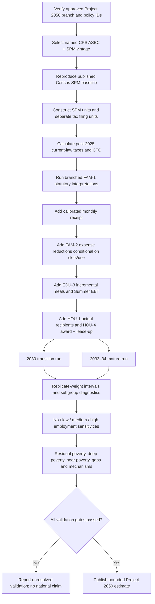

> Original report 3 export filed October 24, 2026 from the supplied local attachment, in full. Historical research/prototype record; the executable rebuild and conditional agenda analysis merged through PR #13 supersede its implementation/execution statements where they conflict. See [recovery findings](family-child-poverty-rebuild-findings-and-integration.md) and [current results](family-child-poverty-agenda-effects.md). No policy changes are adopted by filing.

# Project 2050 Child-Poverty Microsimulation: Build, Validation, Integration, and Verified Artifacts

## Executive summary

I verified the repository authority before touching the microsimulation. The authoritative working branch remains **`claude/pensive-mendel-g1lwl5`**, not `main`, but its head has advanced from the charter-era pointer `e15c5c4a711b4cd2b482bac8300de45f2e08721f` to **`14feb987a7d8aec416ba5bacc50880187a756383`**. The current head commit is explicitly an integration of approved October 23 development work, and the current governing/instruction files treat the post-pilot integrations as approved while preserving Espen's ownership of policy decisions. fileciteturn2file0L1-L3 fileciteturn25file0L2-L6 The research register still prints `e15c5c4…` as its baseline, so its SHA is now a **stale historical pointer**, not evidence that the branch should be reset. fileciteturn19file0L2-L2

The existing microsimulation development branch **`codex/child-poverty-microsim-v1`** is still separate from the approved branch and is now at **`8a8f4b80681a00faea9119b1abd6b5b9b91b7266`**, beyond the earlier `0d9c0d6` prototype. Its code and README correctly describe the engine as a prototype requiring analyst-prepared SPM-unit, tax-unit, and person-level files rather than raw CPS ASEC. fileciteturn7file0L1-L3 fileciteturn11file0L1-L7

I reproduced that engine locally and subjected it to deterministic synthetic validation. One genuine implementation defect emerged: **mechanism attribution treated a legal exclusion affecting one child as an exclusion affecting every sibling in the same SPM unit**. That did not alter the poverty-resource calculation itself, but it would have biased the answer to “which children remain poor or unreached?” I corrected only that attribution logic—without changing adopted benefit amounts, policy inputs, or the resource calculation—and added a regression test. The original version failed that test; the corrected version passes it. The complete suite now passes **7 of 7 tests under Python 3.13.5**.

This is a meaningful validation milestone, but it is **not yet a national microsimulation**. The model still lacks the real CPS ASEC/SPM preprocessing, a validated post-2025 current-law CTC calculation, replicate-weight uncertainty, empirically calibrated receipt, child-care slot availability, voucher award/lease-up, target-year population projection, and employment sensitivities needed for a defensible Project 2050 residual child-poverty estimate. That limit is not incidental: the current canonical model brief itself says research development is approved but no new eligibility, benefit, entitlement, or poverty target has been adopted, and it calls for separate 2030 transition and mature-state analyses with distinct tax and SPM units and overlap-safe attribution. fileciteturn5file0L1-L7

The requested package is now actually downloadable. The complete ZIP is:

**[Download `project2050-child-poverty-microsim.zip`](sandbox:/mnt/data/project2050-child-poverty-microsim.zip)**

SHA-256: `b89d08576c280fe4a7d59f5c49d7797206dddfdbd1c50405ba1991c2fbf26c7a`

No remote GitHub branch, commit, or pull request was created in this session because the connected GitHub interface available here is read-only for repository contents and history. The artifact therefore contains the corrected source, patch, tests, exact integration map, proposed branch name, and shell commands needed for the coordinating repository session to create that PR without guessing.

## Baseline, authority, and package scope

Project instructions require the governing decisions to be read first, identify GitHub's approved governing material as authoritative over working copies, prohibit treating an unmerged proposal as policy, and require branch/commit provenance and conflict reporting. fileciteturn17file0L2-L6 The shared instructions further distinguish `governing/`, canonical `domains/`, generated `index/` material, and research `sources/`; they say Espen approves policy changes, generated index outputs must not be hand-edited, and large work should be isolated on a branch with a focused handoff. They also explicitly state that completion of child-poverty research authorizes analysis, **not adoption of new eligibility or benefit rules**. fileciteturn18file0L2-L6

The relevant adopted package remains the one already recorded in the canonical domain files. FAM-1A is the $3,600 under-six/$3,000 ages six through seventeen CTC, fully refundable, monthly, indexed, with the 2021 increase phase-outs. FAM-2A phases child care and pre-K: 2030–31 has universal voluntary pre-K for three- and four-year-olds, free care below 75 percent of state median income, supply grants and wage parity; the seven-percent cap through 250 percent of state median income begins in 2032. fileciteturn20file0L2-L2 EDU-3A supplies universal breakfast and lunch, current reimbursement rates indexed, and $60-per-month Summer EBT. fileciteturn21file0L1-L2 HOU-1A supplies $85 billion of temporary 2030–31 aid and HOU-4A adds 400,000 mandatory vouchers, phased at 100,000 per year; HOU-4C's much broader voucher entitlement remains an **option**, not adopted policy. fileciteturn22file0L1-L2 fileciteturn24file0L2-L6

That distinction drives the model architecture. A legitimate Project 2050 result cannot convert housing-construction appropriations into household cash, assume all child-care-eligible families obtain slots, or silently replace 400,000 incremental vouchers with a universal rental-assistance entitlement. Likewise, the unresolved FAM-1 identification interpretations belong in analytical branches until Espen makes the relevant policy decision. The current repository's child-poverty brief already requires precisely that treatment. fileciteturn5file0L1-L7

The approved charter and the completed native Deep Research report could not be independently re-downloaded here. The repository research register identifies both of them: it records the approved charter Library object and a 626,969-byte completed child-poverty native report, while warning that the final Markdown attachments from that research workspace were not independently retrievable and that the two accessible Markdown files were preliminary notes. fileciteturn19file0L2-L2 The connected browser interface was unavailable outside its originating browser context, and web retrieval of the Library artifact did not succeed. I therefore did **not** pretend those inaccessible attachments had been re-read. The newly generated reports below are a verified reconstruction/update based on the authoritative repository, the user's uploaded handoff/preliminary materials, the actual prototype source, and primary external evidence.

### Baseline record

| Item | Verified status | Confidence |
|---|---|---|
| Repository | `fm58cn6g4d-stack/project-2050` | High |
| Authoritative branch | `claude/pensive-mendel-g1lwl5` | High |
| Charter-era SHA | `e15c5c4a711b4cd2b482bac8300de45f2e08721f` | High; historical |
| Current approved-branch head | `14feb987a7d8aec416ba5bacc50880187a756383` | High |
| Baseline change | **Commit advanced; branch did not change** | High |
| `main` | Not substituted | High |
| Prototype branch | `codex/child-poverty-microsim-v1` | High |
| Prototype head | `8a8f4b80681a00faea9119b1abd6b5b9b91b7266` | High |
| Remote integration PR | Not created; GitHub connection here is read-only | High |

## Model build and validation

The existing engine has a fundamentally useful division of responsibilities. It takes an already constructed SPM baseline and then layers incremental Project 2050 effects over that baseline. Its FAM-1 module distinguishes age, AGI, filing status, current-law CTC, receipt months, and three identification-rule branches. FAM-2, EDU-3, and housing are represented as separately supplied SPM-countable deltas rather than inferred from program budgets. fileciteturn13file0L1-L7 fileciteturn14file0L1-L7

That is the right conceptual direction because SPM poverty is based on resources available to the SPM unit, not the federal cost of a program. A $300 billion construction-loan authority is not $300 billion of household income; a child-care authorization does not reduce an SPM family's child-care deduction unless a usable slot actually replaces an out-of-pocket expense; and a voucher does not change resources until it is awarded and successfully leased. The engine therefore correctly forces those delivery questions into preprocessing rather than treating appropriations as benefits.

### Defect found and corrected

The prototype's mechanism code originally did, in effect:

```python
excluded = any(
    not id_allowed(child, tax_unit, branch)
    for child in kids_in_spm_unit
)
```

It then assigned that unit-level flag to the weighted count of **all children** in the unit. In a two-sibling family where one child met the selected identification rule and one did not, both were counted as legally excluded.

The package changes that attribution to child level:

```python
for child in kids:
    eligible = id_allowed(child, taxes[tid], branch)
    excluded = not eligible
    nonreceipt = (
        eligible
        and credits[tid] > 0
        and observed_fraction(taxes[tid], "delivered") < 1
    )
```

Resource inadequacy after full receipt and most service shortages remain SPM-unit conditions, which is appropriate because family members share the unit's modeled resources. This correction changes the **diagnostic attribution**, not adopted policy, CTC parameters, or the modeled SPM resources.

The package contains the exact unified diff:

**[Download `model-attribution-fix.patch`](sandbox:/mnt/data/p2050_artifacts/model-attribution-fix.patch)**

and both the original branch version and corrected version:

**[Download original `model-upstream-8a8f4b.py`](sandbox:/mnt/data/p2050_artifacts/model-upstream-8a8f4b.py)**  
**[Download corrected `model.py`](sandbox:/mnt/data/p2050_artifacts/model.py)**

The corrected model SHA-256 is `16f5fe502cb4e6294ddec64b8e43c13d487dc8c9bb21f4844aed4f07cfb53978`; the reproduced upstream version is `702c8e45badb933eb59851718a57dfaed7f0164e09a0961c7bdc1b9d88334bb9`.

### Test results

| Test | What it verifies | Result |
|---|---|---|
| Credit age and phase-out | $3,600 under six, $3,000 older-child fixture, first 2021-style phase-out arithmetic | Pass |
| Identification branches | Adult-ITIN/child-SSN behavior differs between `ssn_only` and `adult_itin` as specified | Pass |
| Child care, transition year | 2030 free-care tier only below 75% of state median and only when a slot exists | Pass |
| Child care, mature year | 2034 fixture applies the seven-percent cap | Pass |
| Monthly delivery | Six months delivers one-half of the annual incremental FAM-1 amount | Pass |
| Current-law branch invariance | Identification branches do not alter the supplied current-law baseline | Pass |
| Mixed-ID sibling attribution | Eligible sibling is no longer mislabeled legally excluded | **Pass after fix; failed before fix** |

Execution used Python **3.13.5** and the standard library. Final test transcript:

```text
Ran 7 tests in 0.008s

OK
```

**[Download `test-results.txt`](sandbox:/mnt/data/project2050_child_poverty_deliverables/test-results.txt)**

The end-to-end synthetic fixture also runs in both 2030 and 2034. Its deliberately artificial 2030 population starts at a poverty rate of `1.0`, falls to `0.764706` under the synthetic “delivered” assumptions and `0.294118` under the synthetic full-receipt assumptions. Those numbers exist only to exercise state changes and weighting. They are **not evidence about Project 2050**, and the package labels them accordingly.

**[Download `synthetic-scenarios.csv`](sandbox:/mnt/data/project2050_child_poverty_deliverables/synthetic-scenarios.csv)**  
**[Download synthetic fixture directory via the complete ZIP](sandbox:/mnt/data/project2050-child-poverty-microsim.zip)**

### What remains unvalidated

The current engine's tax treatment is still labeled provisional in its own source. It takes `reference_under17`, `reference_age17`, and a policy index as analyst inputs rather than running a full post-2025 tax calculation. fileciteturn13file0L1-L7 More importantly, it has no raw CPS-to-SPM preprocessing.

The production blockers are therefore:

| Blocker | Why it matters |
|---|---|
| CPS ASEC/SPM extract pipeline | Without it there is no nationally representative household baseline |
| Tax-unit construction | CTC eligibility operates on tax units; SPM poverty operates on different resource-sharing units |
| Post-2025 current-law CTC | Project 2050's marginal effect must be measured from actual target-year law, not TCJA or no-CTC baselines |
| Identification/custody rules | Determines who receives FAM-1 in mixed-status and complex-family cases |
| Monthly receipt calibration | Statutory eligibility is not equivalent to on-time monthly receipt |
| FAM-2 slot/use model | Subsidies do not reduce expenses when no usable care slot exists |
| EDU-3 receipt/current-law offset | Only incremental meals/Summer EBT resources belong in the policy delta |
| Voucher award and lease-up | 400,000 vouchers are scarce and successful leasing is not automatic |
| Target-year aging/reweighting | A current survey sample is not automatically a 2030 or 2034 population |
| Replicate weights | Point estimates without sampling uncertainty are incomplete |
| Employment sensitivity | A permanent fully refundable CTC can affect earnings and therefore SPM resources |
| Baseline reconciliation | The model must reproduce published source-vintage SPM statistics before policy effects are trusted |

The Census Bureau maintains the underlying CPS dataset and technical-documentation infrastructure needed for that preprocessing. citeturn16view0turn16view1

## Evidence checks and what they imply for the microsimulation

The National Academies evidence is particularly useful here because it shows why the missing production steps cannot simply be replaced with a borrowed headline poverty reduction.

The 2019 *Roadmap to Reducing Child Poverty* used TRIM3-simulatable policy options and evaluated them against explicit criteria. Its Chapter 5 says the committee chose policies it could simulate and emphasizes a package approach because different instruments affect poverty, employment, and subgroups differently. citeturn7view1 Chapter 6 then states that **none of its individual options** reached the 50-percent child-poverty-reduction objective; its packages deliberately combined work supports and income supports, including in some variants housing vouchers, SNAP, child allowances, tax credits, and removal of immigrant restrictions. citeturn7view0

That makes a seemingly tempting shortcut invalid: the approximately half-poverty reductions in the Roadmap cannot be assigned to Project 2050 merely because Project 2050 also contains a large CTC and housing/food/care policy. The populations, policy specifications, tax-law baselines, participation assumptions, housing reach, and employment effects differ.

The 2026 *Pathways to Reduce Child Poverty* report is more directly informative about model design. Its SPM methods chapter explains that the SPM counts refundable tax credits and important in-kind transfers and deducts expenses including child care, making it much better suited than the official poverty measure for analyzing these policies. But the same chapter emphasizes weaknesses that matter directly to this project: annual CPS income is a poor representation of payment timing; taxes and credits are largely tax-model assignments; household composition at interview does not perfectly reconstruct prior-year tax units; and SSN/ITIN and immigration eligibility are imperfectly measured. citeturn3view0

Those limitations are not merely academic for FAM-1. A monthly credit is designed partly to stabilize resources during the year, while the annual SPM can smooth over missed or late months. A national residual-poverty estimate therefore needs both annual SPM outcomes and a delivery diagnostic that preserves month-of-receipt or at least months received. The current prototype's `months_delivered` field is a good start; it should not be replaced with a national 90-percent or 95-percent haircut.

The 2026 take-up chapter is even clearer. The Academies notes that eligible families do not all receive credits, that measured CTC receipt was lower among lower-income and Hispanic families, and that prior tax filing was one of the strongest predictors of receipt. citeturn10view0 Administrative evidence showed broad 2021 advance-CTC reach, but survey studies reported materially lower monthly receipt; the chapter also reports substantial differences by earnings and mixed-status-family proxies. citeturn10view0 Linked CPS/IRS evidence further shows that survey tax models can misallocate qualifying children across tax filing units and mischaracterize filing among low earners. citeturn10view0

That evidence strongly supports the Project 2050 model brief's requirement for subgroup-specific receipt rather than universal take-up or one national haircut. It also supports treating legal eligibility and administrative nonreceipt as different mechanisms.

The 2026 alternatives chapter supplies another important warning. Its longer-run simulations use **2018 CPS ASEC data in a relatively typical near-full-employment context**, and its main “current policy” comparator is non-ARPA EITC plus the **TCJA CTC**, not post-2025 law. citeturn7view2turn13view1 Its baseline estimates exclude employment responses; selected alternatives are then rerun with employment adjustments. citeturn7view2turn13view0 That means even a policy with the familiar $3,000/$3,600 CTC amounts is not automatically a Project 2050 comparator.

For scale only, the Academies' modified 2021-style CTC/EITC option reduced its modeled child-poverty rate substantially relative to its own PO1 baseline, while incorporating employment responses attenuated the reduction. The report also found that expanding eligibility to children and then parents without SSNs produced additional poverty reductions within that same simulation framework. citeturn13view0turn14view3 These are valuable sensitivity anchors, but **not Project 2050 effects**.

The subgroup tables reinforce why a single residual rate is insufficient. In that report's simulations, children in units with no workers and children in units containing a person with a disability continued to face much higher poverty rates than many other groups even after more generous credits. citeturn14view1 A Project 2050 production result should therefore report family structure, work/earnings status, disability, identification/immigration proxy, age, race/ethnicity, geography, and housing tenure alongside the national rate.

The resulting minimum specification is downloadable here:

**[Download `minimum-microsimulation-spec.md`](sandbox:/mnt/data/project2050_child_poverty_deliverables/minimum-microsimulation-spec.md)**

and the comparator assumptions are captured explicitly here:

**[Download `comparator-register.csv`](sandbox:/mnt/data/project2050_child_poverty_deliverables/comparator-register.csv)**

The core production sequence should be:



## Integration package and repository workflow

The repository's own working rules say large changes should use a branch, should not rewrite history, should preserve proposals as proposals, and should end with a focused PR/handoff rather than silently merging. fileciteturn18file0L2-L6 The correct integration base is therefore the **current approved head** `14feb987…`, not the older `e15c5c4…` and not `main`.

I recommend the integration branch name already embedded in the artifact:

`codex/child-poverty-microsim-validated-v1`

That branch has **not** been remotely created here. The exact coordinating-chat commands are:

```bash
set -euo pipefail

git clone https://github.com/fm58cn6g4d-stack/project-2050.git
cd project-2050

git fetch origin \
  claude/pensive-mendel-g1lwl5 \
  codex/child-poverty-microsim-v1

git checkout -b codex/child-poverty-microsim-validated-v1 \
  14feb987a7d8aec416ba5bacc50880187a756383
```

Then copy the validated package according to `integration-map.csv`, keeping the child-poverty tool outside `run-all.sh` until the real-data pipeline exists:

```bash
python3 --version
python3 index/tools/child-poverty/test_model.py

python3 index/tools/child-poverty/model.py \
  --units index/tools/child-poverty/synthetic/units.csv \
  --taxes index/tools/child-poverty/synthetic/taxes.csv \
  --people index/tools/child-poverty/synthetic/people.csv \
  --year 2030 \
  --vintage synthetic-validation-fixture-v1 \
  --policy-index 1 \
  --reference-under17 2200 \
  --reference-age17 2200 \
  --output /tmp/child-poverty-synthetic-2030.json

bash index/tools/run-all.sh
git diff --check
git status --short

git add index/tools/child-poverty sources/family-child-poverty-*
git commit -m "Validate child-poverty microsimulation prototype"
git push -u origin codex/child-poverty-microsim-validated-v1
```

The final step is a focused PR **into `claude/pensive-mendel-g1lwl5`**, not into `main`, with no merge until Espen reviews the integration.

The proposed repository mapping is:

| Artifact | Proposed repository location | Treatment |
|---|---|---|
| Corrected `model.py` | `index/tools/child-poverty/model.py` | Technical fix; no policy change |
| `test_model.py` | `index/tools/child-poverty/test_model.py` | New test suite |
| `synthetic/` | `index/tools/child-poverty/synthetic/` | Fixtures only |
| Evidence review | `sources/family-child-poverty-evidence-review.md` | Research finding |
| Design implications | `sources/family-child-poverty-design-implications.md` | Implementation/proposal record |
| Minimum spec | `sources/family-child-poverty-minimum-microsimulation-spec.md` | Technical specification |
| Comparator register | `sources/family-child-poverty-comparator-register.csv` | Research metadata |
| Synthetic scenarios | `sources/family-child-poverty-synthetic-scenarios.csv` | Clearly nonempirical |
| Test results | `sources/family-child-poverty-test-results.txt` | Validation record |
| Integration handoff | `sources/family-child-poverty-integration-handoff.md` | Handoff |

**[Download `integration-map.csv`](sandbox:/mnt/data/p2050_artifacts/integration-map.csv)**  
**[Download `integration-handoff.md`](sandbox:/mnt/data/project2050_child_poverty_deliverables/integration-handoff.md)**

### Expected failure modes in the coordinating repository session

A test failure on the mixed-ID-sibling case means the old unit-level attribution logic is still present. A baseline-reproduction failure with real CPS data should stop the national run rather than be “calibrated away.” A missing service-availability field must not be replaced by assuming universal access. A mismatch between current-law tax totals and an independent benchmark means the tax baseline must be repaired before FAM-1 effects are interpreted. If `run-all.sh` changes generated files merely because these research artifacts were added, inspect the diff rather than manually editing the generated outputs; the repository instructions explicitly prohibit manual edits to generated index files. fileciteturn18file0L2-L6

## Verified downloadable artifacts

The following files were created and verified in this session. For generated artifacts, “commit” is intentionally **not applicable** because I did not fabricate a GitHub commit that the connector could not create.

| Deliverable | Verified download | Repository/commit status |
|---|---|---|
| Complete package | **[project2050-child-poverty-microsim.zip](sandbox:/mnt/data/project2050-child-poverty-microsim.zip)** | Local verified artifact; not yet committed |
| Evidence review | **[project-2050-child-poverty-evidence-review.md](sandbox:/mnt/data/project2050_child_poverty_deliverables/project-2050-child-poverty-evidence-review.md)** | Proposed `sources/family-child-poverty-evidence-review.md` |
| Design implications | **[project-2050-child-poverty-design-implications.md](sandbox:/mnt/data/project2050_child_poverty_deliverables/project-2050-child-poverty-design-implications.md)** | Proposed `sources/family-child-poverty-design-implications.md` |
| Minimum specification | **[minimum-microsimulation-spec.md](sandbox:/mnt/data/project2050_child_poverty_deliverables/minimum-microsimulation-spec.md)** | Proposed `sources/family-child-poverty-minimum-microsimulation-spec.md` |
| Comparator register | **[comparator-register.csv](sandbox:/mnt/data/project2050_child_poverty_deliverables/comparator-register.csv)** | Proposed `sources/family-child-poverty-comparator-register.csv` |
| Synthetic diagnostics | **[synthetic-scenarios.csv](sandbox:/mnt/data/project2050_child_poverty_deliverables/synthetic-scenarios.csv)** | Proposed `sources/family-child-poverty-synthetic-scenarios.csv` |
| Test transcript | **[test-results.txt](sandbox:/mnt/data/project2050_child_poverty_deliverables/test-results.txt)** | Proposed `sources/family-child-poverty-test-results.txt` |
| Integration handoff | **[integration-handoff.md](sandbox:/mnt/data/project2050_child_poverty_deliverables/integration-handoff.md)** | Proposed `sources/family-child-poverty-integration-handoff.md` |
| SHA-256 manifest | **[project2050-child-poverty-artifacts.sha256](sandbox:/mnt/data/project2050_child_poverty_deliverables/project2050-child-poverty-artifacts.sha256)** | Local verification file |
| Corrected engine | **[model.py](sandbox:/mnt/data/p2050_artifacts/model.py)** | Proposed update to prototype |
| Original reproduced engine | **[model-upstream-8a8f4b.py](sandbox:/mnt/data/p2050_artifacts/model-upstream-8a8f4b.py)** | Reference copy only |
| Test source | **[test_model.py](sandbox:/mnt/data/p2050_artifacts/test_model.py)** | Proposed tool test |
| Attribution patch | **[model-attribution-fix.patch](sandbox:/mnt/data/p2050_artifacts/model-attribution-fix.patch)** | Exact technical diff |
| Validation runner | **[run-validation.sh](sandbox:/mnt/data/p2050_artifacts/run-validation.sh)** | Convenience script |
| Package README | **[README.md](sandbox:/mnt/data/p2050_artifacts/README.md)** | Package documentation |
| Package manifest | **[manifest.json](sandbox:/mnt/data/p2050_artifacts/manifest.json)** | Provenance/hashes |

The principal SHA-256 values are:

| File | SHA-256 |
|---|---|
| `project2050-child-poverty-microsim.zip` | `b89d08576c280fe4a7d59f5c49d7797206dddfdbd1c50405ba1991c2fbf26c7a` |
| Evidence review | `1a1ab80ce089242941488f39a2e3318416accef4d8cfec65091d2f336e6818d5` |
| Design implications | `4e5c1f41bfd2eb191cf4623dccc2ae4f454e14fe2221679e485c35acf4d57bbd` |
| Minimum spec | `4393023948328db067eead9c48c1492f4b123c544168412ff469bd6ef7ad07d3` |
| Comparator register | `44f79224f76169e95f9882950f550ba6c4095fb0edf5d9f90a0c74f8c78cd417` |
| Synthetic scenarios | `0018552fc35459fdd85d1db2f4fa3ebead8444dd0b53d4175fe9152d6146440f` |
| Test results | `ccbdc39062c27663464a957c4eff0d72f01952a165ba78e0fe154a09403780a3` |
| Integration handoff | `c9cc74fe3470596adf8125270c7c3a298ec8c6a7c891eaafcfc237d4e2acf716` |

For the **existing committed repository sources**, these commit-pinned direct-download URLs correspond to files verified through the GitHub connector:

| Existing source | Commit | Path | Direct download |
|---|---|---|---|
| Prototype model | `8a8f4b80681a00faea9119b1abd6b5b9b91b7266` | `index/tools/child-poverty/model.py` | [Raw `model.py`](https://raw.githubusercontent.com/fm58cn6g4d-stack/project-2050/8a8f4b80681a00faea9119b1abd6b5b9b91b7266/index/tools/child-poverty/model.py) |
| Prototype README | `8a8f4b80681a00faea9119b1abd6b5b9b91b7266` | `index/tools/child-poverty/README.md` | [Raw `README.md`](https://raw.githubusercontent.com/fm58cn6g4d-stack/project-2050/8a8f4b80681a00faea9119b1abd6b5b9b91b7266/index/tools/child-poverty/README.md) |
| Canonical model brief | `14feb987a7d8aec416ba5bacc50880187a756383` | `sources/family-child-poverty-model-brief.md` | [Raw model brief](https://raw.githubusercontent.com/fm58cn6g4d-stack/project-2050/14feb987a7d8aec416ba5bacc50880187a756383/sources/family-child-poverty-model-brief.md) |

The GitHub raw host itself cache-missed in the web reader, but the repository connector independently verified those exact commits and paths, including the prototype head/source and current model brief. fileciteturn11file0L1-L7 fileciteturn5file0L1-L7

## Limits, decisions, and handoff

The main conclusion is narrower—and more useful—than a premature headline poverty percentage.

**What is established now, with high confidence:** the approved branch has advanced to `14feb987…`; the existing child-poverty codex branch is a prototype rather than an integrated national model; the prototype can perform deterministic household/SPM arithmetic when prepared inputs are supplied; its mechanism attribution contained a mixed-sibling error; the error is corrected in the downloadable package; and the corrected suite passes seven synthetic tests.

**What remains a research-model problem, not a policy decision:** producing the CPS ASEC/SPM preprocessing; reproducing the Census baseline; building the post-2025 current-law tax baseline; calibrating monthly receipt and service delivery; incorporating replicate weights; and running 2030/mature plus employment sensitivities. The National Academies evidence makes these prerequisites particularly important because SPM tax-unit construction, benefit take-up, payment timing, and employment responses materially alter poverty estimates. citeturn3view0turn10view0turn13view0

**What remains Espen's policy decision:** selecting the final FAM-1 statutory treatment of claimant/spouse/child identification and related residency, custody, updating, and reconciliation rules if those details are not already resolved elsewhere. Until then, the model should continue to show the plausible branches side by side rather than selecting one silently. Nothing in this package adopts FAM-1D, FAM-2D, HOU-4C, a new residual cash supplement, a new poverty target, or a different Project 2050 benefit amount. The canonical family and housing files continue to distinguish those alternatives from adopted policy. fileciteturn20file0L2-L2 fileciteturn24file0L2-L6

**The next minimum empirical milestone is not a Project 2050 poverty number. It is a source-vintage baseline reconciliation.** A coordinating repository session should integrate this validated package on a branch from `14feb987…`, then build the CPS ASEC/SPM preprocessing and require it to reproduce the published Census child SPM baseline before any Project 2050 increment is enabled. Only after that succeeds should the model produce 2030 and mature delivered/full-receipt results, subgroup residuals, overlap-safe mechanisms, replicate-weight intervals, and employment sensitivities.

That is the point at which a residual child-poverty estimate becomes analytically defensible rather than an extrapolation from another package.