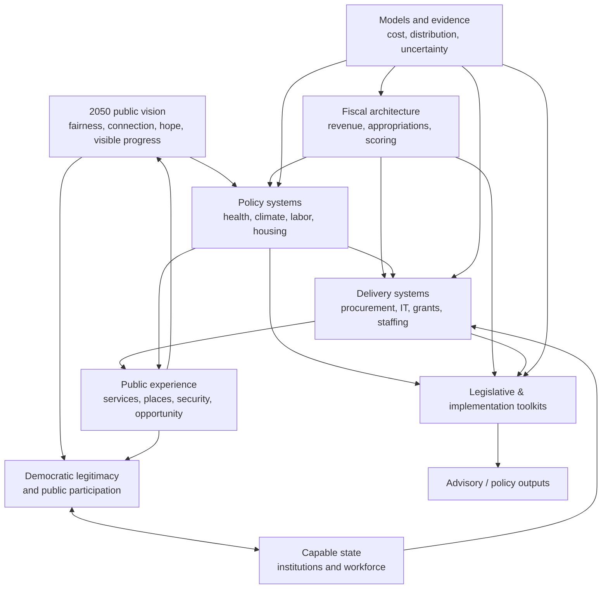
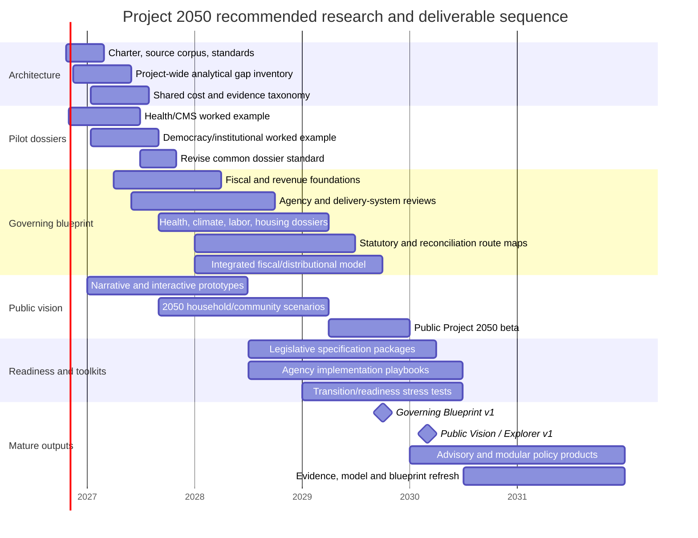

> Full report text recovered October 24, 2026 from the attached native report JSON, `widget_state.report_message.content.parts`, Library `libfile_892f76624c088191a5ef802b20f316e7`. No report-body abridgment. Research recommendations and tiers are not policy or automatic evidence-confidence ratings; the approved charter qualifies the proposed schedule and methods. Original source-search URLs follow the report. Export SHA-256: `ab517e88b0284d293bebeda92a7b072b2f7cfb4163ea412ff01573d9c6e97170`.

# Project 2050: Prioritized Annotated Bibliography and Research Architecture

## Executive summary

Project 2050 now has two linked intellectual tasks. Its **public-facing layer** needs to make a more fair, connected, hopeful, capable, democratic America imaginable: a country that visibly builds, cares, adapts, learns, and gives people a meaningful role in collective decisions. Its **professional layer** must establish that these possibilities can be translated into legislation, budgets, administrative systems, implementation plans, models, and credible estimates.

The bibliography below is designed for both. It contains **81 prioritized sources across nine domains**, weighted heavily toward primary federal sources, official data, consensus assessments, and seminal research. Seventy-two are classified **Tier 1**, seven **Tier 2**, and two **Tier 3**. The emphasis is deliberately not “everything worth reading”; it is a working corpus that can serve as the evidentiary backbone for Project 2050.

The CMS capacity work suggests a broader analytical lesson. Given the way Project 2050 was intentionally built—first establishing high-level policy commitments, fiscal envelopes, political sequencing, and desired outcomes—the next research stage should systematically connect each proposal to **existing law and programs, current appropriations, administrative costs, responsible institutions, workforce and IT needs, intergovernmental delivery, implementation lead times, budget authority and outlay timing, and interactions with other proposals**. Federal experience strongly supports treating these as substantive policy-design questions rather than post-enactment details: GAO repeatedly finds that leadership, organizational capacity, implementation plans, monitoring, and demonstrated progress distinguish improving federal programs from persistently high-risk ones. citeturn18search17turn14search1

The resulting research system should not become a demand that every Project 2050 idea acquire a 200-page implementation manual before it can be discussed publicly. Instead, sources should be used at **different evidentiary depths**. Public claims need defensible foundations; fiscal claims need reproducible calculations; legislative concepts need sufficiently specified mechanisms; and proposals labeled “implementation ready” need considerably more operational detail.

### The source hierarchy

**Tier 1** means the source should normally enter the permanent Project 2050 research corpus: authoritative primary material, official data or methodology, consensus scientific assessment, or genuinely seminal scholarship.

**Tier 2** means important scholarship or policy analysis that interprets, extends, or tests the Tier 1 foundation and is particularly useful for policy design.

**Tier 3** means contextual material useful for examples, narrative development, emerging practice, or background, but not something the project should rely upon by itself for a major quantitative or legal claim.

### The twelve highest-priority readings

| Priority source | Why it belongs near the top | Project 2050 use |
|---|---|---|
| **GAO, High-Risk Series** | Provides a government-wide framework for thinking about leadership, institutional capacity, action plans, monitoring, and demonstrated progress rather than simply appropriating money. citeturn18search17 | Implementation checklist; state-capacity framework |
| **Fukuyama, “What Is Governance?”** | Separates the quality of the state apparatus from democratic regime type and focuses attention on capacity and bureaucratic autonomy—useful for Project 2050's “capable but accountable” state. citeturn13search4turn13search12 | Public argument; governance framework |
| **GAO, Medicare Advantage / improper-payment review, GAO-26-107946** | A concrete demonstration that ambitious savings and integrity goals depend on staff, plans, deadlines, audit capacity, and performance measures. citeturn1search0 | CMS dossier; implementation checklist; model-risk adjustment |
| **MedPAC, March 2026 Report to Congress** | Essential independent congressional analysis of Medicare payment policy, including Medicare Advantage payment, coding and selection issues. citeturn1search5 | Health model; legislative design |
| **CBO, Cost-Estimating Process** | The starting point for understanding how serious federal legislative estimates establish baselines, behavioral effects, implementation assumptions, and uncertainty. citeturn2search6 | Model standards; professional blueprint |
| **GAO, Principles of Federal Appropriations Law (“Red Book”)** | The essential bridge between saying “fund this” and designing legally usable budget authority: purpose, time, amount, authorization, appropriation, and fiscal-law constraints. citeturn15search2turn15search20 | Legislative drafting; implementation |
| **Fifth National Climate Assessment** | The authoritative U.S. synthesis of observed and prospective climate impacts, vulnerability, adaptation and risk across sectors and regions. citeturn17search3turn17search15 | Climate narrative; investment prioritization |
| **IPCC, AR6 Synthesis Report** | Establishes the global physical-science, mitigation, adaptation and risk context against which the U.S. program should be situated. citeturn4search0turn4search12 | Public narrative; technical appendix |
| **DOE, Pathways to Commercial Liftoff** | Especially useful for moving from abstract decarbonization targets to deployment barriers, capital requirements, markets, infrastructure and commercialization pathways. citeturn16search2turn16search14 | Climate/industrial implementation |
| **Brynjolfsson, Li & Raymond, “Generative AI at Work”** | One of the strongest early causal studies of generative AI in an actual workplace; it demonstrates productivity gains but also heterogeneity across worker experience. citeturn5search6 | AI/work narrative; labor-policy design |
| **GAO, Agile Assessment Guide + federal IT high-risk work** | Together they show why federal digital capacity requires iterative development, user involvement, mature acquisition, skilled personnel and management—not simply a technology appropriation. citeturn20search1turn7search0 | IT implementation standards |
| **GAO, Cost Estimating and Assessment Guide** | Gives Project 2050 an unusually useful standard for deciding whether its own program estimates are comprehensive, documented, accurate and credible, including sensitivity and risk analysis. citeturn20search4 | Model QA; capital-project dossiers |

The source architecture implies the following relationship among the project's analytical domains. This is a **Project 2050 research design**, not a claim that every causal arrow has equal empirical strength.

## Architecture and source comparison

The bibliography deliberately treats **delivery capacity as a cross-cutting domain**, rather than burying it inside each substantive policy chapter. That follows from the pattern seen in CMS, unemployment insurance, federal IT, grants and performance management: a policy can have statutory authority and money and still fail because its operating institutions cannot hire, procure, integrate data, build systems, coordinate with states or establish reliable schedules. citeturn18search1turn20search1turn14search5

Likewise, **fiscal modeling is treated separately from budget-process law**. CBO and JCT methodologies answer questions such as “what behavioral and distributional effects should be modeled?”, while GAO appropriations law answers different questions such as “what money is legally available, for what purpose and period?” Project 2050 needs both. citeturn15search0turn15search2

### Comparative source map

| Domain | Tier 1 | Tier 2 | Tier 3 | Most important uses |
|---|---:|---:|---:|---|
| Democratic renewal, governance, state capacity | 8 | 1 | 0 | Public narrative; institutional design; implementation standards |
| Health and care systems | 8 | 1 | 0 | Model inputs; CMS implementation; legislative specifications |
| Fiscal policy and budgeting | 8 | 1 | 0 | Scoring; appropriations; reconciliation; legislative drafting |
| Climate mitigation and adaptation | 8 | 1 | 0 | Public future scenarios; investment plans; model assumptions |
| Labor, AI and economic transition | 8 | 1 | 0 | Workforce architecture; social insurance; future-of-work narrative |
| Housing and infrastructure | 8 | 0 | 1 | Supply strategy; place-based narrative; capital implementation |
| Implementation, procurement, IT and workforce | 8 | 1 | 0 | Agency playbooks; surge funding; readiness reviews |
| Modeling, distribution and reproducibility | 8 | 1 | 0 | Technical appendix; model governance; QA |
| Communications and public engagement | 8 | 0 | 1 | Public-facing A/G products; engagement architecture |
| **Total** | **72** | **7** | **2** | |

### How suggested uses should be interpreted

| Suggested use | Minimum evidentiary expectation |
|---|---|
| **Public narrative** | Strong enough to support the direction and magnitude of a claim without implying false certainty; accessible examples can supplement primary evidence. |
| **Technical appendix** | Methods, assumptions, definitions, uncertainty and source provenance should be visible enough for an informed reviewer to reconstruct the reasoning. |
| **Legislative drafting** | Existing statutory structure, jurisdiction, budget treatment, definitions, administrative authority and interaction with existing programs must be understood. |
| **Implementation checklist** | Ownership, staffing, IT/data, procurement, state/local relationships, timelines, dependencies, metrics and failure modes must be addressed. |
| **Model input** | Quantitative definition, baseline, year, population, behavioral assumptions, uncertainty range and interaction rules should be recorded. |

An important discipline follows: **the same source should not automatically support every use**. A National Climate Assessment finding may justify a public statement about rising climate risks, for example, while it may not by itself provide the engineering cost input for a particular flood-control program. Similarly, an agency budget number is not automatically evidence of the marginal cost of administering a new benefit.

## Annotated bibliography

**Democratic renewal, governance and state capacity**

**GOV-01 — Tier 1. U.S. Government Accountability Office. *High-Risk Series* (2025 edition and continuing online program).**  
GAO's High-Risk framework is probably the single most useful operational source for Project 2050's state-capacity agenda because it evaluates whether government has leadership commitment, sufficient capacity, corrective action plans, monitoring and demonstrated progress. Its methodological strength is decades of cross-agency audit work and explicit criteria; its limitation is that it is designed for oversight of problematic programs rather than as a normative theory of democratic government. **Suggested use:** implementation checklist; technical appendix; public explanation of why institutional capacity matters. citeturn18search17

**GOV-02 — Tier 1. Fukuyama, Francis. “What Is Governance?” *Governance* 26, no. 3 (2013): 347–368.**  
Fukuyama argues that governance quality should be analyzed through the capacity and autonomy of the executive apparatus rather than conflated with democracy or policy outcomes. That distinction is highly valuable for Project 2050's thesis that stronger administrative capability and stronger democratic accountability should be pursued together; the limitation is that the proposed measurement framework is conceptual rather than a ready-made U.S. operating metric. **Suggested use:** public narrative; governance theory; analytical framework. citeturn13search4turn13search12

**GOV-03 — Tier 1. Besley, Timothy, and Torsten Persson. “The Origins of State Capacity: Property Rights, Taxation, and Politics.” *American Economic Review* 99, no. 4 (2009): 1218–1244.**  
Besley and Persson model investment in fiscal and legal state capacity and link those investments to political institutions, common interests and expectations about future political control. The paper's strength is a formal framework showing why capacity itself is an accumulated political-economic asset; its abstraction and cross-country orientation mean it should inform Project 2050's theory rather than be treated as a direct empirical recipe for federal reform. **Suggested use:** technical appendix; public argument about long-term institutional investment. citeturn0search3

**GOV-04 — Tier 1. Wu, Xun, M. Ramesh, and Michael Howlett. “Policy Capacity: A Conceptual Framework for Understanding Policy Competences and Capabilities.” *Policy and Society* 34, nos. 3–4 (2015).**  
This framework decomposes policy capacity into analytical, operational and political competencies at individual, organizational and system levels. Its great value for Project 2050 is diagnostic: it prevents “capacity” from becoming a vague synonym for staffing, while its limitation is that the framework still requires domain-specific measures and thresholds. **Suggested use:** implementation checklist; agency-capacity scorecard. citeturn0search6

**GOV-05 — Tier 1. United States. *Foundations for Evidence-Based Policymaking Act of 2018*, Pub. L. 115-435, approved January 14, 2019.**  
The Evidence Act institutionalized evaluation, data governance and evidence-building functions across the federal government and therefore provides a statutory precedent for Project 2050's interest in government that learns over time. As enacted law it is authoritative about federal requirements, but it does not show that agencies possess enough resources or capability to meet them. **Suggested use:** legislative drafting; institutional-design appendix. citeturn13search6turn13search22

**GOV-06 — Tier 1. U.S. Government Accountability Office. *Evidence-Based Policymaking: Agencies Need Additional Guidance to Assess Their Capacity*, GAO-24-106982 (2024).**  
GAO found meaningful variation in how agencies conducted Evidence Act capacity assessments and recommended greater methodological guidance and lesson-sharing. This is directly applicable to Project 2050: even the act of measuring administrative capacity needs standardization, and the report's cross-agency interviews provide stronger evidence than relying on a single agency case; the assessment remains focused on evidence-building capacity rather than all dimensions of delivery. **Suggested use:** project-wide capacity-review methodology. citeturn14search0

**GOV-07 — Tier 1. U.S. Government Accountability Office. *Managing for Results in Government* and *Government Performance Management: Insights from Cross-Agency Priority Goals* (2026).**  
Federal performance law creates a structure of long-term and annual goals, measurement and transparent reporting, while GAO's 2026 work finds cross-agency goals useful but identifies implementation weaknesses. This gives Project 2050 a concrete foundation for the “long-term thinking” component of its vision; the limitation is that setting and reporting goals cannot substitute for substantive delivery capacity. **Suggested use:** governing blueprint; implementation dashboards; accountability provisions. citeturn14search1turn14search5

**GOV-08 — Tier 1. National Academies of Sciences, Engineering, and Medicine. *Principles and Practices for a Federal Statistical Agency: Eighth Edition*. Washington, DC: National Academies Press, 2025.**  
The Academies identify relevance, credibility, trust, independence and innovation as central to an effective federal statistical system. Because Project 2050 ultimately needs official measurement systems capable of evaluating outcomes over decades, this is an essential guide to the institutional conditions under which data can remain trusted across political administrations; it concerns statistical agencies specifically rather than the entire administrative state. **Suggested use:** evidence architecture; legislative safeguards; implementation checklist. citeturn14search7turn14search3

**GOV-09 — Tier 2. U.S. Election Assistance Commission. *2024 Election Administration and Voting Survey: Comprehensive Report* (2025).**  
EAVS is the most comprehensive recurring federal data collection on U.S. election administration, covering registration, voting methods, polling operations, election technology and related administrative practices, with participation from all states and territories covered by the survey. Its strength is administrative breadth and state-level comparability; it measures systems and practices rather than all dimensions of democratic legitimacy or voter experience. **Suggested use:** democracy policy baseline; model/data input; public explorer. citeturn14search6turn14search10

**Health and care systems**

**HLT-01 — Tier 1. U.S. Government Accountability Office. *Actions Needed to Reduce Improper Payment and Fraud Risks in Medicare Advantage and Veterans' Community Care*, GAO-26-107946 (2026).**  
This report is central to the existing Project 2050 CMS capacity review because it links Medicare Advantage oversight to concrete planning, staffing, cost, deadline and performance-management questions. Its audit methodology makes it strong evidence about current operational weaknesses, but GAO findings do not by themselves establish the savings Project 2050 should score from a redesigned integrity regime. **Suggested use:** CMS implementation checklist; savings-risk analysis; legislative oversight provisions. citeturn1search0

**HLT-02 — Tier 1. Medicare Payment Advisory Commission. *Report to the Congress: Medicare Payment Policy*. March 2026.**  
MedPAC's annual March report supplies Congress with independent analysis of Medicare payment adequacy and program design, and its Medicare Advantage work is especially relevant to Project 2050's payment and savings assumptions. It combines administrative data with policy analysis but is advisory rather than an official score and often cannot resolve how a novel reform would behave outside existing Medicare rules. **Suggested use:** Medicare model inputs; legislative design; technical appendix. citeturn1search5

**HLT-03 — Tier 1. Medicaid and CHIP Payment and Access Commission. *March 2026 Report to Congress on Medicaid and CHIP*. 2026.**  
MACPAC's 2026 work includes home- and community-based-services workforce and payment issues, making it particularly relevant to Project 2050's care agenda. Its advantage is deep familiarity with federal-state Medicaid administration and access problems; because Medicaid varies extensively by state, national recommendations still require state-specific implementation analysis. **Suggested use:** long-term-care design; state implementation; workforce modeling. citeturn11search3

**HLT-04 — Tier 1. Medicaid and CHIP Payment and Access Commission. *State Efforts to Address Medicaid Home- and Community-Based Services Workforce Shortages* (issue brief, 2021/2022).**  
This source catalogs the tools states have used to address the direct-care workforce constraint underlying expansion of HCBS. It is especially useful for reminding Project 2050 that an entitlement or payment commitment does not itself create caregivers; its descriptive state-policy design cannot establish which interventions will scale successfully nationwide. **Suggested use:** implementation checklist; labor model; long-term-care chapter. citeturn11search31

**HLT-05 — Tier 1. U.S. Government Accountability Office. *Medicaid Information Technology: Federal Oversight of State Systems* (2020).**  
GAO's Medicaid IT work documents the scale and complexity of federal matching support for state eligibility and claims systems and identifies weaknesses in CMS oversight documentation and review. Its strength is direct examination of federal-state system spending and controls; the technology landscape has evolved, so specific system findings should be refreshed before being used as a 2029 readiness assessment. **Suggested use:** CMS/state systems checklist; administrative cost register. citeturn11search2

**HLT-06 — Tier 1. U.S. Government Accountability Office. *CMS Innovation Center*, GAO-26-107953 (2026).**  
GAO's examination distinguishes spending on specific payment models from shared administrative and IT support, a distinction that maps directly onto Project 2050's emerging need to separate policy benefits from federal administrative infrastructure. It provides a useful accounting template, although the Innovation Center's portfolio is not equivalent to operating Medicare, Medicaid or a national public-plan system. **Suggested use:** administrative-cost taxonomy; CMS dossier. citeturn11search6

**HLT-07 — Tier 1. Boards of Trustees, Federal Hospital Insurance and Federal Supplementary Medical Insurance Trust Funds. *2026 Annual Report of the Boards of Trustees of the Federal Hospital Insurance and Federal Supplementary Medical Insurance Trust Funds*. 2026.**  
The Trustees report is an indispensable official baseline for Medicare financing, enrollment, expenditures and trust-fund projections. It is a current-law actuarial projection rather than a forecast of Project 2050 reforms, so alternative policies need explicit bridge assumptions rather than simply substituting new program costs into Trustees totals. **Suggested use:** Medicare baseline; model inputs; technical appendix. citeturn11search4

**HLT-08 — Tier 1. Centers for Medicare & Medicaid Services. *Comprehensive Medicaid Integrity Plan, FY 2024–FY 2028* and Medicaid program-integrity guidance.**  
CMS's integrity planning identifies federal and state responsibilities, data and oversight mechanisms for preventing and detecting improper payments. It is valuable for determining what capabilities already exist before Project 2050 creates a new “program integrity” funding line; as an agency strategy, it should be cross-checked against independent GAO and MACPAC assessments of actual performance. **Suggested use:** baseline inventory; implementation checklist; double-counting review. citeturn1search18turn1search2

**HLT-09 — Tier 2. Centers for Medicare & Medicaid Services. *Medicaid & CHIP Scorecard*. Current online data system.**  
The Scorecard integrates information from numerous administrative datasets on enrollment, quality, expenditures and state program performance, making it useful for Project 2050's interactive and analytic layers. Its virtue is accessible standardized data; its limitation is that missingness, reporting differences and lagged measures constrain state comparisons. **Suggested use:** public explorer; baseline dashboard; model calibration. citeturn11search1turn11search5

**Fiscal policy, budgeting, appropriations and scoring**

**FIS-01 — Tier 1. Congressional Budget Office. *CBO's Cost-Estimating Process* (2023).**  
This is the best compact guide to how CBO turns legislative language into estimates using baselines, administrative data, behavioral assumptions and implementation judgments. Project 2050 should use it to emulate congressional scoring discipline without pretending its internal estimates are CBO scores; CBO necessarily works under statutory and scorekeeping conventions that may differ from broader economic welfare analysis. **Suggested use:** model standards; legislative drafting; technical appendix. citeturn2search6

**FIS-02 — Tier 1. Congressional Budget Office. *Frequently Asked Questions About CBO Cost Estimates*. Current edition.**  
CBO's FAQs explain what estimates include, how uncertainty and behavioral responses are handled, and why estimates can differ from outside analyses. Their strength is direct explanation from the institution that Congress relies upon for federal spending estimates; they are principles rather than enough detail to recreate every CBO model. **Suggested use:** scoring protocol; reviewer orientation. citeturn2search4

**FIS-03 — Tier 1. Congressional Budget Office. *The Budget and Economic Outlook: 2026 to 2036*. February 2026.**  
The 2026 outlook is the appropriate current macro-fiscal baseline for Project 2050's near-term federal budget work: CBO projects a $1.9 trillion FY2026 deficit rising to $3.1 trillion by 2036 and debt held by the public reaching roughly 120 percent of GDP by 2036. It is a current-law/current-policy baseline constructed under CBO conventions rather than a prediction that policy will remain unchanged, and Project 2050 should preserve that distinction. **Suggested use:** fiscal baseline; public context; model input. citeturn15search1turn15search7

**FIS-04 — Tier 1. Congressional Budget Office. *How CBO Incorporates Administrative and Judicial Actions Into Its Baseline* (2024).**  
This source is essential for handling one of Project 2050's likely recurring problems: separating current-law baseline activity from new policy and deciding when administrative actions alter projected federal spending. Its strength is direct transparency about baseline practice; internal Project 2050 scenario analysis may reasonably explore alternatives so long as it labels departures from CBO convention. **Suggested use:** baseline rules; technical appendix. citeturn2search9

**FIS-05 — Tier 1. Congressional Budget Office. *How CBO Treats Funding for Program Integrity in Cost Estimates* (2024).**  
CBO explains why secondary savings from additional program-integrity spending may be presented separately rather than credited in an official estimate under scorekeeping rules. This is immediately relevant to Project 2050's Medicare Advantage, tax-enforcement and other “spend to save” assumptions; the limitation is that scorekeeping treatment and real-world expected fiscal effects are distinct concepts and should both be shown. **Suggested use:** savings model; reconciliation design; scoring appendix. citeturn2search12

**FIS-06 — Tier 1. U.S. Government Accountability Office. *Principles of Federal Appropriations Law*, 4th ed. and annual revisions (“Red Book”).**  
The Red Book is the authoritative practical treatise for purpose, time and amount restrictions, authorization-versus-appropriation questions and other federal fiscal-law issues. It is indispensable for Project 2050's new decision to make surge funding immediately available on a multi-year basis, because legal availability and modeled cash outlays need to be specified separately; it is legal doctrine, not a policy-cost model. **Suggested use:** legislative drafting; appropriations architecture; implementation checklist. citeturn15search2turn15search14

**FIS-07 — Tier 1. U.S. Government Accountability Office. *Antideficiency Act* legal guidance.**  
GAO's guidance explains the statutory prohibition on obligations or expenditures exceeding or preceding available appropriations, an elementary but crucial constraint for ambitious multi-year implementation plans. It should be used to test drafting and agency operating assumptions, not as a substitute for counsel reviewing specific language. **Suggested use:** legislative drafting; implementation/legal checklist. citeturn2search16

**FIS-08 — Tier 1. Congressional Budget Office. *Reconciliation Recommendations and Cost Estimates* and reconciliation guidance.**  
CBO's reconciliation material shows how committee recommendations are scored relative to budget instructions and the baseline, making it essential for Project 2050's R1 planning. CBO can illuminate budget effects and procedures but not determine every parliamentary Byrd Rule question; those ultimately depend on Senate procedure and the parliamentarian in the context of actual legislation. **Suggested use:** reconciliation strategy; legislative drafting. citeturn2search1turn2search21

**FIS-09 — Tier 2. Joint Committee on Taxation. *Revenue Estimating* methodology and distributional-analysis guidance.**  
JCT describes its use of tax-return data, behavioral models and distributional methods for legislative revenue estimates, including current-income-group analyses when appropriate. This is the standard Project 2050 should study before claiming that its revenue estimates are “score-like”; published methodology is informative but does not expose every model parameter or proprietary tax record underlying official estimates. **Suggested use:** revenue model; distributional appendix; tax drafting. citeturn15search0turn15search15

**Climate mitigation, adaptation, infrastructure and finance**

**CLM-01 — Tier 1. Intergovernmental Panel on Climate Change. *Climate Change 2023: Synthesis Report of the IPCC Sixth Assessment Report*. Geneva: IPCC, 2023.**  
AR6 synthesizes the physical science, impacts, adaptation, mitigation and emissions pathways underlying any credible 2050 climate program. Its strength is an exceptionally broad formal scientific assessment process and explicit treatment of confidence and uncertainty; its global scale means U.S. investment and distributional decisions need additional national and local evidence. **Suggested use:** public narrative; scenario boundaries; technical appendix. citeturn4search0turn4search12

**CLM-02 — Tier 1. U.S. Global Change Research Program. *Fifth National Climate Assessment*. 2023.**  
NCA5 is the congressionally mandated U.S. synthesis of climate impacts, risks and responses across regions and sectors and therefore should anchor Project 2050's description of the future America is adapting to. Its synthesis is more geographically actionable than the IPCC's global assessment, although it is primarily a risk and response assessment rather than a costed federal investment plan. **Suggested use:** public future narratives; adaptation priorities; regional explorer. citeturn17search3turn17search15

**CLM-03 — Tier 1. National Oceanic and Atmospheric Administration. *U.S. Climate Resilience Toolkit*.**  
The Toolkit translates climate science into place-specific hazards, assets, resilience options, case studies and planning tools. Its practical strength makes it ideal for Project 2050's public explorer and local implementation work; as a portal aggregating many methods and cases, individual tools still need method-specific validation before entering a quantitative model. **Suggested use:** interactive public product; adaptation checklist. citeturn17search2turn17search18

**CLM-04 — Tier 1. U.S. Environmental Protection Agency. *Inventory of U.S. Greenhouse Gas Emissions and Sinks*. Annual series.**  
EPA's inventory is the official national accounting system for U.S. greenhouse-gas emissions and sinks and supplies economy-wide and sectoral trend data. It is therefore the proper historical emissions baseline for Project 2050; inventory accounting documents what occurred rather than predicting the emissions response to proposed policies. **Suggested use:** emissions model input; public charts; technical appendix. citeturn16search0turn16search21

**CLM-05 — Tier 1. U.S. Department of Energy. *Pathways to Commercial Liftoff* series. 2023–present.**  
The Liftoff reports examine deployment conditions for technologies such as advanced nuclear, clean hydrogen, long-duration storage, carbon management and demand-side technologies, emphasizing commercialization bottlenecks and investment needs. This makes them unusually useful for Project 2050's move from “spend X on decarbonization” to a sequence of markets, demonstration projects, infrastructure and private investment; assumptions are technology-specific and should be updated as costs and markets change. **Suggested use:** implementation plans; investment portfolio; model inputs. citeturn16search2turn16search17

**CLM-06 — Tier 1. U.S. Department of Energy. *Commercialization and Demonstration Strategy* and Office of Clean Energy Demonstrations materials.**  
DOE explicitly frames demonstration as a bridge between research and widespread market deployment, with different federal functions needed at different technology-readiness stages. That logic can improve Project 2050's climate portfolio by separating R&D, demonstration, deployment and mature infrastructure spending; DOE's portfolio reflects federal program authorities and does not settle whether every technology deserves public support. **Suggested use:** portfolio architecture; legislative program design. citeturn16search26

**CLM-07 — Tier 1. Financial Stability Oversight Council. *Report on Climate-Related Financial Risk*. U.S. Department of the Treasury, 2021.**  
FSOC formally identified climate change as an emerging and increasing threat to U.S. financial stability and recommended coordinated work on measurement, disclosure, supervision and data. This broadens Project 2050's climate agenda beyond physical infrastructure and emissions into insurance, credit, asset values and systemic finance; the recommendations are an institutional risk framework rather than estimates of total macroeconomic damages. **Suggested use:** climate-finance chapter; regulatory toolkit. citeturn17search1turn17search13

**CLM-08 — Tier 1. U.S. Department of the Treasury, Federal Insurance Office. *Analyses of Climate-Related Risks to U.S. Homeowners Insurance* (2025).**  
Treasury's work on homeowners insurance provides a concrete link between climate hazards, household affordability and the financial architecture of housing. It is especially useful for the public narrative because it makes adaptation visible in everyday economic security, while insurance data and regulation vary substantially across states. **Suggested use:** public narrative; housing-climate analysis; adaptation finance. citeturn4search31

**CLM-09 — Tier 2. National Renewable Energy Laboratory. *Solar Futures Study* data and associated scenario analysis. 2021.**  
The Solar Futures work explores technically plausible pathways in which solar becomes a much larger part of a deeply decarbonized U.S. electricity system and provides reusable scenario data. Its detailed energy-system modeling is valuable for checking Project 2050's deployment ambitions; it is a scenario study rather than a forecast and predates subsequent policy, load-growth and technology developments. **Suggested use:** energy scenario/model input; technical appendix. citeturn16search4turn16search13

**Labor, AI and economic transition**

**LAB-01 — Tier 1. U.S. Bureau of Labor Statistics. *Employment Projections, 2025–2035*. 2026.**  
BLS projections provide the official occupational and industry baseline against which Project 2050 should evaluate claims about labor demand and structural transition. Their methodological discipline and detailed occupational data are strengths; they are explicitly projections based on assumptions, not predictions of disruptive AI scenarios. **Suggested use:** workforce model; technical appendix; public explorer. citeturn5search4turn5search24

**LAB-02 — Tier 1. U.S. Bureau of Labor Statistics. *Artificial Intelligence and Employment Projections* data and methodological materials. 2025–2026.**  
BLS has begun explicitly examining occupations likely to be affected by AI and how those effects are incorporated into employment projections. This is superior to simply multiplying employment counts by a single “AI exposure” index, although BLS necessarily makes cautious assumptions about a rapidly changing technology. **Suggested use:** AI scenario design; model input. citeturn5search12turn5search32

**LAB-03 — Tier 1. U.S. Bureau of Labor Statistics. *Monthly Labor Review* case studies on AI and occupational employment, 2025.**  
BLS occupational case studies examine how task change and technology can alter demand differently across occupations rather than equating exposure with job elimination. The case-study approach provides useful qualitative mechanisms but cannot identify the full economy-wide equilibrium effects of AI diffusion. **Suggested use:** public narrative; occupation-by-occupation scenario assumptions. citeturn5search20

**LAB-04 — Tier 1. Brynjolfsson, Erik, Danielle Li, and Lindsey R. Raymond. *Generative AI at Work*. NBER Working Paper 31161, 2023.**  
Using the staggered rollout of a generative-AI assistant to more than 5,000 customer-support workers, the study finds productivity gains that were especially pronounced for less experienced and lower-skilled workers. Its quasi-experimental workplace design is a major strength, but one company and one type of knowledge work cannot establish economy-wide employment effects. **Suggested use:** public AI narrative; productivity assumptions; training policy. citeturn5search6

**LAB-05 — Tier 1. International Labour Organization. *Generative AI and Jobs: A Refined Global Index of Occupational Exposure*. 2025.**  
The ILO improves exposure measurement using task-level information and multiple exposure gradients instead of a binary “automatable/not automatable” categorization. Its methodology helps Project 2050 distinguish potential transformation from displacement, but international occupational structures differ and exposure is not itself evidence of realized employment loss. **Suggested use:** AI labor scenario design; international comparison. citeturn5search3turn5search7

**LAB-06 — Tier 1. U.S. Department of Labor, Employment and Training Administration. *Workforce Innovation and Opportunity Act* program and performance framework.**  
WIOA is the existing federal-state workforce system that any large Project 2050 reskilling agenda would need either to use, reform or deliberately bypass. Reviewing its institutions, funding streams and performance system before creating a new national training program is essential; statutory program descriptions do not demonstrate program effectiveness. **Suggested use:** existing-program map; legislative drafting; implementation. citeturn18search0turn18search8

**LAB-07 — Tier 1. U.S. Department of Labor, Clearinghouse for Labor Evaluation and Research. *Registered Apprenticeship and Work-Based Learning Synthesis*.**  
DOL's evidence synthesis finds stronger evidence for some sectoral, subsidized-employment and apprenticeship approaches than for generic training, while also documenting limitations in the evidence base. Because CLEAR grades causal evidence, it is well suited to deciding which Project 2050 workforce interventions deserve scaled funding; many studies nevertheless involve specific populations and local labor markets. **Suggested use:** workforce-program design; evidence rating; model assumptions. citeturn18search32

**LAB-08 — Tier 1. U.S. Government Accountability Office. *Unemployment Insurance: DOL Needs to Further Help States Overcome IT Modernization Challenges*, GAO-23-105478 (2023).**  
GAO documents how legacy state systems, contracting and weak federal performance standards impaired unemployment-insurance delivery, especially under pandemic demand. This is a powerful precedent for Project 2050's social-insurance design: resilience must be engineered before a crisis, not funded only once claims surge; the eight-state sample is intentionally not nationally representative. **Suggested use:** social-insurance implementation; IT checklist; surge capacity. citeturn18search1

**LAB-09 — Tier 2. Brookings Institution. Research on workforce adaptation and AI transition, 2026.**  
Recent Brookings work connects AI exposure to workers' actual capacity to adapt, emphasizing occupations, pathways and institutions rather than technological potential alone. It is useful for translating technical labor research into a broader governing agenda, but it should supplement rather than replace BLS administrative data and causal research. **Suggested use:** public narrative; workforce-policy synthesis. citeturn5search9turn5search25

**Housing and infrastructure**

**HOU-01 — Tier 1. U.S. Government Accountability Office. *Housing Trust Fund: HUD Should Improve Oversight* (2023).**  
GAO's review of the Housing Trust Fund is useful not only for housing policy but as a case study in federal grants administered through state entities, including oversight and performance questions. It grounds Project 2050's housing investments in an existing program that could potentially be enlarged or redesigned; it addresses one funding mechanism rather than overall housing supply. **Suggested use:** existing-program map; implementation checklist. citeturn6search1

**HOU-02 — Tier 1. U.S. Government Accountability Office. Federal affordable-housing data and program analysis, 2023.**  
GAO's housing work highlights fragmented federal data and program structures that complicate assessment of affordability and federal assistance. This makes it a strong starting point for Project 2050's housing baseline and for identifying where a unified model will require data reconciliation; administrative datasets do not capture every local land-use or informal-market constraint. **Suggested use:** baseline inventory; housing data architecture. citeturn6search9turn19search0

**HOU-03 — Tier 1. Federal Housing Finance Agency. *Enterprise Housing Goals and Affordable Housing Program Framework*. Current guidance.**  
FHFA's goals show how federal housing-finance regulation uses quantitative targets to influence mortgage credit and affordable housing. For Project 2050, this is a reminder that housing policy runs through financial institutions as well as direct spending and zoning; the framework concerns the regulated housing-finance enterprises and cannot substitute for supply-side construction policy. **Suggested use:** housing-finance design; legislative/regulatory map. citeturn6search10

**HOU-04 — Tier 1. U.S. Department of Housing and Urban Development, Office of Policy Development and Research. *Regulatory Barriers Clearinghouse*.**  
HUD's clearinghouse compiles state and local reforms addressing land-use and regulatory impediments to housing production. It is valuable for Project 2050 because federal supply ambitions ultimately encounter local zoning and permitting institutions; the evidence attached to individual reforms varies and causal effects should be evaluated separately. **Suggested use:** housing-supply toolkit; public explorer. citeturn6search12

**HOU-05 — Tier 1. HUD Office of Policy Development and Research. “What's Next for Construction Innovation at HUD?” 2024.**  
HUD identifies research and demonstration areas including offsite construction, office-to-residential conversion, accessory dwelling units and financing constraints. It is a useful map of technologies and regulatory questions that could make “build more” operational, but as an agency research agenda it is evidence of promising questions rather than proof of scalable savings. **Suggested use:** R&D agenda; housing implementation design. citeturn19search1

**HOU-06 — Tier 1. U.S. Department of Transportation. *Safe Streets and Roads for All: Implementation Grants*.**  
SS4A provides a contemporary example of large federal grants translating national objectives into local plans and capital projects. Its structure is useful for designing Project 2050 place-based infrastructure programs and understanding applicant capacity, eligible uses and implementation sequencing; road-safety grants are not representative of every capital sector. **Suggested use:** grant-program architecture; local implementation checklist. citeturn6search7turn6search15

**HOU-07 — Tier 1. U.S. Department of Transportation. *BUILD Grant Program* materials.**  
BUILD illustrates competitive federal infrastructure selection across transportation modes and geographies, including the challenge of comparing projects with very different local benefits. It is relevant to Project 2050's infrastructure portfolio design, though competitive discretionary grants can favor jurisdictions with greater grant-writing capacity unless program design addresses that imbalance. **Suggested use:** infrastructure grant design; implementation. citeturn6search11

**HOU-08 — Tier 1. HUD Office of Policy Development and Research. “Rural Housing,” *Evidence Matters*, 2026.**  
HUD's synthesis identifies distinctive rural supply constraints including thin construction markets, workforce shortages, transportation of materials and expensive infrastructure connections. It is particularly valuable to a Project 2050 vision that intends to “bring everyone along,” because national housing policies can perform very differently outside large metropolitan markets; the article is synthesis rather than causal program evaluation. **Suggested use:** public narrative; place-sensitive policy design. citeturn19search10

**HOU-09 — Tier 3. HUD Office of Policy Development and Research. “Impact of Accessory Dwelling Units Legislation,” 2025.**  
This policy-oriented discussion of recent state ADU reforms is a useful source of examples for the public-facing housing narrative and for generating hypotheses about regulatory reform. It is contextual rather than sufficient causal evidence on production, rents or displacement and should therefore trigger deeper state-level research before model assumptions are assigned. **Suggested use:** public narrative; case-study shortlist. citeturn19search4

**Implementation, procurement, IT systems and workforce capacity**

**IMP-01 — Tier 1. U.S. Government Accountability Office. Federal high-risk work on *Improving the Management of IT Acquisitions and Operations*, updated through 2025.**  
GAO identifies persistent challenges in oversight, acquisition/development practices and the government's own IT workforce and capabilities. For Project 2050, this is foundational evidence that ambitious new benefits, tax systems, climate grants and public-facing services cannot treat digital infrastructure as a negligible administrative line item; high-risk findings identify patterns rather than estimate the cost of a particular future system. **Suggested use:** every major implementation dossier. citeturn7search0

**IMP-02 — Tier 1. U.S. Government Accountability Office. *Agile Assessment Guide: Best Practices for Agile Adoption and Implementation*, GAO-20-590G (2020; subsequent updates).**  
The guide emphasizes iterative development, user collaboration, requirements management, metrics and organizational adoption rather than monolithic IT delivery. Its strength is converting software-development principles into auditable federal practices; Agile is not a cure for unclear policy requirements, weak procurement or inadequate technical staff. **Suggested use:** IT procurement specifications; implementation checklist. citeturn20search1turn20search23

**IMP-03 — Tier 1. U.S. Government Accountability Office. *Schedule Assessment Guide: Best Practices for Project Schedules*, GAO-16-89G (2015).**  
GAO provides ten best practices for developing and maintaining reliable program schedules and a framework for assessing whether timelines are comprehensive, credible and controlled. This should become Project 2050's standard for major infrastructure and systems implementation schedules; it is a project-management standard, not evidence that any particular proposed deadline is feasible. **Suggested use:** implementation checklist; professional toolkit. citeturn20search8turn20search36

**IMP-04 — Tier 1. U.S. Government Accountability Office. *Technology Readiness Assessment Guide: Best Practices for Evaluating Technology Maturity*, GAO-20-48G (2020).**  
The guide gives a structured way to determine whether critical technologies are mature enough for acquisition or deployment. It is particularly useful for Project 2050 climate, infrastructure and government-IT programs where optimistic schedules may quietly assume immature technology; readiness levels do not capture every market, permitting or workforce constraint. **Suggested use:** capital/technology gates; implementation review. citeturn20search19

**IMP-05 — Tier 1. Technology Modernization Fund. *Program, Investment, and Impact Framework*. U.S. General Services Administration.**  
TMF provides a working federal model for centrally vetting technology projects and releasing funding against milestones rather than simply allocating full project budgets upfront. That structure may inspire parts of Project 2050's federal-capacity surge, especially shared platforms; TMF projects are comparatively bounded and cannot by themselves demonstrate how to modernize the largest benefit systems. **Suggested use:** capacity-surge design; IT financing; milestone funding. citeturn7search1turn7search5

**IMP-06 — Tier 1. U.S. Office of Personnel Management. *Agency Workforce Planning and Annual Staffing Plan Guidance*.**  
OPM guidance treats workforce planning as the translation of mission requirements into critical hiring priorities, rather than merely maintaining an authorized headcount. Project 2050 should borrow that logic when converting its surge appropriations into agency-specific occupational needs and hiring schedules; current guidance exists within federal civil-service constraints that Project 2050 may itself propose to reform. **Suggested use:** agency staffing plans; surge implementation. citeturn7search11turn7search15

**IMP-07 — Tier 1. U.S. Government Accountability Office. Federal legacy-system modernization reviews, 2025.**  
GAO continues to find agencies operating costly and risky legacy systems while modernization projects face governance, cost, schedule and transition challenges. The analytical implication is important: Project 2050 should budget not only the new interface or program but also migration, integration and retirement of old systems; individual GAO cases still need agency-specific updating. **Suggested use:** IT cost register; implementation risk assessment. citeturn7search28

**IMP-08 — Tier 1. U.S. Government Accountability Office. Federal procurement and acquisition-management reviews, 2026.**  
GAO's current procurement work provides evidence on acquisition weaknesses and the institutional systems needed to manage large federal purchasing portfolios. This is crucial for climate infrastructure and government modernization, where appropriations can outrun contracting capacity; procurement performance varies markedly by agency and acquisition type, so Project 2050 should not apply a single overhead ratio government-wide. **Suggested use:** procurement capacity plan; agency dossiers. citeturn7search4

**IMP-09 — Tier 2. Acquisition.gov. *Federal Acquisition Regulation Overhaul* materials, 2025–2026.**  
The current FAR reform effort is useful for tracking how federal procurement rules and guidance are changing in real time and for identifying potential simplifications relevant to a future administration. Because this is an active policy process and could change substantially before 2029, Project 2050 should treat it as a monitored input rather than a stable foundation. **Suggested use:** procurement watchlist; legislative/administrative alternatives. citeturn7search10

**Modeling, fiscal and distributional methods, reproducible analysis**

**MOD-01 — Tier 1. U.S. Government Accountability Office. *Cost Estimating and Assessment Guide: Best Practices for Developing and Managing Program Costs*, GAO-20-195G (2020).**  
GAO defines a reliable estimate as comprehensive, well documented, accurate and credible and specifies a twelve-step estimating process including technical baselines, work breakdown structures, assumptions, data, sensitivity and risk analysis, and updates against actual costs. Project 2050 should make this the quality-control standard for high-value implementation estimates; the guide does not supply the substantive inputs for individual programs. **Suggested use:** model QA; technical appendix; implementation costing. citeturn20search4

**MOD-02 — Tier 1. Congressional Budget Office. *CBO's Cost-Estimating Process* (2023).**  
Beyond its budget-process use, this is a methodological guide to converting legislation into expected changes in federal spending and revenues. It emphasizes administrative feasibility and behavioral responses alongside arithmetic, which is precisely the discipline the next Project 2050 model generation needs; full internal CBO models and confidential administrative data are not reproducible externally. **Suggested use:** model architecture; estimate documentation. citeturn2search6

**MOD-03 — Tier 1. Congressional Budget Office. *Explaining Analytical Methods* collection.**  
CBO's methodological publications expose assumptions and techniques used across health, tax, labor, macroeconomic and distributional work. They should serve as exemplars for Project 2050's own “methods notes,” while the heterogeneity of CBO models means there is no single methodology to copy wholesale. **Suggested use:** technical appendix template; model validation. citeturn8search9

**MOD-04 — Tier 1. Joint Committee on Taxation. *Revenue Estimating* methodology.**  
JCT describes the use of tax-return microdata, economic assumptions, behavioral responses and multiple modeling approaches to estimate federal tax legislation. Its methods should inform Project 2050's revenue architecture and especially the distinction between conventional behavioral effects and broader macroeconomic feedback; many detailed model components necessarily remain nonpublic. **Suggested use:** tax model; revenue estimation. citeturn15search0turn15search15

**MOD-05 — Tier 1. Congressional Budget Office. *The Distribution of Household Income in 2023*. 2026.**  
CBO's distributional series integrates taxes, means-tested transfers and income measures to estimate how federal policy affects households across the distribution. It gives Project 2050 an official benchmark against which to compare household examples and distributional claims; the underlying incidence conventions and lag mean that a Project 2050 microsimulation will still need its own clearly documented methodology. **Suggested use:** distributional baseline; public household examples; model validation. citeturn8search24turn8search6

**MOD-06 — Tier 1. U.S. Census Bureau. *Supplemental Poverty Measure* methodology and annual estimates.**  
The SPM incorporates taxes, transfers, necessary expenses and geographically adjusted housing costs, making it substantially better suited than the official poverty measure to analyzing many Project 2050 anti-poverty proposals. It remains a particular poverty-measure construct rather than a complete measure of economic security, and methodological revisions must be version-controlled when comparing years. **Suggested use:** child-poverty target; distributional model; public narrative. citeturn9search2turn9search5

**MOD-07 — Tier 1. National Academies of Sciences, Engineering, and Medicine. *Reproducibility and Replicability in Science*. Washington, DC: National Academies Press, 2019.**  
This consensus report distinguishes reproducibility of computational results from replication of scientific findings and discusses transparency in data, code and methods. Project 2050 should apply the reproducibility principle to its own models even where full replication is impossible because source datasets are restricted; the report is science-wide and needs translation into a policy-model workflow. **Suggested use:** analytical governance; repository standards; reviewer protocol. citeturn9search4turn9search1

**MOD-08 — Tier 1. Congressional Budget Office. *How Changes in Economic Conditions Might Affect the Federal Budget: 2026 to 2036* (2026).**  
CBO provides tools for examining how alternative economic conditions propagate into revenues, spending and deficits. Project 2050 should use the same conceptual approach to expose rather than bury macroeconomic sensitivity, while avoiding the false precision of treating a few scenarios as a full probability distribution. **Suggested use:** sensitivity analysis; fiscal scenarios. citeturn15search19

**MOD-09 — Tier 2. Tax Policy Center. *Brief Description of the Tax Policy Center Microsimulation Model* and methodological guidance, updated 2026.**  
TPC provides unusually transparent explanations of tax-unit construction, baseline projection, behavioral assumptions and distributional presentation outside the official scoring agencies. It is valuable as an independently reproducible methodological comparator, though Project 2050 should not substitute TPC estimates for JCT when the question is how Congress is likely to score tax legislation. **Suggested use:** tax-model QA; distributional methodology. citeturn8search16turn8search13

**Communications, public engagement and trust**

**COM-01 — Tier 1. National Academies of Sciences, Engineering, and Medicine. *Communicating Science Effectively: A Research Agenda*. Washington, DC: National Academies Press, 2017.**  
The Academies emphasize that communication strategy must begin with the communicator's objective and audience, and that informing, changing beliefs, building engagement and motivating action require different approaches. This is directly relevant to separating Project 2050's public explorer from its technical blueprint; it also warns against assuming that supplying more facts automatically produces persuasion. **Suggested use:** A/G product design; narrative testing. citeturn20search2turn20search14

**COM-02 — Tier 1. OECD. *Innovative Citizen Participation and New Democratic Institutions: Catching the Deliberative Wave*. Paris: OECD Publishing, 2020.**  
Drawing on nearly 300 representative deliberative processes in its original dataset, the report identifies design choices and good-practice principles for citizens' assemblies, juries and panels. It offers Project 2050 concrete ways to make “a more engaged citizenry” institutional rather than rhetorical; comparative international evidence does not guarantee that a process will transfer unchanged into U.S. federalism and political culture. **Suggested use:** democratic design; public-engagement toolkit. citeturn20search3

**COM-03 — Tier 1. OECD. *Evaluation Guidelines for Representative Deliberative Processes*. Paris: OECD Publishing, 2021.**  
These guidelines provide criteria for evaluating deliberative exercises rather than simply celebrating participation as intrinsically successful. They are particularly useful if Project 2050 proposes citizens' panels or assemblies, because independence, transparency, evidence and follow-through can become design requirements; evaluation standards cannot resolve the normative question of which decisions should be delegated to deliberation. **Suggested use:** implementation checklist; democratic safeguards. citeturn20search30

**COM-04 — Tier 1. OECD. *Recommendation of the Council on Open Government*.**  
The Recommendation establishes principles for transparency, integrity, accountability and stakeholder participation in public decision-making. Its institutional framing aligns well with Project 2050's “capable and accountable” government, although OECD principles are deliberately general and require U.S.-specific statutory mechanisms. **Suggested use:** governance charter; public-engagement standards. citeturn20search26

**COM-05 — Tier 1. Pew Research Center. *Public Trust in Government: 1958–2025*.**  
Pew's long-running series shows the extraordinary historical decline and volatility in Americans' trust that the federal government will do what is right, with trust at very low levels in recent measurements. The time series is invaluable for framing Project 2050's legitimacy problem, but a broad trust question cannot establish which institutional reforms would restore confidence. **Suggested use:** public narrative; baseline indicator. citeturn10search1

**COM-06 — Tier 1. Pew Research Center. Research on declining social trust in the United States, 2025.**  
Pew's survey work broadens the problem from trust in government to interpersonal and social trust, relevant to Project 2050's aspiration for a more connected society. The survey evidence describes attitudes and associations rather than identifying a simple policy lever that creates social cohesion. **Suggested use:** public vision; social-outcome dashboard. citeturn10search13

**COM-07 — Tier 1. Pew Research Center. *Americans' Views of Government and the Role It Should Play*, 2024–2025.**  
Pew finds a public divided over whether government should do more to solve problems or is doing too much, while attitudes vary substantially by political affiliation and policy area. This is useful evidence against writing Project 2050 as though “bigger government” itself were the desired public product; the stronger narrative is likely to concern effective outcomes, fairness, agency and accountability. **Suggested use:** message research; public-facing narrative. citeturn10search33

**COM-08 — Tier 1. U.S. Government Accountability Office. Federal customer-experience and service-delivery reviews, 2025.**  
GAO's customer-experience work provides an administrative counterpart to public-opinion research: people's relationship to the state is shaped by whether services are understandable, accessible and functional. Its operational measures can help Project 2050 define “government that visibly works,” although customer experience is only one dimension of democratic legitimacy. **Suggested use:** service standards; implementation metrics; public explorer. citeturn12search29

**COM-09 — Tier 3. U.K. Government Communication Service. Guidance on behavior-change communication and campaign design.**  
GCS materials offer practical frameworks for audience segmentation, behavior objectives, message development and campaign evaluation and therefore provide useful comparative craft knowledge for Project 2050's public layer. They should remain contextual because they were designed for U.K. government communications rather than U.S. political persuasion or democratic deliberation. **Suggested use:** communications workflow; prototype testing. citeturn10search11

## Cross-domain reading pathways

The 81-source corpus is too large to treat as a linear syllabus. The more useful approach is to maintain **different reading pathways for different users**, all drawing on the same underlying research library.

### Short reading path for a public or policy-curious audience

A public-facing Project 2050 bibliography should be selective enough that a motivated non-specialist can actually finish it. I would begin with these ten:

| Reading | What the reader should take from it |
|---|---|
| Fukuyama, **“What Is Governance?”** | A capable state is a distinct institutional achievement; democracy and administrative competence should not be treated as opposites. citeturn13search12 |
| GAO, **High-Risk Series** | Government performance problems have recognizable institutional causes and can improve when capacity and management improve. citeturn18search17 |
| **Fifth National Climate Assessment — Overview** | Climate change is already changing U.S. regions, infrastructure, health and livelihoods, while adaptation choices remain open. citeturn17search3 |
| IPCC, **AR6 Synthesis — Summary for Policymakers** | A compact global account of the scale, timing and choices involved in mitigation and adaptation. citeturn4search12 |
| BLS, **AI and Employment Projections** | AI should be thought about through changing tasks and occupations rather than a single speculative job-loss number. citeturn5search32 |
| Brynjolfsson, Li & Raymond, **Generative AI at Work** | An empirical example of AI augmenting workers and disproportionately helping less-experienced employees. citeturn5search6 |
| Census Bureau, **Supplemental Poverty Measure** | A concrete way to understand how taxes, benefits and living costs change material poverty. citeturn9search2 |
| NOAA, **Climate Resilience Toolkit** | Climate adaptation becomes tangible when examined through particular communities, hazards and assets. citeturn17search2 |
| OECD, **Catching the Deliberative Wave** | Democratic participation can take institutional forms more substantial than periodic voting or open-ended town halls. citeturn20search3 |
| Pew, **Public Trust in Government** | The legitimacy challenge Project 2050 is trying to address is deep and historically unusual, not merely a branding problem. citeturn10search1 |

These readings lend themselves naturally to the **A/G layer**. They can generate maps, timelines, household and community stories, interactive policy choices, and short explainers without asking public users to master appropriations law.

### Technical reading path for professional reviewers

A professional reviewer evaluating whether Project 2050 is a serious governing proposal should instead receive a core packet closer to the following:

| Technical core | Principal test it supports |
|---|---|
| **GAO High-Risk Series** | Does the proposal account for the institutional prerequisites for delivery? citeturn18search17 |
| **GAO Cost Estimating Guide** | Is the cost estimate comprehensive, documented, accurate and credible? citeturn20search4 |
| **GAO Schedule Assessment Guide** | Is the implementation schedule actually constructed from dependencies and critical paths? citeturn20search8 |
| **GAO Agile Assessment Guide** | Is software/system delivery structured for iteration and user feedback? citeturn20search1 |
| **CBO Cost-Estimating Process + FAQs** | Are federal budget effects being estimated using defensible baseline and behavioral conventions? citeturn2search6turn2search4 |
| **CBO 2026–2036 Outlook** | Is the fiscal package being evaluated against a current federal baseline? citeturn15search7 |
| **GAO Red Book** | Are appropriations and funding mechanisms legally coherent? citeturn15search2 |
| **JCT Revenue Estimating methodology** | Are tax estimates comparable to congressional revenue-estimation practice? citeturn15search0 |
| **NASEM Reproducibility and Replicability** | Can another analyst inspect and reproduce the project's calculations? citeturn9search4 |
| **GAO-26-107946 on Medicare Advantage** | Are projected integrity savings matched to actual audit and administrative capacity? citeturn1search0 |
| **GAO UI IT modernization** | Does a federal-state benefit system have the systems and resilience required for shocks? citeturn18search1 |
| **NASEM Principles for Federal Statistical Agencies** | Will the future evaluation/data system be credible, independent and durable across administrations? citeturn14search7 |

A useful practice would be to give each policy dossier a **source stack** rather than a flat bibliography. For example, an HCBS proposal might cite MACPAC for current Medicaid structure and workforce conditions, BLS for occupational labor supply, CBO/GAO for costing methods, GAO Red Book for funding design, and state administrative material for implementation. No single source would be asked to carry the whole argument.

## Research gaps and commissioned work

The source review reinforces the concern raised by the CMS exercise: there is a large amount of excellent evidence about the **pieces** of ambitious governance, but considerably less off-the-shelf analysis answering “What would it cost, staff, build, legislate and sequence if the United States attempted this entire integrated agenda at once?”

That is precisely where Project 2050 can add analytical value.

| Gap needing Project 2050 work | Why the existing literature is insufficient | Recommended commissioned/internal product |
|---|---|---|
| **Government-wide surge-capacity estimate** | OPM and GAO explain workforce and management practices, but there is no ready estimate of the federal administrative workforce required by Project 2050's entire first governing package. citeturn7search11turn18search17 | Agency-by-agency 2027–31 occupational staffing model, including hiring lead times, contractors and attrition |
| **Existing appropriations and administrative baseline** | Program documentation often combines program operations and benefits differently, making incremental administrative funding hard to isolate. The CMS Innovation Center example demonstrates why shared support costs matter. citeturn11search6 | Government resource ledger linking each proposal to current appropriations, FTE, contracts, grants and systems |
| **Cross-policy IT dependency map** | GAO documents IT failures agency by agency, while Project 2050 policies will share identity, eligibility, payment, tax and data infrastructure. citeturn7search0turn7search28 | Federal digital dependency architecture: systems to reuse, modernize, integrate or replace |
| **Administrative-cost overlap rules** | Budget estimates do not consistently reveal how much administration is embedded in program totals. CBO practice illustrates why implementation assumptions matter to scoring. citeturn2search6 | Common Project 2050 cost taxonomy separating transfers, grants, federal admin, state/local admin, capital, IT and continuing operations |
| **Federal-state implementation capacity** | Medicaid and UI show that federal authority and funding can still be bottlenecked by state systems and workforce. citeturn11search2turn18search1 | Fifty-state capacity typology for the handful of Project 2050 programs most dependent on states |
| **AI transition scenarios beyond exposure scores** | BLS and ILO can estimate exposure, while workplace studies show heterogeneous productivity effects; neither supplies a robust U.S. 2030–50 employment trajectory. citeturn5search32turn5search6turn5search3 | Three or four internally consistent AI/productivity/labor-demand scenarios rather than one central prediction |
| **Long-term-care workforce equilibrium** | MACPAC documents severe workforce issues, but a major nationwide benefit expansion would change wages, labor demand, family caregiving and provider supply simultaneously. citeturn11search31turn11search3 | Dynamic HCBS workforce and wage model, ideally with state variation |
| **Housing-production response** | HUD documents regulatory and construction barriers, but national units produced per federal dollar or zoning reform cannot credibly be represented by one elasticity. citeturn6search12turn19search1 | Metropolitan/rural supply model separating land-use reform, subsidy, finance, infrastructure and construction capacity |
| **Climate adaptation investment prioritization** | NCA5 defines risk and NOAA supplies planning tools, but neither yields a single national optimal capital budget. citeturn17search3turn17search2 | Adaptation portfolio method ranking investments by avoided loss, equity, uncertainty, co-benefits and option value |
| **Reconciliation and statutory pathway mapping** | CBO can explain scoring and GAO fiscal law can explain appropriations, but enactability depends on the precise wording and committee/parliamentary context. citeturn2search1turn15search2 | Counsel-reviewed legislative route map for each R1 provision: reconciliation, regular authorization/appropriation, executive action, or later bill |
| **Distributional integration across domains** | CBO, Census and JCT separately model income, taxes and poverty; Project 2050 also affects health costs, housing, energy, care and public services. citeturn8search24turn9search2turn15search0 | Integrated household-impact framework with cash, taxes, in-kind benefits and selected cost-of-living effects shown separately |
| **Democratic participation and state capacity interaction** | State-capacity research and deliberative-democracy research are often separate literatures. citeturn13search4turn20search3 | Focused paper: “A Capable Participatory State,” testing institutional designs that combine speed, expertise, accountability and citizen voice |
| **Visible-progress measurement** | Federal performance systems measure program outputs, while public-trust surveys measure attitudes; neither alone establishes which delivered improvements citizens perceive as meaningful. citeturn14search1turn10search1 | Survey/qualitative research tying service experience and observable community change to trust, efficacy and perceived fairness |

The most important commissioned work is therefore **not another general literature review**. It is the connective analysis between the domains: who must do what, using which existing institution, with which authority and money, on what schedule, supported by which information system, and how that activity appears in the fiscal model.

A standardized policy dossier should consequently contain, at minimum:

**policy mechanism → current-law baseline → affected population → existing programs/funding → statutory change → responsible organizations → federal/state/private roles → workforce → procurement → IT/data → budget authority → obligation/outlay schedule → permanent operating cost → interactions/overlap → outcome metrics → uncertainty → evidence grade.**

That template would turn the CMS exercise from an isolated deep dive into a repeatable Project 2050 analytical method. GAO's cost, schedule, capacity and IT guidance offers a ready-made set of external standards against which those dossiers can be tested. citeturn20search4turn20search8turn18search17turn20search1

## Recommended research-to-deliverable sequence

The bibliography argues for **working from the middle outward**. Project 2050 should neither postpone the public vision until every implementation question is resolved nor write the public future independently of operational reality. The better workflow is an iterative loop:

**vision → policy specification → existing-government map → implementation/cost analysis → integrated model → revised vision → professional toolkit → external challenge.**

That sequence is consistent with federal evidence and performance practice, which emphasizes explicit goals, measurement and iterative learning, and with science-communication research, which emphasizes defining the communication objective and audience rather than merely transmitting technical information. citeturn14search1turn20search14

### Recommended 2026–2031 sequence

The **immediate next phase, from late 2026 into 2027**, should therefore be relatively disciplined.

First, establish this bibliography as a **versioned research corpus rather than a static report**. Each source should eventually have repository metadata for domain, publication date, source type, evidentiary tier, policy IDs it supports, model variables it informs, and date last checked. The Evidence Act and National Academies' statistical principles reinforce the value of institutionalizing provenance and evidence management rather than reconstructing it after decisions have been made. citeturn13search6turn14search7

Second, run the **project-wide analytical maturity assessment before doing nine CMS-sized reviews**. Every major policy can be classified against the dossier fields above. That gives Project 2050 a map of where the consequential uncertainties actually are. A $500 billion proposal with unresolved eligibility and implementation assumptions should outrank a small program merely because more literature happens to be available about the latter.

Third, use **two contrasting worked examples** to refine the method. The existing CMS work should become the delivery-intensive pilot. A democracy/governance proposal should become the institutional and legal pilot. The difference is important: a common framework should accommodate an insurance program, an election-administration reform, a tax provision and a capital-investment program without falsely assuming that all four have identical implementation risks.

Fourth, build a **government resource ledger** in parallel. For every proposal, identify existing programs, agencies, appropriations, personnel, contracts, grants and major systems before assigning “new” administrative funding. The CMS analysis has already demonstrated why this matters; federal reviews of Medicaid IT, unemployment insurance and IT modernization suggest the same problem is likely to appear elsewhere. citeturn11search2turn18search1turn7search28

Fifth, convert the current fiscal model from principally a **policy-allocation model into a policy-plus-delivery model**. At minimum it should distinguish authorization, budget authority, obligations where relevant, cash outlays, transfers/benefits, capital expenditure, federal administration, state/local implementation support and permanent operating costs. CBO and GAO materials make clear that these categories answer different questions and should not be collapsed merely because they all ultimately affect federal finances. citeturn2search6turn15search2

Sixth, begin the A/G public work **during**, not after, that analysis. Produce a small set of 2050 scenes—perhaps a family with young children, an older adult needing care, a worker navigating AI transition, and a climate-exposed community rebuilding around resilience—and force every concrete claim in those scenes to point downward into the professional analytical layer. The public work then becomes a diagnostic tool: whenever an appealing 2050 story requires something the governing program cannot yet explain, it produces a research question rather than unsupported optimism.

Finally, the professional blueprint should adopt **explicit readiness labels**. A proposal could progress through something like *concept → specified policy → costed policy → legislative specification → implementation plan → reviewed toolkit*. GAO's experience with cost, schedule, technology and program capacity strongly supports resisting the temptation to treat the mere presence of a dollar figure or statutory concept as proof of implementation readiness. citeturn20search4turn20search8turn20search19turn18search17

That structure would allow Project 2050 to become what its two-level vision now implies: **at the surface, a bold account of an America that is capable of making visible collective progress; underneath, an increasingly auditable body of work explaining what such progress would require in law, money, institutions, people, technology and time.**

## Exported source-search URL index

These are retrieval leads preserved from the report export, not publications independently read in this audit. Original session citation tokens above remain historical locators; the export does not provide a verified token-to-URL crosswalk. Resolve the named work and exact edition before relying on it.

- [High Risk List | U.S. GAO](https://www.gao.gov/high-risk-list)
- [High-Risk Series: Heightened Attention Could Save ...](https://www.gao.gov/products/gao-25-107743)
- [Disaster Assistance High-Risk Series: State and Local ...](https://www.gao.gov/products/gao-26-108599)
- [Combating Fraud: Managing Risks in Federally Funded ...](https://www.gao.gov/products/gao-26-109100)
- [GAO's High Risk List Highlights Ways to Save Billions and ...](https://www.gao.gov/blog/gaos-high-risk-list-highlights-ways-save-billions-and-help-agencies-work-better)
- [Improving the Delivery of Federal Disaster Assistance](https://www.gao.gov/video/new-high-risk-area-improving-delivery-federal-disaster-assistance)
- [Confronting High Risks and Fiscal Challenges Is Crucial to ...](https://www.gao.gov/assets/gao-26-108824.pdf)
- [Challenges in Managing Fraud Risks in Federally Funded ...](https://www.gao.gov/products/gao-26-109093)
- [Is governance for everybody? | Policy and Society](https://academic.oup.com/policyandsociety/article/33/4/301/6422248)
- [Policy capacity: A conceptual framework for understanding ...](https://academic.oup.com/policyandsociety/article/34/3-4/165/6401373)
- [Introduction: Quality of Government: Why—What—How](https://academic.oup.com/edited-volume/33431/chapter/290551115)
- [Measuring policy analytical capacity for the environment](https://academic.oup.com/policyandsociety/article-pdf/34/3-4/197/42581440/j.polsoc.2015.09.003.pdf)
- [State-Building: Governance and World Order in the 21st Century](https://academic.oup.com/psq/article-abstract/120/2/307/6963085)
- [State Capabilities for Problem-Oriented Governance](https://academic.oup.com/ppmg/article-pdf/3/1/33/36583298/gvz023.pdf)
- [Introduction: policy integration and institutional capacity](https://academic.oup.com/policyandsociety/article/40/1/1/6402143)
- [two orders of governance failure: Design mismatches and ...](https://academic.oup.com/policyandsociety/article/33/4/317/6422326)
- [Local Governance and COVID-19's Health Impact - Oxford Academic](https://academic.oup.com/book/59754/chapter/508147416/chapter-pdf/62399600/isbn-9780198907237-book-part-5.pdf)
- [Standardization of “Good Governance” in the Age of Reflexive ...](https://academic.oup.com/isagsq/article/1/4/ksab029/6380108)
- [The Origins of State Capacity: Property Rights, Taxation, ...](https://www.aeaweb.org/articles?id=10.1257%2Faer.99.4.1218)
- [Article Search – All Journals](https://www.aeaweb.org/journals/search-results?from=a&page=222&per-page=21)
- [An Organizational Theory of State Capacity∗](https://www.aeaweb.org/conference/2023/program/paper/snhFe49k)
- [Democratic Values and Institutions†](https://www.aeaweb.org/conference/2019/preliminary/paper/y9NG7S5t)
- [Institutions, Factor Prices and Taxation: Virtues of Strong States?](https://www.aeaweb.org/conference/2010/retrieve.php?pdfid=257)
- [Article Search – American Economic Review](https://www.aeaweb.org/journals/search-results?journal=1&page=160&per-page=21&q=Stiglitz+J&within%5Bauthor%5D=on)
- [GAO-25-108125, HIGH-RISK SERIES](https://files.gao.gov/reports/GAO-25-108125/index.html)
- [High-Risk Series](https://files.gao.gov/reports/GAO-25-107743/index.html)
- [Do Output Contractions Cause Investment in Fiscal ...](https://pubs.aeaweb.org/doi/10.1257/pol.20150161)
- [Why Do Developing Countries Tax So Little?](https://pubs.aeaweb.org/doi/10.1257/jep.28.4.99)
- [No Taxation without Administration](https://pubs.aeaweb.org/doi/pdfplus/10.1257/jel.20251760)
- [Deep Economic Integration and State Capacity](https://ftp.aeaweb.org/conference/2017/preliminary/paper/SZrNaQHT)
- [GAO-26-107946, PROGRAM INTEGRITY](https://files.gao.gov/reports/GAO-26-107946/index.html)
- [GAO-26-107953, CMS INNOVATION CENTER](https://files.gao.gov/reports/GAO-26-107953/index.html)
- [GAO-26-108505, 2026 ANNUAL REPORT](https://files.gao.gov/reports/GAO-26-108505/index.html)
- [medicare part d](https://files.gao.gov/reports/GAO-26-107935/index.html)
- [The Medicare Advantage program: Status report](https://www.medpac.gov/wp-content/uploads/2026/03/Mar26_Ch12_MedPAC_Report_To_Congress_SEC.pdf)
- [March 2026 Report to the Congress: Medicare Payment ...](https://www.medpac.gov/document/march-2026-report-to-the-congress-medicare-payment-policy/)
- [January 15-16, 2026](https://www.medpac.gov/meeting/january-15-16-2026/)
- [March 2026 Report to the Congress](https://www.medpac.gov/wp-content/uploads/2026/03/Mar26_MedPAC_Report_To_Congress_SEC.pdf)
- [NEWS RELEASE](https://www.medpac.gov/wp-content/uploads/2026/03/March_2026_MedPAC_Report_Press_Release_SEC.pdf)
- [Reports](https://www.medpac.gov/document-type/report/)
- [The Medicare Advantage program: Status report](https://www.medpac.gov/wp-content/uploads/2026/01/Tab-N-MA_Status-Jan-2026.pdf)
- [March 2-3, 2026](https://www.medpac.gov/meeting/march-2-3-2026/)
- [June 2026 Report to the Congress: Medicare and ...](https://www.medpac.gov/document/june-2026-report-to-the-congress-medicare-and-the-health-care-delivery-system/)
- [Medicare Advantage (Part C) – Page 3](https://www.medpac.gov/document-topic/medicare-advantage-part-c/page/3/)
- [Medicaid Integrity Program](https://www.cms.gov/medicare/medicaid-coordination/states/medicaid-integrity-program)
- [Comprehensive Medicaid Integrity Plan for Fiscal Years 2024](https://www.cms.gov/files/document/comprehensive-medicaid-integrity-plan-fys-2024-2028.pdf)
- [Medicare & Medicaid Program Integrity 2024 Report to ...](https://www.cms.gov/files/document/fy2024-medicare-medicaid-report-congress.pdf)
- [CMS announces initiatives to strengthen Medicaid program ...](https://www.cms.gov/newsroom/press-releases/cms-announces-initiatives-strengthen-medicaid-program-integrity)
- [Reports & Guidance](https://www.cms.gov/medicare/medicaid-coordination/center-program-integrity/reports-guidance)
- [Medicaid Integrity Institute (MII)](https://www.cms.gov/medicaid-chip/medicare-coordination/integrity-institute)
- [State Program Integrity Reviews](https://www.cms.gov/medicare-medicaid-coordination/fraud-prevention/fraudabuseforprofs/stateprogramintegrityreviews)
- [CMS Actions to Protect Consumers and Strengthen ...](https://www.cms.gov/newsroom/fact-sheets/cms-actions-protect-consumers-strengthen-exchange-program-integrity)
- [CPI Our Mission Priorities](https://www.cms.gov/medicare/medicaid-coordination/center-program-integrity)
- [Medicaid Program Integrity Educational Resources](https://www.cms.gov/medicare/medicaid-coordination/states/education)
- [Long-Term Services and Supports](https://www.macpac.gov/topic/long-term-services-and-supports/)
- [MACPAC Releases March 2025 Report to Congress](https://www.macpac.gov/news/macpac-releases-march-2025-report-to-congress/)
- [MACPAC Releases June 2025 Report to Congress](https://www.macpac.gov/news/macpac-releases-june-2025-report-to-congress/)
- [Spending and Utilization for Medicaid Home](https://www.macpac.gov/publication/spending-and-utilization-for-medicaid-home-and-community-based-services-2/)
- [June 2025 Report to Congress on Medicaid and CHIP](https://www.macpac.gov/publication/june-2025-report-to-congress-on-medicaid-and-chip/)
- [March 2025 Report to Congress on Medicaid and CHIP](https://www.macpac.gov/publication/march-2025-report-to-congress-on-medicaid-and-chip/)
- [Recommendations](https://www.macpac.gov/recommendation/)
- [Exploring the Role of the State Medicaid Agency in ...](https://www.macpac.gov/publication/exploring-the-role-of-the-state-medicaid-agency-in-the-program-of-all-inclusive-care-for-the-elderly-interview-findings/)
- [MACPAC Releases June 2026 Report to Congress](https://www.macpac.gov/news/macpac-releases-june-2026-report-to-congress/)
- [Understanding the Program of All-Inclusive Care for ...](https://www.macpac.gov/publication/understanding-the-program-of-all-inclusive-care-for-the-elderly/)
- [Actions Needed to Reduce Improper Payment and Fraud ...](https://www.gao.gov/assets/gao-26-107946.pdf)
- [MEDICARE PART D Implementation of Beneficiary ...](https://www.gao.gov/assets/gao-26-107935.pdf)
- [Fiscal Year 2027 Performance Plan](https://www.gao.gov/assets/890/886928.pdf)
- [Rural Health Transformation Program](https://www.gao.gov/assets/gao-27-108853.pdf)
- [THE NATION'S FISCAL HEALTH Action Is Needed to ...](https://www.gao.gov/assets/700/699272.pdf)
- [Cost Estimates](https://www.cbo.gov/cost-estimates)
- [Cost Estimates | Congressional Budget Office](https://www.cbo.gov/cost-estimates/reconciliation)
- [Frequently Asked Questions About CBO's Cost Estimates](https://www.cbo.gov/cost-estimates/faqs)
- [CBO Describes Its Cost-Estimating Process](https://www.cbo.gov/publication/59084)
- [The Budget and Economic Outlook: 2025 to 2035](https://www.cbo.gov/publication/61172)
- [CBO Explains How It Incorporates Administrative and ...](https://www.cbo.gov/publication/61119)
- [Congressional Budget Office](https://www.cbo.gov/)
- [Answers to Questions for the Record Following a Hearing ...](https://www.cbo.gov/publication/60974)
- [The Accuracy of CBO's Budget Projections](https://www.cbo.gov/publication/44017)
- [Options for Reducing the Deficit: 2025 to 2034](https://www.cbo.gov/system/files/2024-12/60557-budget-options.pdf)
- [CBO's Recent Publications and Work in Progress as of ...](https://www.cbo.gov/publication/62306)
- [Transparency at CBO: Plans for 2026 and a Review of 2025](https://www.cbo.gov/publication/62334)
- [CBO — Appropriations cost estimates](https://www.cbo.gov/cost-estimates/appropriations)
- [Frequently Asked Questions](https://www.cbo.gov/faqs)
- [S. 81, Guidance Clarity Act of 2025](https://www.cbo.gov/publication/61728)
- [Congressional Budget Office Supplemental Cost Estimate](https://www.cbo.gov/system/files/2025-10/PL-119-21-Medicaid%20_0.pdf)
- [Products | Congressional Budget Office](https://www.cbo.gov/about/products)
- [Publications & Cost Estimates](https://www.cbo.gov/topics/budget)
- [The Red Book - Appropriations Law](https://www.gao.gov/legal/appropriations-law/red-book)
- [Appropriations Law](https://www.gao.gov/legal/appropriations-law)
- [GAO-16-464SP, Principles of Federal Appropriations Law](https://www.gao.gov/assets/2019-11/675709.pdf)
- [Principles of Federal Appropriations Law: Third Edition ...](https://www.gao.gov/products/gao-09-576sp)
- [Appropriations Law Training](https://www.gao.gov/legal/appropriations-law/appropriations-law-training)
- [Antideficiency Act](https://www.gao.gov/legal/appropriations-law/resources)
- [Shutdowns/Lapses in Appropriations](https://www.gao.gov/legal/appropriations-law/lapses-in-appropriations)
- [Impoundment Control Act](https://www.gao.gov/legal/appropriations-law/impoundment-control-act)
- [GAO's Bid Protest Process and Legal Resources](https://www.gao.gov/blog/gaos-bid-protest-process-and-legal-resources)
- [The Green Book | U.S. GAO](https://www.gao.gov/greenbook)
- [Interstate Natural Gas Pipeline Siting: FERC Policy and ...](https://crsreports.congress.gov/product/pdf/R/R45239/7)
- [Senate Parliamentarian Advises Byrd Rule Violations in ...](https://www.budget.senate.gov/ranking-member/newsroom/press/senate-parliamentarian-advises-byrd-rule-violations-in-republicans-ice-and-border-patrol-slush-fund-bill)
- [Provisions Continue to Violate the Byrd Rule in ...](https://www.budget.senate.gov/ranking-member/newsroom/press/provisions-continue-to-violate-the-byrd-rule-in-the-republicans-one-big-beautiful-bill)
- [Byrd Rule Violations Continue to Mount on the ...](https://www.budget.senate.gov/ranking-member/newsroom/press/byrd-rule-violations-continue-to-mount-on-the-republicans-one-big-beautiful-bill)
- [More Provisions in Republican Bill Violate Senate Rules ...](https://www.budget.senate.gov/ranking-member/newsroom/press/more-provisions-in-republican-bill-violate-senate-rules-according-to-parliamentarian/)
- [“One Big, Beautiful Bill” Has More Provisions That Violate ...](https://www.budget.senate.gov/ranking-member/newsroom/press/one-big-beautiful-bill-has-more-provisions-that-violate-the-byrd-rule-according-to-senate-parliamentarian)
- [Reconciliation Debate, Byrd Rule, 2016 Budget Process](https://www.budget.senate.gov/download/reconciliation-bb0623151pdf)
- [Byrd Bath Violations Continue to Roll in on Republicans' “ ...](https://www.budget.senate.gov/ranking-member/newsroom/press/byrd-bath-violations-continue-to-roll-in-on-republicans-one-big-beautiful-bill)
- [Explaining the Congressional Budget Reconciliation Process](https://www.fischer.senate.gov/public/index.cfm/2025/4/explaining-the-congressional-budget-reconciliation-process)
- [Golden Ballroom Slush Fund Violates Byrd Rule ...](https://www.merkley.senate.gov/golden-ballroom-slush-fund-violates-byrd-rule-according-to-senate-parliamentarian/)
- [Q&A: Big, Beautiful Bill Comes to the Senate](https://www.grassley.senate.gov/news/news-releases/qanda-big-beautiful-bill-comes-to-the-senate)
- [AR6 Synthesis Report: Climate Change 2023](https://www.ipcc.ch/report/ar6/syr/)
- [AR6 Synthesis Report: Climate Change 2023](https://www.ipcc.ch/report/sixth-assessment-report-cycle/)
- [CLIMATE CHANGE 2023](https://www.ipcc.ch/report/ar6/syr/downloads/report/IPCC_AR6_SYR_SPM.pdf)
- [Summary for Policymakers](https://www.ipcc.ch/report/ar6/syr/summary-for-policymakers/)
- [Climate Change 2023 Synthesis Report](https://www.ipcc.ch/report/ar6/syr/downloads/report/IPCC_AR6_SYR_LongerReport.pdf)
- [CLIMATE CHANGE 2023](https://www.ipcc.ch/report/ar6/syr/downloads/report/IPCC_AR6_SYR_FullVolume.pdf)
- [Synthesis Report](https://www.ipcc.ch/synthesis-report/)
- [Summary for Policymakers Headline Statements](https://www.ipcc.ch/report/ar6/syr/resources/spm-headline-statements/)
- [Sixth Assessment Report](https://www.ipcc.ch/assessment-report/ar6/)
- [Figure SPM.7: AR6 Synthesis Report](https://www.ipcc.ch/report/ar6/syr/figures/summary-for-policymakers/figure-spm-7/)
- [U.S. Climate Resilience Toolkit: Home](https://prod-01-alb-toolkit-climate.woc.noaa.gov/)
- [Pathways to Commercial Liftoff: Industrial Decarbonization](https://www.energy.gov/sites/default/files/2024-12/itiac-march-2024-goldman-liftoff-reports.pdf)
- [Innovative Grid Deployment: Pathways to Commercial Liftoff](https://www.energy.gov/sites/default/files/2023-12/Grid%20Liftoff%20Webinar%20Final.pdf)
- [Forging the Pathway: Offshore Wind's Role in U.S. Energy ...](https://www.energy.gov/technologycommercialization/articles/forging-pathway-offshore-winds-role-us-energy-transformation)
- [Grid Modernization Strategy 2024](https://www.energy.gov/sites/default/files/2024-12/Grid%20Modernization%20Strategy%202024.pdf)
- [2021–2024 four-year review - of supply chains for the ...](https://www.energy.gov/sites/default/files/2024-12/20212024-Four%20Year%20Review%20of%20Supply%20Chains%20for%20the%20Energy%20Sector%20Industrial%20Base.pdf)
- [Transformative Pathways for U.S. Industry: Unlocking ...](https://www.energy.gov/sites/default/files/2025-01/transformative-pathways-for-us-industry.pdf)
- [Clean Energy Resources to Meet Data Center Electricity ...](https://www.energy.gov/oe/clean-energy-resources-meet-data-center-electricity-demand)
- [U.S. Department of Energy Showcases Clean ...](https://www.energy.gov/articles/us-department-energy-showcases-clean-energy-achievements-cop29)
- [Carbon Management Strategy](https://www.energy.gov/sites/default/files/2024-10/Carbon%20Management%20Strategy_10.10.24.pdf)
- [Deploy Dialogues](https://www.energy.gov/lpo/deploy)
- [Key Themes from 2023-2024 Climate-related Financial ...](https://home.treasury.gov/system/files/261/CFRAC-Key-Themes-20250115.pdf)
- [FSOC 2024 Annual Report](https://home.treasury.gov/system/files/261/FSOC2024AnnualReport.pdf)
- [READOUT: Financial Stability Oversight Council Meeting ...](https://home.treasury.gov/news/press-releases/jy2597)
- [CFRAC Minutes – 03/08/2024](https://home.treasury.gov/system/files/261/CFRAC-20240308-Minutes.pdf)
- [U.S. Department of the Treasury and State Insurance ...](https://home.treasury.gov/news/press-releases/jy2162)
- [Minutes of the Climate-related Financial Risk Advisory ...](https://home.treasury.gov/system/files/261/CFRAC-20241115-Minutes.pdf)
- [READOUT: U.S. Department of the Treasury Hosts ...](https://home.treasury.gov/news/press-releases/jy2123)
- [Homeowners Insurance Costs Rising, Availability ...](https://home.treasury.gov/news/press-releases/jy2791)
- [Studies and Reports | U.S. Department of the Treasury](https://home.treasury.gov/policy-issues/financial-markets-financial-institutions-and-fiscal-service/fsoc/studies-and-reports)
- [Remarks by Assistant Secretary for Economic Policy ...](https://home.treasury.gov/news/press-releases/jy0881)
- [Climate change impacts are increasing for Americans](https://www.noaa.gov/news-release/climate-change-impacts-are-increasing-for-americans)
- [Third Order Draft of the Fifth National Climate Assessment ...](https://www.noaa.gov/information-technology/third-order-draft-of-fifth-national-climate-assessment-id450)
- [NCA5: Drought and Climate Change in 10 Maps](https://cpo.noaa.gov/nca5-drought-and-climate-change-in-10-maps/)
- [Meet 5 NOAA lead authors of the Fifth National Climate ...](https://research.noaa.gov/meet-5-noaa-lead-authors-of-the-fifth-national-climate-assessment/)
- [Post Archives Category: Climate](https://seagrant.noaa.gov/category/climate/)
- [News & Features | NOAA Climate.gov](https://dev-01-alb-www-climate.woc.noaa.gov/news-features/all?page=58)
- [Fifth National Cimate Assessment Ch. 28 Southwest](https://prod-01-asg-toolkit-climate.woc.noaa.gov/NCA5_Ch28_Southwest)
- [Midwest | U.S. Climate Resilience Toolkit](https://prod-01-asg-toolkit-climate.woc.noaa.gov/region/midwest)
- [The social sciences in climate assessments in the United ...](https://repository.library.noaa.gov/view/noaa/70524/noaa_70524_DS1.pdf)
- [Artificial intelligence, information technology, and ...](https://www.bls.gov/opub/ted/2026/artificial-intelligence-information-technology-and-employment-2024-34.htm)
- [Employment Projections Home Page](https://www.bls.gov/emp/)
- [AI impacts in BLS employment projections](https://www.bls.gov/opub/ted/2025/ai-impacts-in-bls-employment-projections.htm)
- [Artificial Intelligence (AI) exposure categories](https://www.bls.gov/emp/publications/ai-exposure-categories.htm)
- [Employment Projections 2025-2035](https://www.bls.gov/news.release/pdf/ecopro.pdf)
- [Incorporating AI impacts in BLS employment projections](https://www.bls.gov/opub/mlr/2025/article/incorporating-ai-impacts-in-bls-employment-projections.htm)
- [Employment Projections: 2025-2035 Summary](https://www.bls.gov/news.release/ecopro.nr0.htm)
- [Employment Projections: 2025-2035 Technical Note](https://www.bls.gov/news.release/ecopro.tn.htm)
- [Artificial Intelligence (AI) impacts on employment projections](https://www.bls.gov/emp/factsheets/ai-impacts.htm)
- [Industry and occupational employment projections ...](https://www.bls.gov/opub/mlr/2026/article/industry-and-occupational-employment-projections-overview.htm)
- [Early labor market transformation under generative AI](https://www.brookings.edu/articles/still-waters-rapid-currents-early-labor-market-transformation-under-generative-ai/)
- [Generative AI, the American worker, and the future of work](https://www.brookings.edu/articles/generative-ai-the-american-worker-and-the-future-of-work/)
- [Measuring US workers' capacity to adapt to AI-driven job ...](https://www.brookings.edu/articles/measuring-us-workers-capacity-to-adapt-to-ai-driven-job-displacement/)
- [AI labor displacement and the limits of worker retraining](https://www.brookings.edu/articles/ai-labor-displacement-and-the-limits-of-worker-retraining/)
- [Research on AI and the labor market is still in the first inning](https://www.brookings.edu/articles/research-on-ai-and-the-labor-market-is-still-in-the-first-inning/)
- [Getting to all-of-the-above: A framework of solutions for AI's ...](https://www.brookings.edu/articles/ai-workforce-policy-framework/)
- [Workforce policy for the age of AI](https://www.brookings.edu/articles/workforce-policy-for-the-age-of-ai/)
- [How AI may reshape career pathways to better jobs](https://www.brookings.edu/articles/how-ai-may-reshape-career-pathways-to-better-jobs/)
- [Ways to help workers suffering from AI-related job losses](https://www.brookings.edu/articles/ways-to-help-workers-suffering-from-ai-related-job-losses/)
- [Workforce capacity development and occupational ...](https://www.brookings.edu/articles/workforce-capacity-development-and-occupational-transitions-with-dignity/)
- [NBER WORKING PAPER SERIES GENERATIVE AI AT ...](https://www.nber.org/system/files/working_papers/w31161/w31161.pdf)
- [Generative AI at Work](https://www.nber.org/papers/w31161)
- [Early Labor Market Transformation under Generative AI](https://www.nber.org/system/files/working_papers/w33777/w33777.pdf)
- [Workplace Adoption of Generative AI](https://www.nber.org/digest/202412/workplace-adoption-generative-ai)
- [Large Language Models, Small Labor Market Effects](https://www.nber.org/system/files/working_papers/w33777/revisions/w33777.rev0.pdf)
- [What Work Does Generative AI Do?](https://www.nber.org/system/files/working_papers/w35677/w35677.pdf)
- [Artificial Intelligence and the Labor Market](https://www.nber.org/system/files/working_papers/w33509/revisions/w33509.rev0.pdf)
- [NBER WORKING PAPER SERIES SHIFTING ...](https://www.nber.org/system/files/working_papers/w33795/revisions/w33795.rev0.pdf?ref=thetimesoftalent.com)
- [The Economics of Generative AI](https://www.nber.org/reporter/2024number1/economics-generative-ai)
- [Working Paper 33469](https://www.nber.org/system/files/working_papers/w33469/w33469.pdf)
- [Generative AI and jobs: A 2025 update](https://www.ilo.org/publications/generative-ai-and-jobs-2025-update)
- [Generative AI and Jobs: A Refined Global Index of ...](https://www.ilo.org/publications/generative-ai-and-jobs-refined-global-index-occupational-exposure)
- [One in four jobs at risk of being transformed by GenAI, new ...](https://www.ilo.org/resource/news/one-four-jobs-risk-being-transformed-genai-new-ilo%E2%80%93nask-global-index-shows)
- [Generative AI and Jobs: A global analysis of potential ...](https://www.ilo.org/publications/generative-ai-and-jobs-global-analysis-potential-effects-job-quantity-and)
- [How might generative AI impact different occupations?](https://www.ilo.org/resource/article/how-might-generative-ai-impact-different-occupations)
- [Generative AI and Jobs](https://www.ilo.org/sites/default/files/2025-05/WP140_web.pdf)
- [Generative AI and Jobs: A global analysis of potential ...](https://webapps.ilo.org/static/english/intserv/working-papers/wp096/index.html)
- [A Refined Global Index of Occupational Exposure](https://webapps.ilo.org/static/english/intserv/working-papers/wp140/index.html)
- [Generative AI and jobs: a refined global index of occupational ...](https://researchrepository.ilo.org/esploro/outputs/encyclopediaEntry/Generative-AI-and-jobs-a-refined/995653520102676)
- [Generative AI and jobs: a global analysis of potential effects ...](https://researchrepository.ilo.org/esploro/outputs/encyclopediaEntry/Generative-AI-and-jobs-a-global/995326516102676)
- [Evaluating Accessory Dwelling Units in Small - HUD USER](https://www.huduser.gov/portal/pdredge/pdr-edge-trending-010826.html)
- [News from HUD User](https://www.huduser.gov/portal/elist/2025-Jan-14.html)
- [Impact of Accessory Dwelling Units Legislation - HUD USER](https://www.huduser.gov/portal/pdredge/pdr-edge-trending-072425.html)
- [Latest on RBC - HUD USER](https://www.huduser.gov/portal/elist/2024-March-28.html)
- [Rural Housing - HUD USER](https://www.huduser.gov/portal/periodicals/em/Winter-26/highlight1.html)
- [New Updates on PD&R Edge - HUD User](https://www.huduser.gov/portal/elist/2024-Dec-3.html)
- [Housing Research, Datasets & Case Studies | HUD USER](https://www.huduser.gov/portal/)
- [FEATURED ARCHIVE | PDR Edge - HUD USER](https://www.huduser.gov/archives/portal/pdredge/pdr_edge_featart_archive.html)
- [Expanding Housing Choices in Durham, North Carolina](https://www.huduser.gov/archives/portal/rbc/indepth/interior-072621.html)
- [IHS 2024 - HUD USER](https://www.huduser.gov/portal/ihs/2024.html)
- [Improvements Needed in HUD's Oversight of the Housing ...](https://www.gao.gov/products/gao-23-105370)
- [U.S. GAO - Housing](https://www.gao.gov/topics/housing)
- [Affordable Housing: HUD Could Improve Use of Data for ...](https://www.gao.gov/products/gao-23-106628)
- [GAO-26-107517, VETERAN HOMELESSNESS PROGRAMS](https://www.gao.gov/assets/gao-26-107517.pdf)
- [tracking the funds](https://www.gao.gov/assets/730/723206.pdf)
- [Preliminary Observations on Housing and Homelessness](https://www.gao.gov/assets/gao-26-109173.pdf)
- [Combating Fraud: Managing Risks in Federally Funded, ...](https://www.gao.gov/assets/gao-26-109100.pdf)
- [Federal Housing Finance Agency's FY 2021 and ...](https://www.gao.gov/assets/gao-22-105109.pdf)
- [Consistent with the One Big Beautiful Bill, U.S. Federal ...](https://www.fhfa.gov/news/news-release/consistent-with-the-one-big-beautiful-bill-u.s.-federal-housing-expands-americas-affordable-housing-supply-in-rural-and-underserved-communities)
- [U.S. House Price Index Report - 2025 Q2](https://www.fhfa.gov/reports/house-price-index/2025/2)
- [Fannie Mae & Freddie Mac Affordable Housing Goals](https://www.fhfa.gov/programs/enterprise-affordable-housing-goals)
- [FHFA Releases 2025 Scorecard for Fannie Mae, Freddie ...](https://www.fhfa.gov/news/news-release/fhfa-releases-2025-scorecard-for-fannie-mae-freddie-mac-and-common-securitization-solutions)
- [U.S. House Price Index - March 2025](https://www.fhfa.gov/reports/house-price-index/2025/3)
- [Request for Input: The Enterprises' Proposed Underserved ...](https://www.fhfa.gov/programs/proposed-2025-2027-DTS-underserved-markets-plans)
- [FHFA House Price Index® Up 0.4 Percent in October](https://www.fhfa.gov/news/news-release/fhfa-house-price-index-up-0.4-percent-in-october-up-1.7-percent-from-last-year)
- [Public Engagements | FHFA](https://www.fhfa.gov/news/public-engagements)
- [FHFA HPI® Top 100 Metro Area Rankings](https://www.fhfa.gov/data/dashboard/fhfa-hpi-top-100-metro-area-rankings)
- [U.S. House Prices Rise 4.3 Percent over the Prior Year](https://www.fhfa.gov/news/news-release/u.s.-house-prices-rise-4.3-percent-over-the-prior-year-up-0.7-percent-from-the-second-quarter-of-2024)
- [Stage 1 SMART Grants - Final Implementation Reports](https://www.transportation.gov/grants/smart/stage-1-smart-grants-final-implementation-reports)
- [Implementation Grants - SS4A](https://www.transportation.gov/grants/ss4a/implementation-grants)
- [Better Utilizing Investments to Leverage Development ...](https://www.transportation.gov/BUILDgrants)
- [Safe Streets and Roads for All (SS4A) Grant Program](https://www.transportation.gov/grants/SS4A)
- [January 2021-January 2025 | US ...](https://www.transportation.gov/briefing-room/us-department-transportation-accomplishments-overview-january-2021-january-2025)
- [Fiscal Year 2024 Budget and Implementation of the Ocean ...](https://www.transportation.gov/fiscal-year-2024-budget-and-implementation-ocean-shipping-reform-act)
- [USDOT Announces Progress Delivering Results for America](https://www.transportation.gov/briefing-room/usdot-announces-progress-delivering-results-america)
- [SMART Fact Sheet](https://www.transportation.gov/sites/dot.gov/files/2024-03/SMART%20Program%20Fact%20Sheet_030124.pdf)
- [SMART Grants Stage Two Notice of Funding Opportunity](https://www.transportation.gov/sites/dot.gov/files/2024-07/2024%20SMART%20Stage%202%20NOFO-Final_0.pdf)
- [FY 2024 RAISE NOFO Amendment 1. ...](https://www.transportation.gov/sites/dot.gov/files/2024-02/FY%202024%20RAISE%20NOFO%20Amendment%201.pdf)
- [GAO-26-109173, NATIVE AMERICAN ISSUES](https://files.gao.gov/reports/GAO-26-109173/index.html)
- [GAO-26-107517, VETERAN HOMELESSNESS PROGRAMS](https://files.gao.gov/reports/GAO-26-107517/index.html)
- [Critical Actions Needed to Urgently Address IT Acquisition ...](https://files.gao.gov/reports/GAO-25-107852/index.html)
- [Federal Government Needs to Address Procurement ...](https://files.gao.gov/reports/GAO-26-107530/index.html)
- [Leading Practices Can Help Achieve IT Reform Goals](https://files.gao.gov/reports/GAO-25-108627/index.html)
- [Agencies Need to Plan for Modernizing Critical Decades ...](https://files.gao.gov/reports/GAO-25-107795/index.html)
- [Technology Modernization Fund – The work of TMF ...](https://tmf.cio.gov/)
- [About us - Technology Modernization Fund](https://tmf.cio.gov/about/)
- [Our investments - Technology Modernization Fund](https://tmf.cio.gov/investments/)
- [2026 Call for Proposals - Technology Modernization Fund](https://tmf.cio.gov/2026-call-for-proposals/)
- [Agency & project fit - Technology Modernization Fund](https://tmf.cio.gov/fit/)
- [Get started - Technology Modernization Fund](https://tmf.cio.gov/eoi/)
- [Our Board - Technology Modernization Fund](https://tmf.cio.gov/board/)
- [Modernizing Defense Readiness Applications](https://tmf.cio.gov/investment/strengthening-defense-readiness-through-cloud-based-technology/)
- [Modernizing Government Technology Act](https://tmf.cio.gov/files/2025/04/mgt-act-final.pdf)
- [Our impact - Technology Modernization Fund](https://tmf.cio.gov/impact/)
- [May 2, 2025](https://www.acquisition.gov/sites/default/files/page_file_uploads/M-25-25_Overhauling_the_Federal_Acquisition_Regulation.pdf)
- [FAR Overhaul Community Crowdsourcing Campaign](https://www.acquisition.gov/content/far-overhaul-community-crowdsourcing-campaign)
- [Revolutionary FAR Overhaul](https://www.acquisition.gov/far-overhaul)
- [Part 1 - Federal Acquisition Regulations System](https://www.acquisition.gov/far/part-1)
- [FAR CLASS DEVIATION 2025-09 Amendment 1](https://www.acquisition.gov/sites/default/files/page_file_uploads/HHS_RFO_Deviation_Part-4-8-12-38-40-51and52.pdf)
- [Federal Communications Commission Enterprise ...](https://www.acquisition.gov/sites/default/files/page_file_uploads/FCC_RFO_Deviation_Part-13.pdf)
- [FAR Overhaul New Model Deviation Text for Parts 7, 24, ...](https://www.acquisition.gov/content/far-overhaul-new-model-deviation-text-parts-7-24-and-44)
- [September 29, 2025 From: Darnese M. Wilkerson, Chief ...](https://www.acquisition.gov/sites/default/files/page_file_uploads/NARA_RFO_Deviation_Part-9.pdf)
- [RFO-2025-09 Supplement 1 MEMORANDUM FOR GSA ...](https://www.acquisition.gov/sites/default/files/page_file_uploads/GSA_RFO_Deviation_Part-9_Supplement-1.pdf)
- [Acquisition Alert 25-36-01 TO: All Contracting Activities ...](https://www.acquisition.gov/sites/default/files/page_file_uploads/DOS_RFO_Deviation_Part-8.pdf)
- [Merit Hiring Plan](https://www.opm.gov/chcoc/latest-memos/merit-hiring-plan.pdf)
- [Workforce of The Future Playbook](https://www.opm.gov/chcoc/transmittals/2024/attachments/WOF%20Playbook%202-22-2024_banner%20April%202025.pdf)
- [OPM Issues Governmentwide Guidance on Annual Staffing ...](https://www.opm.gov/news/news-releases/opm-issues-governmentwide-guidance-on-annual-staffing-plans/)
- [Merit Hiring Plan Resources](https://www.opm.gov/policy-data-oversight/hiring-information/merit-hiring-plan-resources/)
- [Modernization and Consolidation of Occupational Series](https://www.opm.gov/chcoc/latest-memos/modernization-and-consolidation-of-occupational-series.pdf)
- [Everyone Has a Plan – Until You Step Into the Ring](https://www.opm.gov/news/secrets-of-opm/everyone-has-a-plan-until-you-step-into-the-ring/)
- [Building the AI Workforce of the Future](https://www.opm.gov/chcoc/latest-memos/building-the-ai-workforce-of-the-future.pdf)
- [Under President Trump, OPM Delivers a More Accountable ...](https://www.opm.gov/news/news-releases/under-president-trump-opm-delivers-a-more-accountable-and-effective-federal-workforce/)
- [Hiring Reform](https://www.opm.gov/policy-data-oversight/human-capital-management/hiring-reform/)
- [Performance Management](https://www.opm.gov/agency-services/training-and-development/for-groups/performance-management-training/)
- [CLOUD COMPUTING Federal Government Needs to ...](https://www.gao.gov/assets/890/887836.pdf)
- [Critical Actions Needed to Urgently Address IT Acquisition ...](https://www.gao.gov/assets/880/876322.pdf)
- [Distribution of Federal Taxes](https://www.cbo.gov/topics/income-distribution/distribution-federal-taxes)
- [Distributional Effects of Public Law 119-21](https://www.cbo.gov/publication/61367)
- [Income Distribution](https://www.cbo.gov/topics/income-distribution)
- [Explaining Analytical Methods](https://www.cbo.gov/topics/income-distribution/explaining-analytical-methods)
- [The Distribution of Household Income in 2021](https://www.cbo.gov/publication/60341)
- [Distributional Effects of H.R. 1, the One Big Beautiful Bill Act](https://www.cbo.gov/publication/61387)
- [Distributional Effects of Reducing Carbon Dioxide ...](https://www.cbo.gov/publication/57399)
- [Distributional Effects of Public Law 119-21](https://www.cbo.gov/system/files/2025-08/61367-Distributional-Effects.pdf)
- [The Distribution of Household Income, 2023](https://www.cbo.gov/publication/62792)
- [How the 2025 Reconciliation Act (Public Law 119-21) Will ...](https://www.cbo.gov/interactive/2025-reconciliation-act)
- [What criticisms are levied against standard distributional ...](https://taxpolicycenter.org/briefing-book/what-criticisms-are-levied-against-standard-distributional-analysis)
- [How should distributional tables be interpreted?](https://taxpolicycenter.org/briefing-book/how-should-distributional-tables-be-interpreted)
- [Measuring the Distribution of Tax Changes](https://taxpolicycenter.org/resources/tax-model-resources/measuring-distribution-tax-changes)
- [How should changes in tax progressivity be measured?](https://taxpolicycenter.org/briefing-book/how-should-changes-tax-progressivity-be-measured)
- [Microsimulation Model FAQ](https://taxpolicycenter.org/resources/tax-model-resources/tpcs-microsimulation-model-faq)
- [Brief Description of the Tax Model](https://taxpolicycenter.org/resources/tax-model-resources/brief-description-tax-model)
- [MACROECONOMIC ANALYSIS OF THE TAX CUTS AND ...](https://taxpolicycenter.org/sites/default/files/publication/148841/2001606-macroeconomic-analysis-of-the-tax-cuts-and-jobs-act-as-passed-by-the-house-of-representatives.pdf)
- [Description of Tax Policy Center's Business Tax Model](https://taxpolicycenter.org/resources/tax-model-resources/documentation-tax-policy-centers-business-tax-model)
- [How do taxes affect the economy in the long run?](https://taxpolicycenter.org/briefing-book/how-do-taxes-affect-economy-long-run)
- [Public Comment on Proposed Rulemaking to Expand Tax ...](https://taxpolicycenter.org/sites/default/files/publication/165846/public_comment_on_proposed_rulemaking_to_expand_tax_data_sharing_with_the_us_census_bureau.pdf)
- [Measuring the True Cost of Economic Security](https://www.urban.org/sites/default/files/2024-11/Measuring-the-True-Cost-of-Economic-Security.pdf)
- [Data Appendix to Kids' Share 2024: Report on Federal ...](https://www.urban.org/sites/default/files/2025-01/Jan_Data_Appendix_to_Kids%E2%80%99_Share_2024_Report_on_Federal_Expenditures_on_Children_through_2023_and_Future_Projections.pdf)
- [Bridging the True Cost of Living Gap in New York City](https://www.urban.org/sites/default/files/2026-05/Bridging-the-True-Cost-of-Living-Gap-in-New-York-City-final%20%282%29.pdf)
- [The Distributional Consequences of Federal Assistance for ...](https://www.urban.org/sites/default/files/publication/51646/311210-the-distributional-consequences-of-federal-assistance-for-higher-education.pdf)
- [Are Young Adults Eligible for Safety Net Programs ...](https://www.urban.org/sites/default/files/2026-04/Young-Adults-Safety-Net-Access-final.pdf)
- [Who Gains and Who Loses under a Tax Cut Extension with ...](https://www.urban.org/sites/default/files/2025-05/Who-Gains-and-Who-Loses-under-a-Tax-Cut-Extension-with-Medicaid-and-SNAP-Spending-Reductions.pdf)
- [Report on Federal Expenditures on Children through 2024 ...](https://www.urban.org/sites/default/files/2026-04/Kids-share-data-appendix-2025.pdf)
- [Measuring Poverty at the State Level](https://www.urban.org/sites/default/files/publication/32911/412063-Measuring-Poverty-at-the-State-Level.PDF)
- [Joint Eligibility and Participation in SNAP and Medicaid/ ...](https://www.urban.org/sites/default/files/publication/93031/joint_elig_participation_0.pdf)
- [The US rubber famine, demographics, and AI](https://www.aeaweb.org/journals/jep/recommendations-for-further-reading/spring-2026)
- [AI Agents for Economic Research](https://www.aeaweb.org/content/file?id=23290)
- [Online Seminars](https://www.aeaweb.org/resources/online-seminars)
- [2026 ASSA Annual Meeting Program by Association](https://www.aeaweb.org/conference/2026/download/ASSA_2026_by_association)
- [CSWEP - news](https://www.aeaweb.org/about-aea/committees/cswep/newsletters/2024-issue4)
- [Geoeconomic Pressure](https://www.aeaweb.org/conference/2026/program/paper/EsAG22A3)
- [Reproducibility and Replicability in Science (2019)](https://www.nationalacademies.org/read/25303/chapter/3)
- [Reproducibility and Replicability in Science](https://www.nationalacademies.org/our-work/reproducibility-and-replicability-in-science)
- [Reproducibility and Replicability in Science (2019)](https://www.nationalacademies.org/read/25303/chapter/8)
- [Chapter: 3 Understanding Reproducibility and Replicability](https://www.nationalacademies.org/read/25303/chapter/6)
- [Reproducibility and Replicability in Science (2019)](https://www.nationalacademies.org/read/25303/chapter/10)
- [Reproducibility and Replicability in Science (2019)](https://www.nationalacademies.org/read/25303/chapter/14)
- [Chapter: 2 Scientific Methods and Knowledge](https://www.nationalacademies.org/read/25303/chapter/5)
- [Biographical Sketches of Committee Members and Staff](https://www.nationalacademies.org/read/25303/chapter/12)
- [Decoding Science: Repeat After Me](https://www.nationalacademies.org/news/decoding-science-repeat-after-me)
- [Chapter: Executive Summary](https://www.nationalacademies.org/read/25303/chapter/2)
- [Supplemental Poverty Measure](https://www.census.gov/topics/income-poverty/supplemental-poverty-measure.html)
- [About the Supplemental Poverty Measure](https://www.census.gov/topics/income-poverty/supplemental-poverty-measure/about.html)
- [States With Highest Poverty Rates Clustered in the South](https://www.census.gov/library/stories/2026/09/comparing-opm-spm.html)
- [Comparing Poverty Measures: Development of the ...](https://www.census.gov/newsroom/blogs/random-samplings/2025/09/difference-supplemental-and-official-poverty-measures.html)
- [Supplemental Poverty Rate Below Official ...](https://www.census.gov/library/stories/2025/09/spm-below-official-poverty-rate.html)
- [How Updating Annual Poverty Thresholds Impacts ...](https://www.census.gov/newsroom/blogs/research-matters/2025/09/supplemental-poverty-measure.html)
- [The History of the Official Poverty Measure](https://www.census.gov/topics/income-poverty/poverty/about/history-of-the-poverty-measure.html)
- [Revising Supplemental Poverty Measure Estimates from ...](https://www.census.gov/library/working-papers/2026/demo/sehsd-wp2026-17.html)
- [Minutes of the Meeting of the Executive Committee ...](https://ftp.aeaweb.org/articles/pdf/doi/10.1257/pandp.116.732)
- [Poverty in the United States: 2025 - https: // www2 . census . gov.](https://www2.census.gov/library/publications/2026/demo/p60-290.pdf)
- [Supplemental Poverty Measure: Technical Documentation](https://www2.census.gov/programs-surveys/supplemental-poverty-measure/datasets/spm/spm_techdoc.pdf)
- [Gender Differences in Financial Advice](https://pubs.aeaweb.org/doi/abs/10.1257/aer.20211024)
- [Minutes of the Meeting of the Executive Committee, New Orleans ...](https://pubs.aeaweb.org/doi/pdfplus/10.1257/pandp.113.699)
- [“Potential” and the Gender Promotion Gap](https://pubs.aeaweb.org/doi/10.1257/aer.20220831)
- [Communicating Science Effectively - Publications](https://nap.nationalacademies.org/resource/23674/Science_Communication_Highlights.pdf)
- [Division of Behavioral and Social Sciences and Education](https://nap.nationalacademies.org/resource/23674/dbasse_176564.pdf)
- [A Guide for Scientists to Identify and Address Misinformation](https://nap.nationalacademies.org/resource/26466/02_A_Guide_for_Scientists_to_Identify_and_Address_Misinformation.pdf)
- [Earning and Maintaining Trust — On Being a Scientist](https://nap.nationalacademies.org/pubs/29488/versions/v1.0/modules/module-3.html)
- [Forum on Drug Discovery, Development, and Translation](https://nap.nationalacademies.org/resource/other/hmd/activities/research/drugforum/annual-report-2018/interactive/)
- [Consensus Study Report - Publications](https://nap.nationalacademies.org/resource/24935/RH-alerts.pdf)
- [Forum on Drug Discovery, Development, and Translation](https://nap.nationalacademies.org/resource/other/hmd/activities/research/drugforum/annual-report-2023/interactive/)
- [Forum on Drug Discovery, Development, and Translation](https://nap.nationalacademies.org/resource/other/hmd/activities/research/drugforum/annual-report-2020/interactive/)
- [The Chemistry of Microbiomes - Publications](https://nap.nationalacademies.org/24751)
- [Applications of Social Network Analysis for Building ...](https://nap.nationalacademies.org/catalog/12706/applications-of-social-network-analysis-for-building-community-disaster-resilience)
- [Public Trust in Government: 1958-2025](https://www.pewresearch.org/politics/2025/12/04/public-trust-in-government-1958-2025/)
- [Trust in Government](https://www.pewresearch.org/topic/politics-policy/trust-in-government/)
- [Acknowledgments](https://www.pewresearch.org/politics/2025/08/27/federal-agencies-august-2025-acknowledgments/)
- [Americans' Declining Trust in Each Other and Reasons Behind It](https://www.pewresearch.org/2025/05/08/americans-trust-in-one-another/)
- [Trust in government by race and ethnicity](https://www.pewresearch.org/chart/trust-in-government-by-race-and-ethnicity-4/)
- [The State of Trust, Facts, and Democracy](https://www.pewresearch.org/2020/01/10/the-state-of-trust-facts-and-democracy/)
- [State & Local Government](https://www.pewresearch.org/topic/politics-policy/government/state_local_government/)
- [Feature](https://www.pewresearch.org/formats/feature/)
- [5 facts about Americans' views of government](https://www.pewresearch.org/short-reads/2025/02/25/5-facts-about-americans-views-of-government/)
- [How Americans Rate ICE, FBI, Justice Department and Other Federal ...](https://www.pewresearch.org/politics/2025/08/27/republicans-views-of-justice-department-fbi-rebound-as-democrats-views-shift-more-negative/)
- [Innovative Citizen Participation and New Democratic ...](https://www.oecd.org/en/publications/innovative-citizen-participation-and-new-democratic-institutions_339306da-en.html)
- [Innovative Citizen Participation and New Democratic ...](https://www.oecd.org/content/dam/oecd/en/publications/reports/2020/06/innovative-citizen-participation-and-new-democratic-institutions_11aa2baf/339306da-en.pdf)
- [innovative-citizen-participation-new-democratic-institutions ...](https://www.oecd.org/content/dam/oecd/en/publications/support-materials/2020/06/innovative-citizen-participation-and-new-democratic-institutions_11aa2baf/innovative-citizen-participation-new-democratic-institutions-catching-the-deliberative-wave-highlights.pdf)
- [Innovative Citizen Participation and New Democratic ...](https://www.oecd.org/en/publications/innovative-citizen-participation-and-new-democratic-institutions_339306da-en/full-report/component-11.html)
- [Innovative public participation](https://www.oecd.org/en/topics/sub-issues/open-government-and-citizen-participation/innovative-public-participation.html)
- [Evaluation Guidelines for Representative Deliberative ...](https://www.oecd.org/en/publications/evaluation-guidelines-for-representative-deliberative-processes_10ccbfcb-en/full-report.html)
- [Evaluation Guidelines for Representative Deliberative ...](https://www.oecd.org/content/dam/oecd/en/publications/reports/2021/11/evaluation-guidelines-for-representative-deliberative-processes_10b0cea1/10ccbfcb-en.pdf)
- [good-practice-principles-for-deliberative-processes-for- ...](https://www.oecd.org/content/dam/oecd/en/topics/policy-issue-focus/innovative-citizen-participation/good-practice-principles-for-deliberative-processes-for-public-decision-making.pdf)
- [A behavioural insights checklist for designing effective ...](https://www.local.gov.uk/sites/default/files/documents/Response%20Playbook%20Final.pdf)
- [Behavioural insights: resources and best practice](https://www.local.gov.uk/our-support/behavioural-insights/behavioural-insights-resources-and-best-practice)
- [Using behavioural insights to encourage energy efficiency](https://www.local.gov.uk/case-studies/using-behavioural-insights-encourage-energy-efficiency)
- [Using Behavioural Science to Support Communication ...](https://www.local.gov.uk/sites/default/files/documents/Using%20Behavioural%20Science%20to%20Support%20Communication%20Campaigns%20in%20North%20Yorkshire%20During%20the%20Coronavirus%20Crisis_Summary%20report.pdf)
- [Applying behavioural insights to improve COVID ...](https://www.local.gov.uk/publications/applying-behavioural-insights-improve-covid-vaccination-uptake-guide-councils)
- [The principles of behaviour change](https://www.communications.gov.uk/publication/the-principles-of-behaviour-change-communications/)
- [OECD Evaluation Guidelines for Representative ...](https://web-archive-storage.oecd.org/aemint-web-archive-prod/web-archive/d8/d8d59f390dce95be4b592c8a3bfa86193966010c786bc05ddbe4480a9342d428.pdf)
- [Using behavioural insights to address complex ...](https://assets.publishing.service.gov.uk/media/5ab0c44d40f0b62d8291e316/Using_behavioural_insights_to_address_complex_development_challenges.pdf)
- [Improving people's health: Applying behavioural and social ...](https://assets.publishing.service.gov.uk/media/5bb21dd2e5274a3e0d7af9e0/Improving_Peoples_Health_Behavioural_Strategy.pdf)
- [OECD Recommendation of the Council on Open Government](https://legalinstruments.oecd.org/en/instruments/OECD-LEGAL-0438)
- [Behavioural insights and forward looking charging](https://www.ofgem.gov.uk/sites/default/files/docs/2019/12/behavioural_insights_and_forward_looking_charging_report_0.pdf)
- [Policy context: influencing and changing behaviours](https://cdn.forestresearch.gov.uk/2022/02/behaviour_review_policy.pdf)
- [2026 Medicare Trustees Report](https://www.cms.gov/oact/tr/2026)
- [Trustees Report & Trust Funds](https://www.cms.gov/data-research/statistics-trends-and-reports/trustees-report-trust-funds)
- [Medicare Trustees Report shows Hospital Insurance Trust ...](https://www.cms.gov/newsroom/press-releases/medicare-trustees-report-shows-hospital-insurance-trust-fund-will-deplete-7-years)
- [Trustees Report shows reduced cost growth, longer ...](https://www.cms.gov/newsroom/press-releases/trustees-report-shows-reduced-cost-growth-longer-medicare-solvency)
- [Projected Medicare Expenditures under an Illustrative ...](https://www.cms.gov/files/document/illustrative-alternative-scenario-2026.pdf)
- [2024 Medicare Trustees Report](https://www.cms.gov/files/document/2024-medicare-trustees-report.pdf)
- [2018 Medicare Trustees Report](https://www.cms.gov/research-statistics-data-and-systems/statistics-trends-and-reports/reportstrustfunds/downloads/tr2018.pdf)
- [TRUSTEES REPORT SHOWS MEDICARE REMAINS ...](https://www.cms.gov/newsroom/press-releases/trustees-report-shows-medicare-remains-viable-challenges-remain)
- [Trustees Reports (current and prior)](https://www.cms.gov/data-research/statistics-trends-and-reports/trustees-report-trust-funds/trustees-reports-current-and-prior)
- [Medicare Trustees Report shows lower spending ...](https://www.cms.gov/newsroom/press-releases/medicare-trustees-report-shows-lower-spending-projections-medicare-part-d)
- [Medicaid and CHIP Scorecard](https://www.medicaid.gov/state-overviews/scorecard)
- [About the Medicaid and CHIP Scorecard](https://www.medicaid.gov/state-overviews/scorecard/about)
- [Medicaid and CHIP 2025 Scorecard](https://www.medicaid.gov/state-overviews/scorecard/main?focusStates=%5B%22IN%22%5D)
- [Medicaid and CHIP Enrollment](https://www.medicaid.gov/state-overviews/scorecard/measure/Medicaid-and-CHIP-Enrollment?barSort=0&chart=bar&chartEntities=%5B%22AL%22%2C%22AK%22%2C%22AZ%22%2C%22AR%22%2C%22CA%22%2C%22CO%22%2C%22CT%22%2C%22DE%22%2C%22DC%22%2C%22FL%22%2C%22GA%22%2C%22HI%22%2C%22ID%22%2C%22IL%22%2C%22IN%22%2C%22IA%22%2C%22KS%22%2C%22KY%22%2C%22LA%22%2C%22ME%22%2C%22MD%22%2C%22MA%22%2C%22MI%22%2C%22MN%22%2C%22MS%22%2C%22MO%22%2C%22MT%22%2C%22NE%22%2C%22NV%22%2C%22NH%22%2C%22NJ%22%2C%22NM%22%2C%22NY%22%2C%22NC%22%2C%22ND%22%2C%22OH%22%2C%22OK%22%2C%22OR%22%2C%22PA%22%2C%22RI%22%2C%22SC%22%2C%22SD%22%2C%22TN%22%2C%22TX%22%2C%22UT%22%2C%22VT%22%2C%22VA%22%2C%22WA%22%2C%22WV%22%2C%22WI%22%2C%22WY%22%5D&dataView=pointInTime&keywords=%5B%22155%22%5D&measure=EE.7&measureView=state&stratification=489&timePeriods=%5B%22April+2024%22%5D)
- [June 2026 Medicaid & CHIP Enrollment Data Highlights](https://www.medicaid.gov/medicaid/program-information/medicaid-and-chip-enrollment-data/report-highlights)
- [T MSIS Data Quality Outcomes Based Assessment](https://www.medicaid.gov/state-overviews/scorecard/measure/T-MSIS-Data-Quality-Outcomes-Based-Assessment?measure=FS.11)
- [Medicaid MAGI & CHIP Application Processing Time](https://www.medicaid.gov/state-overviews/medicaid-modified-adjusted-gross-income-childrens-health-insurance-program-application-processing-time-report)
- [State Administration of Experience of Care](https://www.medicaid.gov/state-overviews/scorecard/measure/State-Administration-of-Experience-of-Care-)
- [Medicaid Information Technology: Effective CMS Oversight ...](https://www.gao.gov/products/gao-20-179)
- [Department of Health and Human Services](https://www.gao.gov/assets/870/869304.pdf)
- [Priority Open Recommendations: Department of Health and ...](https://www.gao.gov/assets/880/877735.pdf)
- [GAO-24-106883, Medicaid](https://www.gao.gov/assets/gao-24-106883.pdf)
- [Medicaid: CMS Needs Better Data to Monitor the Provision ...](https://www.gao.gov/products/gao-17-169)
- [GAO-24-107106, Accessible Version, MEDICARE](https://www.gao.gov/assets/870/862553.pdf)
- [ID8Spark, LLC | U.S. GAO](https://www.gao.gov/products/b-424253.2%2Cb-424253.3%2Cb-424253.5)
- [March 2026 Report to Congress on Medicaid and CHIP](https://www.macpac.gov/publication/march-2026-report-to-congress-on-medicaid-and-chip/)
- [MACPAC Releases March 2026 Report to Congress](https://www.macpac.gov/news/macpac-releases-march-2026-report-to-congress/)
- [Medicaid Payment Policies to Support the Home](https://www.macpac.gov/publication/medicaid-payment-policies-to-support-the-home-and-community-based-services-workforce-3/)
- [Medicaid Payment Policies to Support the Home](https://www.macpac.gov/publication/medicaid-payment-policies-to-support-the-home-and-community-based-services-hcbs-workforce/)
- [Self-Direction for Home- and Community-Based Services](https://www.macpac.gov/publication/self-direction-for-home-and-community-based-services/)
- [Medicaid Payment Policies to Support the Home](https://www.macpac.gov/publication/medicaid-payment-policies-to-support-the-home-and-community-based-services-workforce/)
- [News](https://www.macpac.gov/news/)
- [State Efforts to Address Medicaid Home-and Community- ...](https://www.macpac.gov/publication/state-efforts-to-address-medicaid-home-and-community-based-services-workforce-shortages/)
- [MACPAC's Agenda for the 2026-2027 Meeting Cycle](https://www.macpac.gov/news/macpacs-agenda-for-the-2026-2027-meeting-cycle/)
- [Publications - Page 13](https://www.macpac.gov/publication/page/13/)
- [Scorecard pillar v3.9.22 (Development) - Data.Medicaid.gov](https://data.medicaid.gov/dataset/78d44223-b50f-5a31-91d3-ac9b2b609556)
- [Scorecard filters v3.3.1 (prod) - Data.Medicaid.gov](https://data.medicaid.gov/dataset/92926a98-0f8c-5a43-9e83-d9239fb485a3)
- [Election Administration and Voting Survey (EAVS) 2024 ...](https://www.eac.gov/sites/default/files/2025-06/2024_EAVS_Report_508c.pdf?utm_medium=email)
- [Studies and Reports | U.S. Election Assistance Commission](https://www.eac.gov/research-and-data/studies-and-reports)
- [2024 Election Administration and Voting Survey (EAVS ...](https://www.eac.gov/news/2025/06/30/us-election-assistance-commission-releases-2024-election-administration-and-voting)
- [2024 Election Administration and Voting Survey (EAVS)](https://www.eac.gov/sites/default/files/2024-04/2024_EAVS_FINAL_508c.pdf)
- [election administration and voting survey](https://www.eac.gov/sites/default/files/2025-06/EAVS_2024_One_Sheet_06_30_25_508.pdf)
- [Surveys and Data](https://www.eac.gov/research-and-data/datasets-codebooks-and-surveys-old)
- [How Election Officials, Researchers, and Others Can Best ...](https://www.eac.gov/blogs/how-election-officials-researchers-and-others-can-best-utilize-2024-eavs-data-interactive)
- [August 2025 EAC Monthly Updates and Events](https://www.eac.gov/august-2025-eac-monthly-updates-and-events)
- [2024 Election Administration Policy Survey](https://www.eac.gov/sites/default/files/2024-04/2024_Policy_Survey_FINAL_508c.pdf)
- [Report: The History, Evolution, and Future Directions of the ...](https://www.eac.gov/research-and-data/eavs-retrospective)
- [Agencies Need Additional Guidance to Assess Their ...](https://www.gao.gov/assets/880/870700.pdf)
- [GAO-24-106982, EVIDENCE-BASED POLICYMAKING](https://www.gao.gov/assets/gao-24-106982.pdf)
- [evidence-based policymaking](https://www.gao.gov/assets/830/827710.pdf)
- [Improved Communication Needed with Stakeholders on ...](https://www.gao.gov/assets/870/861711.pdf)
- [Additional Action Required for Full Public Access](https://www.gao.gov/assets/720/718205.pdf)
- [White House Leadership Development Program](https://assets.performance.gov/files/WHLDP%2BGraduation%2BBooklet%2BCohort%2B9.pdf)
- [Enable critical human capital decision- making for Federal ...](https://assets.performance.gov/APG/files/FY2024/Q2/FY2024_Q2_OPM_Progress_Enable_critical_human_capital_decision-making_for_Federal_agencies_and_employees.pdf)
- [Enable critical human capital decision- making for Federal ...](https://assets.performance.gov/APG/files/FY2024/Q3/FY2024_Q3_OPM_Progress_Enable_critical_human_capital_decision-making_for_Federal_agencies_and_employees.pdf)
- [Data-Informed Diplomacy](https://assets.performance.gov/APG/files/FY2024/Q1/FY2024_Q1_DOS_Progress_Data-Informed_Diplomacy.pdf)
- [Agency Priority Goal | Action Plan | FY 22 – Q4](https://assets.performance.gov/APG/files/2023/january/FY2022_January_ED_Progress_Reduce_disparities_in_attainment_of_high-quality_degrees_and_credentials.pdf)
- [Principles and Practices for a Federal Statistical Agency](https://nap.nationalacademies.org/resource/27934/interactive/)
- [Toward a 21st Century National Data Infrastructure](https://nap.nationalacademies.org/resource/26688/interactive/)
- [Understanding and Addressing Misinformation About Science](https://nap.nationalacademies.org/resource/27894/interactive/)
- [Read "Higher Education's Path to Sustainability and Resilience](https://nap.nationalacademies.org/read/29177)
- [Understanding and Addressing Misinformation About Science](https://nap.nationalacademies.org/resource/27894/Targeted_Brief_for_Funders.pdf)
- [Principles AND Practices FOR A Federal Statistical Agency](https://nap.nationalacademies.org/resource/18318/dbasse_083078.pdf)
- [Initiatives|COMMITTEE | The National Academies Press](https://nap.nationalacademies.org/initiative/committee)
- [“The Construction of New Security Concerns in the Life ...](https://nap.nationalacademies.org/resource/24761/Evans_Paper_012017.pdf)
- [Understanding the Societal Challenges Facing Nuclear Power](https://nap.nationalacademies.org/resource/26606/interactive/)
- [Media Reporting of Reproducibility and ... - Publications](https://nap.nationalacademies.org/resource/25303/Media%20Reporting%20of%20Reproducibility%20and%20Replicability.pdf)
- [Federal Customer Experience | CX](https://www.performance.gov/cx/)
- [Executive Order | CX](https://www.performance.gov/cx/executive-order/)
- [government performance management](https://files.gao.gov/reports/GAO-26-108516/index.html)
- [GAO-26-107466, FEDERAL DATA](https://files.gao.gov/reports/GAO-26-107466/index.html)
- [Expert Views on the Federal Statistical System](https://files.gao.gov/reports/GAO-25-107124/index.html)
- [OMB Can Better Assess the Improvement Efforts of High ...](https://files.gao.gov/reports/GAO-25-107652/index.html)
- [GAO-26-107681, ARTIFICIAL INTELLIGENCE: OMB Action ...](https://files.gao.gov/reports/GAO-26-107681/index.html)
- [Resilience and Food Security](https://trumpadministration.archives.performance.gov/state/FY2020_july_Resilience_and_Food_Security.pdf)
- [Working Paper 314 January 2013 What Is Governance?](https://www.cgdev.org/sites/default/files/1426906_file_Fukuyama_What_Is_Governance.pdf)
- [Capacity Assessments | ANALYSIS](https://datafoundation.org/news/evidence-act-hub/726/726-Capacity-Assessments)
- [Evidence Act Hub | ANALYSIS](https://datafoundation.org/news/evidence-act-hub/42)
- [Foundations for Evidence-Based Policymaking Act of 2018](https://datafoundation.org/news/evidence-act-hub/772/772-Foundations-for-Evidence-Based-Policymaking-Act-of-2018-A-Primer)
- [National Academies Releases Sixth Edition of Principles ...](https://cossa.org/national-academies-releases-sixth-edition-of-principles-and-practices-for-a-federal-statistical-agency/)
- [CNSTAT Releases Eighth Edition of Principles & Practices ...](https://cossa.org/cnstat-releases-eighth-edition-of-principles-practices-for-a-federal-statistical-agency/)
- [What Is Governance? - Fukuyama - 2013](https://onlinelibrary.wiley.com/doi/abs/10.1111/gove.12035)
- [FISCAL YEAR 2025 BUDGET REQUEST](https://www.gao.gov/assets/gao-24-107438-highlights.pdf)
- [Public Law 115 - 435 - Foundations for Evidence-Based ...](https://www.govinfo.gov/app/details/PLAW-115publ435)
- [Foundations for Evidence-Based Policymaking Act of 2018](https://www.govinfo.gov/app/details/STATUTE-132/STATUTE-132-Pg5529)
- [Foundations for Evidence-Based Policymaking Act of 2018 ...](https://www.govinfo.gov/app/details/CMR-TD1_100-00186094)
- [OPEN Government Data Act](https://www.govinfo.gov/content/pkg/PLAW-115publ435/html/PLAW-115publ435.htm)
- [Foundations for Evidence-Based Policymaking Act of 2018](https://www.govinfo.gov/app/details/BILLS-115hr4174eas/related)
- [Practice 10: Openness About Sources and Limitations ...](https://www.nationalacademies.org/read/25885/chapter/23)
- [Practice 2: Necessary Authority to Protect Independence](https://www.nationalacademies.org/read/24810/chapter/18)
- [What is Governance? by Francis Fukuyama](https://papers.ssrn.com/sol3/papers.cfm?abstract_id=2226592)
- [Robert Shea's Post](https://www.linkedin.com/posts/robertjshea_evidence-based-policymaking-agencies-need-activity-7231733373130489856-D9ud)
- [Principles and Practices for a Federal Statistical Agency](https://pubmed.ncbi.nlm.nih.gov/28806043/)
- [What is Governance? | FSI](https://cddrl.fsi.stanford.edu/publications/what_is_governance)
- [Principles and Practices for a Federal Statistical Agency](https://books.google.com/books/about/Principles_and_Practices_for_a_Federal_S.html?id=Ri_80AEACAAJ)
- [What is governance?](https://www.bibalex.org/baifa/Resources/Document/452970)
- [Evidence Act: Evaluation and Learning | Republic of Good](https://usaid.com/evaluation/evidence-act-evaluation-and-learning)
- [What Is Governance? - Working Paper 314](https://app.overton.io/document.php?policy_document_id=cgdev-179b736690cd3943e178ddf4b92326c9)
- [Survey Results Suggest Increased Use of Performance ...](https://www.dmi-ida.org/knowledge-base-detail/evidence-based-policymaking-survey-results-suggest-increased-use-of-performance-information-across-the-federal-government)
- [INNOVATION AT FEDERAL STATISTICAL AGENCIES](https://www.amstat.org/docs/default-source/amstat-documents/the-nations-data-at-risk-2025/Innovation-Federal-Statistical-Agencies.pdf)
- [Fukuyama, F. (2013) What Is Governance Governance, 26 ...](https://www.scirp.org/reference/referencespapers?referenceid=3918346)
- [GAO REPORTS POSITIVE OUTCOMES OF USING ...](https://xra.org/gao-reports-positive-outcomes-of-using-immersive-technology-across-a-variety-of-federal-civilian-agencies/)
- [Governance: Part I: Laws](https://patimes.org/governance-part-i-laws/)
- [Search all Government Accountability Office (GAO) reports](https://www.legistorm.com/reports/list/gao/page/3.html)
- [Agencies Need Additional Guidance to Assess Their ...](https://www.gao.gov/products/gao-24-106982)
- [Managing for Results in Government](https://www.gao.gov/managing-results-government)
- [Government Performance Management: Insights from ...](https://www.gao.gov/products/gao-26-108601)
- [EVIDENCE-BASED POLICYMAKING](https://www.gao.gov/assets/gao-24-106982-highlights.pdf)
- [Actions Needed to Improve Transparency of Cross-Agency ...](https://www.gao.gov/products/gao-23-106354)
- [Improving Federal Programs Through Data and Evidence](https://www.gao.gov/improving-federal-programs-through-data-and-evidence)
- [Federal Research: Agencies Need to Enhance Policies ...](https://www.gao.gov/products/gao-21-130)
- [OMB and Selected Agencies Need to Fully Address New Requir](https://www.gao.gov/assets/890/886902.pdf)
- [Science & Technology](https://www.gao.gov/science-technology)
- [Principles and Practices for a Federal Statistical Agency](https://www.nationalacademies.org/read/27934/chapter/2)
- [Chapter: Appendix D: Biographical Sketches](https://www.nationalacademies.org/read/27934/chapter/13)
- [Principles and Practices for a Federal Statistical Agency](https://nap.nationalacademies.org/resource/)
- [Principles and Practices for a Federal Statistical Agency](https://nap.nationalacademies.org/resource/27934/Principles_and_Practices_8th_Stats_Value.pdf)
- [Principles and Practices for a Federal Statistical Agency](https://nap.nationalacademies.org/resource/27934/Principles_and_Practices_8th_Ed_Stat_Officials.pdf)
- [government performance management](https://files.gao.gov/reports/GAO-25-108008/index.html)
- [Revenue Estimating | Joint Committee on Taxation](https://www.jct.gov/operations/revenue-estimating/)
- [discussion of revenue estimation - methodology and process](https://www.jct.gov/getattachment/2a70649b-bbc1-4280-981a-e8e76d4f6283/x-31-92-2992.pdf)
- [JOINT COMMITTEE ON TAXATION](https://www.jct.gov/getattachment/ffa150de-6353-4b22-a1e0-b95aebc6ece4/JCX-4-99.pdf)
- [Overview-of-JCT-Methodology-for-Analyzing-the- ...](https://www.jct.gov/getattachment/be5c8105-8eaa-4e0b-bd1e-820441bdd2aa/Overview-of-JCT-Methodology-for-Analyzing-the-Macroeconomic-Effects-of-Proposed-Changes-in-Tax-Law.pdf)
- [JCX-37-25](https://www.jct.gov/publications/2025/jcx-37-25/)
- [Frequently Asked Questions | Joint Committee on Taxation](https://www.jct.gov/operations/frequently-asked-questions/)
- [DISTRIBUTION OF THE ESTIMATED REVENUE EFFECTS ...](https://www.jct.gov/getattachment/1332c86f-04b9-4b89-a418-1df4804e7427/x-33-25.pdf)
- [DISTRIBUTIONAL EFFECTS OF PUBLIC LAW 115-97](https://www.jct.gov/CMSPages/GetFile.aspx?guid=b7441bb5-d3b6-40bb-be8e-46992abedfa8)
- [JCX-23-25](https://www.jct.gov/publications/2025/jcx-23-25/)
- [Explanation of methodology used to estimate proposals affecting ...](https://www.jct.gov/getattachment/9cbc5fb2-3452-4e67-8edf-7b41fa12bdeb/jcs-12-90-3157.pdf)
- [The Budget and Economic Outlook: 2026 to 2036](https://www.cbo.gov/publication/62105)
- [Outlook for the Budget and the Economy](https://www.cbo.gov/topics/economy/outlook-budget-and-economy)
- [The Budget and Economic Outlook: 2026 to 2036](https://www.cbo.gov/publication/61882)
- [Projections of Deficits and Debt Under Two Scenarios With ...](https://www.cbo.gov/publication/62809)
- [Director's Statement on the Budget and Economic Outlook ...](https://www.cbo.gov/publication/62050)
- [The Budget and Economic Outlook: 2026 to 2036 By the ...](https://www.cbo.gov/system/files/2026-02/61882-By-the-Numbers.pdf)
- [How Changes in Economic Conditions Might Affect the ...](https://www.cbo.gov/publication/61914)
- [Effects of Automatic Stabilizers on the Federal Budget](https://www.cbo.gov/publication/62568)
- [CBO Releases Planned for Early 2026](https://www.cbo.gov/publication/61954)
- [Principles of Federal Appropriations Law: Fourth Edition ...](https://www.gao.gov/products/gao-16-463sp)
- [Principles of Federal Appropriations  Law Third Edition](https://www.gao.gov/assets/2019-11/202437.pdf)
- [Chapter 3, Availability of Appropriations: Purpose, Fourth ...](https://www.gao.gov/products/gao-17-797sp)
- [Principles of Federal Appropriations Law: Fourth Edition ...](https://www.gao.gov/products/gao-16-464sp)
- [GAO-06-382SP Principles of Federal Appropriations Law](https://www.gao.gov/assets/gao-06-382sp.pdf)
- [Principles of Federal Appropriations Law Third Edition ...](https://www.gao.gov/assets/2019-11/203470.pdf)
- [PRINCIPLES OF FEDERAL APPROPRIATIONS LAW: ...](https://www.gao.gov/assets/2019-11/687162.pdf)
- [Inventory of U.S. Greenhouse Gas Emissions and Sinks](https://www.epa.gov/ghgemissions/inventory-us-greenhouse-gas-emissions-and-sinks)
- [Inventory of U.S. Greenhouse Gas Emissions and Sinks](https://www.epa.gov/ghgemissions/inventory-us-greenhouse-gas-emissions-and-sinks-1990-2022)
- [Inventory of U.S. Greenhouse Gas Emissions and Sinks](https://www.epa.gov/ghgemissions/inventory-us-greenhouse-gas-emissions-and-sinks-1990-2018)
- [Inventory of U.S. Greenhouse Gas Emissions and Sinks](https://www.epa.gov/ghgemissions/inventory-us-greenhouse-gas-emissions-and-sinks-1990-2021)
- [Inventory of U.S. Greenhouse Gas Emissions and Sinks](https://www.epa.gov/ghgemissions/inventory-us-greenhouse-gas-emissions-and-sinks-1990-2017)
- [Inventory of U.S. Greenhouse Gas Emissions and Sinks](https://www.epa.gov/ghgemissions/inventory-us-greenhouse-gas-emissions-and-sinks-1990-2020)
- [Inventory of U.S. Greenhouse Gas Emissions and Sinks](https://www.epa.gov/ghgemissions/inventory-us-greenhouse-gas-emissions-and-sinks-1990-2005)
- [GHGRP and the U.S. Inventory of Greenhouse Gas ...](https://www.epa.gov/ghgreporting/ghgrp-and-us-inventory-greenhouse-gas-emissions-and-sinks)
- [Inventory of U.S. Greenhouse Gas Emissions and Sinks by ...](https://www.epa.gov/ghgemissions/methodology-report-inventory-us-greenhouse-gas-emissions-and-sinks-state-1990-2022)
- [Sources of Greenhouse Gas Emissions](https://www.epa.gov/ghgemissions/sources-greenhouse-gas-emissions)
- [Electrification Futures Study Technology Report Figure Data](https://data.nrel.gov/submissions/93)
- [Solar Futures Study Databook | NLR Data Catalog](https://data.nrel.gov/submissions/178)
- [U.S. Department of Energy Reports Identify Transformative ...](https://www.energy.gov/articles/us-department-energy-reports-identify-transformative-opportunities-widescale-clean-energy)
- [DOE Releases Fourth Pathways to Commercial Liftoff ...](https://www.energy.gov/cmei/oced/articles/doe-releases-fourth-pathways-commercial-liftoff-report-carbon-management)
- [Pathways to Commercial Liftoff Topic Brief: How Clean ...](https://www.energy.gov/technologycommercialization/events/pathways-commercial-liftoff-topic-brief-how-clean-energy)
- [*Updated* Advanced Nuclear Pathway to Commercial ...](https://www.energy.gov/technologycommercialization/events/updated-advanced-nuclear-pathway-commercial-liftoff-webinar)
- [New Reports From “Pathways to Commercial Liftoff ...](https://www.energy.gov/technologycommercialization/articles/us-department-energy-releases-new-reports-highlighting)
- [U.S. Department of Energy Releases New Report on ...](https://www.energy.gov/articles/us-department-energy-releases-new-report-pathways-commercial-liftoff-sustainable-aviation)
- [Liftoff Enabling Programs](https://www.energy.gov/cmei/oced/liftoff-enabling-programs)
- [Commercialization](https://www.energy.gov/commercialization)
- [Commercializing Advanced Nuclear Reactors Explained in ...](https://www.energy.gov/ne/articles/commercializing-advanced-nuclear-reactors-explained-five-charts)
- [Electrification Futures Study: Power Systems Operation ...](https://www.nrel.gov/docs/fy21osti/80167.pdf)
- [The Demand-Side Opportunity: The Roles of Distributed ...](https://www.nrel.gov/docs/fy21osti/80527.pdf)
- [Scenarios for Future Energy Systems](https://www.nrel.gov/docs/fy23osti/85725.pdf)
- [The Roles and Impacts of PV-Battery Hybrids in a ...](https://www.nrel.gov/docs/fy22osti/82046.pdf)
- [Quantifying the impact of residential space heating ...](https://www.nrel.gov/docs/fy21osti/78027.pdf)
- [North American Renewable Integration Study (NARIS)](https://scenarioviewer.nrel.gov/?layout=Overview&project=0881915c-a15b-46f4-90d5-e7d2f304e128)
- [Solar Futures Study: U.S. Department of Energy (DOE ...](https://research-hub.nrel.gov/en/publications/solar-futures-study-us-department-of-energy-doe-energy-efficiency/)
- [Overview of Building Electrification Technologies and ...](https://docs.nrel.gov/docs/fy25osti/88309.pdf)
- [Fifth National Climate Assessment (NCA5)](https://toolkit.climate.gov/NCA5)
- [Fifth National Cimate Assessment Ch. 2 Climate Trends](https://toolkit.climate.gov/sites/default/files/2025-07/NCA5_Ch2_Climate-Trends.pdf)
- [NCA Interactive Atlas - U.S. Climate Resilience Toolkit](https://toolkit.climate.gov/tool/nca-interactive-atlas)
- [Webinars and Podcasts on the 5th National Climate Assessment](https://toolkit.climate.gov/news-update/webinars-and-podcasts-5th-national-climate-assessment)
- [National Climate Assessment (Fifth)](https://toolkit.climate.gov/tool/national-climate-assessment-fifth)
- [Fifth National Cimate Assessment Ch. 24 Midwest](https://toolkit.climate.gov/sites/default/files/2025-07/NCA5_Ch24_Midwest.pdf)
- [NCA5 Chapter 27: Northwest handout](https://toolkit.climate.gov/NCA5_Ch27_Northwest_Handout)
- [(PDF) Fifth National Climate Assessment: Chapter 12](https://toolkit.climate.gov/sites/default/files/2025-07/NCA5_Ch12_Built-Environment.pdf)
- [Financial Stability Oversight Council Identifies Climate ...](https://home.treasury.gov/news/press-releases/jy0426)
- [Climate-related Financial Risk: 2023 Staff Progress Report](https://home.treasury.gov/system/files/261/FSOC-2023-Staff-Report-on-Climate.pdf)
- [FSOC Report on Climate-Related Financial Risk](https://home.treasury.gov/system/files/261/FSOC-Climate-Report.pdf)
- [FSOC Staff Committee Releases Progress Report on ...](https://home.treasury.gov/news/press-releases/jy1655)
- [Financial Stability Oversight Council Releases Factsheet ...](https://home.treasury.gov/news/press-releases/jy0894)
- [2021 Financial Stability Oversight Council Annual Report](https://home.treasury.gov/system/files/261/FSOC2021AnnualReport.pdf)
- [PRESS RELEASE: Financial Stability Oversight Council ...](https://home.treasury.gov/news/press-releases/jy0987)
- [Tool - U.S. Climate Resilience Toolkit](https://prod-01-alb-toolkit-climate.woc.noaa.gov/tool?assets%5B149%5D=149)
- [Training | U.S. Climate Resilience Toolkit](https://prod-01-alb-toolkit-climate.woc.noaa.gov/training)
- [Update plans and guidance as new climate projections and ...](https://prod-01-alb-toolkit-climate.woc.noaa.gov/option/hud053)
- [Fifth National Climate Assessment](https://nca5.climate.us/)
- [Fifth National Climate Assessment - MRCC](https://mrcc.purdue.edu/fifth-national-climate-assessment)
- [The Fifth National Climate Assessment | USDA](https://www.usda.gov/about-usda/general-information/staff-offices/office-chief-economist/office-energy-and-environmental-policy/climate-change/fifth-national-climate-assessment)
- [Tribal Climate Change Adaptation Planning Toolkit](https://prod-01-asg-toolkit-climate.woc.noaa.gov/tool/tribal-climate-change-adaptation-planning-toolkit)
- [Help Desk | U.S. Climate Resilience Toolkit](https://prod-01-asg-toolkit-climate.woc.noaa.gov/help-desk)
- [Assess local air quality - U.S. Climate Resilience Toolkit](https://prod-01-asg-toolkit-climate.woc.noaa.gov/option/chil-cap21-14)
- [Implement an overlay zone for coastal resilience. The zone ...](https://prod-01-asg-toolkit-climate.woc.noaa.gov/option/ch-fl-co-21)
- [Fifth National Climate Assessment - the NOAA Institutional Repository](https://repository.library.noaa.gov/view/noaa/61592)
- [Fifth National Climate Assessment released](https://www.niehs.nih.gov/news/factor/2023/12/feature/2-feature-fifth%20national%20climate%20assessment%20report)
- [Access and Download National Climate Assessments Here | SECASC](https://secasc.ncsu.edu/2025/07/14/national-climate-assessments/)
- [The Fifth National Climate Assessment | CAKE](https://www.cakex.org/documents/fifth-national-climate-assessment)
- [Workforce Innovation and Opportunity Act](https://www.dol.gov/agencies/eta/wioa)
- [CEO Library](https://www.dol.gov/agencies/oasp/evaluation/resource-library?page=2&regions%5B0%5D=18950)
- [WIOA Performance Assessments](https://www.dol.gov/agencies/eta/performance/results/assessments)
- [Workforce Innovation and Opportunity Act](https://www.dol.gov/sites/dolgov/files/ETA/Performance/PY23%20Databooks/OH_Annual%20Performance%20Narrative%20PY23.pdf)
- [Workforce Innovation and Opportunity Act (WIOA) ...](https://www.dol.gov/agencies/oasp/evaluation/currentstudies/WIOA-Research-Portfolio)
- [CEO Library](https://www.dol.gov/agencies/oasp/evaluation/resource-library?page=5&res_topic%5B0%5D=17502)
- [CEO Library](https://www.dol.gov/agencies/oasp/evaluation/resource-library?page=2&regions%5B0%5D=18838)
- [Unemployment Insurance: DOL Needs to Further Help States ...](https://www.gao.gov/products/gao-23-105478)
- [Pandemic Programs Posed Challenges, and DOL Could Better ...](https://www.gao.gov/products/gao-22-104251)
- [Transformation Needed to Address Program Design, Infrastructure ...](https://www.gao.gov/products/gao-22-105162)
- [UNEMPLOYMENT INSURANCE DOL Needs to Further Help States ...](https://www.gao.gov/assets/830/827380.pdf)
- [Federal Program Supported Contingent Workers Amid Historic ...](https://www.gao.gov/products/gao-22-104438)
- [Fiscal Year 2025 Budget Request: U.S. Government Accountability ...](https://www.gao.gov/products/gao-24-107527)
- [Priority Open Recommendations: Department of Labor](https://www.gao.gov/assets/870/869612.pdf)
- [Why Do Sectoral Employment Programs Work? Lessons ...](https://www.nber.org/system/files/working_papers/w28248/w28248.pdf)
- [Working Paper 34012](https://www.nber.org/system/files/working_papers/w34012/w34012.pdf)
- [NBER WORKING PAPER SERIES ...](https://www.nber.org/system/files/working_papers/w4428/w4428.pdf)
- [Large Language Models, Small Labor Market Effects](https://www.nber.org/system/files/working_papers/w33777/w33777.pdf?mc_cid=2bd0264926&mc_eid=976bc2a5b6)
- [1 Employment and Training Programs Burt S. Barnow ...](https://www.nber.org/system/files/chapters/c13490/revisions/c13490.rev1.pdf)
- [Working Paper 34012](https://www.nber.org/system/files/working_papers/w34012/revisions/w34012.rev0.pdf)
- [How (un)Stable Are LLM Occupational Exposure Scores? ...](https://www.nber.org/system/files/working_papers/w35110/w35110.pdf)
- [w19446.pdf](https://www.nber.org/system/files/working_papers/w19446/w19446.pdf)
- [NBER WORKING PAPER SERIES FIRM DATA ON AI Ivan ...](https://www.nber.org/system/files/working_papers/w34836/w34836.pdf)
- [Employment and Training Programs Burt S. Barnow ...](https://www.nber.org/system/files/chapters/c13490/revisions/c13490.rev0.pdf)
- [NBER WORKING PAPER SERIES HOW RETRAINABLE ...](https://www.nber.org/system/files/working_papers/w34174/revisions/w34174.rev2.pdf)
- [Working Paper 34633](https://www.nber.org/system/files/working_papers/w34633/w34633.pdf)
- [The Politics of AI](https://www.nber.org/system/files/working_papers/w34813/w34813.pdf)
- [Economics of Means-Tested Transfer Programs in the ...](https://www.nber.org/system/files/chapters/c13490/c13490.pdf)
- [Does AI Assistance Enhance or Erode Expertise? ...](https://www.nber.org/system/files/working_papers/w35720/w35720.pdf)
- [Rethinking the Benefits of Youth Employment Programs](https://www.nber.org/system/files/working_papers/w23443/w23443.pdf)
- [Artificial Intelligence in Team Dynamics](https://www.nber.org/system/files/working_papers/w34259/w34259.pdf)
- [WIOA impacts on community college student success ...](https://beta.dol.gov/research-data/clear/studies/wioa-impacts-community-college-student-success-doctoral-dissertation-crumpton-2019-0)
- [Search for Studies | U.S. Department of Labor](https://beta.dol.gov/research-data/clear/studies?page=150)
- [Registered Apprenticeship and Work-Based Learning Synthesis](https://beta.dol.gov/research-data/clear/topics/synthesis/registered-apprenticeship-and-work-based-learning-synthesis)
- [SBA and DOL Should Improve Processes to Identify and Recover ...](https://files.gao.gov/reports/GAO-25-106199/index.html)
- [Further HUD Action Is Needed to Increase Available Loan ...](https://www.gao.gov/assets/gao-23-105615.pdf)
- [Department of Transportation Should Develop Guidance t](https://www.gao.gov/assets/890/884935.pdf)
- [CHEMICAL ACCIDENT PREVENTION: EPA Should ...](https://www.gao.gov/assets/gao-22-104494.pdf)
- [CED-81-73 Food Bibliography](https://www.gao.gov/assets/ced-81-73.pdf)
- [What's Next for Construction Innovation at HUD?](https://www.huduser.gov/archives/portal/pdredge/pdr-edge-frm-asst-sec-121724.html)
- [Innovative Housing Showcase Educational Sessions](https://www.huduser.gov/portal/event/ihs/agenda.html)
- [IHS Programming](https://www.huduser.gov/portal/ihs/programming.html)
- [Elimination Barriers to the Use of HUD-Code Housing in ...](https://www.huduser.gov/publications/pdf/sfa_final.pdf)
- [Port Infrastructure Development Program | MARAD](https://www.maritime.dot.gov/PIDPgrants)
- [MARAD Budget Report - Maritime Administration](https://www.maritime.dot.gov/sites/dot.gov/files/2024-03/MARAD_FY_2025_CONG_BUDGET-Final.pdf)
- [military housing](https://files.gao.gov/reports/GAO-25-106208/index.html)
- [FY2024 USDOT Top Management Challenges - DOT OIG](https://www.oig.dot.gov/sites/default/files/Top%20Management%20Challenges%20for%20DOT%20FY%202024%20Final%20Report%20%2811.1.23%29_signed_508.pdf)
- [Budget Estimates Fiscal Year 2025 - DOT OIG](https://www.oig.dot.gov/sites/default/files/2024-03/25CONG%20OIG%20SUBMISSION%20FINAL_508%20COMPLIANT.pdf)
- [Federal Transit Law as Amended by](https://www.transit.dot.gov/sites/fta.dot.gov/files/2022-01/Chapter-53-as-amended-by-IIJA-redline_0.pdf)
- [Project and Construction Management Guidelines January 2025](https://www.transit.dot.gov/sites/fta.dot.gov/files/2025-01/Project-and-Construction-Management-Guidelines-January-2025.pdf)
- [Review of Third-Party Agreements for Major Capital Projects](https://www.transit.dot.gov/sites/fta.dot.gov/files/2024-11/Oversight-Procedure-39-Review-of-Third-Party-Agreements-for-Major-Capital-Projects.pdf)
- [Oversight Procedure 32B — NEPA and Design Document ...](https://www.transit.dot.gov/sites/fta.dot.gov/files/2024-11/Oversight-Procedure-32B-NEPA-and-Design-Document-Comparison.pdf)
- [Written Testimony for Tristan Brown House EC Hearing.pdf](https://www.phmsa.dot.gov/sites/phmsa.dot.gov/files/2024-01/Written%20Testimony%20for%20Tristan%20Brown%20House%20EC%20Hearing.pdf)
- [DOT ORDER 1100.63E | Federal Highway Administration](https://highways.dot.gov/media/63931)
- [Cost Estimating and Assessment Guide](https://www.gao.gov/assets/gao-20-195g.pdf)
- [Best Practices for Agile Adoption and Implementation](https://www.gao.gov/products/gao-20-590g)
- [Best Practices for Developing and Managing Program Costs](https://www.gao.gov/products/gao-20-195g)
- [Science & Tech Spotlight: Agile Software Development](https://www.gao.gov/products/gao-20-713sp)
- [GAO Schedule Assessment Guide: Best Practices for ...](https://www.gao.gov/products/gao-16-89g)
- [GAO-20-590G, AGILE ASSESSMENT GUIDE](https://www.gao.gov/assets/gao-20-590g.pdf)
- [GAO-24-106886, National Institute on Aging](https://www.gao.gov/assets/gao-24-106886.pdf)
- [GAO-21-227, VETERANS AFFAIRS](https://www.gao.gov/assets/gao-21-227.pdf)
- [Technology Readiness Assessment Guide: Best Practices ...](https://www.gao.gov/products/gao-20-48g)
- [What Does It Mean to Be "Agile" in the Federal Government?](https://www.gao.gov/press-release/what-does-it-mean-be-agile-federal-government)
- [US Merchant Marine Academy](https://www.gao.gov/assets/880/870448.pdf)
- [Census Bureau Needs to Better Manage Schedule for ...](https://www.gao.gov/assets/890/886976.pdf)
- [GAO-18-46, TSA MODERNIZATION](https://www.gao.gov/assets/gao-18-46.pdf)
- [Reviews of Proposed Facility Consolidation Costs Met ...](https://www.gao.gov/assets/gao-25-107630.pdf)
- [Communicating Science Effectively: A Research Agenda 2017](https://www.nationalacademies.org/projects/DBASSE-DBASSE-15-01/publication/23674)
- [Communicating Science Effectively: A Research Agenda (2017)](https://www.nationalacademies.org/read/23674/chapter/4)
- [Communicating Science Effectively: A Research Agenda (2017)](https://www.nationalacademies.org/read/23674/chapter/2)
- [Communicating Science Effectively: A Research Agenda (2017)](https://www.nationalacademies.org/read/23674/chapter/3)
- [1 Communicating Science Effectively: A Research Agenda](https://www.nationalacademies.org/read/24958/chapter/2)
- [Read "Communicating Science Effectively: A Research Agenda" at ...](https://www.nationalacademies.org/read/23674/chapter/36)
- [Read "Communicating Science Effectively: A Research Agenda" at ...](https://www.nationalacademies.org/read/23674/chapter/10)
- [Read "The Science of Science Communication III: Inspiring Novel ...](https://www.nationalacademies.org/read/24958/chapter/13)
- [Chapter: Appendix B: Workshop Agenda](https://www.nationalacademies.org/read/27737/chapter/9)
- [VA Should Improve Its Requirements Development, Cost ...](https://files.gao.gov/reports/GAO-25-107256/index.html)
- [personnel vetting](https://files.gao.gov/reports/GAO-26-108838/index.html)
- [SBA Urgently Needs to Address Risks](https://files.gao.gov/reports/GAO-25-106963/index.html)
- [industrial security](https://files.gao.gov/reports/GAO-26-107861/index.html?_gl=1%2Aemnmxa%2A_ga%2AMTk3NTI0OTk5MC4xNzYyMzI5MTkx%2A_ga_V393SNS3SR%2AczE3NzczNjA4ODAkbzQxJGcwJHQxNzc3MzYwODgwJGo2MCRsMCRoMA..)
- [Census Bureau Needs to Better Manage Schedule ...](https://files.gao.gov/reports/GAO-26-107629/index.html)
- [CATCHING THE DELIBERATIVE WAVE](https://web-archive-storage.oecd.org/aemint-web-archive-prod/web-archive/2d/2dc28e6d5725e0a7f2ca054c6c5b249024fff49c5bd01d3a3871bc81ff5aad3a.pdf)
- [Principles and Practices for a Federal Statistical Agency ...](https://www.nationalacademies.org/read/25885/chapter/16)
- [Principles and Practices for a Federal Statistical Agency](https://nap.nationalacademies.org/resource/27934/Principles_and_Practices_8th_Ed_onepager.pdf)
- [Committee on National Statistics Public Seminar](https://events.nationalacademies.org/46051_12-2025_committee-on-national-statistics-public-seminar-principles-and-practices)
- [The National Academies Press - Publications](https://nap.nationalacademies.org/skim.php?act=nap&chap=9-18&record_id=27934)
- [December 2024 EAC Monthly Updates and Events](https://www.eac.gov/december-2024-eac-monthly-updates-and-events)
- [Focus on Western Wildfires - U.S. Climate Resilience Toolkit](https://toolkit.climate.gov/sites/default/files/2025-07/NCA5_F2_Western-Wildfires.pdf)
- [U.S. Climate Resilience Toolkit](https://toolkit.climate.gov/node?page=22)
- [Insights from Subject-Matter Specialists on Addressing Cro](https://www.gao.gov/assets/890/886903.pdf)
- [Federal Research: Additional Actions Needed to Improve ...](https://www.gao.gov/products/gao-20-81)
- [Performance | U.S. GAO](https://www.gao.gov/about/what-gao-does/performance)
- [Virus Field Research: Policy Options to Help Reduce Risks ...](https://www.gao.gov/products/gao-24-106759)
- [Federal Workforce](https://www.gao.gov/federal-workforce)
- [Federal Real Property: Agencies Need New Benchmarks ...](https://www.gao.gov/products/gao-24-107006)
- [GAO-23-106354, GOVERNMENT PERFORMANCE ...](https://www.gao.gov/assets/gao-23-106354.pdf)
- [Financial Stability Oversight Council Releases 2021 ...](https://home.treasury.gov/news/press-releases/jy0541)
- [Popular Resources | U.S. Climate Resilience Toolkit](https://prod-01-asg-toolkit-climate.woc.noaa.gov/popular-resources)
- [Adaptation Tool Kit: Sea-Level Rise and Coastal Land Use](https://prod-01-asg-toolkit-climate.woc.noaa.gov/tool/adaptation-tool-kit-sea-level-rise-and-coastal-land-use)
- [Foundations for Evidence-Based Policymaking Act of 2018](https://www.govinfo.gov/app/details/BILLS-115hr4174eas)
- [Principles and Practices for a Federal Statistical Agency: A ...](https://www.populationassociation.org/events/event-description?CalendarEventKey=c4017c31-fde1-472f-9209-019a985c5326&Home=%2Fevents%2Fcalendar)
- [Unpacking the Fifth National Climate Assessment | Briefing | EESI](https://www.eesi.org/briefings/view/011824nca)
- [Fukuyama asks: What is governance?](https://governancejournal.net/2013/03/04/fukuyama-asks-what-is-governance/)
- [GAO: Best Practice Guides and Their Influence on Data ...](https://higherlogicdownload.s3.amazonaws.com/DECPROF/1c793a5e-e54a-49b6-83a0-4625a8f17a40/UploadedImages/Documents/2024_Conference_Files/Day_1_Room_1/Day_1_Gallery1_Slidepack3_Leotta.pdf)
- [Fifth National Climate Assessment (NCA5) Teaching Resources](https://cleanet.org/clean/literacy/tools/nca/index.html)
- [Committee on National Statistics (CNSTAT) - Publications](https://www.nap.edu/authors.php?author=CNSTAT&n=10&start=0)
