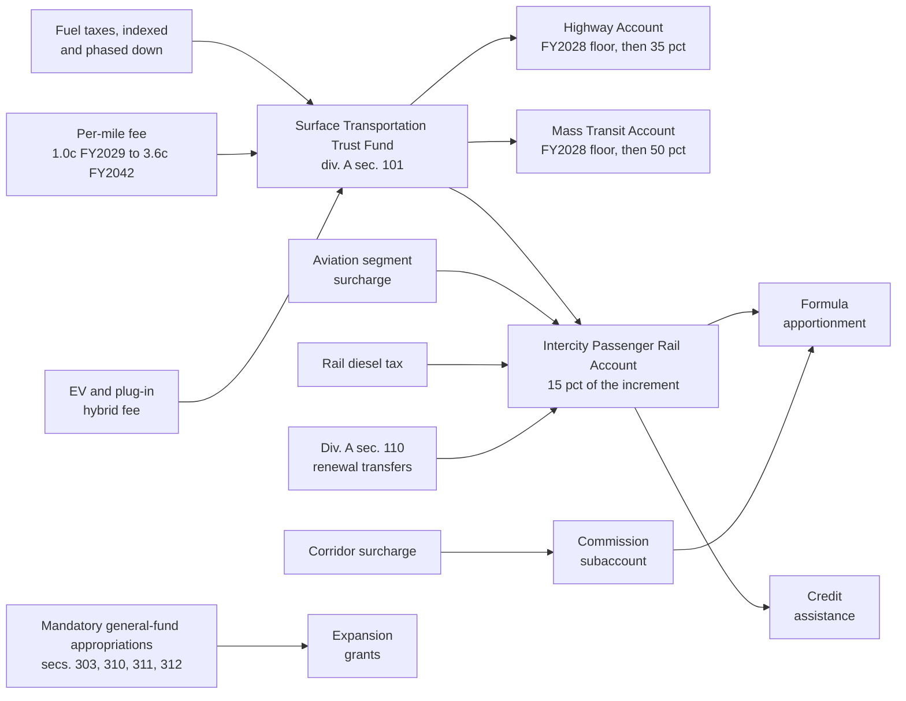
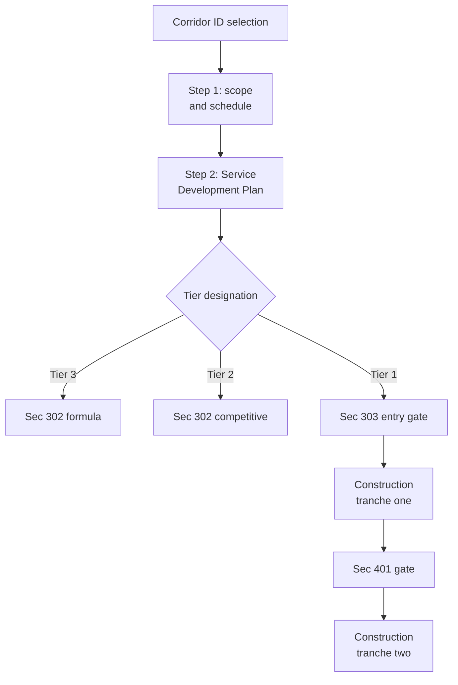
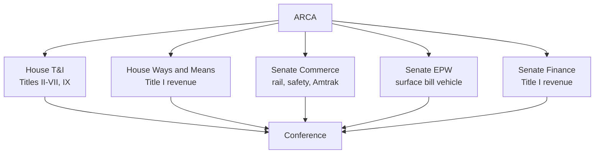

# American Rail Competitiveness Act of 2031 — Full Bill Architecture

> **Filed Oct 20, 2026** from the Surface Transportation claude.ai Project (ARCA doc, artifact 518f3bb4). Project paths are rewritten to their repo locations; the model scripts are in `index/tools/transportation/`. Where this file differs from `domains/transportation-moving-america-act-2031-draft-2.md` (Draft 2, canonical for MOV-), Draft 2 governs.


Sep 21, 2026 · @espen

## What changed from the September 2026 draft

Ten corrections separate this version from the source memo, and three of them change the architecture rather than the wording.

| # | Source draft said | This version does | Why |
| --- | --- | --- | --- |
| 1 | A $150-200B advance appropriation, "guaranteed the same way IIJA's money was" | Contract authority from the Intercity Passenger Rail Account of a reformed Surface Transportation Trust Fund, with an obligation limitation set in appropriations and continuation of renewal programs underneath | Advance appropriations are exactly what the September 2026 stopgap dropped. Contract authority is what has carried the Highway Trust Fund through 29 extensions |
| 2 | A dedicated aviation fee feeding the rail trust fund | The same fee, moved into a companion revenue title routed through Ways and Means and Senate Finance, structured as additive to the Airport and Airway Trust Fund rather than a diversion from it | A rail title moving through T&I, EPW and Commerce has no jurisdiction to levy an excise tax on enplanements. Without a revenue-title strategy the trust fund is undrafted |
| 3 | ConnectUS National Network "roughly 70-80 percent funded" | Recount that separates operating support from corridor expansion capital; the expansion ask is closer to a third funded | Amtrak's National Network grant is largely long-distance operating subsidy. Counting it against a corridor capital ask overstates progress and undersizes the bill |
| 4 | RRIF ceiling raised from $50B, as H.R. 8870 raises it, to $150B | Ceiling raised, plus appropriated credit risk premium assistance, a statutory processing clock, and master credit agreements | The ceiling is not the binding constraint — H.R. 8870 lifts it to $50B and it will still go unreached; the credit risk premium and Bureau throughput are. Raising a ceiling nobody reaches costs nothing and delivers nothing |
| 5 | Silent on host railroads | A full title on dispatching preference enforcement, access terms, and on-time performance, with a civil penalty and an expedited STB track | Tier 3 is defined as frequency and reliability, and reliability off the NEC is a dispatching problem. This is the cheapest provision in the bill |
| 6 | Freight capacity-benefit fee raising about $2B over six years | Dropped. Replaced by reinstating the 4.3 cent per gallon rail diesel tax repealed in 2007, and by the access title above | A fee that raises roughly $330M a year is not worth a war with the Association of American Railroads. The access provisions are worth more and cost the railroads less cash |
| 7 | Long-distance network protected from discontinuation, not funded | A dedicated long-distance preservation and renewal program with its own authorization line and fleet tranche | Long-distance routes are how a rail bill gets to 60 in the Senate. Protecting them without funding them leaves those votes unbought |
| 8 | No fleet, state-of-good-repair, ADA or workforce lines | Named programs for each, sized against the actual backlogs | These are large, unavoidable line items. Their absence is why a $150-200B top line reads as asserted rather than costed |
| 9 | Top line set by comparison to IIJA | Top line built bottom-up from corridor, fleet, backlog and crossing costs; the comparison to IIJA is reported afterward, not used to set the number | The instruction was to think critically about what the levels should be. A multiple of a prior bill is not a cost estimate |
| 10 | Political case reasoned from 2026 personnel | Case reasoned from committee jurisdiction and standing state interests | Capito is on the ballot this November, Graves is retiring, and a 2031 bill faces a Congress with a different cast |

**A second round of corrections, October 2026, from the companion transit work and CBO's September 30 estimate of H.R. 8870.** These are structural rather than marginal:

**Correction zero, and the largest of them: the fiscal years were wrong.** This bill authorizes **FY2032-36**, not FY2031-35. BUILD America 250 runs FY2027-31 with FY2031 as its final year, so a bill enacted in 2031 starts the following fiscal year. Earlier drafts had the two overlapping in FY2031, which the fiscal model carried as a live inconsistency — highways ran at H.R. 8870 levels through FY2031 while transit and rail were already at ARCA and ATRA levels in that same year, and the rail 250-Plus baseline covered only four years. Correcting it moves real conclusions, not just labels: the authorization-period draw falls from 0.185 to **0.174 percent of GDP**, headroom under the benchmark roughly doubles to **$12.4-16.6 billion a year**, the CBO-basis breach inside the bill's own window disappears, and a **$4.19 billion** surplus appears in the Mass Transit Account in FY2031 that division A has to dispose of. Authorization levels are unchanged in nominal terms and now read as FY2032 dollars.

1. **ARCA is division D**, not a standalone act. It keeps its short title; its Title I revenue and trust-fund provisions move to a shared division A reported by Ways and Means and Finance.
2. **One trust fund, three accounts.** The Highway Trust Fund is redesignated and gains an Intercity Passenger Rail Account. The highway and transit accounts are credited with their FY2028 receipts first; everything above those floors splits 35 / 50 / 15. The 8 / 15 / 22 / 28 percent rail share of *all* receipts is retired, and so is the standalone rail trust fund.
3. **No $132 billion transfer.** Reconciliation cannot transfer general-fund money into a trust fund, so rail expansion becomes mandatory general-fund appropriations ($93.20B for secs. 303, 310, 311 and 312) and the renewal shortfall is covered by division A section 110 transfers ($95.2B), on the IIJA precedent.
4. **The per-mile fee starts at 1.0 cent, not 0.6.** And its yield anchor was wrong: 2.4 cents a mile grosses about $80 billion on FHWA's 3,323.8 billion vehicle-miles, not the $44 billion earlier drafts assumed. Current receipts are replaced at about 1.4 cents.
5. **0.206 percent of GDP is a benchmark, not a limit** — not CBO's, not statute's. It is restated from 0.192 percent so that annual appropriations count the same way. The program exceeds it on CBO's net-of-offset basis, and that is a choice.
6. **Rail does not become self-financing.** Dedicated receipts reach 50 percent of the rail program by FY2042-46, not 101 percent. No surface account is self-financing on these projections.
7. **Greenfield capital is reconciliation-eligible** with obligation and expenditure deadlines, on the ARP section 3401 precedent — not "barred in practice."
8. **Transit is the majority payer at most joint terminals**, not a 30 percent contributor: commuter trains run 79 percent of movements at Chicago Union Station.
9. **RRIF's ceiling is $50 billion**, as H.R. 8870 raises it, and H.R. 8870 already concedes credit-risk-premium assistance at $250 million and extends eligibility to Amtrak and interstate compacts.
10. **The Corridor ID sunset extension is traded away** rather than conceded, in exchange for a guaranteed $22.0 billion tranche in 250-Plus.

Everything else in the source memo's diagnosis survives intact: the three real gaps are financing durability, accountability, and a permanent institutional home for interstate corridor planning.

## The real baseline

The authorized tier of IIJA delivered about 38 percent of what it promised, and that single fact drives the entire financing design below.

IIJA split rail money into two tiers: $66 billion in advance appropriations, written into the act and not subject to annual action, and roughly $36 billion in authorizations that had to win an appropriation every year. Program-level advance appropriation figures below are approximate, from the enacted division of IIJA rail funding.

| Program | IIJA advance appropriation, FY22-26 | IIJA authorization, FY22-26 | FY2026 enacted annual appropriation |
| --- | --- | --- | --- |
| Amtrak Northeast Corridor | \~$6.0B | \~$6.6B | $850M |
| Amtrak National Network | \~$16.0B | \~$12.7B | $1,577M |
| Federal-State Partnership (incl. $24B NEC-reserved) | \~$36.0B | \~$7.5B | $65M |
| CRISI | \~$5.0B | \~$5.0B | $137M |
| Railroad Crossing Elimination | \~$3.0B | \~$2.5B | $0 |
| Restoration and Enhancement | — | \~$250M | — |
| Interstate Rail Compacts | — | \~$15M | — |
| **Total** | **\~$66B** | **\~$34.5B** | **$2,629M** |

Run the comparison that matters, with a caveat attached below it. The authorized tier averaged roughly $6.9 billion a year. FY2026 appropriations for those same lines came to $2.63 billion — 38 percent — with the Railroad Crossing Elimination program funded at zero. Amtrak requested $2.427 billion in annual grants for FY2026 and received exactly that, because the request itself had already been written down to what appropriators would plausibly give. ([FY2026 THUD analysis](https://www.railpassengers.org/happening-now/news/blog/analysis-of-fy-2026-thud-rail-funding-and-provisions/); [Amtrak FY2026 Grant and Legislative Request](https://www.amtrak.com/content/dam/projects/dotcom/english/public/documents/corporate/reports/Amtrak-General-Legislative-Annual-Report-FY2026-Grant-Request.pdf))

FY2026 is a low-water mark rather than the norm, for two reasons specific to that year. It was the final year of IIJA authorizations, so appropriators could point to billions in unobligated advance appropriations as a reason to fund the annual tier thinly, and it reflects an administration that had requested outright cuts to Amtrak. The chronic pattern is milder and program-specific: Amtrak's core grants were funded close to their authorized levels in the pre-IIJA years, when no advance appropriation existed to point at, while competitive grant programs have run well below authorization in essentially every year. The next section applies that split rather than the FY2026 headline rate.

Everything real that happened between 2022 and 2026 was paid for out of the guaranteed tier. Amtrak's FY2026 capital program runs about $8.6 billion, roughly three and a half times its annual appropriation, and the difference is IIJA supplemental money. Amtrak projects 36.0 million passengers in FY2026 against 32.8 million in FY2024, an adjusted operating loss of about $416 million, and a 90.8 percent cost recovery ratio, with the passenger service segment projected to reach operational break-even in FY2028.

Two backlogs anchor the sizing work later in this document. The Northeast Corridor Commission puts corridor state-of-good-repair need above $100 billion over fifteen years, against the $117 billion Connect NEC 2035 program. And 163 of Amtrak's 382 stations are fully ADA-compliant, thirty-six years after the statute took effect, though Amtrak reports completing the components it is itself responsible for and targets full completion in FY2029. ([Amtrak station ADA status](https://railwaynews.net/amtrak-reports-163-of-382-stations-fully-ada-compliant.html))

The lesson the 2026 stopgap taught, and the reason correction 1 above matters: a stopgap can decline to renew an advance appropriation, and in September 2026 one did, taking $36.8 billion off the table and cutting passenger rail investment roughly 83 percent through December 11. Contract authority behaves differently. It is created by the authorizing act, it stays available for obligation, and appropriators control the pace through an obligation limitation rather than the existence of the money.

## The December 2026 compromise: BUILD America 250-Plus

ARCA is scoped against an assumed lame-duck deal that authorizes about $73 billion for rail over FY2027-31 and actually delivers something closer to $60 billion. This section constructs that deal explicitly so the delta is legible; it is a forecast, not an enacted law.

The negotiating logic is narrow. Graves needs a bill with his name on it before he loses the gavel. Senate Democrats, stronger after the midterms whether or not they hold a majority, have one demand worth spending capital on, which is restoring guaranteed funding rather than adding authorized dollars that appropriators will not honor. Republicans trade a partial guarantee for the accountability and cost-share provisions already in H.R. 8870. Nobody relitigates structure.

| Program | H.R. 8870 as reported | BUILD America 250-Plus, FY2027-31 | Of which guaranteed |
| --- | --- | --- | --- |
| Amtrak Northeast Corridor | $10.4B | $11.5B | $6.0B |
| Amtrak National Network | $20.7B | $22.0B | $10.0B |
| National Intercity Passenger Railroad Partnership Program | $18.5B | $24.0B | $6.0B |
| CRISI | $9.1B | $10.0B | — |
| Railroad crossing safety and elimination | $3.65B | $5.0B | — |
| Corridor ID and planning | not separately stated | $750M | — |
| Interstate rail compacts | folded into NIPRPP | $50M set-aside | — |
| Restoration and Enhancement | folded into NIPRPP | $500M set-aside | — |
| **Total** | **\~$62.4B** | **\~$73.3B** | **$22.0B (30%)** |

The policy riders come along largely as the House wrote them: the Railway Safety Act provisions already adopted by amendment, the Nationally Significant Rail Station Modernization Act authority, declining federal cost shares and business-plan requirements in NIPRPP, the Amtrak mission rewrite toward financial performance, and FOIA-style transparency for the Amtrak board. There is no Corridor ID sunset extension. Earlier drafts had the Senate conceding one, from October 1, 2031 to October 1, 2033; it is traded away instead, because division D makes Corridor ID permanent in any event and a one-section extension act can move the date if the 2031 bill slips. The guaranteed tranche is worth more than the extension.

### What it actually delivers

Authorization is not money, and the delivery rate differs sharply by program type. Amtrak's core grants have historically been appropriated close to their authorized level once no advance appropriation exists to point at; competitive programs have not. Applying program-specific rates to the $51.3 billion of BUILD America 250-Plus that is not guaranteed:

| Line | H.R. 8870 as written: authorized, none guaranteed | 250-Plus: authorized | 250-Plus: of which guaranteed (Senate trade) | Not guaranteed | Assumed delivery on the rest | Delivered |
| --- | --- | --- | --- | --- | --- | --- |
| Amtrak NEC and National Network | $31.07B for both together | $33.5B | $16.0B (NEC $6.0B, National Network $10.0B) | $17.5B | 90% | $31.8B |
| National Intercity Passenger Railroad Partnership Program | $27.61B with CRISI together | $24.0B | $6.0B | $18.0B | 65% | $17.7B |
| CRISI | included in the $27.61B above | $10.0B | none | $10.0B | 70% | $7.0B |
| Grade crossings | $3.65B | $5.0B | none | $5.0B | 50% | $2.5B |
| Corridor ID and planning | within the $27.61B above | $0.8B | none | $0.8B | 80% | $0.6B |
| **Total** | **$62.4B** | **$73.3B** | **$22.0B** | **$51.3B** |  | **$59.6B** |

The column headings matter more than the figures. **H.R. 8870 guarantees rail nothing** — its $62.4 billion is authorization, every dollar of it subject to annual appropriation, which is why the delivery rates above are applied at all. What 250-Plus adds is both more authorization, to about $73.3 billion, and for the first time a guaranteed tranche of $22.0 billion, about 30 percent, as the price of the Senate concessions. The $59.6 billion delivered figure is the guaranteed tranche plus an assumed rate on the unguaranteed remainder; it is not a forecast of appropriations.

**Three general-fund grant programs in the same bill are also reachable, and the table above leaves them out.** H.R. 8870 authorizes $10 billion of National Infrastructure Grants at its section 7105, which Amtrak can access in partnership with a State or a compact; $6 billion of multimodal freight grants; and $10 billion for the Bridge Investment Program. None are in the rail title, none are guaranteed, and all three are discretionary general-fund money rather than trust-fund contract authority. They do not belong in the rail delivery figures, but a sponsor assembling a capital stack in FY2027-31 should know they exist. **Whether they count against the general-fund benchmark is an open question** — $26 billion is not a rounding error against an $11 billion annual headroom, and the model does not currently count them.

**ARCA's own FY2031 figure is $13.3 billion, not the $13.7 billion the transit model assumed.** It is the residual of the delivered total above: $59.6 billion across FY2027-31 less the $46.3 billion delivered in FY2027-30 (10.5 / 11.0 / 11.9 / 12.9). The fiscal model now carries $13.3B.

**FY2031 is a cliff year, and it is the calendar correction's one genuinely bad consequence.** Rail falls from about $37 billion in FY2030 — 250-Plus delivery plus the reconciliation tranche — to $13.3 billion in FY2031, then back to $39.95 billion in FY2032 when the Moving America Act starts. Transit falls from $40.2 billion to $20.7 billion on the same path. Nothing is wrong with the arithmetic: it is what happens when a five-year bill ends and the reconciliation money has already been spent. There is roughly $48 billion of room under the benchmark in FY2031, so the fix is affordable — the 2030 package should carry availability **through** FY2031, which stays inside the Byrd window provided each line keeps its obligation and expenditure deadlines.

**And the Corridor ID new-selection sunset now falls on the bill's first day.** October 1, 2031 is the first day of FY2032. Section 313 makes the program permanent from that date, so there is no gap if the bill is enacted on time, and a one-section extension act covers a slip. That is a tidier result than the sunset extension earlier drafts spent a concession on.

### A discipline rule about the 2026 bill

Every figure in this section for FY2027-31 is modelled, and the model has perfect knowledge of a program that will not be written for five more years. Lawmakers in December 2026 do not. **The rule from here on: nothing in 250-Plus may be sized to anything in this document.** Three consequences.

First, **H.R. 8870 as written contains no general-fund transfer at all.** It authorizes contract authority against accounts CBO projects will run dry — the highway account in FY2028, the transit account in FY2027 — and does not fix them. That is the baseline. The model's general-fund column for FY2027-31 is an *inference about what Congress would have to do later*, mostly through annual appropriations, not a provision of any bill.

Second, **the 250-Plus transfer this document proposes stays at $108.0 billion** — $71.2 billion highway and $36.8 billion transit, CBO's cumulative shortfall through FY2030. It is **not** grown to the $147.7 billion that the shortfall through FY2031 would justify, even though FY2031 is now 250-Plus's last year. A 2026 Congress sizes a patch to the cash in front of it, in increments, the way it did repeatedly between 2008 and 2014. It does not pre-fund five years of deficit because a bill nobody has drafted will later want the accounts solvent.

Third, and this is the reassuring part: **nothing in FY2032-46 depends on the size of the 2026 transfer.** The rail account's receipts in FY2029-31 come from the per-mile fee enacted at the FY2028 forcing event, not from a 2026 patch, and the $4.19 billion that accumulates in the Mass Transit Account in FY2031 is fee revenue. The forcing event does the work, which is the whole reason it is the hinge of this design. What the transfer size *does* affect is whether the highway and transit accounts are solvent on the day the Moving America Act starts — and if the answer is no, division A section 101(c)(1)'s FY2028 floors are being credited against receipts already spoken for. **That is a real risk and it is not currently modelled.**

### The largest unverified premise in this design

The same discipline rule, applied honestly, puts a question mark over something load-bearing. **The transfer and the fuel-tax extension are the same title of the same bill, and every reauthorization since 1982 has extended the expiring taxes to at least the end of its own authorization period.** IIJA extended the Highway Trust Fund excises through September 30, 2028. A bill covering FY2027-31 meets that expiration three years in, and the ordinary thing for it to do is push the taxes out to FY2031 or FY2032 along with whatever transfer it makes.

If 250-Plus does that, **the FY2028 forcing event this design is built on does not happen.** The consequences are not marginal:

- the per-mile fee starts FY2032, not FY2029;
- the rail account has no FY2029-31 receipts, so "the account opens already funded" goes away, and so does the $4.19 billion transit balance;
- rail's dedicated coverage in FY2032-36 falls well below 27 percent, because the fee sits at 1.0 cent in the bill's first year instead of 1.6;
- division A's revenue title becomes the *first* structural surface revenue legislation rather than a reform of one already enacted, which is a materially harder vote.

The counter-argument is that insolvency is a separate forcing event from expiration: CBO has the highway account dry in FY2028 whichever way the taxes go. But a cash crisis is answerable with another transfer, which is what Congress has always done. It is the **expiration** that makes a structural fix unavoidable, because somebody has to re-legislate the rate. Extend the taxes and the structural moment moves to 2031.

This is carried as the base case because the FY2028 expiration is in current law and the design is coherent on it. **It has not been modelled the other way, and it should be before the bill is scored.** The variant is not obviously worse — one revenue bill in 2031 is a cleaner story than a 2028 reform plus a 2031 refinement — but it is a different bill, and the numbers move a long way.

Add the $22 billion guarantee and the five-year cycle delivers roughly $60 billion against $73 billion authorized. Using the FY2026 headline rate of 38 percent instead would put delivery near $52 billion, which is too pessimistic: it generalizes a single year shaped by the end of the IIJA cycle and by an administration requesting cuts.

| Measure | IIJA, FY2022-26 | BUILD America 250-Plus, FY2027-31 |
| --- | --- | --- |
| Authorized total | \~$102B | \~$73B |
| Guaranteed share | \~$66B (65%) | $22B (30%) |
| Plausible delivery | \~$80-85B | \~$60B |
| In FY2027 dollars, authorized | \~$118-120B | \~$73B |

That is a real-terms cut of roughly 40 percent in authorization and roughly 28 percent in delivered dollars, during a period when the NEC backlog compounds and the long-distance fleet passes fifty years old.

### What it does not do, which is the space ARCA occupies

- **No fleet program.** Amtrak has cancelled its bi-level procurement and committed to a universal single-level long-distance fleet with first deliveries in the early 2030s, and no authorization line anywhere funds it. ([Amtrak fleet strategy](https://media.amtrak.com/2026/02/amtrak-announces-new-and-improved-long-distance-fleet-replacement-strategy/))
- **No dedicated revenue.** Every dollar still competes inside the general fund or the Highway Trust Fund's existing base.
- **No permanent corridor institutions.** Corridor ID still sunsets on October 1, 2031 and the commissions do not exist.
- **Nothing on host railroads.** Dispatching preference, access terms and on-time performance are untouched.
- **No ADA, state-of-good-repair or workforce lines.**
- **No Tier 1 program.** There is no federal program whose purpose is building a high-speed line.

### The other half of the baseline: permitting

The December 2026 lame duck is likely to carry a second bill that matters as much to this document as the reauthorization does. The **American Affordability and Jobs Act**, introduced September 30, 2026 by Capito, Lee, Whitehouse and Heinrich, rewrites the environmental review baseline for every mode. ([EPW announcement](https://www.epw.senate.gov/public/index.cfm/2026/9/whitehouse-capito-heinrich-lee-introduce-bipartisan-american-affordability-and-jobs-act-of-2026); [Holland & Knight analysis](https://www.hklaw.com/en/insights/publications/2026/10/bipartisan-senate-committee-leaders-release-permitting-reform-text))

What ARCA would inherit if it passes:

| Provision | Effect on rail |
| --- | --- |
| Two-year EIS and one-year EA deadlines, enforceable by the sponsor | Compresses the review itself, though agencies will miss deadlines absent staff |
| 150-day filing window, courts of appeals, standing tied to commenting | Collapses the litigation tail that actually sets greenfield schedules |
| Remand rather than vacatur; no injunction for a NEPA or historic-preservation violation alone | **The single largest change.** Construction continues while a challenge is remedied |
| Programmatic reviews valid 10 years instead of 5 | Makes a national or regional first-tier high-speed review genuinely worth doing |
| Nationwide Permit 14 maintained, 10-year term, under-2-acre discharges deemed minimal | Covers most Tier 3 work: sidings, culverts, double-tracking |
| Section 106 narrowed, with staged deadlines running with NEPA | Helps, but see Section 4(f) below |
| Title IV bar on revoking permits and records of decision | Protects approvals — but almost certainly not grant agreements |

And four gaps that fall on rail specifically. The bill is energy-centric, and it shows:

- **No Endangered Species Act parity.** The right-of-way exemption rides on MAP-21 section 1316, which covers highway and transit work in existing operational right-of-way and not FRA intercity rail. Tier 3 work happens almost entirely in existing right-of-way, so rail pays a consultation cost that transit does not.
- **The grant carve-outs probably miss rail.** NEPA's narrowed "major Federal action" excludes grant-only projects where the agency lacks predominant control. FRA exercises predominant control over its grants; FHWA and FTA often do not. The practical result is that the bill accelerates highway and transit projects more than rail ones.
- **Section 4(f) is untouched**, as are Coast Guard bridge permits and the Corps' section 408 review. Rail is bridge-heavy and runs through old urban rights-of-way full of 4(f) resources. Narrowing section 106 while leaving 4(f) at the old standard moves the bottleneck rather than removing it.
- **Funding is unprotected.** Title IV shields permits and records of decision for non-federal sponsors; grant agreements sit outside it, and the disparate-treatment damages in its companion section cover 47 project types, none of them transportation. **A California-style grant termination remains fully available.**

**Contract authority does not change this, and the reason matters for how Title III is drafted.** The control test follows the *selection decision*, not the budget mechanism. Whether money reaches a project as contract authority available on enactment or as an annual appropriation, the question is still whether the agency picks the project, conditions its scope and signs the agreement — and section 106(a) makes "approval of a project under this Act" a contractual obligation of the United States, which is exactly the discretionary federal act that establishes control. What actually spares many FHWA projects is not contract authority; it is **formula apportionment plus State project selection.** Federal-aid highway money is all three, and the carve-out rides on the second and third.

So the distinction runs *inside* this bill rather than between rail and highways. **Section 302's Tier 3 formula program has a genuine claim to reduced federal control; section 303's Tier 1 gated program does not, and should not.** That is the uncomfortable trade in Title IV: every accountability gate — the section 401 entry requirements, the section 403 match conditions, the section 106(c) contingent-commitment conditions — is a fact establishing predominant federal control. **A program cannot hold the gates and claim the carve-out at the same time.** The right answer is to keep the gates on Tier 1, where a thirty-billion-dollar greenfield corridor ought to be federally conditioned, and to draft Tier 3 deliberately thin on project-level federal approval so that the formula tier can ride the narrowed definition.

One further wrinkle runs the other way. Contract authority available on enactment lets the Secretary obligate earlier, but NEPA must still be complete before the obligation that commits federal money to construction. Contract authority therefore **sharpens** the mismatch between money and clearance rather than relieving it — which is an argument for the section 106(e) readiness reserve and the section 301(e) tiered reviews, not for expecting a permitting carve-out to do the work.

The net for rail: roughly 18 to 30 months of schedule on a greenfield corridor and 12 to 18 months on an upgrade, against three to four years for a highway project. Which is why Title IX of this bill is no longer a general permitting title. It is a parity title.

## The 2029-30 reconciliation window

A climate and fair-economy reconciliation package in 2029 or 2030 can put roughly **$48.5 billion** of rail money in place before ARCA is written, but almost none of it can be greenfield construction. The Byrd rule decides the composition, and it rules out most of what a rail advocate would reach for first. Reconciliation cannot transfer general fund money to a trust fund, because an intragovernmental transfer produces no change in outlays or revenues — a rule that, as set out below, constrains ARCA rather than this package. It cannot create contract authority subject to an annual obligation limitation, because those outlays score against appropriations bills instead. It cannot reauthorize programs subject to annual appropriation, which is what CRISI, the Federal-State Partnership and Corridor ID currently are. And it cannot fund slow-spending programs at all, because outlays falling outside the ten-year window are themselves a Byrd violation — the standing example in the literature is high-speed rail, where $1.3 billion of a $2.5 billion FY2010 appropriation was still unspent a decade later. ([Eno Center analysis](https://enotrans.org/article/with-unified-democratic-control-can-budget-reconciliation-be-used-for-infrastructure/); [CRS RL30862](https://www.congress.gov/crs-product/RL30862))

**One distinction inside that third constraint, because it decides how much of this package is real.** Reconciliation cannot *reauthorize* a discretionary program, but it can *appropriate to* one. A provision reading "there is made available to the Secretary $3,500,000,000 to carry out section 25101 of title 49, United States Code, to remain available until expended" creates budget authority that scores in the reconciliation bill, sits outside both the annual appropriations process and any obligation limitation, and is precisely the instrument the Inflation Reduction Act used. What is extraneous is raising section 25101's *authorization ceiling*, or changing its eligibility, federal share or program design, because those produce no direct spending of their own — appropriators would still have to act. **Fund the program; do not amend it.** Every line in the table above is drafted that way, the $3.5 billion for Corridor ID included.

Two consequences follow, one better than a reauthorization and one worse.

The better one: **a mandatory appropriation available until expended is more durable than an authorization.** An authorization must be refilled by appropriators every year and can simply not be; money already appropriated and obligated into an executed grant agreement cannot be clawed back the same way. That is the lesson of what survived from the Inflation Reduction Act, and it is the central argument for doing any of this in 2029 rather than waiting for 2031.

The worse one: the money rides the **existing** program's rules. A reconciliation appropriation to carry out section 25101 inherits section 25101's escalating non-federal match — none at Step 1, 10 percent at Step 2, 20 percent at Step 3 — which is the very thing gating the city, county and regional sponsors this document has identified as stalled. But there is a way through, and it is the most useful drafting point in this section. **The Byrd rule's first test expressly permits "a change in the terms and conditions under which mandatory outlays are made."** Conditions attached to the new money are therefore available even though changes to the underlying program are not: a 100 percent federal share for sponsors below a stated capacity threshold, an obligation deadline, a set-aside for disadvantaged communities. Each rides as a condition on the appropriation rather than as an amendment to the program — which means it reaches only that money, and ARCA still has to make it permanent in 2031.

**And one of those constraints is in the wrong column.** The bar on transferring general fund money to a trust fund does not bind this package at all. Nothing in the table below is such a transfer: there is no rail account in 2029 or 2030 to transfer into, and every line is either a direct general-fund appropriation carrying out an existing authority or a revenue provision whose receipts go to the general fund until division A creates the Surface Transportation Trust Fund in 2031.

Where the rule used to bite was on **ARCA**, whose earlier draft capitalized a standalone rail trust fund with a $132 billion transfer — something reconciliation could never do, at any time, however the fund was structured. That is why the transfer is gone. And the replacement is not a workaround: ARCA funds expansion with mandatory appropriations and renewal with division A section 110 transfers, and the 2031 reauthorization moves under regular order, where general-fund-to-trust-fund transfers are permitted — it is reconciliation, not the Constitution, that forbids them.

So the rule's real function is to say what reconciliation **cannot take off ARCA's plate.** Reconciliation can hand the 2031 bill a created trust fund, two flowing revenue streams, a roughly $11 billion opening balance and a cleared project pipeline. It cannot hand it the single largest financing item in the bill, which still has to be won in regular order with sixty votes. One corollary worth drafting around: the fund reconciliation creates is a **user-fee fund, not a general-revenue fund**, which is good for durability — fee receipts flow without appropriators — and means the general-revenue leg is structurally a 2031 problem that no amount of pre-positioning in 2029 can solve.

| Instrument | Byrd status | Why |
| --- | --- | --- |
| New mandatory general-fund spending for rail grants | **Available** | Direct spending; the IRA model, e.g. "there is made available to the Secretary $X to carry out…" |
| Excise tax or user fee increase deposited to a trust fund | **Available** | Revenue change; 1990 reconciliation raised motor fuel taxes and deposited half in the Highway Trust Fund |
| Credit subsidy for RRIF lending | **Available, and the cleanest** | FCRA scores the subsidy cost at obligation, so none of it falls outside the window |
| New contract authority exempt from obligation limitation | Available but costly | Byrd-legal; appropriators fight it hard |
| General fund transfer into the Rail Trust Fund | **Barred** | Intragovernmental transfer; no change in outlays or revenues. This is the reason ARCA has no rail trust fund to transfer into: the 2031 bill uses mandatory appropriations for expansion and division A section 110 transfers for renewal, and the $132 billion transfer earlier drafts carried is gone |
| Contract authority under an obligation limitation | **Barred** | Outlays score against appropriations, not reconciliation |
| Raising CRISI, partnership or Corridor ID authorization levels | **Barred** | Programs subject to annual appropriation — but a direct appropriation to carry them out is available |
| Greenfield high-speed capital | **Available with obligation and expenditure deadlines** | Outlays run past the ten-year window unless the grant itself pulls them inside it. On the American Rescue Plan section 3401 precedent, a capital grant for a project not yet under agreement — Capital Investment Grants included — is reconciliation-eligible where the statute fixes both an obligation deadline and an expenditure deadline. Earlier drafts had this as barred in practice, which was wrong |
| Preference enforcement, dispatching, Amtrak reorganization, permitting parity | **Barred** | Policy with merely incidental budgetary effect |

The constraint is clarifying rather than crippling. What survives it is precisely the set of things ARCA most needs to inherit: a funded planning pipeline, a fleet, an electrified spine, and lending capacity.

### Two packages, sized to the spend-out test

| Provision | Package | Amount | Why it clears the window |
| --- | --- | --- | --- |
| RRIF credit risk premium subsidy | 2029 | $6.00B | Subsidy cost scores at obligation |
| Zero-emission rail: electrification and trainsets | 2029 | $9.00B | Equipment orders and discrete catenary segments |
| State-of-good-repair backlog, NEC and national | 2029 | $8.00B | Documented, designed, shovel-ready |
| Amtrak long-distance fleet replacement | 2029 | $5.50B | Firm delivery schedule against a Superliner fleet past life |
| Corridor ID planning and design | 2029 | $3.50B | Consultant-paced; spends in four to six years |
| Station access and ADA backlog | 2029 | $3.00B | Small discrete projects |
| RRIF credit risk premium subsidy, second tranche | 2030 | $4.00B | As above |
| Grade crossing elimination | 2030 | $4.00B | Discrete, locally delivered |
| Electrification, second tranche | 2030 | $3.00B | As above |
| Workforce and domestic supplier base | 2030 | $2.50B | Grants and cooperative agreements |
| **Total budget authority** |  | **$48.50B** |  |
| Aviation segment surcharge enacted, effective FY2031 at $4; rail diesel 10¢ and 5¢ | 2030 | revenue | A revenue change, so Byrd-eligible on the 1990 precedent. But there is no surface fund in 2030 to deposit it in, so receipts go to the general fund until division A section 104 credits them to the rail account from FY2031, outside the three-way split |

**Two drafting requirements run across every capital line above.** First, each one carries both an **obligation deadline and an expenditure deadline** in the statutory text. That is not housekeeping — it is what makes greenfield capital reconciliation-eligible at all, on the American Rescue Plan section 3401 precedent, by pulling the outlays inside the window rather than leaving them to run past it. A capital grant for a project not yet under agreement is available in reconciliation if, and only if, the statute fixes when the money must be obligated and when it must be spent.

Second, **both instructions go to Finance and Ways and Means as well as to Commerce.** The grant lines could be reported by Commerce alone, but the aviation surcharge and the rail diesel tax cannot, and splitting them across two reconciliation bills loses the pairing that makes the revenue vote defensible. One instruction, three committees.

**The $10 billion of credit subsidy is the largest item in the package, not the smallest.** Nothing else in reconciliation is as efficient: FCRA scores only the subsidy cost, so a credit subsidy appropriation is the one rail provision with no spend-out risk at all. At credit risk premiums in the range rail projects have actually been quoted, $10 billion supports somewhere between $60 and $80 billion of face-value lending — more investment than every grant line above it combined. It also attacks the constraint identified earlier in this document: RRIF's $50 billion ceiling, as H.R. 8870 raises it, has never been the binding limit, the premium a sponsor must post has been. Reconciliation can buy that premium down in a way the 2031 authorization would struggle to.

**What this does to ARCA.** Four things, in descending order of importance. First, **the revenue fight is already over.** The aviation segment surcharge and the rail diesel tax are enacted in the 2030 package and flowing, so ARCA steps the segment fee from $4 to $12 across FY2032-36 and raises the diesel rate from 10 and 5 cents to 15 and 7.5 cents, rather than creating either — a materially easier vote.

Second, **the rail account opens already funded, and the transit account opens over-funded.** Division A's revenue provisions take effect at the FY2028 forcing event, not with this bill, so both accounts receive their share of incremental receipts for three years — FY2029, FY2030 and FY2031 — before ARCA is enacted. Rail's $14.9 billion across those years runs against a 250-Plus-sized rail program and is absorbed. Transit's is not: in FY2031 its dedicated receipts of $24.9 billion exceed its 250-Plus program of $20.7 billion, leaving **$4.19 billion with nowhere to go.** Division A has to say what happens to it — carry it forward as an opening balance, which is the defensible version of the claim earlier drafts made about $11 billion, or delay the three-way split to FY2032 and forgo it. There is no general-fund transfer into a rail trust fund for an opening balance to shrink; that framing, and the $143.0 billion and $132 billion figures that went with it, are superseded.

Third, **ARCA can obligate on day one**, because the Corridor ID money arrives in 2029 and the pipeline crests inside the BUILD America 250-Plus years instead of ARCA's own. Fourth, **section 106(e)'s $25 billion readiness reserve is retargeted** from generic readiness to Tier 1 design maturity — now written into subsection (e)(1) as a 30 percent design threshold rather than only described here — which the cost analysis above identifies as the condition that makes schedule compression reduce cost rather than raise it.

The case for doing any of this in reconciliation rather than waiting for 2031 is durability. A mandatory appropriation available until expended, obligated into an executed grant agreement before January 2033, is far harder to unwind than annual appropriations or obligation-limited contract authority — which is the lesson of what survived from the Inflation Reduction Act and what did not. That is also the gap section 407 exists to close: the 2026 permitting law protects issued permits and says nothing about executed grant agreements.

## The FY2027-31 baseline, modeled

Twenty-seven months into the Corridor Identification and Development Program, not one of its corridors has received a Step 3 obligation. That single fact from the March 31, 2026 status report is the most important input to this whole design, because it means the constraint ARCA inherits in 2031 is a planning pipeline that has barely moved, not a shortage of projects wanting money.

### Where the pipeline actually stands

The program runs in three steps: Step 1 is scope, schedule and cost estimate for a service development plan; Step 2 is preparing the SDP itself; Step 3 is NEPA and preliminary engineering. Of roughly 67 corridors on the March 2026 report:

| Stage | Corridors | Obligated |
| --- | --- | --- |
| Step 1 obligated | \~60 | \~$29M |
| Step 2 obligated by FRA | 5 | $64.97M |
| Step 2 entered via a CRISI grant instead | 2 | not stated |
| Step 3 obligated | **0** | **$0** |
| No obligation of any kind | \~4 | — |

The five Step 2 obligations are Cascadia High-Speed Rail ($49.75M, November 2024), Amtrak to Long Island ($5.08M, July 2025), Scranton to New York Penn ($4.91M, December 2024), Boston and Albany ($3.56M, May 2025), and the Downeaster ($1.68M, December 2024). Atlanta-Savannah and the Colorado Front Range reached Step 2 through CRISI awards rather than through the program.

Two structural facts sit behind those numbers. FRA drew the program's entire planning envelope — **$1.8 billion**, from the Federal-State Partnership program — for all 69 corridors, and roughly $29 million of it had been obligated in Step 1 grants after 27 months — about sixty corridors at $500,000 each, or 1.6 percent of the envelope. Step 2 obligations sit outside that line and are much larger: Cascadia alone carries $49.7 million. And the steps carry escalating non-federal match: **none at Step 1, 10 percent at Step 2, 20 percent at Step 3**. A sponsor that is a city, a county or a regional authority without a state DOT behind it can do everything the program asks and still be unable to advance, because it cannot put up the match. That is the mechanism behind most of the corridors this document later finds never reach construction, and it is why section 301's funded-step structure and section 501's commissions are aimed at the same problem from two directions. ([FRA Corridor ID StoryMap, November 2025](https://storymaps.arcgis.com/stories/e1f1bd55cfad489a859cc8905d0dad16))

Three things follow from that table. Cascadia is not the laggard this document treated it as in an earlier draft — its single obligation is 77 percent of all Step 2 money in the country, and it is by a wide margin the best-funded corridor planning effort anywhere. Every Tier 1 candidate other than Cascadia is still sitting on a $500,000 Step 1 obligation, including Charlotte-Atlanta, Fort Worth-Houston and Dallas-Fort Worth-Houston. And the step that actually produces a buildable project, NEPA under Step 3, has not begun anywhere.

### The attrition nobody scored

FRA selected **69** corridors in FY2022. The March 2026 report lists **67**. The two that left are Amtrak's Dallas-Houston high-speed corridor and California High-Speed Rail Phase 1 — the two largest high-speed projects in the country, gone from the program inside three years, after Amtrak withdrew from Texas and FRA terminated roughly $4 billion of California's grants.

**California is the case this document must not read backwards.** Leaving Corridor ID and losing $4 billion of federal grants are real setbacks, but neither touches the project's ability to keep building toward San Francisco, and this model should not treat them as if they did. Corridor ID is a planning program whose entry prize is $500,000 — California has no use for it. The authority won **full Phase 1 environmental clearance, San Francisco to Los Angeles, in 2024**, so the alignment to the Bay Area is cleared and the section 313 and 906 review provisions below are irrelevant to it. And in 2025 California extended cap-and-invest to 2045 with **$1 billion a year dedicated to high-speed rail** (AB 1207 and SB 840), which is roughly $20 billion of state revenue that no federal administration can rescind and which the authority says closes the funding gap on the Central Valley early operating segment outright. The federal pipeline lost California; California did not lose the railroad. This document therefore carries Merced-San Jose-San Francisco and Bakersfield-Palmdale as live construction in the 2030s, reaching service by the early 2040s, with ARCA's Tier 1 money accelerating them rather than deciding whether they happen. ([CAHSRA funding](https://hsr.ca.gov/work-with-us/investors/))

That changes how the high-speed pipeline should be read. Seven high-speed corridors were selected; five remain; three of those five are still sitting on a $500,000 Step 1 obligation, and the fifth is Brightline West, which is privately financed and would be building with or without the program. The surviving federal high-speed pipeline, stripped of the private project, is four corridors — three still at Step 1 on $500,000 each, and Cascadia, which is well into Step 2 on a great deal more. That is a statement about the pipeline, not about the country: the largest high-speed project in America is proceeding on state money entirely outside it.

**Correction, and it cuts against the paragraph above.** Cascadia is not sitting on a Step 1 grant. WSDOT's own December 2025 report to the Washington Legislature records two Corridor ID awards: $500,000 for Step 1 in December 2023, whose deliverables FRA accepted in November 2024, and then a Step 2 award in November 2024 of **$49.7 million in federal funding, "awarded and obligated," against a $5.5 million state match.** Cascadia alone has therefore drawn about **$50.2 million** of Corridor ID money, so the four non-private high-speed corridors have drawn roughly $51.2 million rather than $2 million. Three of the five remain at Step 1, not four: Charlotte-Atlanta, Fort Worth-Houston and High Desert. ([WSDOT Corridor ID status report, December 2025](https://wsdot.wa.gov/sites/default/files/2025-11/CascadiaHighSpeedRail-Report-CorridorIdentificationDevelopmentProgram-December2025.pdf))

Two things follow that matter more than the arithmetic. **Corridor ID is a pipeline, not a repeated competition.** WSDOT states plainly that it "does not need to compete for funding in subsequent phases as long as requirements to advance to the next step are met" — so the program's gating is deliverable acceptance, not annual grant selection, and section 301's obligation deadline is doing more work than this document credited it with. And the apparent conflict with the $29 million figure used earlier resolves cleanly: **that $29 million is the Step 1 total** across roughly sixty corridors at $500,000 each, not program-wide obligations. Cascadia's $49.7 million is a Step 2 obligation and sits outside it. Both figures are right; the earlier one was described too broadly, and is corrected above.

**One Cascadia-specific risk this document should carry.** Under 2025 ESSB 5161, WSDOT "may not move forward with programmatic environmental review unless authorized to do so by the legislature," and the agency repeats that it will not advance any other Corridor ID activity without that authorization. The service development plan completes at the end of 2028, and route alignment and station locations are not chosen until after that. So the 2033 groundbreaking modeled here rests on a Washington State legislative authorization that has not been given — a sponsor-side gate that no federal permitting reform touches, and the kind of constraint the corridor grid cannot see.

Two drafting consequences follow. Section 301's removal rule has to be written so it cannot be used to purge a corridor whose sponsor did everything asked of it, which is why the clock runs from the Step 2 obligation rather than from selection. And section 303's per-corridor cap matters more than it first appears: with this much attrition at the top, a program that let one corridor absorb half the money would be one withdrawal away from having nothing to show.

### Three political phases, FY2027-31

| Phase | Period | What governs |
| --- | --- | --- |
| Lame-duck enactment | Dec 2026 - Jan 2027 | BUILD America 250-Plus passes with $22B guaranteed and $51.3B authorized. Graves closes his deal before losing the gavel; Senate Democrats trade policy riders for a partial guarantee |
| Divided government | FY2027-28 | A Democratic House writes the first appropriations number and a Trump DOT controls whether awards actually go out. The authorized tier is funded at roughly 60-65 percent, and discretionary obligations move slowly: NOFOs late, awards contested, Step 3 still barely started |
| Restoration | FY2029-31 | A Democratic administration re-staffs FRA and clears the obligation backlog. The authorized tier reaches 80-87 percent. This is when Step 2 completions and the first Step 3 obligations actually happen |

| Fiscal year | Guaranteed | Appropriated | Delivered | Share of the authorized tier |
| --- | --- | --- | --- | --- |
| 2027 | $4.4B | $6.1B | $10.5B | 59% |
| 2028 | $4.4B | $6.6B | $11.0B | 64% |
| 2029 | $4.4B | $7.5B | $11.9B | 73% |
| 2030 | $4.4B | $8.5B | $12.9B | 83% |
| 2031 | $4.4B | $8.9B | $13.3B | 87% |
| **Total** | **$22.0B** | **$37.6B** | **$59.6B** | **73%** |

The shape matters more than the total. Two-thirds of the delivered money arrives in the last three years, which is also when the planning pipeline unclogs, so the projects that will be ready to build in 2031 are the ones that get their Step 2 and Step 3 money in FY2029-31 — a two-year runway, not a five-year one.

### Where the pipeline is in 2031

| Stage | March 2026 actual | End FY2028 | End FY2031 |
| --- | --- | --- | --- |
| Step 1 obligated | \~60 | 67 | 67 |
| Step 2 obligated or complete | 7 | 12-14 | 28-32 |
| Step 3 obligated | 0 | 1-2 | 10-14 |
| Environmental record of decision in hand | 0 new | 0-1 | 3-5 |

That is the honest answer to how many corridors can clear a section 303 or 302 gate on the day ARCA is enacted: three to five with a completed environmental record, ten to fourteen with NEPA underway, and roughly thirty with a service development plan good enough to compete for capital. Everything else in the pipeline is still a plan for a plan.

### What is physically built by the end of FY2031

The planning pipeline and the service network run on different clocks, and the slow pipeline above should not be read as a slow decade. Three Corridor ID corridors are **already carrying new trains**: the Borealis began Chicago-St. Paul service in May 2024, the Mardi Gras Service opened New Orleans-Mobile in August 2025, and the Ethan Allen Express reached Burlington in 2022. All three sit on corridors whose Corridor ID planning is still at Step 1 or Step 2. Roughly $18 billion of partnership-program capital and $7 billion of CRISI flow in FY2027-31, and a partnership grant requires one discrete project with its own environmental clearance, not a finished service development plan.

- **About 19 corridors carry new or improved service by FY2031**, and about 26 have capital in the ground during the window while still sitting at Step 1 or Step 2.
- **Brightline West opens**, late 2029 or 2030, 218 miles at up to 200 mph — the first true high-speed line in the country, and the one thing in this baseline that changes the political argument rather than continuing it.
- **Near-term service additions are concrete and mostly funded**: Chicago-Quad Cities, where Illinois closed the funding gap in late 2025 for a 2027 target, gated on an Iowa Interstate positive train control agreement and a new BNSF connection at Wyanet; Virginia's New River Valley extension, under construction with a 2027 launch; and added Lincoln Service, Hiawatha, Wolverine and Cascades frequencies.
- **Long Bridge completes** on its 2030 schedule, and the Washington-Richmond-Raleigh spine goes to construction behind it. Virginia's $5 billion program and NCDOT's S-Line work build throughout.
- **Baton Rouge-New Orleans is the cautionary case**: a 2027 target, roughly $81 million of a $260 million cost committed, and a $200 million federal request denied in 2023. It is the clearest illustration of the match problem, not of a planning problem.
- **Hudson Tunnel is still under construction.** So is CAHSR's Merced-Bakersfield segment, which opens in the mid-2030s rather than in this window.

What does not happen is a new greenfield high-speed corridor: none other than Brightline West breaks ground before 2031, because none clears environmental review before 2031. That is the state of the world ARCA is written into. The incremental program is healthy and the transformational program has not started, which is precisely why section 106(e)'s readiness reserve and the Title IV gates are load-bearing: in 2031 the federal government will have more capital available for big corridors than it has big corridors ready to receive it, and the risk is obligating against optimism.

## What the baseline leaves undone

Costing the work bottom-up produces a federal need of roughly $400 billion through 2045 and a five-year obligation capacity of about $185 billion, and that second number — not a multiple of IIJA — is what sets ARCA's size. The canonical table below puts it at $254.03 billion; the $185 billion figure was an earlier generation of the same bottom-up count and is superseded.

The constraint on the five-year figure is not appetite. It is how much the FRA, the states and the supply chain can actually obligate and build between 2031 and 2035. The FY2022-23 Federal-State Partnership round obligated $16.4 billion at once, so the agency has demonstrated capacity at this scale; the binding limits are environmental clearance, rolling stock production slots, and the number of corridors with a completed Service Development Plan.

| Category | Federal need, FY2031-45 | ARCA obligation, FY2032-36 | Basis for the number |
| --- | --- | --- | --- |
| Northeast Corridor capital and SOGR | \~$56B | $27.00B | NEC Commission puts corridor need above $100B over 15 years; \~$40-45B delivered by FY2031; federal share \~75% of the remainder |
| Amtrak National Network operating | \~$36B | $11.00B | $2.2B/yr, against a $1.577B FY2026 grant, a $416M adjusted operating loss and service restoration |
| Long-distance preservation and renewal | \~$20B | $5.90B | Route-specific capital, heavy overhauls, station work on 15 long-distance routes |
| National fleet program | \~$26B | $15.00B | 800-1,000 universal single-level long-distance cars, ALC-42 continuation, NEC trainset expansion, a pooled state corridor fleet, maintenance facilities |
| Corridor capital, Tier 2 and Tier 3 | \~$54B | $38.00B | \~30 Tier 3 corridors at \~$800M and \~15 Tier 2 corridors at \~$3.5B, federal share averaging 70% |
| Tier 1 high-speed construction | \~$80B | $40.00B | Two greenfield corridors' federal share plus California completion, at 50% federal share |
| Grade crossing elimination and safety | \~$30B | $12.50B | \~200,000 public crossings; separations run $20-80M each |
| CRISI | \~$30B | $12.50B | $2.4B made available in the FY2025-26 round against persistent multiples of that in demand |
| Stations, hubs and ADA | \~$16B | $6.65B | 219 of 382 Amtrak stations not yet fully ADA-compliant, plus hub reconstruction outside the NEC line |
| Corridor ID, planning, commissions | \~$8B | $3.50B | Permanent planning capacity for the 67 corridors in the pipeline and five commissions |
| Workforce and industrial base | \~$10B | $3.95B | Domestic carbuilding capacity is itself a constraint on the fleet and Tier 1 lines |
| RRIF credit assistance (budget authority) | \~$15B | $5.00B | Credit risk premium and interest buy-down supporting $50-75B of lending |
| Safety implementation | \~$5B | $1.75B | Wayside detector network and Railway Safety Act implementation |
| Access enforcement and permitting capacity | \~$6B | $1.35B | Preference enforcement, dispatching data, and agency review staffing |
| FRA capacity, oversight, independent review | \~$4B | $1.33B | Roughly 0.7% of program value, the cost of the accountability title working |
| **Total** | **\~$396B** | **$254.03B** |  |

Round the authorization to $254.03 billion over five years, or $50.8 billion a year, plus $25 billion of contingent authority under section 106(e) that releases only as corridors clear their section 303 gates. The term is five years because the rail title rides inside the surface transportation bill and has to expire with it; a six-year rail title would orphan rail in 2036 and leave it looking for its own vehicle, which is the problem that got rail folded into the highway bill in 2015.

**Section 106(e), the readiness reserve.** The hardest thing to forecast in 2031 is how many Tier 1 corridors will actually be ready to obligate against between 2034 and 2036, and guessing low permanently caps the program while guessing high produces unobligated balances that invite rescission. Section 106(e) resolves it structurally: $25 billion of contract authority exists in the statute but becomes available only on the Secretary's certification that a corridor has cleared section 303 entry, and lapses unexpended at the end of FY2036. Authority scales with demonstrated readiness rather than with an estimate made six years earlier. The honest budget note is that CBO would score some portion of it at enactment rather than treating it as free.

**Capital actually in motion is larger than the authorization.** The $254.03 billion is federal contract authority alone. Add the non-federal match it pulls — roughly $55 billion against Tier 1 at a 50 percent share and about $16 billion against Tier 2 and 3 — and the RRIF lending that section 801's credit risk premium assistance unlocks, $50-75 billion, and the five-year program puts roughly $375-400 billion of capital into the network. That figure should be used carefully, since debt is repaid and match is somebody else's money, but it is the right number when comparing against a bill like Moulton-DelBene that is a grant authorization with no credit title behind it.

### How that compares, honestly

| Comparison | Annual rate | ARCA as a multiple |
| --- | --- | --- |
| BUILD America 250-Plus, plausible delivery | \~$12.0B/yr | 3.1x |
| BUILD America 250-Plus, as authorized | \~$14.7B/yr | 2.5x |
| IIJA, nominal | \~$20.4B/yr | 1.8x |
| IIJA, in FY2031 dollars | \~$26-27B/yr | \~1.4x |
| American High-Speed Rail Act (H.R. 9036), HSR only, in FY2031 dollars | \~$48B/yr | 0.8x |

That last row is the one to lead with in a hearing. ARCA is not a tripling of federal rail investment. Measured in real dollars against the last serious bill, it is roughly a forty percent increase, over the same five-year term, with the guarantee restored and the money pointed at a costed program. The tripling language in the source memo compared a nominal ARCA total against an inflation-adjusted IIJA total, which is not a comparison anyone should make on the record.

The honest caveat runs the other way too: even $254.03 billion over five years leaves a large share of the fifteen-year need unfunded at the end of the window. ARCA is sized to make the 2036 reauthorization a continuation argument rather than a founding argument, which is the most any single bill can do.

## ARCA at a glance

The American Rail Competitiveness Act is a **thirteen-title, $254.03 billion** five-year authorization, plus $25 billion of contingent readiness authority, enacted as division D of the Moving America Act of 2031, the surface transportation reauthorization and funded by contract authority from the Intercity Passenger Rail Account of a reformed Surface Transportation Trust Fund. It is preceded by $48.50 billion of mandatory appropriations in the 2029-30 reconciliation packages, which makes the federal commitment across FY2029-36 about **$302.53 billion**.

| Title | Subject | FY2032-36 |
| --- | --- | --- |
| I | Rail account; contract authority; obligation limitation; readiness reserve; continuation on lapse; cross-references to division A | revenue title |
| II | Core network: NEC, National Network, long-distance preservation, Amtrak fleet, stations and ADA | $59.95B |
| III | Corridors: Corridor ID, Tier 2/3 capital, Tier 1 high-speed, CRISI, crossings, safety, **terminals (310), federally initiated corridors (311), long-distance implementation (312), eligibility (313)** | $160.45B |
| IV | Accountability: delivery gates, independent review, termination, reallocation, funding certainty | $1.33B |
| V | Institutions: five regional corridor commissions, planning formula, Amtrak structure neutrality | $1.00B |
| VI | Access and operations: dispatching preference, access terms, on-time performance, one ticket | $0.85B |
| VII | Industrial base, workforce and project delivery, including cost discipline | $3.95B |
| VIII | Credit: RRIF reform, credit risk premium assistance, value capture | $5.00B |
| IX | Permitting parity for rail | $0.50B |
| X | Operating support: the 22908(e) ramp made usable, interstate floor, cost allocation, compacts | $8.00B |
| XI | Access, competition and structure: operator-neutral access, access charges, horizontal separation | $1.50B |
| XII | The national fleet: equipment pool, Tier III completion, certification capacity | $8.50B |
| XIII | The night network (one ticket, value capture and the airline bargain carry no appropriation) | $3.00B |
|  | **Total** | **$254.03B** |
| 106(e) | Contingent readiness reserve, released on gate clearance, lapsing FY2035 | up to $25.00B |
|  | Preceding it: 2029-30 reconciliation packages | $48.50B |

### The guarantee, stated precisely

ARCA does not use advance appropriations. It uses the mechanism that has carried the Highway Trust Fund through twenty-nine short-term extensions without the underlying money disappearing.

1. **Contract authority.** Title I creates budget authority in the authorizing act itself. The Secretary may enter binding obligations against it on the day of enactment, and a lapse in appropriations does not extinguish the authority or the obligations already made. This is the operative difference from IIJA: on September 2, 2026, a stopgap declined to renew $36.8 billion in advance appropriations and the money was simply gone. Contract authority cannot be undone that way; repealing it takes an authorizing act.
2. **Obligation limitation.** Appropriators retain control over the annual pace through a limitation on obligations, the same lever they hold over federal-aid highways. This is a deliberate concession. It gives the Appropriations Committees a real role and removes their strongest institutional objection to trust-fund financing, which is that it cuts them out entirely.
3. **Continuation on lapse.** Section 107 of division A continues the renewal programs of every account at their FY2035 levels, indexed, whether or not Congress reauthorizes. This replaces the $12 billion rail-only permanent transfer earlier drafts put in ARCA, which asked highways and transit to vote for a guarantee rail alone enjoyed. If the 2036 reauthorization fails, the program contracts to roughly a third of its size rather than to zero, and Amtrak's operating grant, the fleet contracts, the commissions and the debt service on RRIF loans all continue to be paid.
4. **Contingent commitment authority through FY2045.** Capital projects outrun authorization cycles. Section 106 lets the Secretary make multi-year commitments extending to FY2045 against future-year contract authority, up to 60 percent of any single year's authorization, so a Tier 1 corridor can sign a construction contract in 2032 with a credible federal commitment through completion. This generalizes what the Federal-State Partnership program already does administratively.

The combination matters more than any single piece. Contract authority survives a stopgap. The obligation limitation buys appropriator consent. The mandatory floor survives a failed reauthorization. And contingent commitment authority lets a general contractor believe the money will be there in year eight.

## The fiscal envelope, and what it will bear

Everything above this section sizes the program from the bottom up: projects, corridors, backlogs, operating need. This section does the opposite. It asks what the federal fisc can actually carry between now and 2045, tests the drafted bills against it, and then makes the financing choices that follow. **The answer is better than I expected, and it rests on one structural change rather than on a bigger number.**

### Start from the cliff, because the cliff is now

Any envelope has to be measured from the right baseline, and the baseline is collapsing as this is written. IIJA's authorizations and its Division J advance appropriations **expired September 30, 2026**. The extension enacted since (P.L. 119-103) runs only to **December 11, 2026** and **does not carry Division J forward**, cutting FY2027 annualized funding by about **$37 billion** across DOT.

For rail specifically that is not a trim, it is a cliff. FY2026 carried **$13.2 billion** of advance appropriations against an annual appropriations base of roughly **$2.6 billion**. When the advance appropriations lapse, intercity passenger rail reverts to about **$2 billion a year** — a drop of roughly 95 percent in the discretionary money and the single strongest argument in this document for contract authority over advance appropriations. IIJA's rail total was $66 billion over five years, all of it advance appropriations, none of it contract authority, and all of it now gone.

| FY2026 recurring base |  | Including IIJA Division J |  |
| --- | --- | --- | --- |
| Federal-aid highways | $62.7B | Highways | $63.6B |
| Transit, formula plus annual CIG | $16.3B | Transit, all sources | $21.1B |
| Intercity passenger rail, annual | $2.6B | Rail, all sources | $15.9B |
| **Ratio** | **24 : 6.3 : 1** | **Ratio** | **4.0 : 1.3 : 1** |
| Rail + transit as a share of highways | **30%** |  | **58%** |

Those two columns are the whole parity argument in one table. The recurring commitment to rail is **three percent** of the surface program. IIJA briefly took rail and transit together to 58 percent of highways and then let it lapse. **So parity is not a utopian target; it is a level this country reached for five years and then walked away from.**

### The parity arithmetic, and the build-out premium

Take highways as flat in real terms — about $62.7 billion escalating with inflation — and converge rail plus transit onto it by FY2045, from the 45 percent that a post-cliff recovery can plausibly restore. Split the combined envelope 55 percent transit, 45 percent rail. (**That split is the one assumption here I would not defend hard**; transit deserves its own model, and this document is explicit that it has not built one.)

| Period | Highways/yr | Rail + transit/yr | % of highways | Rail envelope/yr | Rail over the period |
| --- | --- | --- | --- | --- | --- |
| FY2027-30 | $66.7B | $30.0B | 45% | $13.5B | $54.0B |
| FY2032-36 | $74.6B | $55.9B | 75% | $25.2B | $125.8B |
| FY2037-41 | $84.4B | $75.9B | 90% | $34.2B | $170.9B |
| FY2042-46 | $95.5B | $95.5B | **100%** | $43.0B | $214.8B |

Now the test that earlier drafts got wrong. **The parity-envelope ratio is retired.** On H.R. 8870's highway levels the FY2032-36 rail-plus-transit envelope is $313.7 billion. Once the transit package draws $224.42 billion of it, rail's residual is $89.3 billion, which would make ARCA **2.85 times** its allotment. On a flat 60/40 split of the same envelope it is 2.02 times. Against the $125.8 billion envelope an earlier draft used it was 2.02, and at one point 2.27. The number moves with the denominator, which is the tell: it measures how the envelope was built, not what the program costs. Parity stays in the bill as a policy statement and a target date. The binding tests are the three that do not move — renewal programs covered by dedicated revenue, the general-fund benchmark, and expansion giving way first under the section 108 trigger.

I am not going to resize ARCA on that finding, and the reason is substantive rather than stubborn. A parity share is a **steady-state** concept, and FY2032-36 is not a steady state: it is the one cycle in which a national network gets built from almost nothing. Construction is lumpier than maintenance, and a build-out premium of roughly 2x for a single authorization is what building looks like. What matters is whether the premium is **temporary and self-liquidating**, and the next section is where that gets decided. The second decade is the evidence that it is — the general-fund draw falls from 0.174 percent of GDP in FY2032-36 to 0.123 percent in both FY2037-41 and FY2042-46, while dedicated coverage of the rail program rises from 27 percent to 50 percent. The premium unwinds on its own as the first generation opens, which is the same finding as the real-terms decline reported earlier, arrived at from the opposite direction.

### What else is asking for money, sorted by whether it actually competes

The useful discipline here is to separate **investment need** from **federal budget claim**. Most of the big numbers in circulation are the former. The loudest claimants turn out to be the weakest competitors.

| Claimant | The number people cite | Does it compete for appropriations? |
| --- | --- | --- |
| Electric grid and transmission | Investor-owned utility capex **$1.1 trillion, 2025-29** | **Barely.** That is ratepayer capital. DOE's 2026 draft National Transmission Needs Study publishes no national investment-need figure and no federal share at all; historical national transmission capex has run about $13.0B a year |
| Water infrastructure | Drinking water **$625B/20yr**, clean water **$630B/20yr** | **Barely.** Roughly $63B a year of need against federal State Revolving Fund appropriations of $3-4B. Federal share well under ten percent. Lead service lines annualize at $1.17-1.64B, PFAS at about $1.55B |
| **Aviation air traffic control** | **$31.5B (2025) → phase one alone $16B → a further $30B requested Sept 2026** | **Yes, and it is the direct rival.** Same committees, overlapping trust fund, and FAA reauthorization plus the aviation excise taxes expire **Sept 30, 2028**, immediately before ARCA's window. GAO found FAA has no comprehensive lifecycle cost estimate |
| Army Corps civil works | Construction backlog **$100-200B** | **Yes.** Almost entirely federal, and WRDA runs on a two-year cycle |
| **The Highway Trust Fund itself** | Cumulative shortfall **$317.9B through FY2036** | **Yes, and it is unavoidable.** This is the largest single claim on the list and it comes due first |
| Broadband (BEAD) | **$21B unobligated** after the 2025 restructuring | **In reverse.** The most liquid infrastructure money in government: a rescission target, and therefore a possible offset |
| IRA energy credits | Originally \~$870B over 2026-35 | **No longer.** The 2025 reconciliation energy title was scored at roughly **$499B of net revenue raised** over 2025-34. Already in the baseline, and not a claim after the early 2030s |

One absence is worth naming because this document has now hit it twice. **GAO found no government-wide federal estimate of climate adaptation investment need**, and no consistent cross-sector method for producing one — the same hole found earlier on the Northeast Corridor. Nobody has priced adaptation anywhere, at any level of government, which means every resilience number in this document and every competing one is a placeholder.

### The macro constraint, and the rule I am adopting

CBO's February 2026 baseline: debt held by the public rises from **100.6 percent of GDP in 2026 to 120.2 percent in 2036** and about 144 percent by 2046, passing the 1946 record of 106 percent along the way. Net interest goes from $1,039 billion, 3.3 percent of GDP, to **$2,144 billion and 4.6 percent** — what CBO calls nearly a fifth of all federal spending. And the binding fact for a discretionary program: **total discretionary spending falls from 5.9 percent of GDP to 4.8 percent** over that same decade. Social Security's OASI trust fund depletes in 2032 and Medicare's hospital fund in 2033 on the Trustees' projection, 2040 on CBO's.

In that environment "what is affordable" is not a question anyone can answer in the abstract. So the rule adopted here is an **observed** one rather than an invented one:

> **Hold the combined federal transportation general-fund draw to its IIJA-era peak as a share of GDP, and no higher.**

In FY2026 that peak was $36.8 billion of Division J advance appropriations plus IIJA's Highway Trust Fund transfer annualized at $23.6 billion — **$60.4 billion, or 0.192 percent of GDP.** Counting the annual general-fund appropriations on the same footing — rail's $2.6 billion and transit's $1.7 billion of Capital Investment Grants — restates that same peak as **0.206 percent of GDP**, and 0.206 percent is the figure used from here on. Congress carried it for five years with bipartisan votes, so it has evidence behind it. **But it is a benchmark, not a limit.** Neither CBO nor any statute sets it; it is a discipline rule this design adopts for itself and writes into Division A section 108 as a trigger measured on transfers. The constraints that actually bind are the reconciliation instructions, statutory PAYGO and the Byrd rule — and CBO scores new excise receipts net of roughly 25 percent for forgone income and payroll taxes, so an instruction has to be sized to that net score rather than to gross receipts.

### Four choices

**Choice 1. Rail stops having its own trust fund and gets an account inside a reformed surface fund.** This supersedes the standalone Intercity Passenger Rail Trust Fund in Title I as originally drafted, and it is the most consequential change in this section.

The reason is partly principle and mostly timing. **Most Highway Trust Fund excise taxes expire September 30, 2028, and CBO projects the fund insolvent in FY2028.** Congress has to legislate a surface revenue structure in 2028 whether it wants to or not. That is the only moment between now and 2045 when a structural revenue change is *certain* to be on the table, and a rail account created in that bill is a share of a reformed fund rather than a new ask. The precedent is exact: **the mass transit account was created in 1982 as the price of passing a five-cent fuel tax increase.** Rail's account is the 2029 version of that trade.

And it answers the worry this document raised a section ago. A rail program financed by annual general-fund transfers is contestable one appropriations bill at a time, which is the opposite of what Title I exists to prevent. A statutory share of a dedicated fund is not.

**Choice 2. The revenue package, legislated at the 2028 forcing event.**

| Instrument | Design | Basis |
| --- | --- | --- |
| Existing fuel taxes | Retained, indexed, and phased down over fourteen years as the per-mile fee matures, rather than allowed to lapse September 30, 2028 | 18.4¢ gasoline and 24.4¢ diesel, unchanged since 1993; about $2B a year per cent gross |
| EV and plug-in hybrid registration fee | **$130 and $35**, escalating $5 a year to $200 | The levels in the House bill that cleared committee 62-2. H.R. 8870 runs its fee only through FY2036 and sends it to the general fund; Division A section 103 redirects it to the trust fund and makes it permanent |
| **Per-mile fee** | Phased from **1.0¢ in FY2029, rising 0.2¢ a year to 3.6¢ in FY2042**, with fuel taxes displaced over the same fourteen years | Priced on FHWA vehicle-miles: 3,323.8 billion in 2025, growing 0.5 percent a year, all vehicles, 10 percent collection cost. At that base 2.4¢ grosses about $80B, and current Highway Trust Fund receipts are replaced at about **1.4¢** — not 2.4¢, which is the anchor earlier drafts used and which understated the yield by roughly 40 percent. The 1.0¢ start is set by H.R. 8870's highway levels: at 0.6¢ the combined draw breaches the benchmark, and 0.8¢ clears it by $0.2B in FY2030 |
| Aviation segment surcharge | **$4 in FY2032, $12 by FY2036, capped at $16 by FY2046** | $1 a domestic segment yields about $0.70B a year on 696 million enplanements, growing 2.15 percent a year |
| Rail diesel tax | 10¢ freight and **7.5¢ passenger — strictly, 10¢ and 5¢ for FY2030-31 under the 2030 reconciliation package, raised to \*\*15¢ and 7.5¢\*\* from FY2032** | About $0.36B in FY2030 and $0.53B a year thereafter; credited to the rail account outside the three-way split |

**The aviation cap is a correction to an earlier passage in this document**, which floated stepping the surcharge toward $24. That ignored stacking. The existing federal segment fee is **$5.30 and CPI-indexed**, so what a passenger actually pays is $10.00 a segment in FY2031, **$18.62 in FY2035 and $24.47 in FY2045** — before the 7.5 percent ad valorem ticket tax on top. A $24 surcharge would put the federal per-segment charge above $32. Sixteen dollars is the defensible ceiling, and it is why the surface fund has to carry the weight instead.

**Choice 3. The rail account share, written as a share rather than a number.**

| Element | Design |
| --- | --- |
| Fund | One Surface Transportation Trust Fund, 26 U.S.C. 9503 redesignated, with three accounts: Highway, Mass Transit, and Intercity Passenger Rail |
| First call | The Highway and Mass Transit accounts are credited with their FY2028 receipts, CPI-indexed — a floor, not a share |
| Receipts above the floors | **35 percent highway, 50 percent transit, 15 percent rail** |
| Within each account | Renewal is paid before expansion |
| Rail account | ARCA's five rail accounts become subaccounts of it; the aviation segment surcharge and the rail diesel tax are credited to it outside the three-way split |

This replaces the 8 / 15 / 22 / 28 percent rail share of *all* fund receipts that earlier drafts carried. A share of everything cannot be made to work: it either strands money in the rail account in the early years or starves the highway account in the late ones, which is what architectures A and B do in the model. Floors first, then a fixed split of the increment, is the only one of the three that leaves nothing trapped in any year.

The shares are not quite the solved answer. Equalizing dedicated coverage of each mode's renewal programs in FY2042-46 gives roughly **35 / 54 / 12** (34.7 / 53.7 / 11.6 unrounded). Highway's 35 percent is exactly right; the remaining gap is four points of transit against four of rail. That gap is left open deliberately: the EV fee needs a larger redesign than this bill attempts, and transit's shortfall is the natural claim on it.

**Choice 4. Parity gets a date, and the discipline rule goes in statute.** Rail plus transit reaches **100 percent of federal-aid highway funding in FY2045**, on the glide path in the table above. And the Secretary and CBO jointly report annually on the combined transportation general-fund draw as a share of GDP, with any year projected above **0.206 percent** triggering a required report to the Committees identifying either offsetting receipts or a reduction in obligation authority under section 108, which falls on expansion programs before renewal programs. A benchmark nobody measures is not a benchmark.

### Does it fit? Yes, and the build-out premium pays itself off

| Period | Rail program | Rail dedicated receipts | Share dedicated | ARCA alone, all-in draw | ARCA + ATRA, all-in draw (peak year) | On CBO's net-of-offset basis | vs the 0.206% benchmark |
| --- | --- | --- | --- | --- | --- | --- | --- |
| FY2029-31 — 250-Plus and the reconciliation packages | $86.6B | $14.9B | 17% | 0.121% | 0.154% (0.197% in FY2030) | 0.219% in FY2030 | under |
| **FY2032-36 — ARCA** | $254.03B | $68.3B | 27% | 0.122% | 0.174% (0.177% in FY2034) | 0.193-0.203% | under |
| FY2037-41 | $214.3B | $103.1B | 48% | 0.069% | 0.123% (0.132% in FY2037) | not modelled | under |
| FY2042-46 | $242.4B | $121.8B | 50% | 0.068% | 0.123% (0.124% in FY2042) | not modelled | under |

**The program fits under the 0.206 percent benchmark in every year, with the transit package layered on top of it — and now on CBO's basis as well.** ARCA alone draws 0.121 percent in FY2029-31 and 0.122 percent in FY2032-36. Combined with ATRA the draw averages 0.154 percent and 0.174 percent across those periods, peaking at **0.177 percent in FY2034**. On CBO's net-of-offset basis FY2032-36 runs 0.193 to 0.203 percent, under the benchmark in all five years. The one year that still breaches on CBO's basis is **FY2030, at 0.219 percent** — and FY2030 belongs to the reconciliation packages and the last years of 250-Plus, not to ARCA.

Correcting the authorization window did that. Earlier drafts had this bill authorizing FY2031-35, which was wrong: BUILD America 250 runs through FY2031, and a bill enacted in 2031 authorizes **FY2032-36**. Two mechanisms follow. One more year of nominal GDP growth sits in the denominator, and the per-mile fee stands one notch further up its ramp in every year of the bill — 1.6 cents in FY2032 where the old window assumed 1.4 cents in FY2031. Headroom under the benchmark roughly doubles, from $6.9-11.2 billion a year to **$12.4-16.6 billion**, and the CBO-basis breach in the authorization period disappears.

**And the earlier self-financing claim is withdrawn.** Rail's dedicated receipts reach 50 percent of the whole program in FY2042-46, and 79 percent of its renewal programs — not 101 percent. No surface account is self-financing on these projections: dedicated receipts across all three accounts run about $142.9 billion a year in FY2042-46 against roughly $222.9 billion of programs.

**Two housekeeping notes on this table.** ARCA's own original affordability rows — 0.105 percent for FY2029-30, 0.099 for the authorization period, 0.019 and 0.001 for the out-years — are **retired rather than relabelled onto the new calendar.** The calendar is not why they are gone. The method behind them froze highways and transit at CBO baseline outlays, skipped fuel-tax displacement, and counted no continuing general-fund appropriations for either, while the benchmark's numerator counts all three. Reproduced faithfully on ARCA's own method the rows come out 0.111 / 0.098 / 0.019 / 0.002 — close enough to confirm the arithmetic, far enough from the all-in figures above to show why the method was replaced. The old dedicated-revenue rows ($9.4B / $83.7B / $165.9B / $244.5B) are the same case: reproducible, and superseded.

And the $25 billion readiness reserve is modelled as released evenly across **FY2032-36**, $5 billion a year. Set against the headroom above, that still leaves **$7.4 to $11.6 billion a year** unspent under the benchmark. The reserve is not what decides whether the bill fits.

That last row is the answer to the build-out premium, and it is a narrower answer than earlier drafts claimed. The premium is not financed by a general-fund bridge that closes on its own. **Rail's general fund in FY2032-36 is $185.8 billion** — $92.6 billion of renewal transfer under division A section 110, on the IIJA precedent, and $93.2 billion of mandatory appropriations for the expansion sections 303, 310, 311 and 312. There is no $132 billion transfer into a rail trust fund, because reconciliation cannot make one and the 2031 bill does not need one.

What falls is the draw measured against GDP, from 0.174 percent in FY2032-36 to 0.123 percent in FY2042-46. The dollar draw does not fall: it runs $75.4 billion a year in FY2032-36 and $80.0 billion a year in FY2042-46. The program becomes affordable by being outgrown, not by being paid off.

And no account's general-fund need goes to zero. Dedicated revenue covers the highway account at 73 to 75 percent throughout, the transit account at 58 to 63 percent, and the rail account rising from 13 percent to 50 percent. **Total transportation general-fund dependence falls as a share of GDP even as transportation spending roughly doubles** — that is the argument, and it is not available without touching the surface revenue structure. But it is an argument about ratios, not about the Highway Trust Fund's gap closing. On these projections it does not close.

```markdown
SEC. 101. SURFACE TRANSPORTATION TRUST FUND.

[Division A of the Surface Transportation Reauthorization Act of 2031 —
Ways and Means and Finance. Restated here because ARCA's rail account is
created by it, not by ARCA.]

(a) REDESIGNATION.—The Highway Trust Fund is redesignated the Surface
Transportation Trust Fund.

(b) ACCOUNTS.—The Fund shall consist of a Highway Account, a Mass Transit
Account, and an Intercity Passenger Rail Account.

(c) ORDER OF CREDITING.—Of amounts credited to the Fund in each fiscal
year, there shall be credited—
  (1) first, to the Highway Account and the Mass Transit Account, the
      amounts credited to each such account in fiscal year 2028, adjusted
      for inflation; and
  (2) second, of any amounts remaining—
      (A) 35 percent to the Highway Account;
      (B) 50 percent to the Mass Transit Account; and
      (C) 15 percent to the Intercity Passenger Rail Account.

(d) NO REDUCTION IN HIGHWAY OR TRANSIT AMOUNTS.—No amount credited under
subsection (c)(2)(C) may reduce any amount credited under subsection (c)(1).
Amounts credited to the Intercity Passenger Rail Account shall be derived
from receipts attributable to revenue measures enacted after the date of
enactment of this Act.

(e) DEDICATED RAIL RECEIPTS.—Receipts from the aviation segment surcharge
and the rail diesel fuel tax imposed by section 104 shall be credited to the
Intercity Passenger Rail Account without regard to subsection (c).

(f) SUBACCOUNTS.—The accounts established by title I of division D shall be
maintained as subaccounts of the Intercity Passenger Rail Account.

(g) RENEWAL BEFORE EXPANSION.—Within each account, amounts shall be
available for obligation for renewal programs before any amount is available
for obligation for an expansion program, as those terms are defined in
section 108.

(h) PARITY TARGET.—It is the policy of the United States that Federal
assistance for intercity passenger rail and public transportation, combined,
shall equal Federal assistance for highways by fiscal year 2045.

(i) GENERAL FUND BENCHMARK.—The Secretary and the Director of the
Congressional Budget Office shall jointly report each year on the combined
Federal general fund contribution to surface transportation and aviation as a
percentage of gross domestic product. If that percentage is projected to
exceed 0.206 percent in any fiscal year, the Secretary shall transmit to the
Committees a report identifying offsetting receipts or a reduction in
obligation authority under section 108. Nothing in this subsection limits any
authority to transfer or appropriate amounts otherwise provided by law.
```

**Subsection (d) is the provision that makes this passable, and it is worth saying plainly why.** Rail's account is funded out of *new* revenue, not by reallocating the highway account. Any design that takes a share of existing fuel tax receipts and gives it to rail loses, immediately and permanently, and deserves to — it would be asking highway users to fund a mode they do not use while their own fund is insolvent. The per-mile fee has to come first, and the rail account has to be a share of what the per-mile fee adds — which is what subsection (c)'s ordering does mechanically: the highway and transit accounts are made whole at their FY2028 levels before the three-way split touches a dollar. That ordering is not a drafting detail; it is the entire political theory of the section.

### What breaks this

**The per-mile fee's base barely grows.** Vehicle miles travelled rise about 0.5 percent a year, and light-duty VMT grows only 8 to 12 percent *in total* between 2025 and 2050. A per-mile fee therefore sits on a nearly flat base, and the rate has to climb in real terms to keep pace — which is why the schedule runs to 3.6¢ rather than settling at the 2.4¢ that merely replaces today's receipts. That is an honest weakness: this is a user fee on an activity that is no longer growing, and it will need legislating again in the 2040s.

**Electric vehicle share is a regulatory variable, not a technological one.** EIA renamed its 2026 reference case the "Counterfactual Baseline" precisely because it retains vehicle rules now being unwound: with those rules battery EVs reach about 53 percent of new sales by 2032, without them about 20 percent by 2050. The actual data runs the other way — **battery EVs were 6 percent of new sales in the second quarter of 2026, down from 7 percent a year earlier**, after the federal credits expired. The defensible range for EV fleet share in 2040 is 15 to 40 percent, and nobody can narrow it. **The per-mile fee is the hedge**: it is indifferent to powertrain, which is the entire reason to prefer it over either a fuel tax or an EV-specific fee.

**Aviation's base grows faster than the surface base, and that cuts both ways.** Passengers grow 2.15 percent a year and enplanements go from 854 million in 2025 to 1,178 million by 2046, so the segment surcharge compounds while the per-mile base does not. But aviation is also the one competitor with a $30 billion ask and a 2028 reauthorization of its own, so the growth that makes its base attractive is the same growth that makes the claim contested.

And one gap worth legislating against: **there is no federal forecast of intercity passenger travel demand or intercity mode share.** FAA forecasts air travel, FHWA forecasts vehicle miles, and nobody forecasts the trip. A bill authorizing a quarter of a trillion dollars against intercity markets should require USDOT to produce one — and the absence is itself a measure of how mode-siloed the federal planning apparatus is.

### The precedent, which is discouraging and instructive

In seventy years Congress has significantly raised the federal fuel tax four times: **1956, 1982, 1990 and 1993.** Two of those four — 1990 and 1993 — **sent the money to deficit reduction rather than to transportation.** The 1993 increase of 4.3 cents went entirely to the general fund and was redirected to the Highway Trust Fund only in 1997. The one clean transportation increase, in 1982, came with **a new mass transit account as the price of passage.** When repeal pressure arrived in 1996 amid a price spike, Congress resolved it by changing where the money went, not the rate. The only recent increases to any federal transportation user fee were industry-requested — barge diesel from 20¢ to 29¢, at the barge industry's own request — or security-driven, like the September 11 fee, much of which also went to deficit reduction. The passenger facility charge has been capped at $4.50 since 2000, and the 2024 FAA reauthorization raised no aviation user fee at all.

The template that has actually worked is therefore: **pair the increase with deficit reduction or a new dedicated account, move it in reconciliation, and expect to relitigate the destination of the money within three years.**

This design uses the "new dedicated account" half deliberately — that is what the rail account is. The uncomfortable implication is that it probably needs the other half as well. **A defined share of the per-mile fee should go to deficit reduction in its first years and convert to the Fund later**, running the 1993-to-1997 sequence on purpose rather than by accident. That costs rail money in FY2029-32, which is precisely the window the reconciliation packages are sized to bridge, and it buys the one thing no amount of advocacy buys: a transportation revenue measure a deficit hawk can vote for.

## Title I — The rail account and contract authority

**Title I no longer creates a trust fund.** ARCA is division D of the Surface Transportation Reauthorization Act of 2031, and the fund, the revenue and the trigger all sit in the shared division A, which goes to Ways and Means and Finance rather than to Commerce. What Title I does here is take the rail account that division A creates, convert the rail program to contract authority against it, and carry the cross-references. ARCA keeps its short title; it does not keep its own fund.



The corridor surcharge is the one leg that does not pass through the general trust fund: it flows to the subaccount of the commission whose corridor generated it, which is what makes it defensible to the fliers paying it.

### Section-by-section

| Section | Provision | Effect |
| --- | --- | --- |
| 101 | Cross-reference to division A, section 101 | No standalone fund. ARCA's five accounts — Core Network, Corridor Development, High-Speed, Credit, Commission — become subaccounts of the Intercity Passenger Rail Account of the Surface Transportation Trust Fund |
| 102 | Aviation Rail Competitiveness Fee | $4 per enplanement in 2031, +$2/yr to $12 in 2035, CPI-indexed thereafter |
| 103 | Corridor Competitiveness Surcharge | $12 on itineraries between city pairs served by a Corridor ID corridor with a funded Service Development Plan |
| 104 | Rail diesel fuel tax | Sets 15 cents per gallon for Class I and 7.5 cents for Class II, replacing the 4.3 cent rate repealed in 2007; Class III and passenger operations exempt, deposited to the Trust Fund |
| 105 | Mandatory expansion appropriations | $93.20B over FY2032-36 of mandatory general-fund appropriations for sections 303, 310, 311 and 312. No transfer into a rail trust fund; the renewal shortfall is covered by division A section 110 transfers to each account, on the IIJA precedent |
| 106 | Contract authority and contingent commitments | Authority available on enactment; commitments to FY2045 capped at 60% of a year's authorization; $25B readiness reserve under subsection (e), released on gate clearance and subject to the section 108 trigger |
| 107 | Continuation on lapse | Every account's renewal programs continue at FY2035 levels if reauthorization lapses. Replaces ARCA's $12B rail-only floor, which asked the other two modes to accept a guarantee rail alone enjoyed |
| 108 | Expansion-first trigger | If the projected end-of-year balance falls below one quarter of the following year's obligations, the reduction falls on expansion programs first and renewal programs last, not proportionally. Executed grant agreements are exempt. The section 106(e) readiness reserve is expressly subject |
| 109 | Joint facilities | The Mass Transit and Intercity Passenger Rail Accounts both pay for shared facilities: renewal split by share of train movements, expansion by share of added train movements. ARCA's bar on chapter 53 uses at joint facilities is deleted |

### Drafted text: Sections 101, 106 and 107

Section numbering in the Internal Revenue Code is illustrative and would be conformed by the Finance Committee.

```markdown
SEC. 101. RAIL ACCOUNT; CONTRACT AUTHORITY.

(a) SOURCE OF AUTHORITY.—The Intercity Passenger Rail Account established by
section 101 of division A is the source of contract authority under this
division. No separate trust fund is established by this division.

(b) SUBACCOUNTS.—Within that Account there are established a Core Network
Subaccount, a Corridor Development Subaccount, a High-Speed Rail Subaccount,
a Credit Subaccount, and a Commission Subaccount. Receipts from the corridor
competitiveness surcharge imposed by section 104 of division A shall be
credited to the Commission Subaccount and, within it, to a subaccount
maintained for the regional corridor commission with jurisdiction over the
corridor to which the surcharge relates.

(c) EXPENDITURES.—Amounts in the Account are available, without further
appropriation, to carry out titles II through XIII of this division.

(d) RULE OF CONSTRUCTION.—Nothing in this division limits the availability
of amounts in the Mass Transit Account for a joint facility under section 109
of division A.
```

Division A is where the money now comes from. ARCA's drafters need its cross-references more than its text:

| Div. A section | What it does | Status |
| --- | --- | --- |
| 101 | The Fund: redesignation, three accounts, FY2028 floors, 35 / 50 / 15 split of the increment, renewal before expansion, parity target, general-fund benchmark | Drafted |
| 102 | Fuel taxes retained, indexed, and phased down over fourteen years as the per-mile fee matures | To draft |
| 103 | EV and plug-in hybrid registration fee, $130 and $35 escalating to $200, made permanent and credited to the Fund rather than the general fund | To draft |
| 104 | ARCA's own revenue legs, moved here: aviation segment surcharge, rail diesel tax, corridor competitiveness surcharge — credited to the rail account outside the three-way split | Moved from ARCA secs. 102-104 |
| 106 | Contract authority and contingent commitments | To draft |
| 107 | Continuation of every account's renewal programs at FY2035 levels if reauthorization lapses | To draft |
| 108 | Expansion-first solvency trigger; executed grant agreements exempt; sec. 106(e) reserve expressly subject | Drafted |
| 109 | Joint transit-rail facilities: renewal attributed by share of train movements, expansion by share of added movements | Drafted |
| 110 | Renewal transfers to each account — $114.1B highway, $43.7B transit, $92.6B rail over FY2032-36, $250.4B in all | To draft |
| 111 | Per-mile fee administration: Treasury collection, odometer reads only and a bar on location data, a State collection-agreement option, 10 percent cost allowance | To draft — and the provision most likely to decide whether the fee survives at all |

```markdown
SEC. 106. CONTRACT AUTHORITY; CONTINGENT COMMITMENTS.

(a) IN GENERAL.—Amounts made available under titles II through XIII shall be
available for obligation on the date of enactment of this Act and shall
remain available until expended. Such amounts shall be treated as being
authority described in section 1341(a)(1) of title 31, United States Code,
and approval of a project under this Act is a contractual obligation of the
United States for payment of the Federal share of the cost of the project.

(b) OBLIGATION LIMITATION.—Obligations under this Act in any fiscal year may
not exceed the limitation on obligations set forth for that fiscal year in an
appropriations Act. A limitation set below 90 percent of the amount made
available for that fiscal year shall be applied first to reduce obligations for
expansion programs, and to renewal programs only after obligations for
expansion programs have been reduced to zero. Section 108 of division A
governs any reduction made on account of account solvency.

(c) CONTINGENT COMMITMENTS.—
  (1) The Secretary may enter into an agreement committing amounts to be made
  available in a fiscal year not later than fiscal year 2046.
  (2) The aggregate of commitments under paragraph (1) against the contract
  authority of any single fiscal year may not exceed 60 percent of the amount
  made available for that fiscal year.
  (3) An agreement under this subsection shall state the amount committed by
  fiscal year, the conditions on which each installment depends, and the
  non-Federal commitments on which the Federal commitment is contingent.

(d) EFFECT OF LAPSE IN APPROPRIATIONS.—A lapse in, or failure to enact, an
appropriations Act does not reduce, rescind, or otherwise affect amounts made
available under this Act or obligations incurred against them.

(e) READINESS RESERVE.—
  (1) In addition to amounts made available under titles II through XIII, there
  is made available $25,000,000,000 in contract authority, which shall become
  available for obligation only upon a certification by the Secretary that a
  project has satisfied the entry requirements of section 303, that its design
  is complete to not less than 30 percent for each Tier 1 element, and that amounts
  otherwise available under section 303 for that fiscal year are fully
  obligated.
  (2) Not more than 35 percent of amounts under this subsection may be
  obligated for any one corridor.
  (3) Amounts under this subsection that have not become available for
  obligation on September 30, 2036, shall lapse.
  (4) Amounts under this subsection are an expansion program for purposes of
  section 108 of division A, and are reduced before any renewal program.
```

```markdown
SEC. 107. CONTINUATION ON LAPSE.

[Division A. This replaces ARCA's $12,000,000,000 rail-only permanent
minimum, which asked highways and transit to vote for a guarantee only rail
enjoyed.]

(a) IN GENERAL.—If authorizations under this Act expire without
reauthorization, the Secretary shall continue to apportion and obligate, from
each account of the Surface Transportation Trust Fund, amounts for the
renewal programs of that account at the levels apportioned for fiscal year
2036, adjusted for inflation.

(b) RENEWAL PROGRAMS.—For purposes of this section and section 108, the
renewal programs are—
  (1) in the Highway Account, the Federal-aid highway formula programs and
  the programs of the National Highway Traffic Safety Administration and the
  Federal Motor Carrier Safety Administration;
  (2) in the Mass Transit Account, the programs under sections 5307, 5310,
  5311, 5337 and 5339 of title 49, United States Code, and the service
  operating assistance program under section 5307(i) of that title; and
  (3) in the Intercity Passenger Rail Account, the programs under sections
  201 through 205 of division D.

(c) EXPANSION PROGRAMS EXCLUDED.—No amount is available under this section
for an expansion program, including a program under section 303, 310, 311 or
312 of division D.

(d) RULE OF CONSTRUCTION.—Amounts made available under this section
constitute direct spending and their obligation does not require an annual
appropriation or an obligation limitation.
```

Subsection 107(c) is the provision that does the most work per word. It means a failed 2036 reauthorization produces a smaller program on a pre-agreed allocation rather than a hostage negotiation over which routes die first.

## Title I revenue and the jurisdictional path

Against a $254.03 billion program over FY2032-36, the rail account's dedicated receipts are **$68.3 billion, about 27 percent** — $32.0 billion from its 15 percent share of incremental fund receipts and $36.2 billion from the aviation surcharge and the rail diesel tax, which are credited to it outside the split. The remaining **$185.8 billion is general fund**: $92.6 billion of renewal transfer under division A section 110 and $93.2 billion of mandatory appropriations for the expansion sections. And the drafting problem is unchanged — none of the fee provisions can originate in the committees writing the rail title, which is why they are in division A.

### The jurisdictional fix

An excise tax on air travel is Ways and Means and Senate Finance jurisdiction, sitting on the same base as the 7.5 percent ticket tax that funds the Airport and Airway Trust Fund. T&I, EPW and Commerce cannot levy it. The source memo assumed this away, and it is the single most likely way the whole design dies quietly in a parliamentarian's office.

The path that works is the one surface transportation bills already use. Title I is drafted as a companion revenue title, reported separately by Ways and Means and Senate Finance and merged in conference, exactly as IIJA's financing provisions and the FAST Act's offsets moved. Three drafting choices make that report easier to obtain:

- **Additive, not diverted.** The fee is a new tax, not a carve-out of the existing ticket tax, and section 9512(e) forbids any transfer to or from the Airport and Airway Trust Fund. Airlines for America will oppose it regardless, but the aviation trust fund's own constituency has no reason to.
- **Exemptions that pre-empt the rural objection.** Flights to or from an airport receiving Essential Air Service support, and flights wholly within Alaska or Hawaii, are exempt. That costs roughly 3 percent of the base and removes the Honolulu-Maui argument before anyone makes it.
- **Indexed at enactment.** The September 11th security fee has sat at $5.60 since 2001 because nobody indexed it. CPI indexing after 2035 is written in from the start rather than promised later.

### The fee, sized

On 696 million FY2025 domestic enplanements growing about 2.15 percent a year, which is roughly 790 million by 2031, net of exemptions:

| Fiscal year | Segment fee | Aviation surcharge | Rail diesel | 15% of incremental fund receipts | Rail account dedicated | General fund |
| --- | --- | --- | --- | --- | --- | --- |
| 2032 | $4 | $3.18B | $0.53B | $5.65B | $9.4B | $30.6B |
| 2033 | $6 | $4.87B | $0.53B | $6.06B | $11.5B | $35.8B |
| 2034 | $8 | $6.64B | $0.53B | $6.43B | $13.6B | $38.5B |
| 2035 | $10 | $8.48B | $0.54B | $6.79B | $15.8B | $40.3B |
| 2036 | $12 | $10.39B | $0.54B | $7.10B | $18.0B | $40.6B |
| **Total** |  | **$33.6B** | **$2.7B** | **$32.0B** | **$68.3B** | **$185.8B** |

Rows are rounded; the totals are the model's. Four things to read off it. The years are **FY2032-36**, the authorization window a bill enacted in 2031 actually covers. The **general-fund column is no longer a transfer into a rail trust fund** — the $143.0 billion single transfer earlier drafts carried is gone, replaced by $93.2 billion of mandatory appropriations for the expansion sections and $92.6 billion of division A section 110 renewal transfers. The **corridor competitiveness surcharge is not in these figures**: it raises about $0.97 billion over the five years and is credited to the Commission subaccount, which spends it rather than offsetting the program. And the aviation column is lower here than in earlier drafts, which priced $1 a segment at roughly $0.85 billion; the $0.70 billion figure used now comes off 696 million FY2025 enplanements, and it is the one the model runs on.

### The rail diesel rate, tested

Section 104 replaces the source memo's capacity-benefit fee with a fuel tax, which has the advantage of already having existed: freight railroads paid a 4.3 cent per gallon deficit-reduction rate from 1993 until its repeal in 2007. Class I railroads burn roughly 3.4 billion gallons of diesel a year and Class II regionals about 0.25 billion. Class III short lines and passenger operations are exempt — short lines run on margins that a fuel tax genuinely threatens, and taxing Amtrak to fund Amtrak is circular.

| Rate, Class I / Class II | Annual | FY2032-36 | Note |
| --- | --- | --- | --- |
| 4.3 / 4.3 cpg | \~$0.16B | \~$0.8B | Pure restoration of the pre-2007 rate |
| 10 / 5.0 cpg | \~$0.36B | \~$1.8B | The cautious setting this document carried in its previous draft |
| **15 / 7.5 cpg (ARCA's rate)** | **\~$0.53B** | **\~$2.65B** | Recommended |
| 24.4 / 12.2 cpg | \~$0.86B | \~$4.3B | Parity with the federal highway diesel tax |

Fifteen cents is the recommended setting, and the reasoning changed between drafts. The standard objection to a rail fuel tax is that the highway diesel tax is a user fee for publicly owned roads, while railroads own and maintain their own track, so a rail fuel tax is a tax on a private asset rather than a charge for using a public one. That is a good argument against a **user fee** framing. It is not an argument against a **beneficiary** framing, and Title VI gives the beneficiary framing real content it did not previously have.

Run the arithmetic. Over five years ARCA directs a meaningful share of its $38 billion corridor program, its $12.5 billion of CRISI, and $640 million of dispatching modernization grants onto infrastructure that freight railroads own, and under section 602 those investments now come with recorded slot covenants rather than a terminable operating agreement. Federal capital landing on host-railroad property over the window is plausibly $10-15 billion. Against that, a 15-cent rate collects $2.65 billion. Even at full parity it would collect $4.3 billion. Railroads remain net recipients of federal capital by a wide margin under every rate on this table, and that is the sentence to put in the committee report.

The second thing that changed is the political read. The previous draft's argument for restraint was that a higher rate would mobilize the Association of American Railroads. But ARCA already asks freight railroads for thirty-year slot covenants under section 602, which is a far larger ask than cents per gallon. The fight is already joined; the marginal cost of a higher fuel rate, on top of 602, is smaller than treating the rate in isolation suggests.

What still argues against going to full parity is narrower and worth keeping: 24.4 cents lets opponents describe the bill as taxing one mode to subsidize another at highway-equivalent rates, which is a cleaner soundbite than anything available against 15 cents, and the extra $1.65 billion over five years is about one percent of the program. Fifteen cents takes most of the available revenue while leaving that line unavailable. If Finance needs the score, parity is drafted and the net-beneficiary arithmetic above defends it.

### Flat versus percentage

| Structure | Level | Annual revenue at a 940M base |
| --- | --- | --- |
| Flat per enplanement | $4 | \~$3.8B |
| Flat per enplanement | $8 | \~$7.5B |
| Flat per enplanement | $12 | \~$11.3B |
| Percentage of fare | 1% | \~$2.7B |
| Percentage of fare | 2% | \~$5.4B |
| Percentage of fare | 3% | \~$8.1B |

The flat fee wins on administrability and on the fact that a single number is defensible in a floor speech. It loses on progressivity, taking the same $8 from a $129 advance-purchase fare and a $700 walk-up, and it requires the explicit CPI index that a percentage would have supplied automatically.

### The corridor surcharge, narrowed

Section 103 sets a $12 surcharge, indexed, on nonstop itineraries between metropolitan areas served by a designated corridor. Three changes from the source memo's version matter:

1. **The trigger is narrower than Corridor ID selection.** Sixty-nine corridors are already selected; if all of them triggered a surcharge the fee would be a national short-haul tax with extra steps. Section 103 requires Corridor ID selection **and** a funded Service Development Plan **and** a Tier 1 or Tier 2 designation under section 303 or 302.
2. **Nonstop segments only.** A connecting itinerary through a hub is not charged, which avoids taxing a passenger twice and keeps the collection rule simple enough for airlines to implement in a reservation system.
3. **It lapses automatically.** A corridor that loses its designation or fails a section 401 gate stops generating the surcharge in the following quarter. This is the safeguard that makes taxing fliers for a train not yet built defensible.

The honest accounting is that this leg raises about $1.0 billion over five years, against Tier 1 corridors costing $35-45 billion each. It is worth keeping for two non-fiscal reasons: it gives each commission a small pot of genuinely own-source revenue that no appropriator controls, and it establishes the principle that modal competition runs both directions. It also creates one new opponent, since airlines now have a financial interest in opposing corridor designations, and the bill should expect that fight rather than be surprised by it.

### How much of the rail account is self-funded, really

Better than a first pass suggests, and improving — but less than earlier drafts of this document claimed. Dedicated receipts cover **27 percent** of the rail program across FY2032-36 and reach **50 percent** by FY2042-46. Of the $68.3 billion in the first figure, $36.2 billion is the aviation segment surcharge and the rail diesel tax, credited to the account outside the three-way split, and $32.0 billion is the account's 15 percent share of incremental fund receipts. For comparison, on the same projections the highway account covers 73 to 75 percent of its program from dedicated revenue and the transit account 59 to 66 percent. **Rail stays the most general-fund-dependent of the three modes through 2046, by a wide margin.** What it is no longer is a token user-fee gesture.

Two further levers exist if the Finance Committee wants a higher ratio: adding a 1 percent ad valorem layer on top of the flat fee raises about $13 billion over the window and takes user financing past 30 percent, or stepping the flat fee to $15 by 2035 adds about $9 billion. Both are worth having drafted and ready as fallbacks.

## Paying for it

The rail account is solvent on its own terms, but the general-fund side is what has to survive a PAYGO fight — $185.8 billion across FY2032-36 in two forms, not the single $143.0 billion transfer this paragraph was written against.

&#91;embedded content: Trust Fund cash flow model · FY2031-35\]

Revenue exceeds obligations in every year, and the balance builds to $78.0 billion by the end of FY2035 against a remaining outlay tail of $77.8 billion from commitments already made — so the fund closes the window just covered, with post-FY2035 fee revenue and the section 107 continuation providing the margin. That is the point of the structure: the fund can honor its contingent commitments through FY2045 without a single new dollar of authority, which is what lets a contractor sign a nine-year construction agreement in 2032. Section 108's solvency trigger reduces obligations if the projected end-of-year balance ever falls below a quarter of the next year's obligations, cutting expansion programs first and renewal programs last rather than proportionally, so the account cannot write checks it cannot cover. The balance figures in this paragraph come from the superseded cash-flow model and are among the ones awaiting a re-run.

**The cash flow model above is superseded and has not been re-run.** It is scored on the obsolete $185.43 billion program, on a standalone rail trust fund, and on a $143.0 billion general-fund transfer falling to about $132 billion if the 2030 package carries the revenue. None of those three survive: the program is $254.03 billion, there is no rail trust fund, and the general fund supplies $188.4 billion in two distinct forms rather than one transfer. Re-running it is an open item, and it is deliberately deferred until the transit/rail split settles, since the renewal-transfer share under division A section 110 moves with it.

### Scoring

Contract authority is budget authority scored when provided; outlays score as they occur, on a rail capital spend-out of roughly 15/28/24/17/10/6 over six years. That mechanic stands. **The figures that used to follow it do not.** The old line — about $225 billion of outlays over FY2031-40 against roughly $112 billion of fee revenue, for a net deficit effect of about $115 billion — was scored on the superseded $185.43 billion program, on a standalone rail trust fund, and on a permanent $12 billion floor from FY2036 that no longer exists.

What replaces it has not been re-scored, so the honest statement is what changed rather than a new total. The rail account's general-fund requirement in FY2032-36 is **$185.8 billion**, in two forms CBO treats differently: $93.2 billion of mandatory appropriations for the expansion sections, which score as direct spending at enactment, and $92.6 billion of division A section 110 renewal transfers, which are intragovernmental and score only as the underlying outlays occur. CBO also scores new excise receipts net of roughly 25 percent for forgone income and payroll taxes — $56.3 billion across all three modes in FY2032-36 — so gross fee yields overstate what the revenue package buys against an instruction. **A CBO-style score of divisions A and B is an open item.**

Two things not to do. Do not designate the transfer as emergency spending; it works once and teaches the next Congress that rail money is the kind that gets designated away. And do not try to solve the problem by shrinking the program, because $149 billion of offsets over ten years is a normal surface transportation reauthorization problem, not an unusual one. IIJA transferred $118 billion to the Highway Trust Fund and the Highway Trust Fund has absorbed roughly $275 billion in general fund transfers since 2008.

### Offset menu

| Offset | Ten-year value | Character |
| --- | --- | --- |
| Step the aviation fee to $15 rather than $12 by 2035 | \~$25B | Genuine; the cleanest available |
| Add a 1 percent ad valorem layer on the fee | \~$30B | Genuine; makes the fee progressive |
| Rescind unobligated balances across expired DOT and other accounts | \~$5-10B | Genuine but one-time |
| Spectrum auction proceeds | \~$15-25B | Real receipts, repeatedly promised elsewhere |
| Customs user fee extension | \~$10-15B | Timing gimmick; scores, moves nothing |
| Federal Reserve surplus account transfer | \~$10-20B | Pure gimmick; used in the FAST Act |
| Pension smoothing | \~$5-10B | Pure gimmick; used in MAP-21 |
| **Genuine offsets available** | **\~$60-65B** |  |
| **Remainder** | **\~$55-60B** | Requires either the gimmick menu or budgetary treatment in the reauthorization itself |

The recommendation is to lead with the two fee levers, which together cover roughly $50 billion and have the advantage of strengthening the trust fund's dedicated-coverage ratio to about 26 percent rather than merely scoring. Pair them with rescissions and spectrum. Then seek the same budgetary treatment surface transportation reauthorizations have received in every cycle since SAFETEA-LU for the remainder, and be honest in the committee report that this is what is happening rather than dressing $90 billion in pension smoothing and calling it paid for.

If the Finance Committee will not clear the general fund transfer at $26-30 billion a year, the fallback is in the last section of this document: the program shrinks to roughly $125 billion over five years and Tier 1 construction slips a reauthorization cycle. That is a worse bill, not a dead one.

## Title II — Core network

Title II spends $59.95 billion keeping what exists usable: the Northeast Corridor spine, Amtrak's operating base, the long-distance network, a fleet that is mostly older than the people riding it, and 219 stations that still are not accessible.

| Section | Program | FY2032-36 | Annual | Federal share |
| --- | --- | --- | --- | --- |
| 201(a) | Amtrak Northeast Corridor base grant | $10.00B | $2.00B | 100% |
| 201(b) | Northeast Corridor Capital Program | $17.00B | $3.40B | 80% |
| 202 | Amtrak National Network operating grant | $11.00B | $2.20B | 100% |
| 203 | Long-distance preservation and renewal | $4.70B | $0.94B | 90% |
| 204 | National Fleet Program | $13.10B | $2.62B | 80-100% |
| 205 | Stations, hubs and accessibility | $4.15B | $0.83B | 80-100% |
|  | **Title II total** | **$59.95B** | **$11.99B** |  |

### Section 201 — Northeast Corridor

The base grant funds operations, normalized replacement and the corridor's own state-of-good-repair program. The separate capital program funds the named major projects in the NEC Project Inventory — Hudson Tunnel completion, the Baltimore and Potomac Tunnel, Susquehanna River, Connecticut River, Sawtooth Bridges, Frederick Douglass Tunnel fit-out, Penn Station reconstruction — at an 80 percent federal share, with the remaining 20 percent allocated among Amtrak, the states and the commuter agencies under the Northeast Corridor Commission's existing cost allocation policy rather than negotiated project by project.

Two conditions are new. A project over $500 million may not receive a second tranche until the Commission certifies that every non-federal party's share for that tranche is committed at a stated legal status under section 403. And the Commission's annual capital investment plan becomes the statutory project list, so Congress funds a plan rather than a queue.

### Section 202 — National Network operating

$2.2 billion a year against Amtrak's $1.577 billion FY2026 grant reflects three things the current number does not cover: restoration of daily service on routes now running tri-weekly, the operating cost of corridors entering service under Title III, and the reality that Amtrak's projected FY2028 break-even applies to the passenger service segment, not to the long-distance network, which does not break even anywhere.

The grant carries route-level cost and revenue reporting, a cost recovery ratio target set in the grant agreement rather than in statute, and an explicit rule that a route's failure to meet a financial target is not by itself grounds for discontinuance.

### Section 203 — Long-distance preservation and renewal

This line does not exist in current law or in BUILD America 250, and it is what buys the Senate. Eligible uses: heavy overhaul and life extension of existing equipment pending fleet delivery, station and platform work on long-distance routes, route-specific capacity projects negotiated with host railroads, and restoration of daily service. New long-distance route implementation is **not** in this line — section 312 owns it, and earlier drafts carried a $1.2 billion set-aside here that duplicated it. Planning comes through section 301, not this line: Corridor ID already covers long-distance restoration and frequency increases, and section 203 is the capital and operating money that has never existed behind the network as it stands.

Section 203 is therefore $4.70 billion of preservation, renewal and daily-service restoration on the existing long-distance network, and nothing more. The new routes — and the $12.0 billion behind them — live in section 312, where the sponsor question is also answered. This is the provision a senator from a state with no corridor can point to, but it should be described at its real scale: keeping the national network running, not expanding it.

### Section 204 — National Fleet Program

| Sub-allocation | FY2032-36 | Purpose |
| --- | --- | --- |
| Long-distance universal single-level fleet | $7.50B | 800-1,000 cars replacing Superliners and Amfleet II, per Amtrak's 2026 strategy |
| Northeast Corridor and high-speed trainsets | $2.85B | Airo follow-on orders and next-generation high-speed equipment |
| Locomotives | $1.85B | ALC-42 continuation and dual-mode units |
| Maintenance and layover facilities | $0.90B | The constraint that actually limits fleet deployment |
| **Total** | **$13.10B** | The state corridor pooled fleet moved to section 1201 |

The pooled fleet that earlier drafts put here has moved to section 1201. Title XII builds it properly — performance-based national specifications for no more than six equipment families, leases to any operator rather than states alone, and lease terms set by the equipment's useful life rather than by the length of an operating contract. Carrying a $1.90 billion pool in section 204 and an $8.00 billion pool in section 1201 was double-counting the same idea at two scales. Section 204 is now the Amtrak-specific fleet: the long-distance replacement order, locomotives, Northeast Corridor and high-speed trainsets, and the maintenance and layover facilities that actually limit deployment.

Procurement conditions: final assembly in the United States, multi-year firm orders rather than option-heavy structures, and a requirement that the Secretary publish the standard specification so a second carbuilder can bid.

### Section 205 — Stations, hubs and accessibility

$2.5 billion is reserved for ADA compliance with a hard FY2036 completion deadline and a requirement that the Secretary certify each station's status annually by name. Amtrak reports 163 of 382 stations fully compliant and targets FY2029 for the components it controls; the gap is largely at stations Amtrak does not own, which is exactly the coordination problem a funded federal program with a deadline exists to solve.

The remaining $1.65 billion funds a small-station platform program and hub work at New Orleans, Dallas and Denver. \*\*Chicago Union Station, Atlanta and Los Angeles Union are not funded here\*\* — they moved to section 310, which treats them as terminals and junctions of national significance rather than as stations, and prices them accordingly. Earlier drafts funded all three in both places. Station-area development authority under the Nationally Significant Rail Station Modernization Act provisions carried in BUILD America 250 is made the default tool at every hub receiving funds under this section, with net development revenue required to flow to a capital reserve for that station rather than to general corporate purposes.

## Title III — Corridor development

Title III is the build title: $160.45 billion across a permanent corridor pipeline, a $38 billion capital program for conventional and higher-speed corridors, and the first federal program whose stated purpose is constructing high-speed lines.

| Section | Program | FY2032-36 | Structure |
| --- | --- | --- | --- |
| 301 | Corridor ID and Service Development Program | $2.50B | Competitive, three steps, permanent |
| 302 | Intercity Passenger Rail Capital Program (Tier 2 and 3) | $38.00B | 45% formula, 55% competitive |
| 303 | National High-Speed Rail Program (Tier 1) | $55.00B | Competitive, gated, plus the 106(e) reserve |
| 304 | CRISI | $12.50B | Competitive |
| 305 | Grade crossing elimination and safety | $12.50B | 50% formula, 50% competitive |
| 306 | Safety implementation | $1.75B | Competitive and directed |
| 310 | Multimodal terminals and joint facilities | $20.20B | Expansion: mandatory general-fund appropriation. Transit share set project by project under div. A sec. 109 |
| 311 | Federally initiated corridors | $6.00B | Expansion: mandatory general-fund appropriation. Secretary-initiated |
| 312 | Long-distance network implementation | $12.00B | Expansion: mandatory general-fund appropriation |
|  | **Title III total** | **$160.45B** |  |



### Section 301 — Corridor ID made permanent

BUILD America 250 bars new corridor selections after October 1, 2031, and the lame-duck deal leaves that date where it is, having traded the extension for guaranteed money. Section 301 strikes the sunset outright and codifies the three-step structure, with each step funded rather than dependent on a discretionary notice. The 750-mile ceiling that 49 U.S.C. 25101(h) places on new routes is struck by section 313, not here — earlier drafts carried that fix twice, once as section 301(c) and again as section 313, and section 313 is the one to keep because it also strikes the "formerly operated by Amtrak" limb. Corridor ID already reaches long-distance service through its restoration and frequency-increase limbs — FRA selected the Cardinal, the Sunset Limited and the North Coast Hiawatha in December 2023 on exactly that basis — but a genuinely new route longer than 750 miles that Amtrak never operated is eligible under none of them, which is an arbitrary line to draw in a planning program.

One piece of pipeline hygiene comes with permanence, and the March 2026 obligation data dictates its shape. A corridor is removed from the program if it has not completed Step 2 within six years of **receiving its Step 2 obligation** — not within six years of selection. The distinction is everything: as of March 2026, five corridors had a Step 2 obligation and none had a Step 3 obligation, so a selection-date clock would purge sponsors who have done everything asked of them and are waiting on FRA. Section 301(d) pairs the removal rule with an obligation deadline running the other way: FRA must obligate Step 2 funds within 18 months of a sponsor completing Step 1, or publish why it has not.

Section 301(e) adds a step the 2026 permitting law makes worth taking. First-tier environmental reviews now hold for ten years, so FRA completes a national first-tier review of the high-speed network and a regional first-tier review for each commission's plan, and corridors tier their project-level reviews off those rather than starting from a blank page. Funded at $300 million under section 906. This is the single cheapest schedule compression available anywhere in the bill.

### Section 302 — The capital program, and an actual formula

Forty-five percent of section 302 apportions by formula to the five regional commissions and, outside their footprints, to states directly. Formula factors:

- 35 percent by population within 25 miles of a designated corridor
- 25 percent by route-miles of designated corridors
- 25 percent by intercity passenger boardings in the region
- 15 percent divided equally among eligible recipients

with a floor of 0.5 percent for any eligible state and a cap of 25 percent for any single commission. The equal-share leg and the floor are the provisions that make this formula survivable in the Senate; the cap is what stops the Northeast from absorbing a formula built on population and boardings.

The remaining 55 percent stays competitive, which is where novel or multi-state projects and anything outside a commission's plan gets funded.

**Federal share.** Tier 3 projects, 80 percent. Tier 2 projects, 70 percent falling to 60 percent for applications after FY2034. Two increments of 5 percentage points are available, one for a recipient with a dedicated state or regional revenue source pledged to rail, one for a project advanced under an interstate compact. BUILD America 250's declining-cost-share principle survives, with the decline made predictable rather than discretionary.

**Tier definitions**, written into statute rather than left to guidance: Tier 1 means a design speed of at least 186 mph on dedicated, grade-separated right-of-way; Tier 2 means 110 to 186 mph on upgraded shared or semi-dedicated track; Tier 3 means service at existing speeds with increased frequency or improved on-time performance. A corridor may hold Tier 1 and Tier 2 designations simultaneously for different segments, which is the drafting expression of the parallel-track approach rather than a sequencing requirement.

A point about what the existing pipeline actually is, which bears on how section 302's money should be split. FRA's own corridor descriptions put roughly 25 of the 67 corridors at a **79 mph** target and a handful at 90 (Northern Lights Express, the Hartford Line, Boston-Albany). 110 mph appears only on discrete segments: Raleigh-Petersburg on the rebuilt S-Line, Poughkeepsie-Schenectady on the Empire, Philadelphia-Harrisburg on the Keystone, Chicago-St. Louis, and one Wolverine round trip. Two corridors then jump to a different category altogether — Charlotte-Atlanta at **220 mph** over 274 miles with eight to eleven daily round trips, and Cascadia at **250 mph** with at least a train an hour.

That distribution is the empirical case for this bill's structure. A pipeline that is mostly 79 mph frequency-and-reliability work with two genuine high-speed projects inside it wants exactly what Title III provides: a large formula-weighted Tier 3 program for the many, and a separate gated competitive program for the two. It does not want a single blended corridor fund, and nobody should claim that fully funding the existing pipeline produces a 110 mph network — at any funding level, it does not.

### Section 303 — National High-Speed Rail Program

$55 billion over five years, plus first call on the section 106(e) readiness reserve, at a 50 percent federal share, minimum project size $1 billion, open to states, interstate compacts, commissions, Amtrak, and private operators on identical terms.

Entry requires four things before a dollar moves: a completed environmental record of decision or an executed programmatic agreement covering the segment; an executed rolling stock procurement or a procurement strategy with a firm solicitation date; ridership and revenue projections certified by an independent reviewer under section 402; and a non-federal share committed at a stated legal status under section 403.

**No corridor may receive more than 35 percent of section 303 funds over the five-year period.** That cap, about $14.0 billion, is the direct lesson of California: concentration in a single project converts a program failure into a political catastrophe for the whole mode.

An illustrative allocation consistent with the cap and with the phasing in a later section:

| Corridor | FY2032-36 federal | Status at enactment |
| --- | --- | --- |
| Dallas-Houston | $14.00B | Greenfield; no legacy alignment; cap-bound |
| California, Merced-Bakersfield completion and Bakersfield-Palmdale | $10.00B | Gated on the section 401 remediation conditions |
| Seattle-Portland | $7.00B | Service Development Plan completing 2028; later start |
| Charlotte-Atlanta | $6.50B | Extends the Southeast Corridor's cleared work northward |
| Brightline West extensions to Los Angeles Union and Phoenix | $2.50B | Private-led; federal share on the public segments only |
| **Total** | **$40.00B** | The 106(e) reserve funds whichever of these clears its gates early, or a sixth corridor that does |

**This allocation is stale and deliberately left so.** It sums to $40.00 billion, which was section 303's old level; the canonical table now carries **$55.00 billion**, leaving $15 billion unallocated here. The per-corridor cap moves with it — $14.0 billion was 35 percent of $40 billion, and 35 percent of $55 billion is $19.25 billion, which Dallas-Houston currently sits exactly on the old figure of. Two choices to make before this table is rebuilt: whether the extra $15 billion deepens these five corridors or admits a sixth, and whether the cap stays a percentage (and rises) or is fixed in dollars at $14.0 billion (and tightens in relative terms). The coalition table's Texas line is downstream of the same decision.

### Sections 304-306 — CRISI, crossings and safety

CRISI holds at $2.5 billion a year, against the $2.4 billion made available in the FY2025-26 round and demand that has consistently run several times higher. A 25 percent rural set-aside and a short line safety set-aside carry forward.

The crossing program moves to half formula, apportioned by a state's number of public at-grade crossings weighted by collision history, and half competitive for eliminations above $50 million. Funding a $5 billion program entirely through competition, as current law effectively does, means a state with three hundred dangerous crossings and no grant-writing capacity gets nothing.

Section 306 funds the wayside detector network and the remaining implementation costs of the Railway Safety Act provisions carried in the 2026 bill. It is small, it is not controversial, and it is the line that lets a member say the bill did something about East Palestine.

## What the pipeline cannot see

The 67 corridors are not a plan for a national network. They are the output of a sponsor-initiated program with one selection round, and the holes in them are three specific institutional failures rather than considered judgments about what America needs. Each has a statutory fix, and together they are the strongest argument in this document for a federally initiated track alongside the sponsor-initiated one.

| The failure | The evidence | The fix |
| --- | --- | --- |
| **The 750-mile wall.** 49 U.S.C. 25101(h) limits eligibility to new routes under 750 miles, enhancement of existing routes under 750 miles, restoration of a route *formerly operated by Amtrak*, or added frequency on an existing long-distance route. | FRA's own Long-Distance Service Study identified 15 preferred route options. **Fourteen of the 15 are categorically ineligible** for the only planning program Congress built. FRA says so in the study: "new long-distance routes are not eligible under the Corridor ID Program." | Strike the ceiling; create a long-distance implementation program with a named federal sponsor |
| **No sponsor, no corridor.** The program needs an applicant with staff, a match, and knowledge that it exists. | A city of 180,000 sponsors a four-state corridor because Tennessee will not. Idaho's Boise-Salt Lake application **was never considered because it was filed through the wrong electronic portal**. The Utah-Nevada-Idaho Pioneer and Desert Wind applications were rejected outright. Phoenix-Las Vegas, Atlanta-Birmingham, Cleveland-Pittsburgh and Denver-Albuquerque have no sponsor, no study and no money. | FRA designation on its own motion; 100 percent federal planning share; federal sponsor of last resort for interstate routes |
| **A terminal is not a corridor.** The unit of analysis is a city pair, so the shared infrastructure every city pair depends on is invisible to the program. | Roughly a dozen pipeline corridors plus 16 existing Amtrak routes run through Chicago Union Station, a **double stub-end terminal at or above capacity with 409 daily movements**; CREATE has 14 projects awaiting funding against a program now put at $6 billion. Three pipeline corridors converge on Atlanta, which has **no intercity terminal** — a two-track station with one train a day each way. | A terminals and junctions program scored on how many corridors it unlocks, not on one corridor's benefit-cost ratio |

The timing is favorable. FRA restructured the program in December 2025 into a feasibility-first "Core SDP" track and a "Near-Term SDP" track for unbundling shovel-ready capital, with a new competitive round for new routes. A second round will add corridors on its own; what follows is what a second round plus a federal track should produce by 2031. ([Long-Distance Service Study](https://railroads.dot.gov/sites/fra.dot.gov/files/2025-09/Amtrak-Daily-Long-Distance-Service-Study_Final-Report_2025.pdf); [FRA Corridor ID program](https://railroads.dot.gov/corridor-ID-program))

### Corridors to add

Twelve corridors, in three groups: links that complete a network out of projects already funded, markets with no sponsor at all, and two high-speed trunks no single state will ever propose. Costs are total project cost in 2031 dollars, not the federal share.

| Corridor | Miles | Tier | Project cost | What it does that nothing else does |
| --- | --- | --- | --- | --- |
| Palmdale-Los Angeles | 60 | 1 | \~$16B | Three funded projects — Brightline West, High Desert and California HSR — currently terminate in the desert. Sixty miles of mostly tunnel is what makes them one railroad |
| Cleveland-Pittsburgh | 135 | 3 | \~$2.5B | Joins the Keystone, 3C+D and Cleveland-Toledo-Detroit corridors. Midwest Connect reaches Pittsburgh but bypasses Cleveland entirely |
| Atlanta-Birmingham | 150 | 3 | \~$2.0B | Turns Charlotte-Atlanta high-speed rail into a Southeast network rather than a spur. No study, no sponsor, nothing |
| Birmingham-Montgomery-Mobile | 260 | 3 | \~$1.4B | Completes Atlanta to the Gulf and connects to the Mardi Gras Service now running. A 2020 Alabama study costed 70 mph service at $1.33B |
| Austin-Houston | 165 | 2 | \~$6B | The Texas Triangle's missing leg. Both cities have trains; neither has one to the other |
| Scranton-Binghamton-Syracuse | 130 | 3 | \~$1.5B | Joins the new Scranton-New York service to the Empire Corridor, making a loop out of two dead ends |
| Pueblo-Santa Fe | 250 | 3 | \~$3B | Closes the 250-mile institutional void between Front Range's southern terminus and New Mexico Rail Runner's northern one |
| Phoenix-Las Vegas | 300 | 1 | \~$30B | **The largest unserved market in the country.** A 5.2 million metro with no station and a 2.4 million metro with no rail since 1997, and nothing whatsoever proposed. Extends Brightline West's 200 mph spine east |
| Nashville-Chattanooga-Atlanta | 280 | 2 | \~$8B | Takes a four-state corridor off the City of Chattanooga. Nashville is a 2.2 million metro with no train since 1979 |
| Pioneer: Salt Lake City-Boise-Portland | 770 | 3 | \~$2.5B | Rejected from Corridor ID twice, once on a filing-portal error. Boise is the largest metro in the interior West with no rail at all |
| Chicago-Milwaukee-Twin Cities, 186 mph | 411 | 1 contingent | planning only | The pipeline version is a 79 mph frequency play on freight track. The Midwest's trunk route deserves a spine, and only a federal program will study one |
| Atlanta-Nashville-Louisville-Indianapolis-Chicago | \~700 | 1 contingent | planning only | The single corridor that would knit the Midwest to the Southeast. Five states, no compact, no chance of a state-led proposal |

### Terminals and junctions

This is the part of the bill I would fight hardest for, because it is the only money in it that makes the money already appropriated work. Every corridor in the pipeline terminates somewhere, and five of those somewheres are the binding constraint on everything upstream. A corridor program structurally cannot fund them, because a terminal is not a city pair and its benefit-cost ratio is diffuse by construction.

| Node | What depends on it | ARCA share | The problem |
| --- | --- | --- | --- |
| Chicago: CREATE completion and Union Station through-running | \~12 pipeline corridors, 16 existing Amtrak routes, 6 Metra lines | $9.0B | A double stub-end terminal at or above capacity with 409 daily movements and no through-running. CREATE has 14 projects awaiting funding against a program now put near $6B |
| New York Penn and Sunnyside through-running | NEC, Empire, Scranton, Long Island extension | $4.0B | FRA's July 2026 study reaches 32 trains per hour per direction by optimizing dwells and platforms — about a third of the capacity of the cancelled expansion — and leaves Sunnyside untouched |
| Washington Union Station | NEC, Southeast Corridor, Commonwealth, Bristol extension | $3.5B | The $8.8B expansion was approved in March 2024 and **cancelled in July 2026**, replaced by $24M of public-private scoping. There is no replacement design for ARCA to fund |
| Atlanta terminal | Charlotte-Atlanta, Atlanta-Savannah, Nashville-Atlanta, Atlanta-Birmingham, the Crescent | $3.0B | No intercity terminal exists. Peachtree Station has two tracks and one train a day each way. The 2013 multimodal terminal died on Norfolk Southern's refusal to host it, so this is an access negotiation first and a construction project second |
| Los Angeles Union Station run-through | LOSSAN, California HSR, Brightline West connection, long-distance | $0.7B | Stub-end geometry forces 20-minute dwells and caps the station near 180 trains a day. Link US is under construction and roughly $600M short |

**The funding argument for this program is different from the rest of the bill, and stronger.** Terminals are not a new-service subsidy. Sixteen existing Amtrak routes already run through Chicago Union Station and will keep doing so whether or not a single new corridor opens. That makes the terminal program deferred maintenance on a national asset rather than an expansion, which is exactly the claim that justifies general revenue rather than a user fee — and it is the easiest piece of ARCA to defend to a member whose state has no new corridor in it.

**And the rail account does not pay for all of it.** Division A section 109 makes the Mass Transit and Intercity Passenger Rail Accounts both liable for a shared facility: renewal attributed by each mode's share of train movements, expansion by each mode's share of *added* train movements. Earlier drafts here carried a flat 30 percent transit share as a placeholder, and the placeholder was wrong in the wrong direction. **Commuter trains run 79 percent of movements at Chicago Union Station and carry roughly 85 to 94 percent of the riders at the four terminals that already exist.** On a movement-share rule, transit is the majority payer at most of these nodes, not a minority contributor — which is why the companion transit bill carries $6.0 billion at its section 606 as a planning figure rather than a settled number.

The $20.20 billion in the table above is therefore the rail account's side of an envelope that is larger, and the split has to be set project by project once each terminal is scoped. That scoping is an open item. Two of the five nodes do not yet have a design to split: Washington Union Station's expansion was cancelled in July 2026 and its commuter figures here are unverified, and Atlanta has no intercity terminal at all.

### The long-distance network, as a program rather than a study

FRA's Long-Distance Service Study identified 15 preferred route options adding **23,200 route miles**, 11,100 of them over track carrying no passenger service today, reaching **61 new metropolitan areas and 39 million people**. It then said, in its own words, that "there is no sustained financial support or program to construct or operate the selected preferred route options," named no sponsor for any of them, and put the timeline at 15 or more years. Fourteen of the 15 cannot enter Corridor ID because of the 750-mile ceiling.

Section 312 funds a first tranche of **$12.0 billion** against FRA's own five highest-rated options — Houston-New York, Chicago-Miami, Dallas/Fort Worth-New York, Detroit-New Orleans and Phoenix-Minneapolis — and makes the Secretary the sponsor, because no state funds operating costs on a route over 750 miles and none will start. Two drafting cautions. FRA stamped every route page "not an FRA proposal for service," so the bill should direct a route-specific assessment before obligation rather than appropriating against the study's figures. And FRA published per-route capital ranges it explicitly said could not be summed, with track capacity, structures and grade crossings excluded — so the roughly $46 to $59 billion that summing them produces is a floor for an incomplete scope, not a program cost.

### What it costs, and what ARCA becomes

| New authority | FY2032-36 |
| --- | --- |
| Sec. 310, terminals and junctions of national significance | $20.20B |
| Sec. 311, federally initiated corridors | $6.00B |
| Sec. 312, long-distance network implementation, first tranche | $12.00B |
| Sec. 303 Tier 1 expansion: Palmdale-Los Angeles and Phoenix-Las Vegas | $15.00B |
| **Added** | **$53.20B** |
| Titles I-IX core, after removing the duplication the audit found | $179.83B |
| **ARCA, revised (before Titles X-XIII)** | **$233.03B** |

That is $47.7 billion a year, and it lands about where the ambition always pointed: the Moulton-DelBene bill's $200 billion in 2026 dollars is roughly $226 billion escalated to 2031, so this is that benchmark plus a terminal program the benchmark did not have. The honest caveat is the one that set the original number — absorption. Section 310 and section 312 are the two pieces most likely to obligate slowly, because a terminal project needs a host-railroad agreement before it needs money and a long-distance route needs a service development plan that does not exist. That is an argument for doing the planning in the 2029-30 reconciliation packages, where it is Byrd-eligible and cheap, rather than discovering the problem in FY2032.

Two cross-references make these sections work. Section 602's capacity-for-access covenants are what give the Atlanta terminal a path that the 2013 multimodal terminal did not have — Norfolk Southern killed that project by declining to host it, and no amount of section 310 money changes that without the covenant. And section 407's grant-agreement protection matters more here than anywhere else in the bill, because a terminal built over twelve years across three administrations is the most cancellable thing in it.

```markdown
SEC. 311. FEDERALLY INITIATED CORRIDORS.

(a) DESIGNATION.—The Secretary may designate a corridor of national
significance under this section on the Secretary's own motion and without
an application from a sponsor.

(b) CRITERIA.—A corridor may be designated if it—
  (1) connects two or more corridors selected under section 25101 of title
  49 such that the connection generates benefits neither corridor realizes
  alone;
  (2) serves a metropolitan statistical area of more than 1,000,000 persons
  having no intercity passenger rail station;
  (3) traverses three or more States and no interstate compact or joint
  authority exists with authority to sponsor it; or
  (4) consists of terminal, junction, or approach capacity on which two or
  more corridors depend.

(c) FEDERAL SHARE.—The Federal share of planning and development through
the completion of preliminary engineering and environmental review shall be
100 percent.

(d) SPONSOR OF LAST RESORT.—The Secretary may act as sponsor of a corridor
designated under this section. Before obligating amounts for final design,
the Secretary shall solicit a State, interstate compact, or public authority
to assume sponsorship, and shall report to the Committees on the result.

(e) LIMITATION.—Not more than 14 corridors may be designated under this
section during the period of fiscal years 2031 through 2035.

SEC. 313. CORRIDOR ELIGIBILITY.

Section 25101(h) of title 49, United States Code, is amended by striking
"750 miles" each place it appears and by striking "formerly operated by
Amtrak" in paragraph (3).
```

Section 313 is three lines and it is the most consequential provision in this part of the bill. It is what moves fourteen of FRA's fifteen preferred long-distance routes from categorically ineligible to merely unfunded.

## Title IV — Accountability

Title IV spends $1.33 billion, about 0.8 percent of the program, to make a second California structurally harder — and, just as important, to make it harder for a hostile administration to manufacture a pretext for withdrawal.

That second half is the part the source memo underweighted. The 2025 termination of roughly $4 billion in California grants followed a compliance review conducted by a department whose officials had publicly called for defunding the project before the review concluded. A gate regime that is objective, scheduled and public protects a project from that as much as it protects the taxpayer from the project. Both failure modes get designed against here.

| Section | Provision |
| --- | --- |
| 401 | Tranche gates at 25, 50 and 75 percent of federal capital for every Tier 1 and Tier 2 project |
| 402 | Independent reviewers; Office of Rail Project Delivery within FRA |
| 403 | Non-federal match status taxonomy and two-sided contingent commitments |
| 404 | Public variance reporting against the original business case |
| 405 | Cure, termination and reallocation |
| 406 | Identical application to non-Amtrak and private operators |

### The match status taxonomy

This is the provision that encodes what the California inspector general actually found. The authority was not faulted for having match dollars that were merely authorized rather than obligated. It was faulted for representing its funding position to a federal court as more secure than it was. So the statute requires disclosure of legal status rather than demanding a status nobody can deliver:

| Category | Meaning | Countable toward the gate |
| --- | --- | --- |
| A | Obligated under an executed agreement | Yes |
| B | Appropriated by the non-federal entity, not yet obligated | Yes |
| C | Authorized by statute, appropriation pending | Yes, capped at 40% of the non-federal share |
| D | Committed contingent on the federal award | Yes, capped at 40%, and only paired with a federal contingent commitment |
| E | Planned, identified source, no legal action taken | No |

Category D is the one that unlocks projects. A state legislature often will not obligate its share until the federal award is secure, while FRA will not finalize an award until the state share looks secure. Section 403 resolves the standoff by making the contingency explicit and mutual, generalizing the contingent commitment authority the Federal-State Partnership program already uses administratively.

### Drafted text: Sections 401 and 403

```markdown
SEC. 401. PROJECT DELIVERY GATES.

(a) APPLICABILITY.—This section applies to each project receiving assistance
under section 302 or 303 for which the Federal share exceeds $300,000,000.

(b) TRANCHES.—The Secretary shall disburse the Federal share of a project to
which this section applies in four tranches of not more than 25 percent each.
The second, third, and fourth tranches may not be obligated until the
Secretary, on the basis of a certification by an independent reviewer under
section 402, determines that the requirements of subsection (c) are met.

(c) GATE REQUIREMENTS.—For each tranche after the first, the recipient shall
demonstrate—
  (1) that the non-Federal share for the work covered by that tranche is
  committed, with the amount in each category described in section 403(a)
  stated separately;
  (2) that rolling stock required for initial operation is under contract, or
  that a solicitation has been issued with a stated award date;
  (3) updated ridership and revenue forecasts, prepared on the methodology used
  in the original business case, together with a reconciliation of every
  variance exceeding 10 percent;
  (4) project cost and schedule performance, with a cure plan under subsection
  (e) if cost at completion exceeds the baseline by more than 15 percent or the
  revenue service date has slipped more than 12 months; and
  (5) that all disclosures required under section 404 have been published.

(d) TIMELINE.—The Secretary shall grant or deny a gate determination not later
than 90 days after a complete submission. A failure to act within 90 days shall
be treated as a determination that the requirements are met. A denial shall
state each requirement not met and the specific evidence relied upon, and shall
be published.

(e) CURE.—A recipient denied a gate determination shall have 180 days, which
the Secretary may extend once by 180 days, to submit a cure plan. The Secretary
may not deobligate funds, terminate an agreement, or withhold a subsequent
tranche on grounds stated in a denial until the cure period has run.

(f) LIMITATION.—The Secretary may not terminate an agreement or deobligate
funds under this Act except—
  (1) after the cure process under subsection (e) has been completed; or
  (2) upon a finding of fraud.
A termination shall be accompanied by a published statement of the factual
basis and is subject to review under chapter 7 of title 5, United States Code.
```

```markdown
SEC. 403. NON-FEDERAL SHARE; CONTINGENT COMMITMENTS.

(a) CATEGORIES.—A recipient shall report each component of the non-Federal
share in one of the following categories: (A) obligated; (B) appropriated but
not obligated; (C) authorized, with appropriation pending; (D) committed
contingent upon receipt of the Federal award; (E) planned, with an identified
source but no legal action taken.

(b) COUNTABLE AMOUNTS.—Amounts in categories (A) and (B) count in full toward
the non-Federal share. Amounts in categories (C) and (D) together may not
exceed 40 percent of the non-Federal share for a tranche. Amounts in category
(E) do not count.

(c) TWO-SIDED CONTINGENT COMMITMENTS.—The Secretary may execute an agreement
under which the Federal commitment is contingent upon the non-Federal entity
converting amounts in category (C) or (D) to category (A) or (B) by a stated
date, and the non-Federal commitment is contingent upon the Federal obligation.
Each such agreement shall state the conditions, the dates, and the consequence
of non-satisfaction, and shall be published within 30 days of execution.

(d) PROHIBITION ON MISREPRESENTATION.—A recipient that represents the status
of its non-Federal share to a court, to the Secretary, or in a public
disclosure in a category higher than that reported under subsection (a)
shall be ineligible for a subsequent tranche until the representation is
corrected and published.
```

Subsections 401(d), 401(e) and 401(f) are the anti-pretext provisions. A deadline that defaults in the recipient's favor, a mandatory cure period, a published factual basis and ordinary APA review together mean that withdrawing support from a project requires the department to make a record it can defend in court. None of it prevents a genuine termination for a genuinely failing project; all of it prevents a termination announced before the review that justifies it.

### Sections 402 and 404-406

Section 402 establishes an Office of Rail Project Delivery inside FRA and a roster of independent reviewers — engineering firms, academic transport economists, and the DOT Inspector General for projects above $2 billion — selected by the Secretary from nominations by the recipient, the relevant commission and the Comptroller General, with no reviewer serving on a project for which it holds a design or construction contract.

Section 404 requires quarterly public posting of cost, schedule, ridership and revenue against the original business case, in a machine-readable form, for every project above $300 million. This is deliberately more than is comfortable. The absence of exactly this reporting is why California's problems surfaced through an inspector general in 2026 rather than through routine disclosure in 2019.

Section 405 sends deobligated funds to the section 302 competitive pool rather than back to the Treasury, so the incentive facing FRA is reallocation rather than rescission.

Section 406 applies Title IV identically to private and non-Amtrak operators. BUILD America 250 opens corridor programs to those operators; without this section, private capital would face lighter oversight than a state authority doing the same work, which is both bad policy and the easiest attack on the whole framework.

**Section 407 — Funding certainty.** Added in response to the 2026 permitting law, which bars agencies from revoking or materially altering a permit or record of decision held by a non-federal sponsor but leaves grant agreements outside that protection, and whose disparate-treatment damages cover 47 project types, none of them transportation. The effect is to close the permit lever and leave the grant lever wide open — which is precisely the lever used against California in 2025.

Section 407 extends the same treatment to funding: a grant agreement or multi-year commitment under this Act may not be terminated, suspended or materially altered except on the grounds in section 401(f), and a recipient whose agreement is terminated otherwise may recover costs incurred to date. Paired with section 401's cure process and published factual basis, this is the provision that makes an ARCA corridor harder to kill by press release than a corridor funded under current law. It should be drafted to travel: if the 2031 bill cannot carry it, it belongs in any vehicle that can, because without it the accountability architecture in this title protects the taxpayer from the project and not the project from the department.

## Title V — Institutions

Title V spends $1.0 billion to make interstate corridor planning permanent, and writes rules that let Amtrak reorganize itself without that reorganization becoming a route-cutting or union-breaking mechanism.

### Section 501 — Five regional corridor commissions

The Northeast Corridor Commission, operating continuously since 2015, is the only multi-state rail governance body in the country that has actually worked. Section 501 keeps it and replicates its structure four times.

| Commission | Members | Anchor projects |
| --- | --- | --- |
| Northeast Corridor (existing, 49 U.S.C. 24905) | 8 states, DC, Amtrak, FRA, commuter agencies | Hudson Tunnel, B&P Tunnel, Penn Station |
| Southeast | VA, NC, SC, GA, FL, Amtrak, FRA | Long Bridge, the S-Line, Charlotte-Atlanta |
| Cascadia | WA, OR, FRA, with British Columbia as a non-voting participant | Seattle-Portland, Cascades upgrades |
| Midwest Hub | IL, WI, MI, IN, OH, MN, MO, Amtrak, FRA | Chicago hub capacity, Chicago-St. Louis, Chicago-Detroit |
| Texas Triangle | TX, Amtrak, FRA, with the four metropolitan planning organizations | Dallas-Houston, Austin-San Antonio |

Each commission gets $40 million a year for planning staff and technical capacity. That is roughly forty to sixty positions plus consultant capacity, which is the difference between a corridor that keeps moving between administrations and one that restarts every four years.

**What a commission may do:** adopt a regional rail plan; allocate its section 302 formula apportionment among projects in that plan; set cost allocation among its members on the NEC Commission model; receive and program its section 103 surcharge subaccount; and contract for planning and engineering.

**What it may not do:** exercise eminent domain, operate service, issue debt, or levy any tax. Those exclusions are not modesty, they are the answer to the objection that this creates five new federal bureaucracies. A commission is a planning and allocation table whose members are states.

Section 501(g) lets three or more states petition the Secretary to designate an additional commission on the same terms. California, Nevada and Arizona are the obvious first petitioners, and the reason that region is handled by petition rather than by name is that California already has the country's most developed multi-agency rail governance — three joint powers authorities plus the High-Speed Rail Authority — and the interstate coordination gap there is narrower than in the Southeast or the Midwest.

Section 504 grants advance congressional consent under the Compact Clause to interstate rail compacts meeting stated criteria, which removes a step that has historically taken multi-state rail agreements years.

### Section 503 — Amtrak structure neutrality

ARCA takes no view on whether the holding company model is right. It writes four rules that apply whatever structure emerges, because by the time this bill takes effect Amtrak may look nothing like it does today.

```markdown
SEC. 503. CONTINUITY OF OBLIGATIONS ON REORGANIZATION.

(a) LABOR PROTECTIONS.—Section 24706 of title 49, United States Code, is
amended by adding at the end the following:

  "(d) REORGANIZATION.—If Amtrak transfers any function, asset, or employee to
  a subsidiary, affiliate, successor, or contractor—
    "(1) each collective bargaining agreement in effect immediately before the
    transfer shall continue in effect and shall be binding on the transferee
    until changed under the Railway Labor Act;
    "(2) the representation of employees under the Railway Labor Act shall
    continue without a new certification; and
    "(3) protective arrangements no less protective than those required under
    subsection (c) shall apply.
  "(e) NO EVASION.—A transfer, contract, or reorganization the effect of which
  is to avoid subsection (d) is void as to that effect.".

(b) SERVICE OBLIGATIONS.—Section 24701 of title 49, United States Code, is
amended by adding at the end: "The obligation to operate each route in the
basic system, and each route supported under section 24101(d), applies to
Amtrak and to each subsidiary, affiliate, or successor to which the function
of operating that route is transferred, without regard to corporate form.".

(c) FLOW OF FUNDS.—Before any amount under title II of the American Rail
Competitiveness Act is disbursed to an entity other than Amtrak, the Secretary
shall certify that the grant agreement obligates the recipient to the same
statutory purposes, reporting, and audit requirements that would apply to
Amtrak.

(d) OPEN ACCESS.—If Amtrak transfers control of Northeast Corridor
infrastructure to a separate entity, that entity shall allocate capacity under
published, nondiscriminatory criteria, shall charge access fees on a published
schedule applied equally to affiliated and unaffiliated operators, and shall
publish its capacity allocation decisions.
```

Subsection (d) is the one that takes the restructuring's genuine upside seriously rather than only defending against its risks. If the NEC's infrastructure is going to be separated anyway, separating it under open-access rules is how that produces competing operators and transparent capital accounting instead of a rebranded monopoly. Subsection (c) is the provision that answers the observation that no restructuring proposal so far specifies how funding would flow: ARCA does not need to know the org chart, only that money follows statutory function.

## Title VI — Access and operations

Title VI costs $0.85 billion and is probably the highest return-per-dollar title in the bill, because outside the Northeast Corridor almost every passenger train in America runs on somebody else's railroad.

Tier 3 is defined as frequency and reliability. Reliability off the NEC is overwhelmingly a dispatching outcome, not a capital one. Amtrak has a statutory preference over freight under 49 U.S.C. 24308(c), and the enforcement path built in 2008 and rebuilt after a decade of litigation gives the Surface Transportation Board authority to investigate when a route's customer on-time performance falls below 80 percent for two consecutive quarters. The first investigations under that authority have taken years to reach decision, and the remedies at the end are damages and prescriptions rather than a faster train. A bill that authorizes $105 billion of corridor investment and leaves that machinery untouched is buying track it cannot schedule.

| Section | Provision | FY2032-36 |
| --- | --- | --- |
| 601 | Preference enforcement: burden shift, civil penalties, 240-day decision deadline, private right of action | $125M (STB and FRA capacity) |
| 602 | Capacity-for-access covenants on federally funded host railroad projects | $640M (dispatching modernization grants) |
| 603 | On-time performance standards and certified delay reporting | $85M |
| 604 | Interoperable ticketing and scheduling | included |

### Section 602 is the structural one

Under current practice, federal money improves a host railroad's track and the passenger benefit depends on the host's continued cooperation, which is renegotiated whenever the operating agreement is. Section 602 changes what public capital buys: a federally funded capacity project on host-owned track carries a recorded covenant specifying the number of passenger slots, the schedule windows, and the on-time performance standard those slots must meet, running with the property for thirty years.

This is not a taking and it is not a mandate. A host railroad that does not want the covenant does not have to take the money, and the compensation provisions of 49 U.S.C. 24308(a) continue to apply on top of it. What it ends is the situation where a state spends $400 million on sidings and receives, in exchange, an operating agreement terminable on notice.

```markdown
SEC. 601. ENFORCEMENT OF PREFERENCE.

(a) BURDEN.—Section 24308(c) of title 49, United States Code, is amended by
adding at the end: "If the customer on-time performance of an intercity
passenger rail route is less than 80 percent for 2 consecutive calendar
quarters, delay attributable to the rail carrier's dispatching shall be
presumed to constitute a failure to provide preference, and the rail carrier
shall bear the burden of demonstrating that the failure was attributable to a
cause beyond its reasonable control.".

(b) CIVIL PENALTY.—A rail carrier found under section 24308(f) to have failed
to provide preference is liable for a civil penalty of not more than $25,000
for each day on which the failure continued after the Board's finding.
Penalties collected shall be deposited in the Intercity Passenger Rail Trust
Fund and credited to the Commission Account subaccount for the region in which
the route operates.

(c) DEADLINE.—The Board shall issue a final decision in a proceeding under
section 24308(f) not later than 240 days after the proceeding is initiated,
and may extend that period once, by not more than 90 days, by published order
stating the reason.

(d) STANDING.—Amtrak, a State that provides funding for a route, a regional
corridor commission with jurisdiction over a route, and any operator of a
route selected under title III of the American Rail Competitiveness Act may
initiate a proceeding under section 24308(f).
```

```markdown
SEC. 602. CAPACITY-FOR-ACCESS COVENANTS.

(a) REQUIREMENT.—As a condition of assistance under section 302, 303, 304, or
602(c) for a project on railroad right-of-way not owned by the recipient, the
owner shall execute and record an instrument that—
  (1) specifies the number of passenger train slots and the schedule windows
  the project is intended to enable;
  (2) specifies the on-time performance standard applicable to those slots;
  (3) runs with the right-of-way for not less than 30 years; and
  (4) is enforceable by the Secretary, the recipient, and any operator of the
  affected service.

(b) COMPENSATION UNAFFECTED.—Nothing in this section affects the
compensation to which a rail carrier is entitled under section 24308(a) of
title 49, United States Code.

(c) DISPATCHING MODERNIZATION.—The Secretary may make grants to rail carriers
for dispatching systems, control point upgrades, and interfaces enabling
real-time reporting under section 603, subject to subsection (a).
```

### Sections 603 and 604

Section 603 sets the on-time performance standard at 80 percent, rising to 85 percent for routes receiving section 302 or 303 assistance after FY2034, and requires certified, machine-readable delay cause reporting published within thirty days. The dashboard matters more than it sounds: most preference disputes are arguments about whose data is right, and ending that argument shortens every proceeding under section 601.

Section 604 requires any operator receiving funds under this Act to participate in a common reservation, ticketing and schedule interface with an open API, and to offer through-ticketing with connecting operators including transit agencies. This is the provision that makes a national network out of a set of corridors. It is also the provision most likely to be quietly weakened in conference by an operator that would prefer to own its customers, which is worth watching for.

One drafting note carried forward from the source memo's freight fee: none of this asks the freight railroads for cash. It asks them for slots and data, in exchange for capital and compensation. That is a materially easier ask, and it is the trade the source memo's capacity-benefit fee was gesturing at without the mechanism to deliver it.

## Titles VII-IX — Industrial base, credit, and delivery

These three titles cost $9.45 billion and remove the three constraints that would otherwise make the rest of the bill unspendable: nobody to build the trains, no credit terms that work for a thirty-year asset, and a permitting timeline longer than a presidential term.

### Title VII — Industrial base, workforce and project delivery ($3.95B)

The binding constraint on section 204 is not money. Large-scale passenger railcar assembly in the United States runs through a small number of plants, and a $13.1 billion fleet program over five years asks for throughput the existing base does not have. Ordering more cars faster into a supply chain that cannot expand produces delivery slips, not trains.

| Section | Provision | FY2032-36 |
| --- | --- | --- |
| 701 | Rolling stock manufacturing capacity grants, including the supplier tier: trucks, traction, HVAC, doors | $1.75B |
| 702 | Standard specification and pooled procurement authority | policy |
| 703 | Workforce: apprenticeships in signal, catenary and car maintenance crafts; state DOT and FRA technical capacity | $1.75B |
| 704 | Buy America: 75 percent domestic content, final assembly in the United States, published waiver register | $0.45B (transition assistance) |

Section 701 grants are conditioned on committed orders, not on promises. A carbuilder receives capacity assistance against a firm multi-year order under section 204, which is what turns a federal fleet program into a reason to build a second line rather than a reason to quote a longer lead time.

Section 704 raises domestic content but pairs it with a published waiver register and a standing waiver for components with no domestic source, because the alternative is what has happened before: a content rule nobody can meet, met instead by a waiver process nobody can see.

### Cost and delivery: the lever nobody is pulling

The 2026 permitting law does cut cost, through time. Schedule and cost are not independent: a project that clears review two years sooner is exposed to two fewer years of construction inflation, carries two fewer years of owner's overhead, accrues two fewer years of interest on debt drawn during construction, and prices litigation risk lower in its credit subsidy. On a $20B corridor those channels plausibly total 8 to 15 percent of capital cost.

| Channel | Mechanism | On a $20B corridor | Confidence |
| --- | --- | --- | --- |
| Escalation exposure | Less capital exposed to construction inflation between obligation and revenue service | $0.8–1.2B real | High |
| Owner's burn | Program management, legal and insurance costs are time-based, not output-based | $0.4–0.6B | High |
| Capitalized interest | Fewer accrual years on RRIF and PAB debt drawn during construction | $0.2–0.3B | High |
| Credit risk premium | Remand-over-vacatur and the 150-day window cut probability-weighted loss, lowering RRIF subsidy cost | $0.1–0.2B, plus loans that pencil at all | Medium |
| Scope accretion | A shorter review window is a shorter window for betterment extraction and alignment re-litigation | $0–1.5B | Low |

Two cautions. Compression can raise cost where it outruns design: a sponsor that reaches a construction obligation at 15 percent design buys its savings back in change orders, and contractors price compressed schedules with acceleration premiums. And the scope-accretion channel is only partly federal, because much betterment extraction happens through state and local permits the 2026 law does not touch. This is what the section 106(e) readiness reserve is for: compression reduces cost only when projects arrive at the front of a faster queue already mature.

What permitting reform does not touch is unit cost. American rail capital runs several multiples of peer-country cost per mile holding schedule constant, and the drivers are consultant-dependent procurement, bespoke design, utility relocation and thin in-house engineering capacity. A 10 percent schedule dividend and a 30 percent unit-cost gap are not the same size of prize, which is why the sections below spend on the second.

Sections 705 through 709 are drawn from within Title VII's existing $3.95 billion rather than added on top, because the binding constraint here is institutional, not fiscal.

| Section | Provision |
| --- | --- |
| 705 | **Cost benchmarking and disclosure.** Every project over $100M receiving assistance under this Act reports standardized unit costs — per track-mile, per station, per grade separation, soft costs broken out — to a public database. No penalty attaches; publication is the mechanism |
| 706 | **Standard designs.** FRA publishes reference designs for stations, platforms, catenary and grade separations. Using one is grounds for an expedited review and a higher federal share under section 302 |
| 707 | **In-house engineering capacity.** $600M in grants to state rail authorities and commissions to hire owner-side engineers, on the finding that agencies which cannot staff a project pay consultants to tell them what they are buying |
| 708 | **Delivery methods.** Progressive design-build and alliance contracting authorized as of right for projects under this Act, removing the state-law and federal-review frictions that push sponsors to design-bid-build by default |
| 709 | **Utility relocation.** Statutory deadlines and cost-allocation rules for utility relocation on federally assisted rail projects, the single most reliable source of unbudgeted delay in corridor construction |

The honest framing for a hearing: permitting reform makes projects arrive sooner, and these five sections make more of them arrive at all. If section 302 buys 30 Tier 3 corridors at American unit costs, it buys perhaps 40 at costs a third lower, and the second number is the one that changes what the map looks like in 2045.

### Title VIII — Credit ($5.0B)

RRIF's $50 billion ceiling, as H.R. 8870 raises it from $35 billion, is mostly unused, and the source memo read that as headroom that needed expanding. It is better read as evidence that the ceiling was never the problem.

| Provision | Change |
| --- | --- |
| Lending ceiling | From $50B, which is where H.R. 8870 puts it after raising it from $35B, to $150B. Costless, and worth doing, but not the operative reform |
| Credit risk premium | $3.3B appropriated to pay the credit risk premium on behalf of public-sector and commission borrowers. This is the actual barrier: a borrower must currently pay it in cash up front or find an appropriation, and rail borrowers have rarely had either. H.R. 8870 concedes the principle at a tenth of the scale — its section 10513 lets rail grant money pay a credit risk premium, and its section 10515 authorizes $250M for RRIF credit assistance — so ARCA is arguing about the amount, not the idea |
| Interest rate buy-down | $1.25B, modeled on the Gateway Development Commission's financing |
| Term | Extended to the lesser of 75 years or the useful life of the asset, from 35 years |
| Processing | The Bureau shall act on a complete application within 180 days and publish the reason for any extension |
| Master credit agreements | Authorized for multi-phase corridors, so a Tier 1 project negotiates terms once rather than per tranche |
| Eligible borrowers | H.R. 8870 already extends RRIF eligibility to Amtrak and to interstate compacts, and extends eligible purposes to equipment pools, transit-oriented development within half a mile of a station, and freight shipper facilities. ARCA adds regional corridor commissions and private operators selected under title III |
| Value capture | $0.45B for station-area development, with net revenue required to flow to a station capital reserve |

$5.0 billion of budget authority supports roughly $50-75 billion of lending at typical subsidy rates. That is the piece of the source memo's "total capital mobilized" claim that survives scrutiny, and it should be described as lending capacity rather than blended into a headline investment figure, because debt has to be repaid out of farebox and value capture revenue that a Tier 1 corridor does not generate until it opens.

### Title IX — Permitting parity for rail ($0.5B)

This was a general permitting title in earlier drafts. It is not one now, because the American Affordability and Jobs Act does that job for every mode. What remains is the four places that bill leaves rail behind, plus the one thing its ten-year programmatic shelf life makes newly worth buying.

| Section | Provision |
| --- | --- |
| 901 | **Endangered Species Act parity.** Extends the MAP-21 section 1316 right-of-way exemption to FRA-assisted projects in existing operational railroad right-of-way, so rail upgrades get the treatment highway and transit upgrades already get |
| 902 | **Statutory categorical exclusion** for work wholly within existing operating rail right-of-way adding no new alignment: sidings, double-tracking, signaling and train control, grade separations, electrification, platform and station work |
| 903 | **Section 4(f) alignment.** Conforms the 4(f) standard to the narrowed historic-preservation test, expands de minimis findings, and runs 4(f) determinations on the NEPA clock rather than after it |
| 904 | **Other agencies' clocks.** Enforceable deadlines for Coast Guard bridge permits and Corps section 408 review, concurrent with the environmental review rather than sequential |
| 905 | **Judicial review parity.** Confirms FRA-assisted projects receive the same filing period, venue and remedies as other federally assisted transportation projects |
| 906 | **National programmatic review.** $300M for a national first-tier environmental review of the high-speed network and regional first-tier reviews for each commission, taking the new ten-year shelf life |
| 907 | **Review capacity.** $200M for environmental staff at FRA and the resource agencies, because a deadline without reviewers produces denials, not decisions |

Section 906 has the best return per dollar in the bill. A first-tier environmental review now holds for ten years rather than five, which is long enough for a national high-speed network review to still be valid when the corridors tiering off it reach final design. One review, done once, that every Tier 1 corridor and every commission's plan inherits. Three hundred million dollars against a $55 billion construction program, and it is the difference between five corridors each spending four years on a from-scratch environmental impact statement and five corridors spending two years on a tiered one.

The honest caveat has changed shape. Earlier drafts of this title treated permitting reform as upside because reform had been promised in every cycle and never delivered. If the American Affordability and Jobs Act passes, the general reform is no longer a promise, it is the baseline, and every date in the phasing section below is built on it. What Title IX buys on top is parity: roughly a further year, and a reduction in the risk that rail ends up the one mode the 2026 permitting deal left behind.

## The full authorization table

Every line, every year, in billions of dollars of contract authority.

| Section | Program | FY31 | FY32 | FY33 | FY34 | FY35 | Total |
| --- | --- | --- | --- | --- | --- | --- | --- |
| 201(a) | Amtrak NEC base grant | 2.00 | 2.00 | 2.00 | 2.00 | 2.00 | 10.00 |
| 201(b) | NEC Capital Program | 3.00 | 3.30 | 3.50 | 3.55 | 3.65 | 17.00 |
| 202 | Amtrak National Network operating | 2.20 | 2.20 | 2.20 | 2.20 | 2.20 | 11.00 |
| 203 | Long-distance preservation and renewal | 0.90 | 0.92 | 0.95 | 0.96 | 0.97 | 4.70 |
| 204 | National Fleet Program (Amtrak fleet) | 1.90 | 2.35 | 2.80 | 3.05 | 3.00 | 13.10 |
| 205 | Stations, small-station program and ADA | 0.75 | 0.85 | 0.90 | 0.85 | 0.80 | 4.15 |
| 301 | Corridor ID and Service Development | 0.50 | 0.50 | 0.50 | 0.50 | 0.50 | 2.50 |
| 302 | Intercity capital, Tier 2 and 3 | 6.20 | 7.20 | 7.80 | 8.20 | 8.60 | 38.00 |
| 303 | National High-Speed Rail Program | 6.00 | 9.00 | 11.00 | 13.50 | 15.50 | 55.00 |
| 304 | CRISI | 2.50 | 2.50 | 2.50 | 2.50 | 2.50 | 12.50 |
| 305 | Grade crossing elimination | 2.50 | 2.50 | 2.50 | 2.50 | 2.50 | 12.50 |
| 306 | Safety implementation | 0.40 | 0.40 | 0.35 | 0.30 | 0.30 | 1.75 |
| 310 | Terminals and junctions of national significance | 2.50 | 3.70 | 4.50 | 4.80 | 4.70 | 20.20 |
| 311 | Federally initiated corridors | 1.60 | 1.40 | 1.10 | 0.95 | 0.95 | 6.00 |
| 312 | Long-distance network implementation | 1.50 | 2.00 | 2.50 | 3.00 | 3.00 | 12.00 |
| 313 | Corridor eligibility (strikes the 750-mile wall) | — | — | — | — | — | — |
| IV | Accountability and independent review | 0.25 | 0.27 | 0.27 | 0.27 | 0.27 | 1.33 |
| V | Regional commissions | 0.20 | 0.20 | 0.20 | 0.20 | 0.20 | 1.00 |
| VI | Access, operations and ticketing | 0.15 | 0.20 | 0.20 | 0.15 | 0.15 | 0.85 |
| VII | Industrial base, workforce and delivery | 0.90 | 0.90 | 0.80 | 0.70 | 0.65 | 3.95 |
| VIII | Credit assistance | 1.00 | 1.00 | 1.00 | 1.00 | 1.00 | 5.00 |
| IX | Permitting parity for rail | 0.10 | 0.10 | 0.10 | 0.10 | 0.10 | 0.50 |
| X | Operating support | 0.80 | 1.20 | 1.60 | 2.00 | 2.40 | 8.00 |
| XI | Access, competition and structure | 0.40 | 0.30 | 0.30 | 0.25 | 0.25 | 1.50 |
| XII | The national fleet (equipment pool, certification) | 1.30 | 1.70 | 1.80 | 1.90 | 1.80 | 8.50 |
| XIII | The night network | 0.40 | 0.60 | 0.70 | 0.70 | 0.60 | 3.00 |
|  | **Total** | **39.95** | **47.29** | **52.07** | **56.13** | **58.59** | **254.03** |
| 106(e) | Readiness reserve, released on gate clearance | — | up to 5.00 | up to 7.00 | up to 7.00 | up to 6.00 | up to 25.00 |

This is the canonical table, and it authorizes **FY2032-36** — not FY2031-35, which earlier drafts had. BUILD America 250 runs through FY2031, so a bill enacted in 2031 starts the following fiscal year. The levels are unchanged in nominal terms and are now read as FY2032 dollars; they were not re-indexed, because the bottom-up costing behind them was never dated to a precise dollar-year and a 2.5 percent re-index sits well inside the estimating error on corridor capital. Where an earlier figure in this document conflicts with this table, this one governs.

The cash flow model in the Paying for it section applies a 15/28/24/17/10/6 spend-out to each year's contract authority, which is why outlays lag obligations by several years and why a large share falls after FY2036 — but that model was built on the $185.43 billion program and on the wrong fiscal years. **It needs re-running before this is scored**, and the honest expectation is that the rail account needs $185.8 billion of general fund across FY2032-36 — $93.2 billion of mandatory expansion appropriations plus $92.6 billion of division A section 110 renewal transfers — rather than the single $132 billion transfer section 105 used to carry.

### Against the baseline

Annual rates, comparing the assumed FY2027-31 compromise with ARCA:

| Category | BUILD America 250-Plus | ARCA | Change |
| --- | --- | --- | --- |
| Amtrak grants (NEC, National Network, long-distance) | $6.70B/yr | $8.78B/yr | +31% |
| Corridor capital, including Tier 1 | $4.80B/yr | $15.60B/yr | +225% |
| CRISI | $2.00B/yr | $2.50B/yr | +25% |
| Grade crossings | $1.00B/yr | $2.50B/yr | +150% |
| Fleet | — | $3.00B/yr | new |
| Stations and accessibility | — | $1.33B/yr | new |
| Corridor ID, safety, institutions, access, industrial base, credit, delivery | \~$0.15B/yr | $3.38B/yr | new in substance |
| **Total** | **$14.70B/yr** | **$37.09B/yr** | **+152%** |
| Guaranteed share | 30% | 100% |  |

The shape of the increase matters as much as its size. Amtrak's own grants rise 25 percent, which is roughly keeping pace with cost growth and adding the long-distance line. The money that actually changes what the country has is in corridor capital, the fleet, and the categories that do not exist today at all.

### Measured against Amtrak's own plans

ARCA does not fully fund either 2021 vision, and it is worth being exact about the shortfall rather than implying otherwise.

| Plan | Original ask | Delivered by FY2031 | ARCA, FY2032-36 | Cumulative | Share of the ask |
| --- | --- | --- | --- | --- | --- |
| Connect NEC 2035 | $117B over 2021-2035 | \~$40-45B | $27.0B | \~$67-72B | \~60% at its own target year |
| ConnectUS National Network | $75B in 2021 dollars, roughly $100-105B by the mid-2030s | \~$25-30B of corridor expansion capital | $40.5B (sections 301 and 302) | \~$65-70B | \~90% of the nominal ask, \~65% of it in real terms |
| FRA Long-Distance Service Study, 15 preferred new routes | Tens of billions in capital plus recurring operating support | negligible | $1.2B set-aside under section 203 | \~$1.2B | a pilot, not a program |

Three things follow.

**There is no "Connect NEC 2035" any more, and this document was measuring against a plan superseded twice.** CONNECT NEC is a rolling fifteen-year plan that the Commission re-bases every two years or so: C35 in July 2021 at $117 billion in 2020 dollars, then **C37** in November 2023 at $175 billion year-of-expenditure, then **C40** on October 31, 2025, covering **FY2026-40 at $120 billion in 2025 dollars, or $163 billion year-of-expenditure.** By that cadence a further re-base is due around 2027, before ARCA is even drafted. So the right framing is not that ARCA finishes C35; it is that ARCA funds five years of a rolling plan whose horizon already runs past ARCA's own expiration. The Commission's near-term ask is about **$34.3 billion for FY2026-30**, with New York Penn and Washington Union listed as to-be-determined and excluded from that total. And the measure of what section 201 is up against is the Commission's own: of more than 300 projects, 118 are under construction or fully funded, and when those finish, **half of the major backlog is eliminated and the roughly $40 billion basic-infrastructure backlog is essentially untouched.** ([CONNECT NEC 2040](https://nec-commission.com/document/connect-nec-2040-nec-capital-investment-plan-fy26-30/))

**The National Network number looks better than it is.** Against the 2021 nominal figure ARCA gets to about 90 percent, which is the comparison the source memo made. Against the same ask priced in mid-2030s dollars it is about 65 percent, and that is the honest one. The reason it still improves on the source memo's account is correction 3: once operating support is stripped out of the delivered-to-date figure, the starting point is lower and the ARCA contribution is doing more of the work.

**Long-distance expansion is the real gap.** Section 203 preserves and renews the long-distance network that exists, at $4.70 billion, and section 312 implements new routes, at $12.00 billion. An earlier draft of this document put a $1.2 billion start-up set-aside in section 203 and then added section 312 on top of it, which double-counted the same work; the set-aside is gone and section 312 owns new-route implementation outright, including the sponsor question that section 203 could never answer. One correction to how this was framed in an earlier draft: the planning pathway for long-distance routes already exists. Corridor ID covers restoration of any route formerly operated by Amtrak and frequency increases on existing long-distance routes, and FRA used that authority in December 2023 to select three long-distance routes — the Cardinal, the Sunset Limited and the North Coast Hiawatha. The gap is the one the Long-Distance Service Study itself names: there is no sustained program to construct or operate the routes once they are planned. That is precisely what section 312 now is, funded against FRA's five highest-rated route options and with the Secretary named as sponsor. Section 203 keeps the existing network running; section 312 grows it.

One statutory gap does remain, and section 301 closes it. [49 U.S.C. 25101](https://www.law.cornell.edu/uscode/text/49/25101) defines an eligible corridor as a new intercity route of **less than 750 miles**, an enhancement of such a route, restoration of a route formerly operated by Amtrak, or a frequency increase on an existing long-distance route. A genuinely new long-distance route over 750 miles that Amtrak has never operated fits none of those limbs. Section 313 strikes both the 750-mile limit and the "formerly operated by Amtrak" condition, so the Long-Distance Service Study's genuinely new routes can enter the pipeline on the same terms as everything else. ([Long-Distance Service Study final report](https://fralongdistancerailstudy.org/final-report/))

## Title X — Operating support ($8.00B)

Everything above this title buys capital, and **capital without an operator is a stranded asset.** This is the largest hole in the bill as drafted, and closing it is the cheapest thing in it per route-mile opened.

First, a correction to earlier drafts of this document, which located the operating-commitment requirement in 49 U.S.C. 24911. It is not there — I read the section and the current Federal-State Partnership notice of funding opportunity, and neither conditions a capital grant on an operating commitment. The real chokepoint is **49 U.S.C. 24712(g)(2)**, which opens "notwithstanding any other provision of law" and bites at *construction*, not merely at service:

> Before beginning construction necessary for, or beginning operation of, a State-supported route initiated on or after enactment of the Passenger Rail Expansion and Rail Safety Act of 2021, Amtrak shall secure an agreement with each State that would be providing funding for sharing — (A) ongoing operating costs and capital costs in accordance with the cost methodology policy under subsection (a)(7); **or** (B) ongoing operating costs and capital costs in accordance with the maximum funding limitations described in section 22908(e).

Subparagraph (B) is the escape hatch Congress built, and **three numbers in section 22908(e) make it unusable at national scale**:

| Provision | What it says | Why it breaks |
| --- | --- | --- |
| 22908(e)(2) | "Not more than **6** of the operating assistance grants … may be **simultaneously active**" | Six slots nationwide. All six are currently occupied — Borealis, Brightline Florida, Pacific Surfliner, Gulf Coast, Piedmont and the Hartford Line, $146.3M awarded of $153.8M available. A 40-corridor network cannot pass through a six-slot queue |
| 22908(e)(1) | Six years maximum per route, and "**may not be renewed**" | A corridor that needs year seven has no federal instrument at all, whatever its ridership trajectory |
| 22908(e)(3) | 90/80/70/60/50/30 percent of net operating cost over six years | Terminates at zero, which assumes a state can absorb the whole loss by year seven. The record says otherwise |

The record is the argument. **Indiana dropped the Hoosier State** when the 2019 budget omitted roughly $3 million a year; the last train ran June 30, 2019. The **Heartland Flyer** is the live case: Texas support ended August 31, 2026, the North Central Texas Regional Transportation Council put in $3.5 million of emergency money, and Oklahoma DOT is carrying it through 2027 out of a revolving fund while asking its legislature for about $2.5 million a year it has not yet appropriated. A two-state route died in one state's budget markup and a second is being kept alive by a metropolitan planning organization. No amount of Tier 1 capital fixes that.

### Section 1001 — Making the ramp usable

```markdown
SEC. 1001. OPERATING ASSISTANCE.

Section 22908 of title 49, United States Code, is amended—
  (1) in subsection (e)(1), by striking "6 years" and inserting "10 years",
  and by striking "may not be renewed" and inserting "may be renewed once
  for a period of not more than 5 years on a finding by the Secretary that
  ridership and revenue are within 20 percent of the projections in the
  service development plan for the route";
  (2) by striking subsection (e)(2);
  (3) in subsection (e)(3), by striking the table and inserting a maximum
  Federal share of 90 percent in the first year of service, declining by 5
  percentage points in each year thereafter until it reaches 50 percent, and
  remaining at 50 percent thereafter; and
  (4) by adding at the end the following:

    "(i) INTERSTATE ROUTES.—(1) For a route serving stations in two or more
    States, the Federal share under subsection (e)(3) shall not decline
    below 50 percent.
      (2) The non-Federal share of a route described in paragraph (1) shall
      be allocated among the States served on the basis of relative use,
      applying the factors in the cost methodology policy under section
      24712(a)(7).
      (3) A State's failure to provide its allocated share does not
      discontinue the route; the Secretary shall fund the unmet share for
      not more than 2 years and report to the Committees on the shortfall."
```

Striking 22908(e)(2) is seven words and it is the highest-leverage amendment in this bill after section 313. The permanent 50 percent floor for interstate routes is the substantive argument: **a route crossing state lines has a free-rider problem no single state can solve**, because each state captures a fraction of the benefit and bears a negotiated share of the loss, and the first state to walk shifts the whole burden to the others. Paragraph (3) removes the hostage dynamic — under current practice one state's withdrawal threatens the service, which is precisely the leverage that makes withdrawal attractive.

### Section 1002 — Cost allocation the states will believe

States pay about **$328 million a year** across 28 routes, 20 agencies and 17 states — down from $348 million in FY2023 because the IIJA-mandated revision shifted some cost back to Amtrak. The problem is not mainly the amount. Amtrak's own Inspector General found that **18 of 20 state partners do not believe there is a strong correlation between the costs they pay and the service they receive**, and 11 of 14 low-trust partners say Amtrak is not sufficiently transparent about its costs. States have been billed for fixed costs that persisted after they cut frequencies, and for police and marketing support untethered to services used. A state that does not trust the bill is a state that drops the route.

There is a drafting trap here. The section 209 methodology is **not codified** — it is a note under 49 U.S.C. 24101 — and **24712(a)(7)(A)** delegates the power to amend it to the State-Supported Route Committee, which votes in three blocs by unanimous consent, with the States' bloc itself requiring two-thirds. Text that merely adds criteria to 24712 can be absorbed or stalled by that structure. Section 1002 therefore specifies the outcome directly and displaces the Committee's discretion on three points: no allocation of a cost to a route that the route's discontinuance would not avoid within two years; no allocation of a shared cost except on a published relative-use factor; and an annual route-level cost statement to each funding partner in the same detail Amtrak uses internally, with Surface Transportation Board jurisdiction under 24712(c) to compel it.

### Section 1003 — Advance consent to interstate rail compacts

The Pioneer is the case study: advocates in Oregon, Idaho and Utah concluded they need an interstate compact, and a compact needs congressional consent under Article I, section 10, which means a separate act of Congress and a separate fight. Section 1003 grants **advance consent** to any interstate rail compact that meets stated conditions — two or more states, a governing board with one vote per state, authority to receive federal funds, contract for operations and hold equipment, and no authority to tax without separate state legislation. Congress has given advance consent to classes of compacts before; doing it here converts a multi-year legislative obstacle into a drafting exercise for the states.

This is the provision that gives the six stalled corridors a sponsor. The Southern Rail Commission — Louisiana, Mississippi and Alabama, chartered in 1983 — is the proof it works: it is the sponsor that actually delivered the Gulf Coast service, and it is the only compact in the pipeline doing so. The reason there is exactly one is that creating the second has required an act of Congress.

**Sizing.** $8.00 billion over FY2032-36: roughly $5.5 billion for the corridor ramp as new services enter revenue service between 2032 and 2036, $2.0 billion for the first long-distance routes under section 312, and $0.5 billion for the interstate floor and the two-year shortfall backstop. The ramp is mandatory spending, not contract authority, so it carries none of the obligation-pace risk that constrains the capital titles — and it is the one line in the bill where a dollar reliably converts into service rather than into a construction schedule.

## Title XI — Access, competition and structure ($1.50B)

I drafted this title intending to propose what every peer country did: separate infrastructure ownership from operations, a Network Rail or RFI for America, with access charges and competitive operation on top. **The evidence says do not.** This is the one place in the bill where the international lesson points the opposite way from the intuition, and the honest version of this title is narrower and better.

| What the evidence shows | Source |
| --- | --- |
| Vertical separation's cost effect depends on traffic density, with a **break-even at 62.72 train-km per route-km**. Below it separation cuts costs; above it separation raises them. At the sample mean the effect is **not significantly different from zero** | Mizutani, Smith, Nash & Uranishi (2015), *J. Transport Economics and Policy* 49(3), 33 networks, 1994-2010 |
| A **higher freight revenue share amplifies separation's cost penalty**, significant at 1 percent. The United States has the highest freight share of any developed rail network | same |
| EU-wide mandatory vertical separation would raise costs **\~€6 billion a year** at 2010 densities, rising to €15 billion under 50 percent traffic growth | same |
| A holding-company structure yields roughly a **5 percent** cost reduction — significant only at the 10 percent level | same |
| **Horizontal separation of passenger from freight: 24 percent cost reduction** | same |
| Britain is **reversing** separation: the Passenger Railway Services (Public Ownership) Act 2024 took franchised operators into public ownership, and the Railways Bill creates Great British Railways, re-integrating Network Rail with most operations. France reintegrated in 2015. Germany never fully separated — DB InfraGO sits inside DB | UK Commons Library CBP-10386; Italian regulator ART Advisory Board, *Vertical Separation in Railways*, Oct 2025 |

Read together, the finding is not that separation is bad. It is that **separation is for thin networks, and America's problem is not thinness, it is sharing track with freight.** The single largest structural number in this literature is the 24 percent from separating passenger operations from freight operations — which is what Tier 1 and Tier 2 dedicated track already buy, and which now has a magnitude behind it rather than an assertion. ARCA should spend on horizontal separation and leave vertical structure alone.

That leaves the real barrier, which is not ownership and not a monopoly. **There is no statutory Amtrak monopoly** — Brightline is the proof. What Amtrak has is a package of operator-specific privileges in 49 U.S.C. 24308 that no competitor holds:

- **24308(a)(1)-(2)**: Amtrak may contract for any rail carrier's facilities; failing agreement, the Board "**shall** order" them made available and prescribe terms and compensation benchmarked to **incremental cost**, with quality of service "a major factor" in going above it, decided within 90 days.
- **24308(c)**: preference over freight for passenger service "provided **by or for Amtrak**" — tied to Amtrak by its own terms.
- **24308(d)-(e)**: authority to compel higher speeds and additional trains by Board order.
- **24308(f)**: the on-time-performance investigation and damages regime.

A state, a compact or a private operator negotiating its own access has none of this. The asymmetry is the barrier, and it is the thing to legislate.

### Section 1101 — Operator-neutral access

```markdown
SEC. 1101. ACCESS RIGHTS OF DESIGNATED CORRIDOR OPERATORS.

(a) DEFINITION.—In section 24308 of title 49, United States Code, the term
"designated corridor operator" means a person selected by a State, an
interstate rail compact, a public authority, or the Secretary to provide
intercity rail passenger transportation on a corridor receiving assistance
under this Act, for the duration of that selection.

(b) EXTENSION.—Section 24308 of title 49, United States Code, is amended by
striking "Amtrak" each place it appears in subsections (a), (c), (d), (e)
and (f) and inserting "Amtrak or a designated corridor operator".

(c) PRESERVATION.—Nothing in this section diminishes any right of Amtrak
under section 24308, or any obligation of a rail carrier to Amtrak.
```

That is the whole reform, and it is a search and replace. It gives a state-selected or compact-selected operator the same compulsory-access right at incremental cost, the same statutory preference, the same ability to compel speeds and frequencies, and the same on-time-performance remedy that Amtrak has had since 1970. It does not privatize anything, does not alter who owns track, and does not take a single right away from Amtrak — which is what makes it passable.

**The precedent is already running.** Connecticut tendered the operation of its New Haven-Hartford-Springfield service in 2017. Five bidders came in — Amtrak, Bombardier, Keolis, First Transit, and a TransitAmerica Services/Alternate Concepts joint venture — and **the joint venture won, beating Amtrak**, on plan quality rather than price, at about $45 million over five years. Amtrak kept infrastructure maintenance and still runs its own trains on the same line. A tendered state operator and Amtrak coexist on one corridor today, and 49 U.S.C. 24711(i) says in terms that nothing prohibits a state from introducing competition on its own routes. Section 1101 simply stops making the winner negotiate access from a weaker position than the loser would have had.

### Section 1102 — Reopening a window that closed in 2018

Congress created a Competitive Passenger Rail Service Pilot Program at 49 U.S.C. 24711 and FRA implemented it at 49 CFR part 269 in 2017. **Section 269.7(b)(1) required petitions no later than 180 days after September 5, 2017** — about March 4, 2018. The window shut, no petition was ever filed, and the authority has been dead letter for eight years. Amending the statute alone will not revive it, because the deadline lives in the regulation. Section 1102 therefore raises the cap from three long-distance routes to eight routes of any length, strikes the requirement that a petitioner hold the host railroad's written agreement in advance (which made host consent a precondition to even applying), directs a new rule within 12 months, and provides that **49 CFR 269.7(b)(1) shall have no force or effect** on and after enactment — a direct statutory override, because a cross-reference would not reach it.

### Section 1103 — Access charges, borrowed from a policy that works

The Northeast Corridor Commission's cost allocation policy under 49 U.S.C. 24905(c) is already a functioning access-charge regime, and nobody calls it that. Version 14.00, approved December 2024 and effective FY2026-30, allocates costs among Amtrak and eight commuter authorities on published relative-use factors — gross ton-miles for track, train-miles for dispatching, electric unit-miles for catenary, kilowatt-hours for propulsion power — with no cross-subsidization permitted and a Surface Transportation Board backstop that "shall" determine and enforce compensation if the parties fail to comply. Section 1103 extends that architecture to every corridor ARCA funds, so a new-build corridor with multiple operators has a charging rule on day one rather than a decade of litigation.

It also fixes the flaw the policy admits to. Baseline Capital Charges are computed as assets divided by useful life times unit cost — **normalized replacement, which as the policy itself concedes "presumes that assets are maintained in a state of good repair, which is not the case across the NEC."** So the charge funds steady-state replacement and does nothing about the backlog, which is how a corridor can be fully charged and still decaying. Section 1103 adds a state-of-good-repair component to the charge wherever an owner's backlog exceeds a stated share of asset value, and directs that the proceeds be restricted to backlog retirement.

### Section 1104 — Horizontal separation as the design standard

Where a shared corridor carries traffic above a density threshold set by the Secretary, dedicated passenger track is the presumptive design for Tier 1 and Tier 2 projects, and a sponsor proposing shared track above that threshold must explain why. This is the 24 percent finding written as a design rule rather than left as a research result, and it is the cheapest way to make the capital titles buy what the evidence says they should.

**One caution the bill should absorb.** Brightline is the proof that a private operator can run intercity rail in America, and also the proof of how hard it is: $549 million of net loss in FY2024 on three million trips, never operationally profitable, and parent-company Chapter 11 in late September 2026 with $490 million of new capital, Brightline Trains Florida excluded from the filing and service continuing. Section 1101's access rights should attach to the *service obligation*, not to the firm — so that when an operator fails, the corridor's access rights survive and transfer with the franchise rather than dying in a bankruptcy estate.

## Title XII — The national fleet ($8.50B)

A corridor with finished track and no trains is the most expensive object in transportation policy, and America keeps building them.

| What happened | The lesson |
| --- | --- |
| **Portland's WES line** was over 90 percent complete with all track in place in June 2008; opening slipped from September 2008 to February 2009 when **Colorado Railcar failed**. TriMet lost $3 million, paid the builder's own suppliers, and lent it engineers to finish four DMUs | Supplier failure is a delivery risk no corridor can hedge alone |
| The **Midwest bi-level cars failed a buff-strength test in August 2015**, forcing a complete redesign, delaying the program two years past the September 30, 2017 ARRA spending deadline. Nippon Sharyo exited the market and closed its Rochelle plant; replacement Venture cars did not run until February 2022 | A certification failure can destroy a manufacturer and a grant deadline together |
| The **Hartford Line opened in May 2018 on sixteen coaches built in 1988**, leased from the MBTA for $4.54 million plus $2.3 million of repairs | A new corridor launched on thirty-year-old borrowed equipment because no fleet existed |
| Amtrak pulled **70 Horizon cars for corrosion in March 2025**, 26 of them from Cascades, leaving roughly one working trainset and bus substitution across 18 stations from Vancouver to Eugene. Airo did not carry passengers until September 30, 2026 | A fleet with no reserve converts one inspection finding into eighteen months of bus bridges |
| The **Gulf Coast service launched in August 2025 by shifting equipment off the Northeast Corridor**, and a car had to be added for demand. Amtrak's long-distance replacement fleet is not expected in revenue service until **2033** | Every new service is currently funded out of another service's equipment |

Two counter-examples keep this honest. Caltrain's EMUs finished testing in mid-2023 and waited on **electrification**, not the reverse. TEXRail's trainsets arrived fourteen months before an opening that slipped on **signals**. So the correct generalization is narrower than "we need more trains": equipment is frequently the binding constraint, but the mechanism is almost always **certification, defect remediation, or supplier failure — not build time.** That points the title at certification as much as at procurement.

### The certification gate, and why Acela lost three and a half years

The Avelia Liberty is the case that should govern this title's design. Twenty-eight trainsets ordered August 2016, roughly $2.3 billion of contract, original in-service May 2021, **actual revenue service August 28, 2025**. Amtrak's Inspector General found the cause: after seven years and **at least fourteen model iterations**, Alstom could not produce a collision model FRA would validate, and validated model-based prediction is a regulatory precondition to testing. Alstom's own account to the OIG was that FRA's computer-modeling requirements "are significantly different than how they verify trainset safety in Europe." Separately, the twelve serial trainsets already built carried **125 unique field modification instructions**, 39 not ready to implement and 15 with no engineering solution, because serial production began before the model was validated.

This matters because the standards question is widely misdiagnosed. FRA already did the substantive liberalization: the November 2018 rule (83 FR 59182) created Tier III for service up to 220 mph on exclusive right-of-way, raised Tier II to 160 mph, and created a Tier I alternative-compliance path at 49 CFR 238.201(b)(2) and Appendix G that substitutes performance criteria for the old prescriptive carbody rules **without a waiver**. FRA's own analysis estimated that a hypothetical $50 million European trainset could be brought into compliance for about **$310,000 — six tenths of one percent of its price.**

So the problem is not the standard. It is three things downstream of it:

- **It is not mutual recognition.** EN 12663 and EN 15227 compliance is not accepted as such, by design, because US trainsets share track with heavy freight and grade crossings. The binding gate is an FRA-approved validated model — the exact gate that cost Acela three and a half years.
- **Tier III is unfinished.** FRA's April 2023 proposed rule (88 FR 19730) would add inspection and maintenance, safety appliances, pre-revenue testing, and crucially an alternative crashworthiness path for **individual vehicles** rather than whole trainsets. **No final rule has issued.** A manufacturer cannot design to a half-written tier.
- **Nobody has used Appendix G.** I found no record of any trainset formally accepted as a Tier I alternative passenger trainset. The in-service European-derived fleets — Caltrain's KISS, the TEXRail and Arrow FLIRTs — reached service by waiver and US-specific redesign, built in Salt Lake City. An unused path is not a path.

### Sections 1201-1204

```markdown
SEC. 1201. NATIONAL PASSENGER RAIL EQUIPMENT POOL.

(a) ESTABLISHMENT.—The Secretary shall establish a National Passenger Rail
Equipment Pool to acquire, own, maintain and lease rail passenger equipment.

(b) LESSEES.—The Secretary may lease equipment from the Pool to Amtrak, a
State, an interstate rail compact, a public authority, or a designated
corridor operator as defined in section 1101.

(c) SPECIFICATIONS.—The Secretary shall adopt performance-based national
specifications for not more than 6 equipment families, and equipment
acquired under this section shall conform to one of them. A lessee requiring
a variation shall bear its incremental cost.

(d) LEASE TERM.—A lease under this section shall be for a term determined by
reference to the useful life of the equipment and not by reference to the
duration of any operating agreement, contract or franchise.

(e) ORDER BOOK.—The Secretary shall publish, and update annually, a 10-year
schedule of intended acquisitions by equipment family and quantity, and may
enter into framework contracts committing to quantities across fiscal years.

SEC. 1202. COMPLETION OF TIER III STANDARDS.

Not later than 18 months after enactment, the Secretary shall issue a final
rule completing the requirements proposed in the notice of proposed
rulemaking published April 3, 2023 (88 Fed. Reg. 19730), including an
alternative crashworthiness compliance path applicable to individual
vehicles as well as to trainsets.

SEC. 1203. CRASHWORTHINESS VALIDATION.

(a) PROTOCOL.—Not later than 12 months after enactment, the Secretary shall
publish a protocol specifying the data, test configurations and acceptance
criteria sufficient to validate a computational model under part 238.

(b) PRESUMPTION.—Test evidence developed under EN 12663 and EN 15227 shall
be treated as presumptively sufficient to satisfy an element of the protocol
that it addresses, unless the Secretary finds in writing that the element is
materially affected by a condition not present in European service.

(c) DETERMINATION PERIOD.—The Secretary shall accept or reject a validation
submission not later than 120 days after receipt. A rejection shall state
each deficiency and the showing that would cure it.
```

**Why a public pool and not a leasing market.** Britain's rolling stock companies are the obvious model and the wrong one. The Office of Rail and Road concluded in April 2020 that the competition problems the Competition Commission identified in 2009 **"have not been alleviated"** despite new entrants, and the structural defect is a maturity mismatch: leases track franchise length while trainsets last decades, so short contract awards attract **short-term lease premiums that sometimes exceed 100 percent of capital rent.** Subsection (d) is written directly at that failure. The pool is public, and the lease follows the asset rather than the contract.

Public ownership of passenger equipment is already the American norm, which makes this less novel than it sounds. Caltrans owns the California Cars and 22 Chargers under its own reporting marks; **NCDOT owns the entire Piedmont fleet** — locomotives, cab cars, coaches and lounges — and Amtrak supplies only the crews; the multi-state bi-level and Charger procurements were explicitly structured so the states own the equipment and Amtrak operates it. Agencies already lease to each other: the MBTA to Connecticut in 2017, Caltrain to Caltrans in 2025. Section 1201 federalizes a practice rather than inventing one, and it closely tracks the Rail Passengers Association's proposed National Equipment Leasing Pool, which would seat the function in the State-Amtrak Intercity Passenger Rail Committee at $7 billion over FY2027-31.

**The standardization case is quantified and the Buy America case is not.** GAO found the US accounts for roughly **5 percent of the world rail car market** across 54 separate systems, that American orders "tend to be small," that recent procurements ran $1.5 to $3.4 million per car, and that standardization could save up to **20 percent**. On Buy America I looked for a quantified cost premium on passenger rolling stock and could not find one, so this document does not assert one — but the market has demonstrably narrowed: Nippon Sharyo exited after the 2015 buff-test failure, Alstom absorbed Bombardier in 2021, and the 2020 defense authorization excluded CRRC. Three regimes apply at three different thresholds — Amtrak's own purchases at more than 50 percent domestic content under 49 U.S.C. 24305(f), FTA-funded equipment at 70 percent, and FRA-funded equipment at **100 percent** of manufactured-product components under 49 U.S.C. 22905(a) and the Build America, Buy America Act. A single fleet procured through the Pool should face one standard, not three, and section 1201 should state which.

**Sizing.** $8.00 billion for the Pool and $0.50 billion for FRA testing and certification capacity — the latter being the cheapest line in the entire bill relative to what it unlocks, since the binding constraint on the last high-speed trainset order was a government review queue, not a factory.

## Title XIII — Three further moves ($3.00B)

### One ticket (no new money: already in Title VI)

America has no integrated intercity rail ticketing. Brightline, Amtrak, the state corridors and the commuter operators that share their track all sell separately, which means **a network is worth no more than the sum of its corridors, because nobody can buy a journey across two of them.** Every corridor ARCA funds makes this worse by adding one more island.

The statutory precedent already exists in miniature and only needs generalizing. **49 U.S.C. 22908(h)** lets the Secretary compel Amtrak to provide reservation-system, station and facility access to a non-Amtrak operating-assistance grantee and pay Amtrak for it out of the grant. **24711(c)(1) and (g)** do the same for a pilot-program operator, with Surface Transportation Board determination of necessity and compensation if terms cannot be agreed. But **section 604 already carries the general duty** — a common reservation, ticketing and schedule interface with an open API, and through-ticketing with connecting operators including transit agencies — and earlier drafts of this title duplicated it with an $0.80 billion line of its own. The correction is to leave the money in Title VI and add the one thing section 604 is missing: **connection protection**, so that if the first train is late the second honors the ticket, and the cost falls on the operator that caused the delay rather than on the passenger who bought it. That is a conforming amendment to section 604, not a new program, and Title XIII carries no appropriation for it.

### Stations as value, not only cost (authority, no appropriation)

The terminals program in section 310 is the largest new capital line in the bill, and part of it can pay for itself — but not the way people assume. **Denver Union Station** is the cleanest American model: more than $500 million, financed with a $145 million TIFIA loan and a $155 million RRIF loan through a purpose-built authority, repaid from a Regional Transportation District sales-tax annuity of about $12 million a year, a 30-year tax increment, and 20 mills of special-district levy on incremental value running to 2049. **Land sale proceeds were $38.4 million — the smallest piece of the stack.** The work was done by the pledges, not the land.

The Transbay program shows the other extreme, with **$515.6 million in state parcel sales** — the largest value-capture figure in any US rail station project. And Hudson Yards is the caution: value capture did not cover debt service in the early years, and New York City paid **$359 million in interest support** plus capital support on top, partly because a PILOT abatement schedule gave away roughly $785 million of city revenue to get the development moving. So the provision is modest and specific: authorize a station development authority structure for section 310 projects, permit a portion of a terminal grant to be repaid from captured increment, and require a value-capture analysis for any terminal grant above a threshold. The aspiration is the Japanese *keiretsu* railways, where Tokyu earns 29 percent of profit from real estate and 25 percent from retail against 41 percent from transportation — and the right comparators there are Tokyu, Hankyu and Seibu, not the JR companies, whose numbers are usually quoted loosely.

### The airline bargain (authority, no appropriation)

The aviation user fee is the most contested dollar in Title I, and the bill currently gives its opponents nothing. It should. Where a new Tier 1 corridor takes a short-haul market, let a carrier that discontinues that route retain the value of its slots at a congested airport by converting the service to a rail codeshare, and credit rail-connecting itineraries in the same way as a connecting flight. Lufthansa and Air France have run this with DB and SNCF for years. It converts the fee's loudest opponent into a beneficiary of the corridor the fee is building, and the carrier keeps the asset it actually cares about, which is the slot and the connecting passenger, not the regional jet. Honest caveat: this sits in aviation jurisdiction, so it rides in a different committee's title or a different vehicle.

### The night network ($3.00B)

Between the 400-mile markets high-speed rail will win and the 2,000-mile markets it never will lies a band of 500 to 1,200-mile city pairs that the airlines own completely and that no corridor in this bill addresses. The instrument for those is an overnight train, and Europe's Nightjet revival is the evidence the product works **when the equipment is designed for it** rather than inherited.

This is a different thing from the long-distance network in section 312. FRA's preferred route options run 1,100 to 2,300 miles on 25 to 50-hour schedules — a journey, not a commute between two cities. A designed overnight service is a 10 to 14-hour timing that leaves after dinner and arrives before the working day, which is a product specification, not a route length. Title XIII funds a modern American sleeper design through the Pool and designates eight city pairs on it, and the money is almost entirely equipment because the track already exists.

## The bill, whole

| Component | FY2032-36 |
| --- | --- |
| Titles I-IX as scored above, including sections 310-313 | $233.03B |
| Title X — Operating support | $8.00B |
| Title XI — Access, competition and structure | $1.50B |
| Title XII — The national fleet | $8.50B |
| Title XIII — Three further moves | $3.00B |
| **ARCA, as now designed** | **$254.03B** |
| Preceding it: 2029-30 reconciliation packages | $48.50B |
| **Federal commitment, FY2029-36** | **$302.53B** |

That is $52.1 billion a year of authorization, against a FY2026 rail program of roughly a fifth of that. The absorption question from the first version of this document has not gone away, and the reconciliation front-loading is the answer to it: planning and design paid for in 2029 and 2030, so that FY2031 opens against cleared projects rather than a queue.

But notice what the last four titles cost. **$21.00 billion is nine percent more money, and it is the part of the bill with the best ratio of effect to dollar**, because Titles X through XIII do not buy more railroad — they change what a dollar in Titles II and III buys. Operating support decides whether a finished corridor carries trains. The equipment pool decides whether it carries them on schedule. Operator-neutral access decides whether a state that wants to run a better service is allowed to try.

### Three closing observations

**The three cheapest provisions in this bill are all drafting, and they matter more than the money.** Section 313 strikes "750 miles" and "formerly operated by Amtrak" from 49 U.S.C. 25101(h), which moves fourteen of FRA's fifteen preferred long-distance routes from categorically ineligible to merely unfunded. Section 1001(2) strikes seven words — the six-simultaneous-grant cap at 49 U.S.C. 22908(e)(2) — which converts a national operating-support program from a six-slot queue into a program. Section 1101 is a search and replace in 49 U.S.C. 24308. None of the three scores as more than rounding, and together they change what is legally possible more than the $254 billion does.

**Title X is the best buy in the bill.** It is mandatory spending, so it carries none of the obligation-pace risk that constrains every capital title, and it is the only line that reliably converts a dollar into service rather than into a construction schedule. If the whole bill had to shrink by $20 billion, the right cut is the fifth Tier 1 corridor and part of the long-distance first tranche — because section 313 makes those routes legally possible and their money can arrive in the 2036 reauthorization. Operating support cannot wait, because a corridor that opens without it closes.

**What this bill still does not do.** It does not fix American unit costs, which run several multiples of peer-country levels; Title VII's cost-discipline sections are a first attempt and the honest expectation is that they recover a fraction. It does not build a transcontinental high-speed network, and no bill written in 2031 could. It does not resolve who dispatches a passenger train on freight-owned track when the two conflict — sections 601 and 1101 strengthen the passenger claim but leave the dispatcher employed by the host. And it assumes a political settlement in 2029 and 2030 that has not happened yet, which is the largest single assumption in the document and the one most likely to be wrong.

## Phasing and milestones, 2031-2045

The first Tier 1 groundbreaking under ARCA happens in 2032, not 2031. The schedule below is built on the 2026 permitting law as enacted baseline — two-year environmental impact statements, a 150-day filing window, remand rather than vacatur, no injunction for a NEPA violation alone — and treats Title IX's rail-parity provisions as upside on top of it.

| Period | What happens |
| --- | --- |
| FY2031 | Enactment. Contract authority available on day one, so section 302 formula apportionments and Amtrak's grants flow immediately. Aviation fee collection begins with the first full calendar year, so FY2031 revenue is the general fund transfer plus the diesel tax. FRA stands up the Office of Rail Project Delivery; the five commissions are chartered |
| FY2031-32 | Commissions staff up and adopt first regional plans. The national first-tier environmental review begins under section 906, and completes in time for the later Tier 1 corridors to tier off it. Accountability-gate rulemaking runs its ordinary course, roughly 18 months. Corridor ID Step 2 work accelerates on the corridors that have been waiting for money rather than for a decision |
| FY2032 | First section 303 entries: the High Desert Corridor, which is small, shovel-ready and connects Brightline West to the California system, and California's Bakersfield-Palmdale segment once the section 401 remediation conditions are met. Charlotte-Atlanta and Dallas-Houston begin the supplemental environmental work their 2021 and 2020 records of decision require |
| FY2032-33 | California's gate determination under section 401, with the Merced-Bakersfield segment opening as a going concern and Bakersfield-Palmdale entering as a new tranche. Dallas-Houston completes environmental re-validation |
| FY2031-33 | First Tier 1 groundbreakings: the High Desert Corridor in 2031 on reconciliation money, then Dallas-Houston and Charlotte-Atlanta in 2032 — three years earlier than this document carried before the 2026 permitting law removed the injunction risk between a record of decision and a shovel and reconciliation paid for the design work ahead of it. First long-distance fleet deliveries arrive on Amtrak's own early-2030s schedule. Seattle-Portland clears environmental review and enters the section 303 program through the 106(e) readiness reserve |
| FY2035-36 | Reauthorization. If it succeeds, the program continues at or above $37B a year. If it fails, division A section 107 continues every account's renewal programs at FY2035 levels and construction contracts already signed are honored out of the account balance; expansion programs stop |
| FY2037-46 | Tier 1 construction on four to five corridors, with the first opening in 2035 and the last in 2041. Tier 2 corridors open progressively on faster timelines. Contingent commitments run to FY2043, which is the horizon a 2032 construction contract can be written against |

### What this schedule does not assume

- **No permitting miracle** beyond the statute. The schedule assumes the 2026 permitting law as written, and agencies that miss its deadlines about as often as they have missed previous ones. It does not assume Title IX passes: the rail-parity provisions are worth roughly another year, and that year is not in these dates. Nor does it assume the national first-tier review goes unchallenged.
- **No outcome from Amtrak's restructuring.** Section 503 is written to work whatever corporate structure exists in 2031.
- **No new corridors reaching Tier 1 readiness ahead of schedule.** If Cascadia or the Texas Triangle move faster than assumed, the section 303 corridor cap is what stops one of them from absorbing the others' money.

The honest comparison with the source memo: it put first groundbreakings in 2032-36 and national maturity at 2051. This version puts them in 2031-33 for three compounding reasons: contract authority available on enactment removes the year usually lost to standing up an appropriation, the 2026 permitting law compresses pre-construction review, and the 2029-30 reconciliation packages pay for the planning that would otherwise have been ARCA's first two years of work. It also stops making claims past 2045, because a contingent commitment horizon is a thing a statute can actually create and a 2051 network is not.

## What gets funded, and what gets built

Four new high-speed corridors break ground between 2031 and 2033 and open between 2035 and 2041, roughly thirty conventional corridors reach Tier 2 or Tier 3 standard, and the long-distance fleet is fully replaced. That is what $254.03 billion over five years buys on top of the two reconciliation packages. The gap between groundbreaking and opening is construction duration, not review: once the 2026 permitting law and early planning money clear the front end, an eight-year build is still an eight-year build.

### Tier 1: the four new high-speed corridors

| Corridor | Miles | Total cost | ARCA federal, FY31-35 | Gate cleared | Ground broken | Revenue service |
| --- | --- | --- | --- | --- | --- | --- |
| Dallas-Houston | \~240 | \~$45B | $14.0B | 2031 | 2032 | 2039 |
| California, Bakersfield-Palmdale | \~80 | \~$28B | $10.0B | 2031 | 2032 | 2039-41 |
| Seattle-Portland | \~173 | \~$35B | $7.0B | 2032 | 2033 | 2041 |
| Charlotte-Atlanta | 274 | \~$18B | $6.5B | 2031 | 2032 | 2040 |
| Brightline West extensions, including High Desert | \~100 | \~$11B | $2.5B | 2031 | 2031 | 2035-36 |

Each of those dates traces to a specific document rather than a guess. Dallas-Houston carries a 2020 federal record of decision and a Rule of Particular Applicability, which is the furthest-advanced legal position of any greenfield corridor in the country — but a 2020 record is stale by 2031 and needs a supplemental review, which is the two years between enactment and the gate. California's Bakersfield-Palmdale segment is gated on the section 401 remediation conditions rather than on paperwork, and it is the hardest piece of civil engineering in the national network. Cascadia has the money to finish its service development plan by 2028-29 and therefore starts NEPA first, but NEPA on a new alignment through the Puget Sound corridor is a four-year proposition, which puts its record of decision in 2033 and its entry into the 106(e) readiness reserve rather than the base allocation. Charlotte-Atlanta has a 2021 Tier 1 record of decision to build from and needs Tier 2 review by segment.

The High Desert Corridor is the cheapest strategic purchase in the table. Fifty miles between Victorville and Palmdale connects Brightline West to the California system, and it converts two isolated projects into one network reaching from Las Vegas to the Central Valley. It holds a Corridor ID Step 1 obligation today and almost nothing else.

### Tier 2 and Tier 3: where the $38 billion goes

| Region | ARCA federal, FY31-35 | What it buys |
| --- | --- | --- |
| Southeast | $6.0B | S-Line Richmond-Raleigh to 110 mph, Raleigh-Charlotte upgrades, DC-Richmond capacity behind Long Bridge |
| Chicago hub | $7.0B | Chicago-St. Louis and Chicago-Detroit to full 110 mph, Twin Cities via both the TCMC and Northern Lights routes, Carbondale and Quad Cities |
| Northeast feeders | $5.0B | Scranton-New York Penn, Boston-Albany, Downeaster, Long Island, Empire and Keystone — the six corridors with real Step 2 money already obligated |
| Texas and the Gulf | $5.0B | Houston-San Antonio, the Dallas-Fort Worth core, I-20, Baton Rouge-New Orleans, Gulf Coast, Atlanta-Savannah and Atlanta-Chattanooga-Nashville |
| California conventional | $4.0B | LOSSAN, Capitol Corridor, San Joaquins, Coachella Valley, Central Coast |
| Cascades conventional | $3.0B | 110 mph upgrades on the existing route in parallel with the Tier 1 new build, plus Seattle-Vancouver |
| Mountain West and Southwest | $2.5B | Front Range, Phoenix-Tucson |
| Florida | $2.0B | Jacksonville-Orlando-Miami, Miami-Orlando-Tampa |
| Unprogrammed competitive reserve | $3.5B | Corridors that clear Step 3 during the window |

The parallel-track principle from the source memo shows up concretely in two places. Cascadia gets $7.0 billion of Tier 1 new-build money and $3.0 billion of Tier 2 upgrades to the existing Amtrak Cascades route at the same time, so riders see 110 mph service in the late 2030s while the high-speed line is under construction. The Southeast does the same thing: Charlotte-Atlanta is greenfield Tier 1 while Richmond-Raleigh-Charlotte is an upgrade of track being rebuilt right now.

### Fleet

| Program | Contract | First delivery | Fleet complete |
| --- | --- | --- | --- |
| Long-distance universal single-level cars | Exercised under Amtrak's 2026 solicitation | early 2030s | 2038-40 |
| Airo follow-on and NEC high-speed trainsets | 2032 | 2035 | 2040 |
| Pooled state corridor fleet | 2033 | 2036 | rolling |
| ALC-42 and dual-mode locomotives | continuing | continuous | 2037 |

The pooled fleet is what makes the Tier 2 program deliverable. Thirty corridors reaching service standard between 2035 and 2045 cannot each run a separate equipment procurement; section 204(d)'s standard specification and federal lease pool is the difference between corridors that open on schedule and corridors that sit finished waiting for trains.

### The network in 2045

| Measure | 2026 | 2045 under ARCA |
| --- | --- | --- |
| True high-speed route-miles in service | 0 | \~1,180, on five corridors including Brightline West |
| Corridors at 110 mph or better | a handful of segments | \~15 |
| Corridors with improved frequency or reliability | — | \~30 |
| Long-distance fleet average age | 40+ years | under 10 |
| Amtrak stations fully ADA-compliant | 163 of 382 | 382 |

### What still does not get built

- **The rest of the Texas Triangle.** Houston-San Antonio and Austin stay conventional. Only the Dallas-Houston leg is built to high-speed standard, and the triangle as a triangle is a 2050s proposition.
- **Cascadia north of Seattle.** Seattle-Vancouver stays a conventional upgrade; the cross-border piece needs a bilateral framework this bill cannot create.
- **Connect NEC 2035 in full.** It reaches roughly 60 percent by 2035 and the remainder becomes the 2036 reauthorization's opening argument.
- **The Long-Distance Service Study network.** Two or three routes start; the other twelve do not.
- **Anything in the interior West beyond the Front Range**, and no second transcontinental high-speed alignment. Those are not in the pipeline and no amount of authorization in 2031 puts them there.

The honest summary is that ARCA finishes the first generation of American high-speed rail and starts the second. A rider in 2045 can go San Francisco to Los Angeles, Las Vegas to Bakersfield, Phoenix to Las Vegas, Dallas to Houston, Charlotte to Atlanta, and Seattle to Portland at 186 mph or better, and can reach thirty more city pairs faster and more reliably than today. They cannot cross the country that way, and no bill written in 2031 could have made them able to.

## The next decade: the FY2037 reauthorization

ARCA was sized to make 2036 a continuation argument rather than a founding argument. This section is what that continuation looks like, and the headline is that **the second bill is a different kind of bill.** It is not a construction program with an operating annex. It is a railroad with a construction program attached — and the decade in which American passenger rail stops being a thing being built and becomes a thing being run.

### What the FY2037 bill inherits

This is the whole return on the first bill's structure, and it is worth stating as a balance sheet rather than a narrative.

| Inherited on day one of FY2037 | Consequence for the second bill |
| --- | --- |
| **A $12 billion a year mandatory floor** under section 107, indexed, continuing whether or not Congress acts | The second bill argues for growth from a floor. Failure contracts the program to about a quarter of its size, not to zero — which is the single most important thing ARCA does for its successor |
| A funded trust fund with the aviation user fee at $12, the rail diesel tax and the corridor surcharge all flowing | No revenue fight at the front of the bill. The fight is over whether to step the fee again |
| **Roughly 50 corridors carrying service**, against 25 in the unaccelerated 2026 baseline | The operating line, not the capital line, is the one that grows |
| Four or five Tier 1 corridors open or within two years of opening | The first generation is a fact to point at rather than a promise to defend |
| A national first-tier environmental review under section 906, with ten-year shelf life, covering the high-speed network | Second-generation corridors tier off a cleared document instead of starting from nothing |
| A federal equipment pool with six standard families, and a long-distance fleet delivered | Fleet procurement stops being each corridor's separate crisis |
| Operator-neutral access rights under section 1101 and a working access-charge regime under 1103 | Competitive tendering is available, which changes what a state can ask for |
| Six to eight corridors that never cleared an operating commitment | The unfinished business, and the reason section 1003's compacts matter more in the second decade than the first |

Two inheritances are liabilities rather than assets. The first is the **$40 billion basic-infrastructure backlog on the Northeast Corridor** that ARCA barely touches. The second is **everything the first generation of Tier 1 corridors overran** — and the one project actually building in 2026 went from $12 billion to $21.5 billion, so this is not a hypothetical. If the first generation finishes 30 percent over, the second decade spends its first five years paying for the first decade's optimism, and the second-generation corridors below do not happen.

### The Northeast Corridor's actual choice: 2050 or 2100

The highest-return decision in the second bill is not a new corridor. It is an arithmetic the NEC Commission has already published and nobody has acted on. From CONNECT NEC 2040, in the Commission's own words: if annual capital renewal investment is **ramped to roughly $4 billion and sustained**, today's basic-infrastructure backlog is cleared **by 2050 at about $150 billion** year-of-expenditure. If it is held at **today's roughly $1 billion** and merely indexed, clearing the same backlog takes **another fifty years beyond 2050** and costs **over $350 billion more.**

The Commission headlines this as **"2050 vs. 2100."** It is the cheapest large decision available to a transportation authorizer in this century, and the second decade is when it gets made or lost, because a renewal ramp only works if it is sustained — which means it has to start in the FY2037 bill and survive the FY2042 one.

Two details sharpen it. C40 concedes its analysis **"does not account for assets which will fall out of a state of good repair after 2040, and those needs could be significant"** — so $150 billion is a floor against a static asset base, not a forecast. And of the major-backlog projects, exactly two have no construction, development or design funding at all: the Gateway Highline renewal, and the **Cos Cob Bridge** in Connecticut, built in 1904 and the busiest movable bridge on the New Haven Line. Ninety-eight further projects sit in the Commission's earliest category, "Focusing on the Future," entirely unfunded.

**Section 1401 therefore sets the renewal ramp in statute**: not less than $4 billion a year of NEC capital renewal, indexed, as a floor rather than a ceiling, with the obligation limitation barred from reaching it. A ramp that an appropriator can shave is not a ramp.

### The thing no plan addresses

I went looking for the Northeast Corridor's climate adaptation plan and there is not one. In CONNECT NEC 2040 — the document governing $163 billion of investment through FY2040 — **the words "climate," "sea level," "storm," "heat" and "flood" do not appear** in the main chapters, beyond a single drainage project. The only published, corridor-wide, quantified exposure analysis is a decade old: FRA's 2016 NEC FUTURE environmental impact statement.

| What that 2016 analysis found | Today | End of century |
| --- | --- | --- |
| Right-of-way exposed to sea level rise | 1% | \~6% |
| Right-of-way exposed to storm surge | 8% | 20% |
| Right-of-way exposed to riverine flooding | 14% | — |
| Stations at risk | 68 | 80 |
| Days above 95°F, southern corridor states | 3-6/yr | 47-73/yr (18-35 at mid-century) |

The Hartford/Springfield Line is 25 percent exposed to riverine flooding. The highest-risk counties named are New London, Harford, Hudson, Philadelphia and New Castle — and Connecticut dominates across all three hazards. Amtrak reports that **the NEC coastline has seen sea level rise at three times the global average since 1980**, and discloses an expectation of **$220 million in weather-related revenue losses over the coming decade.**

Heat is already operational, not prospective. Amtrak's published thresholds: heat restrictions when ambient temperature exceeds **95°F**, and speed reductions when **rail temperature reaches 128°F**. In July 2026 the whole corridor went under restriction and every Washington-New York train ran up to thirty minutes late. Peer-reviewed work puts the buckling-risk inflection above **39°C (102°F)** and finds the Northeast suffers the greatest network connectivity losses of any US region under heat.

**And there is no published corridor-wide resilience cost estimate from anyone.** Amtrak has run vulnerability assessments since 2014 — a Wilmington pilot in 2015, a corridor-wide sea-level screening in 2017, a four-stressor assessment in 2021-22, and a board-approved Climate Resilience Strategic Plan — and **none of them has been published.** The 2017 study became public only through a Freedom of Information Act request, and **the sections analyzing protection costs and benefits were redacted**, Amtrak arguing that release "could possibly cause public confusion."

That is the gap section 1402 is written at, and the design follows from it: **the money is conditioned on the assessment.** Not less than $18 billion for NEC and coastal-corridor resilience, of which none may be obligated until the Secretary publishes a corridor-wide vulnerability assessment and adaptation cost estimate, by asset and by segment, with no cost figure withheld. The $18 billion is a sized placeholder and this document says so plainly — it cannot be a real number, because the real number has never been disclosed.

### The realignment question, and why climate is what decides it

The 2017 NEC FUTURE Record of Decision selected a "Grow" alternative with targets the Commission is no longer planning to: **Washington-New York in 2:10 and New York-Boston in 2:45**, design speeds of 160 mph on the existing corridor and 220 mph on new segments, **more than 200 route-miles of additional track** producing a four-to-six-track NEC, at $120-150 billion over 25-plus years. The Commission's current commitment is 2:30 and 3:15 by 2040. The ROD remains the governing Tier 1 NEPA decision and FRA still reviews Tier 2 projects for consistency with it — but **C40 does not mention NEC FUTURE or the Record of Decision anywhere**, where C35 and C37 both named it as the long-term vision they were phasing. That divergence is documented; the reason for it is not stated anywhere I could find.

The specific thing the ROD deferred was the **Old Saybrook to Kenyon new segment** through eastern Connecticut and Rhode Island, dropped after local opposition and replaced with a capacity planning study. That study is now live: Amtrak-sponsored, roughly twenty-four months, explicitly considering **"inland as well as shoreline routes, both on and off the existing NEC,"** with **"no preconceived preferred alignment,"** and positioned as "a fresh approach" rather than a continuation of NEC FUTURE. Crucially, **it is not a NEPA process** — no environmental document, no engineering, no permitting.

So the second decade faces a clean choice: revive the ROD's ambition or formally retire it. And the argument for an inland alignment that the 2017 process never made is the one this document has been assembling. Eight percent of the right-of-way sits in the storm surge zone today and twenty percent will by end of century; the most exposed miles are precisely the eastern Connecticut shoreline the deferred segment would have bypassed; and Amtrak's own 2023 market study for this corridor concluded that new or improved alignments would **"position the corridor for greater resilience in the face of future climate trends."** An inland route is not a speed project with a resilience benefit. It is a resilience project with a speed benefit, and that is a different bill with a different coalition.

**Section 1403** therefore funds the Tier 2 environmental work the capacity planning study cannot do, on a deadline, and requires the alternatives analysis to price the do-nothing case against the exposure figures rather than against today's conditions. A resilience comparison that assumes a static coastline is the mechanism by which the shoreline route keeps winning.

### The operating cliff

By FY2040 roughly fifty corridors carry service. ARCA's Title X spent $8.00 billion over five years ramping a handful of new services; the second decade carries fifty of them plus a long-distance network two to three times its current size. **Operating support becomes the largest single line in the bill after NEC renewal, at roughly $30 billion over the decade.**

This is the first operating-weighted passenger rail bill in American history, and that is a political problem rather than a fiscal one. Operating money has no groundbreaking, no ribbon, and no district-specific announcement. It is also the line most easily cut in a downturn, and the line whose cut shows up fastest as discontinued trains — which is exactly the Hoosier State and Heartland Flyer dynamic, scaled fifty-fold. The structural answer is the one already in section 1001: the interstate floor is permanent and a state's withdrawal does not discontinue the route. The second decade's job is to resist the pressure to reopen that.

### The second generation

Four corridors enter Tier 1 in the second decade, drawn from the section 311 pipeline and tiering off the section 906 national review. The honest statement about all four: **the FY2037 bill buys their clearance and their first construction, not their opening.** They are 2050s railroads.

| Corridor | Miles | Why now rather than in ARCA |
| --- | --- | --- |
| Chicago-Milwaukee-Twin Cities at 186+ mph | 411 | ARCA funded the 79 mph frequency play; the Midwest trunk needs a spine, and by 2036 the first-tier review exists to tier off |
| Atlanta-Nashville-Louisville-Indianapolis-Chicago | \~700 | Five states, no compact. Section 1003's advance consent makes the sponsor possible, and a decade of operating service makes the politics possible |
| Texas Triangle closure: Houston-San Antonio-Austin-Dallas | 420 | The one gap that turns three Texas corridors into a network. ARCA left it dotted |
| Northeast Corridor new segments | 200+ | The ROD's additional track, including whatever the capacity planning study selects — the only one of the four that is also a renewal project |

### Long-distance routes six through fifteen

Section 312 funded five of FRA's fifteen preferred route options. The second decade funds the rest, **conditioned on the first five actually working** — which means a ridership and cost-recovery test written into section 1404 rather than an assumption. Roughly $38 billion over the decade, against the $46-59 billion floor FRA's own partial figures imply for the whole fifteen. If the first five underperform, this is the line that does not get written, and that is the right outcome rather than a failure of nerve.

### Sizing the FY2037-46 authorization

| Line | FY2037-46 |
| --- | --- |
| NEC capital renewal ramp, sec. 1401 | $40.00B |
| NEC major backlog, New York Penn and Washington Union | $35.00B |
| NEC and coastal resilience, sec. 1402 | $18.00B |
| Completing first-generation Tier 1 | $85.00B |
| Second-generation Tier 1 entry | $70.00B |
| Tier 2 and Tier 3 build-out and renewal | $60.00B |
| Operating support | $30.00B |
| Fleet | $32.00B |
| Long-distance routes six through fifteen | $38.00B |
| Terminals, second tranche | $22.00B |
| Credit, safety, workforce, institutions, accountability | $20.00B |
| **Total, ten years** | **$450.00B** |

**That is $45 billion a year, and it is a real-terms decline of roughly thirty percent from ARCA.** At two and a half percent inflation, $45 billion in 2040 dollars is about $36 billion in 2031 dollars against ARCA's $50.8 billion a year. **That decline is what success looks like,** and it is the most counterintuitive conclusion in this document. The composition shifts: first construction falls away as the first generation opens, and renewal and operations — which are cheaper per route-mile than building — take its place. A program that still needed $51 billion a year in 2040 dollars would be a program whose first decade had failed to finish anything.

The caveat is the one the empirical record insists on. **This assumes the first generation finishes near budget**, and the only true high-speed project building in 2026 went from $12 billion to $21.5 billion. If the first generation lands thirty percent over, the $85 billion completion line becomes $110 billion and the second generation does not enter. The second decade is therefore hostage to the first decade's cost discipline, which is the strongest possible argument for Title VII's sections 705 through 709 being taken seriously in 2031 rather than treated as throat-clearing.

### The financing question the second bill cannot avoid

| Source, FY2037-46 | Amount |
| --- | --- |
| Aviation user fee at $12, indexed | \~$105B |
| Rail diesel tax | \~$7B |
| Corridor surcharge | \~$4B |
| Station value capture, now that stations exist | \~$6B |
| **Dedicated revenue** | **\~$122B** |
| **General fund transfer required** | **\~$328B**, about $33B a year |

So the second bill either steps the aviation fee again — **and the fiscal envelope section below settles this: the surcharge caps at $16 because of stacking, and the dedicated base comes instead from a rail account inside a reformed surface trust fund** — or it accepts that intercity passenger rail is a general-fund program. The second path is not unprecedented: the Highway Trust Fund has absorbed roughly $275 billion of general fund transfers since 2008 and nobody calls it a user-fee program any more. But it is the opposite of what Title I was built for. **ARCA's entire architecture exists to make rail money un-contestable** — contract authority surviving a stopgap, a floor surviving a failed reauthorization, commitments surviving an authorization cycle. A decade of growing general-fund dependence erodes exactly that, one appropriations bill at a time. If you believe the Title I thesis, the fee step is not optional.

### Three things a 2031 bill cannot plan for

**Autonomous road vehicles.** If door-to-door autonomous driving becomes cheap, the market it takes is the 200-to-400-mile trip — which is precisely Tier 3's market, and precisely the 79 mph corridors that make up most of the pipeline. Nobody can price this in 2031. The hedge is that Tier 1 and the dense Tier 2 corridors compete on time rather than on convenience, and they are the least exposed.

**Aviation decarbonization.** If sustainable aviation fuel stays expensive, short-haul flying gets dearer and rail's position improves without rail doing anything. If it gets cheap, rail's climate argument narrows to a congestion-and-capacity argument, which is weaker but not weak. The aviation user fee's politics move with this in the same direction, which is awkward: the scenario that most strengthens the case for rail is also the one in which the airlines least want to pay for it.

**Climate damage outrunning the adaptation plan.** The exposure figures above are mid-century projections made in 2016, and NEC sea level rise has run at three times the global average. If the end-of-century numbers arrive at mid-century, section 1402's $18 billion is an order of magnitude light, and the inland alignment stops being a choice about trip time. This is the risk that would reshape the second decade rather than merely strain it — and the reason section 1402 buys a published assessment before it buys concrete.

## Political path

ARCA has to clear four committees, and the revenue title is the one that can kill it without ever getting a vote on the rail provisions.



The practical consequence is that Title I should be drafted, scored and shopped to Finance and Ways and Means first, as a standalone revenue product, before the rail title is introduced. A rail bill that arrives with its financing already blessed is a different object from one that arrives asking for it.

### The coalition, by what each bloc is actually buying

| Bloc | What ARCA gives them | Provision |
| --- | --- | --- |
| Northeast delegation | The NEC backlog funded at a real rate with a guarantee | 201, $27.00B |
| Rural and long-distance states | A dedicated long-distance line and new-route implementation money, for the first time | 203, $4.70B (the new-route set-aside needs re-deriving) |
| Southeast (VA, NC, SC, GA) | A commission, and the country's most advanced corridor pipeline funded through construction | 302, 303, 501 |
| Texas | A commission and the largest single Tier 1 allocation | 303 — allocation to be re-derived at $55.00B |
| Midwest and Cascadia | Formula money that arrives without winning a national competition | 302 formula, 45% |
| Appropriators | A real obligation limitation rather than being cut out | 106(b) |
| Fiscal conservatives | Statutory gates, a project cap, published variance reporting, and termination discipline | Title IV |
| Rail labor | Collective bargaining and representation carried through any reorganization | 503(a) |
| Freight railroads | Capital and compensation, no new cash demand beyond 10 cents a gallon | 602, 104 |

The formula in section 302 is what makes this list longer than the corridor map. A state with no Tier 1 prospect still receives an apportionment it can plan against, which is the same reason the highway formula has survived every reauthorization fight for sixty years.

### What is tradeable, and what is not

| Tradeable | Value | Notes |
| --- | --- | --- |
| Aviation fee level | $4-15 per enplanement | The single biggest dial; $8 is the drafted setting |
| Corridor surcharge | \~$1.0B over five years | Droppable outright if it buys airline neutrality on the main fee |
| Rail diesel rate | 4.3-24.4 cents | 15 / 7.5 cents drafted; parity at 24.4 available and defensible |
| Tier 1 program size | $40.0B | Can fall to one corridor without breaking the architecture |
| Open-access requirement on a separated NEC infrastructure entity | 503(d) | Worth real money to whoever runs that entity |
| Permitting title | Title IX | Trade upward, not downward; the other side wants more of it |

Four provisions are load-bearing and should not be traded at any price, because without them the bill is a larger version of the thing that just failed: contract authority under section 106, the mandatory floor under section 107, the Title IV gate regime, and the section 602 covenants. They cost, between them, about $2 billion.

### The real risks

The risk is not that rail is unpopular. The 62-2 committee vote on BUILD America 250 settled that. The risks are that the revenue title never clears Finance and the trust fund becomes an authorization with no money behind it; that a $115 billion ten-year deficit effect as scored on the superseded $185.43 billion program, materially larger at $254.03 billion until the cash-flow model is re-run, collides with whatever budget agreement governs 2031; and that an administration hostile to a specific project uses the gate regime as the instrument of termination rather than the discipline it is meant to be — which is why sections 401(d) through 401(f) are written the way they are.

## Fallback tiers

If the package has to shrink, cut Tier 1 construction first and the structural provisions never — a $100 billion ARCA that keeps contract authority, the gates and the commissions is worth more than a $185 billion one that does not — read against the canonical $254.03 billion rather than the superseded $185 billion.

| Round | Cuts | Program after |
| --- | --- | --- |
| First, −$33.6B | Section 303 Tier 1 to $22.0B (two greenfield corridors instead of four plus California); crossings to $8.0B; fleet to $11.0B; NEC Capital Program to $14.0B; stations and hubs to $4.5B; industrial base to $2.0B | **$151.8B** |
| Second, −$25.9B | Section 302 corridor capital to $28.0B; section 303 to $12.0B; CRISI to $10.0B; long-distance to $4.5B; fleet to $9.0B | **$125.9B** |
| Third, −$26.0B | NEC Capital Program to $10.0B; section 302 to $20.0B; section 303 to $4.0B; National Network operating to $10.0B; crossings to $4.0B; stations to $3.5B | **$99.9B** |

### What survives every round

- **Section 106 contract authority.** Free. Without it the bill is BUILD America 250 with bigger numbers, and the numbers do not arrive.
- **Section 107's continuation of renewal programs on lapse.** Free in the five-year window; it only scores after FY2035.
- **Title IV gates and the section 403 match taxonomy.** $1.33B.
- **Title V commissions.** $1.0B, and the cheapest durable thing in the bill.
- **Title VI access and preference enforcement.** $0.85B, and the highest return per dollar anywhere in the package.
- **The section 205 ADA reserve and its FY2036 deadline.** This is a legal obligation thirty-six years overdue, not a program.

Those six items total about $3.2 billion, under two percent of the full bill. Any version of ARCA that keeps them is a functioning framework that a later Congress can fund. Any version that trades them for construction dollars has bought one round of projects and rebuilt the problem.

### What a $100 billion ARCA actually buys

It still funds: the NEC at a rate that holds the backlog roughly flat rather than growing it; Amtrak's operating base and the long-distance network; about two-thirds of the Tier 2 and Tier 3 corridor program; the fleet order, later and smaller; crossings at roughly current law; and the whole institutional and accountability architecture.

It does not fund: more than one greenfield high-speed corridor, and that one on a schedule extending past 2040; the pooled state fleet at a scale that changes corridor economics; or any meaningful progress on the long-distance expansion network.

That is a defensible bill. It is not the bill this document argues for, and the difference between them is almost entirely section 303 — which is worth remembering when the Tier 1 line is the first thing a conference offers to cut, because it is also the only line in the bill that builds something the country does not currently have.

## Sources

- FRA, Corridor ID Program Monthly Obligation Status Report, March 31, 2026 (attached; the source for every pipeline figure in the baseline section)
- [Rail Passengers Association, Analysis of FY2026 THUD Rail Funding and Provisions](https://www.railpassengers.org/happening-now/news/blog/analysis-of-fy-2026-thud-rail-funding-and-provisions/)
- [Amtrak FY2026 Grant and Legislative Request](https://www.amtrak.com/content/dam/projects/dotcom/english/public/documents/corporate/reports/Amtrak-General-Legislative-Annual-Report-FY2026-Grant-Request.pdf)
- [Amtrak, long-distance fleet replacement strategy, February 2026](https://media.amtrak.com/2026/02/amtrak-announces-new-and-improved-long-distance-fleet-replacement-strategy/)
- [Amtrak station ADA compliance status](https://railwaynews.net/amtrak-reports-163-of-382-stations-fully-ada-compliant.html)
- [49 U.S.C. 25101, Corridor Identification and Development Program](https://www.law.cornell.edu/uscode/text/49/25101)
- [FRA, Amtrak Daily Long-Distance Service Study, final report](https://fralongdistancerailstudy.org/final-report/)

Figures not carrying a link — IIJA program-level splits, corridor capital costs, Class I fuel consumption, spend-out rates and every projection past FY2026 — are approximate and modeled, not sourced.
