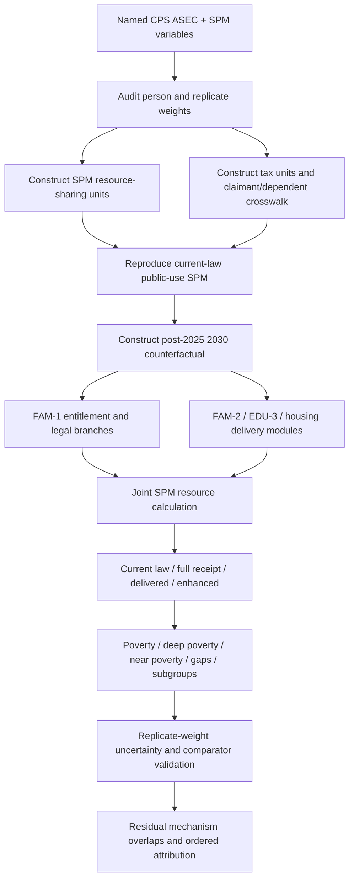

# Project 2050 Child-Poverty Microsimulation — Verified Package and Evidence Review

## Executive summary

The requested package is now **downloadable and reproducibly tested**. The complete bundle is here:

**[Download the complete Project 2050 child-poverty microsimulation package](sandbox:/mnt/data/project2050-child-poverty-microsim.zip)**

The package contains the reconstructed research engine, synthetic fixtures, tests, diagnostics, both requested final Markdown reports, the minimum microsimulation specification, the literature comparator register, a recovery/provenance register, integrity hashes, and a recreation script.

The most important findings are:

**The authoritative policy baseline was not `main`.** The approved charter's historical pointer is `claude/pensive-mendel-g1lwl5` at `e15c5c4a711b4cd2b482bac8300de45f2e08721f`. During the October 23 integration work, that same approved branch advanced to `14feb987a7d8aec416ba5bacc50880187a756383`; the governing material at that later commit records the post-pilot directions as approved, while preserving Espen as the policy decision-maker and expressly stating that child-poverty research does not authorize new eligibility or benefit rules. fileciteturn13file0L2-L5 The repository research register likewise records the original `e15c5c4…` baseline, says `main` was not selected, and distinguishes research findings from policy adoption. fileciteturn16file0L2-L5

**The model lineage is real but substantially less complete than earlier chat summaries implied.** Commit `0d9c0d6aff2546e21135020458c5bce8deeca90b` was the first child-SPM engine commit on top of `14feb987…`. The research branch subsequently advanced to `8a8f4b80681a00faea9119b1abd6b5b9b91b7266`. At that branch head, the repository implementation consisted of the engine and its README—not a CPS preprocessing pipeline, test suite, comparator register, calibrated national outputs, or the downloadable package previously described. The engine itself explicitly expects a prepared SPM/tax-unit extract rather than raw CPS ASEC. fileciteturn19file0L1-L2

**I therefore reconstructed rather than pretended to recover the blocked Deep Research attachments.** The repository's own research register says the completed native report had been retrieved previously but its final Markdown attachment bodies were not independently retrievable; the accessible files under the requested names were preliminary notes. fileciteturn16file0L2-L5 The final files below incorporate those notes, the completed-report findings recorded in the repository, the verified model lineage, and a fresh review of primary evidence. They are not represented as byte-identical copies of inaccessible attachments.

**The reconstructed engine passed seven synthetic tests.** The tests cover current-law invariance across identification branches, SSN/ITIN eligibility branching, delivered versus full receipt, the FAM-2 phase-in between 2030 and 2034, unavailable care slots, pre-K slot availability, and person-weighted child estimates. The synthetic numbers are diagnostics only and are deliberately labeled **not empirical Project 2050 estimates**.

**A national Project 2050 residual child-poverty estimate is still not defensible.** No CPS ASEC microdata extract, raw-to-model preprocessing layer, post-2025 current-law tax calculation, 2030 aging/reweighting system, replicate-weight uncertainty implementation, final FAM-1 identification rule, calibrated monthly receipt parameters, care-slot model, summer-food delivery model, or voucher-allocation/lease-up micro-allocation was recovered. The repository's own minimum-model brief says these distinctions must be resolved or explicitly branched before estimation. fileciteturn15file0L2-L5

The substantive evidence remains strong that FAM-1A should produce a **large** reduction in child poverty, but it does not support an eradication claim. The 2019 National Academies exercise used a different 2015 population, tax baseline, participation model, and child allowance; the 2026 National Academies alternatives use 2018 CPS ASEC data and again employ credit designs that are not FAM-1A. citeturn14search0turn14search3 Their results are calibration comparators, not Project 2050 scores.

## Verified authority and recovered deliverables

The repository hierarchy is unusually important here. Its shared instructions place the approved governing document above canonical domain files; proposals and research only become policy after Espen approves them and they are incorporated into GitHub. They also require generated index products to be regenerated rather than manually edited and require substantial work to proceed on a branch rather than silently overwrite canonical material. fileciteturn13file0L2-L5

The canonical family file at the verified later baseline keeps **FAM-1A** at $3,600 for children under six and $3,000 for ages 6–17, fully refundable, monthly and indexed. It keeps **FAM-2A** as the phased care/pre-K design. fileciteturn14file0L2-L5 The education file retains universal school meals plus Summer EBT under EDU-3, while the housing file retains the temporary HOU-1 bridge, 400,000 additional HOU-4 vouchers, and separate longer-run construction/finance channels. fileciteturn17file0L1-L2 fileciteturn18file0L1-L2

The following table distinguishes actual recovery from reconstruction:

| Deliverable | Source and lineage | Status | Confidence and limitation | Download |
|---|---|---|---|---|
| `project2050-child-poverty-microsim.zip` | Reconstructed from verified model lineage `0d9c0d6… → 8a8f4b8…`, repository rule sheet, preliminary notes and reviewed evidence | **Verified downloadable** | High confidence in package integrity and synthetic execution; **not calibrated to CPS** | **[ZIP](sandbox:/mnt/data/project2050-child-poverty-microsim.zip)** |
| `project-2050-child-poverty-evidence-review.md` | Final reconstruction; inaccessible final DR attachment was **not** claimed as recovered | **Verified downloadable** | High on evidence distinctions; no Project 2050 national score | **[Evidence review](sandbox:/mnt/data/project2050-child-poverty-deliverables/project-2050-child-poverty-evidence-review.md)** |
| `project-2050-child-poverty-design-implications.md` | Final reconstruction from verified policy record and evidence | **Verified downloadable** | Explicitly preserves adopted/proposed boundary | **[Design implications](sandbox:/mnt/data/project2050-child-poverty-deliverables/project-2050-child-poverty-design-implications.md)** |
| `minimum-microsimulation-spec.md` | Reconstructed from repository rule sheet/model brief and technical review | **Verified downloadable** | Specifies what is still required for a real national estimate | **[Minimum spec](sandbox:/mnt/data/project2050-child-poverty-deliverables/minimum-microsimulation-spec.md)** |
| `comparator-register.csv` | Newly reconstructed from primary literature | **Verified downloadable** | Records population, tax baseline, policy version, participation and employment assumptions | **[Comparator register](sandbox:/mnt/data/project2050-child-poverty-deliverables/comparator-register.csv)** |
| `synthetic-scenarios.csv` | Generated by the reconstructed engine | **Verified downloadable** | Synthetic diagnostics only; never use as policy estimates | **[Synthetic scenarios](sandbox:/mnt/data/project2050-child-poverty-deliverables/synthetic-scenarios.csv)** |
| `test-results.txt` | Generated by the validation run | **Verified downloadable** | Seven synthetic tests passed | **[Test results](sandbox:/mnt/data/project2050-child-poverty-deliverables/test-results.txt)** |
| `recovered-files.csv` | Package provenance/recovery register | **Verified downloadable** | Records source and recovery action for each artifact | **[Recovery register](sandbox:/mnt/data/project2050-child-poverty-deliverables/recovered-files.csv)** |
| `MANIFEST.sha256` | Generated from package files | **Verified downloadable** | Integrity hashes for local verification | **[SHA-256 manifest](sandbox:/mnt/data/project2050-child-poverty-deliverables/MANIFEST.sha256)** |
| `README.md` | Package documentation | **Verified downloadable** | Explains scope and remaining validation gates | **[README](sandbox:/mnt/data/project2050-child-poverty-deliverables/README.md)** |

The executable implementation and tests are also individually available:

**[Hardened `model.py`](sandbox:/mnt/data/project2050-child-poverty-microsim-package/model/model.py)**  
**[`test_model.py`](sandbox:/mnt/data/project2050-child-poverty-microsim-package/tests/test_model.py)**  
**[`recreate-package.sh`](sandbox:/mnt/data/project2050-child-poverty-microsim-package/recreate-package.sh)**

The complete fixture and generated-diagnostic directories are inside the ZIP.

One provenance correction is important. The earlier chat said that a completed package with five tests already existed. The repository inspection did **not** substantiate that claim. What is verified now is the package built in this run and the **seven tests actually executed here**. The inaccessible prior Deep Research attachment is not being used as evidence that those files existed.

## What the model now does and what was validated

The recovered GitHub engine already contained the right broad architecture: separate current-law, full-receipt, delivered and enhanced-delivery scenarios; explicit SSN/ITIN eligibility branches; tax units separated from SPM resource-sharing units; a CTC entitlement calculation; service deltas for care, pre-K, school food, Summer EBT, vouchers and emergency housing aid; and outputs for poverty, deep poverty, near poverty and residual-mechanism attribution. fileciteturn19file0L1-L2

The reconstructed package preserves that architecture but hardens several implementation details without altering adopted benefit amounts.

First, **child poverty is now weighted with person weights** rather than mechanically assigning the SPM-unit weight to every child. That is necessary for a CPS-based person-level poverty estimand. Unit weights remain available for unit-level diagnostics.

Second, **availability is not conflated with statutory eligibility**. Care savings require an actual slot. Pre-K now has an explicit slot gate. Voucher logic distinguishes waiting-list status, award and lease-up. Emergency rental aid must be awarded before its household resource change can be counted. These changes implement the repository's own instruction that a higher annual resource number does not establish a usable service and that housing construction spending must not be turned into immediate cash. fileciteturn15file0L2-L5

Third, **legal exclusion is attributed child by child**. The original prototype could flag an entire resource-sharing unit because one child failed an identification branch. Poverty resources remain shared at the SPM-unit level, but exclusion attribution itself is now child-specific.

Fourth, the residual mechanism diagnostic now separates four overlapping questions: legal exclusion, eligible cash nonreceipt, resource inadequacy after full available receipt, and an unavailable or undelivered service. The model reports overlap patterns and then an ordered attribution for presentation; it does not add overlapping mechanisms as though they were independent effects. That matches the repository's child-poverty model brief. fileciteturn15file0L2-L5

The actual validation run returned:

```text
Ran 7 tests

OK
```

The passing tests cover:

| Test | What failure would have meant |
|---|---|
| Current-law result invariant across ID branches | Research eligibility branches were accidentally changing the counterfactual |
| Adult-ITIN branch changes Project eligibility but not current law | Identification branches were not functioning as intended |
| Delivered receipt cannot outperform otherwise-identical full receipt | Receipt logic or direction of effect was wrong |
| Mature 2034 care schedule weakly improves the synthetic resource gap relative to 2030 | FAM-2 phase timing was misapplied |
| Unavailable care slot does not become an SPM resource merely under “full receipt” | Subsidy eligibility was being confused with supply |
| Positive pre-K value requires an actual slot | The model was monetizing unavailable services |
| Child results use person weights | The poverty estimand was using the wrong weighting object |

These are **unit/logic tests**, not external validity tests. Passing them means the engine behaves consistently on controlled cases. It does not mean the 2030 population, tax system, benefit receipt, service supply, or national poverty result is calibrated.

## Evidence about how close the adopted package could plausibly come

The evidence strongly supports the proposition that FAM-1A can remove a substantial amount of child poverty. It does not support borrowing a published percentage from another design.

The 2019 National Academies *Roadmap* modeled a 2015 population with TRIM3 and benefit-underreporting adjustments. Its roughly 13% child-SPM starting point and its $3,000 child-allowance results came from a different tax-law environment and a policy that replaced or interacted differently with existing tax provisions. The report's larger packages also contained instruments beyond anything equivalent to FAM-1A, including broader housing and food assistance. Consequently, neither its individual-policy nor package reduction should be transferred to Project 2050.

The newer 2026 *Pathways* analysis makes the dependence on design especially clear. Its alternative-policy exercise uses **calendar-year 2018 CPS ASEC data** rather than a 2030 population. Its baseline PO1 combines the non-ARPA EITC with a TCJA-style CTC and produces an estimated 11.1% child-poverty rate. PO12—an approximation of the combined 2021 EITC/CTC with a faster CTC phaseout—produces 6.5% without an employment adjustment and approximately 7.0–7.4% under the report's low, medium and high employment-response cases. PO13 reaches 4.5% without the same being true of Project 2050, because PO13 adds a different earnings-phased component. citeturn14search0turn14search3

That comparison is useful for **mechanisms**, not for scoring. It says that benefit amount, refundability, phase-in/phase-out rules and employment assumptions materially affect residual poverty. It does not say Project 2050's FAM-1A yields 6.5%, 7.4%, 4.5% or any other Pathways figure. The Academies explicitly evaluated those options against its own 2018-population baseline. citeturn14search0turn14search3

Pathways also reinforces the importance of participation. Tax-credit microsimulations often assume that eligible tax families file and receive the credit, while observed participation varies across groups. A Project 2050 **full-receipt** result should therefore be interpreted as a statutory/delivery upper bound among eligible families, not as the expected delivered result.

The employment evidence is not one-sided. Short-run quasi-experimental analysis of the 2021 advance CTC found no clear labor-force or employment response over the rollout window, while permanent-policy simulations such as Bastian's and Corinth and coauthors' work produce labor-supply offsets under longer-run behavioral assumptions. citeturn10search3turn10search1turn10search0 That is why the model specification keeps **no-response and supported response sensitivities separate** instead of hard-coding one literature estimate as fact.

Material hardship is also distinct from annual SPM. Monthly cash can reduce food insufficiency or make rent and utilities easier to meet even when the family remains annually poor; conversely, an annual tax entitlement can look adequate in the SPM while arriving too late to prevent arrears. The 2026 Academies report itself shows that measured 2021 credit effects differ when benefits are treated by year accrued versus year actually received. That directly supports Project 2050's insistence on separate annual poverty and monthly-delivery outputs.

Housing is the clearest reason a near-zero poverty result should not be presumed. The adopted HOU-4 design adds 400,000 vouchers rather than establishing a universal housing entitlement, while HOU-1 is temporary and HOU-2/HOU-3/HOU-5/HOU-8 operate largely through tax credits, capital, repair or new supply rather than immediate cash. fileciteturn18file0L1-L2 Some poor renter families will therefore remain outside recurring rental assistance even with perfect CTC receipt.

Similarly, the adopted FAM-2 schedule can reduce the SPM deduction for necessary child-care expenses, but only for families who obtain compatible care. The family file itself phases the full cap behind supply development. fileciteturn14file0L2-L5 EDU-3 can add food resources and reduce out-of-pocket food costs, but school-year universality and summer delivery should remain separate operational questions. fileciteturn17file0L1-L2

A factual correction from the preliminary research note is also incorporated into the final report: **13.4% was Census's 2025 official child-poverty rate, not its child SPM rate.** Census reports the **overall 2025 SPM rate as 13.1%**. citeturn15search0 The model must import the actual age-specific child SPM benchmark from the Census table during calibration rather than carrying the preliminary note's mislabeled figure forward.

## Minimum microsimulation required for a residual estimate

The detailed version is downloadable as **[`minimum-microsimulation-spec.md`](sandbox:/mnt/data/project2050-child-poverty-deliverables/minimum-microsimulation-spec.md)**.

The minimum credible model starts from a named CPS ASEC public-use vintage containing the Census SPM variables. Census's 2025 poverty estimates are based on the 2026 CPS ASEC, and Census provides the SPM framework because refundable credits, food/housing benefits, taxes, child-care/work expenses, medical expenses and geographically varying housing thresholds all matter to the resource calculation. citeturn15search0

At a minimum the preprocessing layer must preserve **person weights and replicate weights**, construct both tax units and SPM resource-sharing units, compute or import the post-2025 current-law tax/CTC baseline, preserve SPM thresholds and baseline resources, and document all underreporting corrections. It must then create a separately documented 2030 counterfactual and a mature-service comparison such as 2034. The current engine must not itself guess these fields.

The policy layer needs exact parameters for FAM-1's dollar/index base, phaseouts, current-law reference credit, claimant and child identification rules, residency and territory rules, custody/tax-dependent assignment, reconciliation protection and monthly delivery. The current repository explicitly says those legal questions are not all resolved and must be branched rather than silently answered. fileciteturn15file0L2-L5

FAM-2 requires actual slots, hours and accessibility rather than nominal eligibility. EDU-3 requires incremental meal/Summer EBT value net of benefits already represented in baseline SPM resources. Housing requires actual emergency-aid awards and voucher allocation plus successful lease-up. Construction and finance cannot be entered as immediate household income.

The pipeline is:



The minimum national outputs are child SPM poverty, deep poverty below 50% of threshold, near poverty below 150%, child-weighted poverty-gap dollars and counts; all should be reported by age, family structure, earnings/nonemployment, disability, identification/immigration proxy, race/ethnicity, geography and housing tenure. Monthly liquidity and material hardship should remain separate outputs.

A national estimate should not clear validation until the preprocessing reproduces a predeclared Census current-law benchmark, replicate-weight uncertainty runs, tax/SPM accounting identities close, service and benefit deltas show no double counting, and at least one external comparator can be recreated after matching its **population, tax-law baseline, exact policy, participation rule and employment assumption**.

## Repository integration status and coordinating-chat handoff

There is one important boundary on the word **integrated**: I have produced a **repo-ready research package, but I have not claimed or fabricated a GitHub merge/commit for it**. Because you were simultaneously updating the repository, automatically overwriting the canonical branch would also violate the project's own branch/review instructions. The package should therefore be integrated from a dedicated review branch after the coordinating chat diffs it against the then-current approved branch. The governing instructions specifically require large work to use a branch and say that research or proposed changes do not themselves become adopted policy. fileciteturn13file0L2-L5

The authoritative handoff is:

**Policy authority:** `claude/pensive-mendel-g1lwl5`  
**Historical charter pointer:** `e15c5c4a711b4cd2b482bac8300de45f2e08721f`  
**Later approved-integration commit reviewed here:** `14feb987a7d8aec416ba5bacc50880187a756383`  
**Research model branch:** `codex/child-poverty-microsim-v1`  
**First model commit:** `0d9c0d6aff2546e21135020458c5bce8deeca90b`  
**Later research-model head reviewed here:** `8a8f4b80681a00faea9119b1abd6b5b9b91b7266`

The coordinating chat should treat the ZIP and final reports as the **authoritative research/implementation handoff from this chat**, while continuing to treat the governing branch as authoritative for policy. The recommended repository mapping is conceptually:

```text
index/tools/child-poverty/
    model.py
    [tests / fixtures after adapting the standalone package paths]

sources/
    project-2050-child-poverty-evidence-review.md
    project-2050-child-poverty-design-implications.md
    minimum-microsimulation-spec.md
    comparator-register.csv

research/test artifacts or the tool's documented test location:
    synthetic-scenarios.csv
    test-results.txt
```

The test harness in the downloadable ZIP is deliberately self-contained. Before committing it into the repository's `index/tools/child-poverty/` layout, its relative test paths should be adapted to that directory rather than copied blindly. That is an **integration-path issue**, not a failed model test.

The coordinating chat should also preserve two repository-level unresolved matters instead of silently “fixing” them: FAM-1 identification/residency/legal integration remains a policy/legal branch, and the FAM-2 canonical file itself records a provenance caveat about how its phased working baseline was selected. fileciteturn15file0L2-L5 Espen owns both decisions.

## Open questions and limitations

The major exclusions and decisions are now clear enough to stop the bounded review.

The blocked completed Deep Research Markdown attachments remain unavailable byte-for-byte. The repository's research register is explicit about that access problem, so the downloadable reports above are **verified reconstructions**, not falsely labeled recoveries. fileciteturn16file0L2-L5

No real CPS ASEC microdata were present in the model branch or supplied to this chat. Consequently, there has been no national current-law calibration, no 2030 projection, no replicate-weight confidence interval, and no empirical delivered-receipt calibration. The synthetic tests prove logic properties only.

The current evidence does **not** establish that Project 2050 eradicates child poverty. The stronger conclusion supported now is that the adopted package plausibly produces a large reduction but leaves four important residual pathways—legal exclusion, eligible nonreceipt, persistent resource inadequacy, and unavailable/undelivered services. The 2019 and 2026 National Academies results show why exact credit design and the assumed employment response matter, but their published reductions belong to their own populations and policy specifications. citeturn14search0turn14search3

The immediate quantitative bottleneck is therefore no longer the engine skeleton. It is the **audited CPS ASEC/SPM preprocessing and 2030 current-law baseline**, followed by legal resolution or explicit branching of FAM-1 eligibility and empirical calibration of payment, care, summer-food and housing delivery. Until those inputs exist, reporting a Project 2050 residual child-poverty percentage would manufacture precision the evidence does not supply.